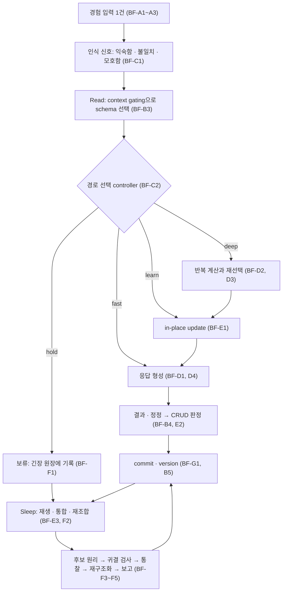
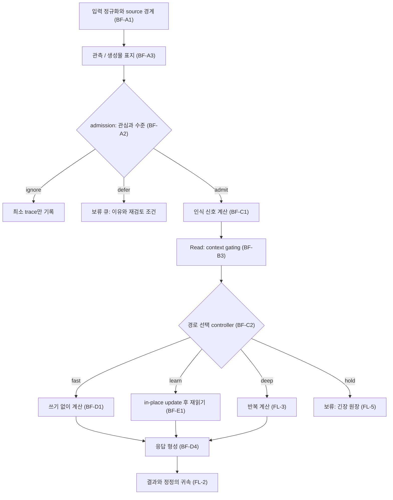
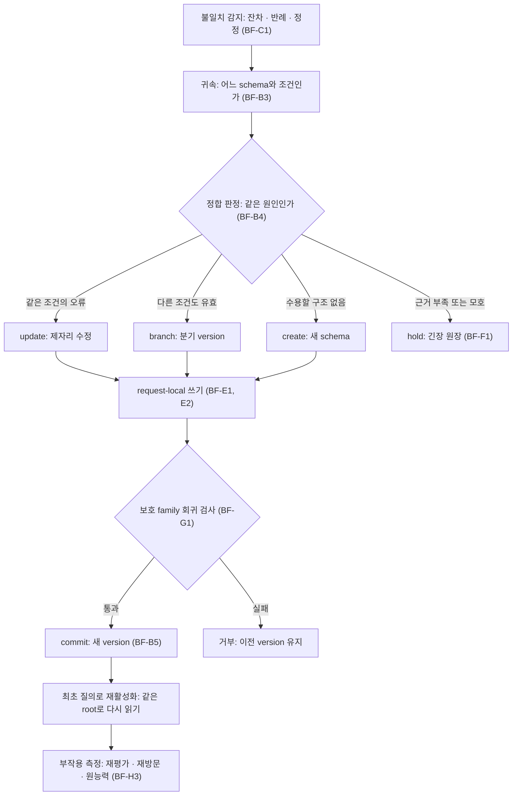
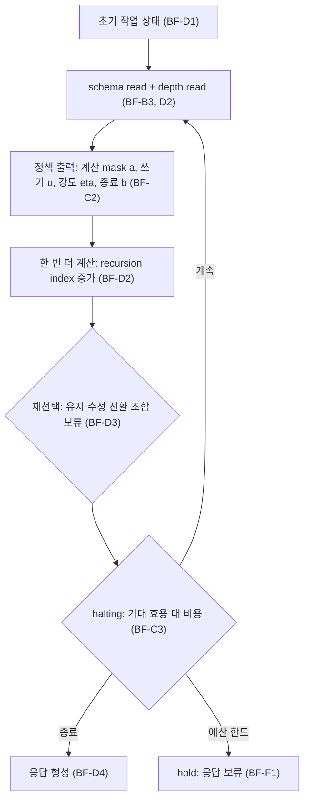
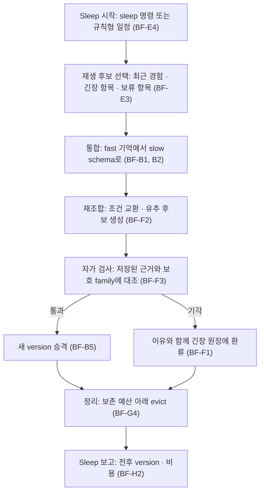
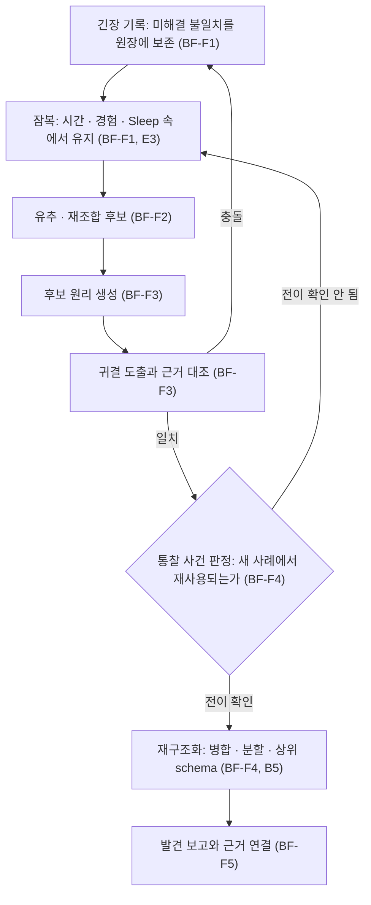
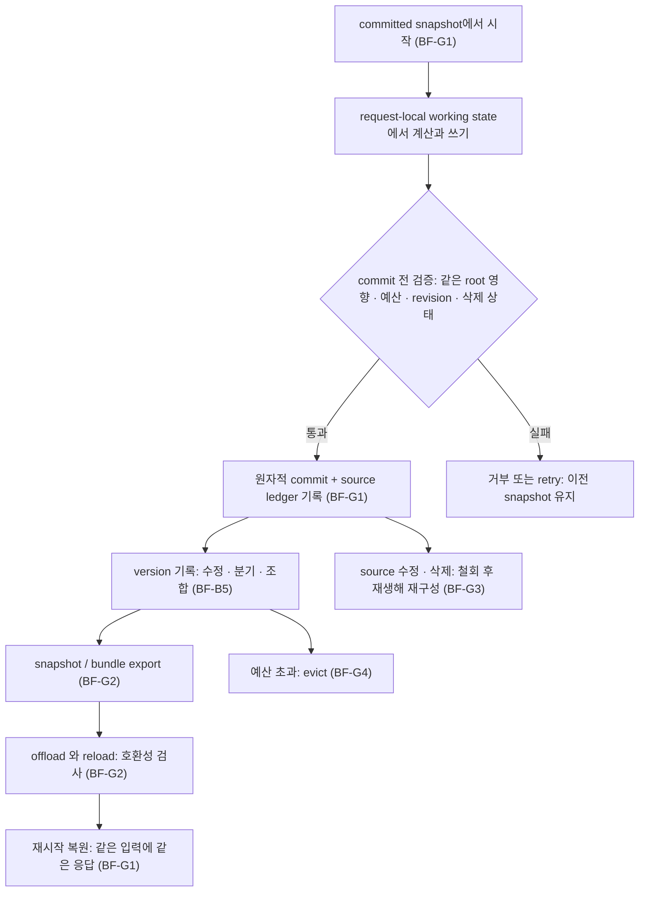

# 16. 이상 청사진: System ONE이 갖출 feature와 동작 flow

**상태 라벨:** 이 문서 전체는 **PROPOSAL**이다. feature·flow·이름·phase별 해상도는 사용자가 승인한 값이 아니며 구현·학습·실험 실행(**NOT RUN**)을 뜻하지 않는다. 사용자 원문(**USER**)은 위치를 달아 인용했고 문헌(**LITERATURE**)·과거 기록(**ARCHIVE**)은 이번에 새로 실행하거나 재검증한 것이 아니다. 미결정은 **OPEN**이다. 작성: 2026-11-18. **P0(NP)는 사용자가 요청한 POC 대역이며 최종형이 아니다**(§1.2).

## 한눈에 보기

**정의.** 이상형 System ONE은 경험에서 재사용 가능한 schema를 형성하고 조건별로 분해해 version으로 보존하며(BF-B), 현재 문맥에 맞는 schema를 context gating으로 가져다 쓰고(Read) 익숙함·불일치·모호함에 따라 fast / learn / deep / hold 경로로 답한다(BF-C, BF-D). 한 경험에서 즉시 배우되 반례로 고치고 새 구조가 필요하면 분기하거나 만들며(BF-E1, BF-E2), Sleep에서 통합·재조합·정리한다(BF-E3). 설명되지 않는 불일치를 버리지 않고 보존했다가 재조합·재구조화해 새 원리에 이른다(BF-F). 이 모두가 하나의 모델 안에서 일어난다. 출발점은 헌장 [01-intent-and-charter.md](/home/jimmy/repos/full-continual-learning/docs/01-intent-and-charter.md) §1의 한 문장이다: 「경험에서 재사용 가능한 연속적인 schema를 형성하고, 그 schema가 현재 입력의 해석과 계산 경로, 필요한 학습을 제어하며, 깊은 사고의 성과가 미래의 빠른 판단으로 전환되는 하나의 System ONE.」

**feature 그룹.** 32개(§3)를 여덟 그룹으로 묶었다.

| 그룹 | 묻는 것 | feature | 주 flow |
|---|---|---|---|
| A 경험 입력 | 무엇을 얼마나 받아들이나 | BF-A1~A3 | FL-1 |
| B schema 기억 | 무엇을 어떤 형태로 저장하고 어떻게 가져다 쓰나 | BF-B1~B5 | FL-1, FL-2, FL-6 |
| C 인식·제어 | 지금 어떤 경로로 처리할까 | BF-C1~C3 | FL-1, FL-3 |
| D 사고(계산) | 어떻게 생각해서 답하나 | BF-D1~D4 | FL-1, FL-3 |
| E 시간에 따른 학습 | 언제 어떻게 배우고 고치고 통합하나 | BF-E1~E4 | FL-2, FL-4 |
| F 발견·통찰 | 설명 안 되는 것에서 어떻게 새 원리가 나오나 | BF-F1~F5 | FL-5, FL-4 |
| G 상태·저장·외부화 | 무엇을 남기고 옮기고 지우나 | BF-G1~G4 | FL-6 |
| H 접점·관찰 | 어떻게 쓰고 어떻게 재나 | BF-H1~H4 | 전 flow |

**핵심 flow.** 입력 하나가 경로를 따라 처리되고, 결과와 정정이 schema를 고치며, 보류된 불일치가 Sleep과 발견 흐름으로 이어진다. 여섯 flow(FL-1~FL-6)의 상세는 §5다.

**최종 목표와의 관계.** 사용자의 최종 목표는 아인슈타인 테스트 통과이고(USER, §7.1) 이 저장소의 운영 정의는 경험 조건부 발견 시험(ET)이다. 이 문서에서는 BF-F1~F5와 FL-5가 그 목표의 시스템 쪽 대응이다. ET 단의 정의·상한·절차는 [17-einstein-test.md](/home/jimmy/repos/full-continual-learning/docs/17-einstein-test.md)가 소유한다.

**phase 해상도.** P0(NP)부터 P6(ET)까지 모든 phase가 같은 feature 32개를 갖고, 달라지는 것은 형태다. P0(NP)에서는 비모수 대역(stand-in)이고 뒤 phase에서 학습 모듈로 하나씩 바뀐다. 모든 phase는 실제 `fcl` CLI와 실제 의존성으로 끝까지 도는 전체 제품이다(§4).

**어디를 볼까.**

| 알고 싶은 것 | 볼 곳 |
|---|---|
| 경로와 CRUD 판정의 이름, 발견 수준 L0–L5, H-DISCOVER | §2 |
| feature 32개의 이름과 한 줄 정의 | §3 |
| phase마다 feature가 어떤 형태인가(NP 대역 / 학습 모듈) | §4 |
| 입력 1건 처리, 불일치와 조절, 깊이, Sleep, 발견, 상태의 흐름 | §5 |
| feature마다 목적·입출력·상태·메커니즘 후보·근거·docs/05 대응·P0 대역 | §6 |
| 사용자가 말한 것이 어디에 있나 | §7 |
| 기존 문서와의 관계, 미결정, 결정 후보 | §8, §9 |

## 1. 문서의 지위와 근거 표기

### 1.1 지위

이 문서는 FCL(System ONE)이 갖출 feature와 그것들이 어떤 flow로 동작하는지를 **이상형 기준**으로 그린 청사진이다. 이상형은 phase·비용·구현 가능성으로 깎기 전에 목표로 삼는 모습이다. Melete 시기에 사용자가 제한 없는 이상적 청사진을 먼저 정하고 그 위에서 단계별로 가치를 더하자고 한 요구(B02, 2026-10-05, [09-roadmap.md](/home/jimmy/repos/full-continual-learning/docs/09-roadmap.md) §1.1에 요약된 재구성)와 같은 순서다. 이 문서는 이상형(§3, §5, §6)과 phase별 해상도(§4)를 분리해서 쓴다.

| 하는 것 | 하지 않는 것 |
|---|---|
| feature 32개의 이름과 정의, 공통 이름(경로·CRUD 판정·발견 수준), flow 6개, feature × phase 해상도 표, 사용자 요구와의 대응, 기존 문서와의 관계, OPEN과 결정 후보 | 구현·학습·GPU 실행·비용 지출. 모두 0회이고 이 문서에 성능·효과 수치는 없다(NOT RUN) |
| 기존 문서를 이름과 링크로 가리킨다 | 기존 문서를 대체하거나 고치지 않는다. 어긋난 곳은 OPEN으로 표기한다 |
| feature·flow·경로·CRUD 판정의 이름과 의미를 정의한다 | phase 정의·종료 gate([09-roadmap.md](/home/jimmy/repos/full-continual-learning/docs/09-roadmap.md)), ET 단·상한·rubric([17-einstein-test.md](/home/jimmy/repos/full-continual-learning/docs/17-einstein-test.md)), P0의 상세와 검증 항목([18-poc-nonparametric.md](/home/jimmy/repos/full-continual-learning/docs/18-poc-nonparametric.md)), 논문 주장([19-paper-plan.md](/home/jimmy/repos/full-continual-learning/docs/19-paper-plan.md)), 비용 수치([15-compute-plan.md](/home/jimmy/repos/full-continual-learning/docs/15-compute-plan.md))는 정의하지 않고 이름으로 가리킨다 |

### 1.2 P0(NP)는 대역이며 최종형이 아니다

**P0(NP)는 사용자가 요청한 POC 대역(stand-in)이며 최종형이 아니다.** 사용자는 모델 학습 없이 non parameter 기반의 무언가로 POC 검증을 먼저 해보자고 했다(USER, §7.1). 그래서 P0(NP)는 고정(frozen) 공개 가중치 LLM과 비모수 schema 기억으로 전체 flow를 실제 `fcl` CLI에서 끝까지 돈다. 그러나 이것은 외부 frozen LLM을 쓰는 대역이고, 하나의 통합 모델이라는 최종 목표(헌장 U05, [05-integrated-architecture.md](/home/jimmy/repos/full-continual-learning/docs/05-integrated-architecture.md) §3, docs/09 §1.3)를 대신하지 않는다.

- 가중치 수준의 schema 형성, 간섭 해소, 통합 모델의 내부 depth 효율은 P0로 주장하지 않는다.
- P0는 mock이나 조사 단계가 아니다. 실제 LLM·실제 저장·실제 CLI로 도는 완결 제품이다.
- P0의 NP arm은 이후 모든 phase의 영구 대조군이다. 학습 모듈은 같은 예산의 NP보다 나을 때만 필요하다고 주장한다.
- 이 문서는 P0(NP)에서 P6(ET)까지 모든 phase를 같은 관점으로 본다. 모두 실제 인터페이스와 실제 의존성으로 끝까지 도는 전체 제품이고, 한 계층만 만드는 phase나 mock만으로 도는 phase나 조사만 하는 phase는 없다.

### 1.3 근거 표기

[SYNC_POLICY.md](/home/jimmy/repos/full-continual-learning/SYNC_POLICY.md)의 표기를 따른다.

| 표기 | 이 문서에서의 쓰임 |
|---|---|
| USER | 사용자 원문이 있는 문장에만 붙인다. 원문 파일과 위치를 단다(§7) |
| USER-HYPOTHESIS | 사용자가 검증 대상으로 제시한 가설(LLM의 schema 중첩, 분해와 지속학습). 과학적 입증이 아니다 |
| PROPOSAL | 이 문서의 feature·flow·이름·해상도 배정 전부. 사용자가 승인한 값이 아니다 |
| LITERATURE | 원 논문·공식 구현에 귀속되는 주장. catalog ID로 가리키고 확인 수준은 catalog의 status를 따른다. 이 문서는 제목·초록 수준의 인접 근거만 썼다 |
| ARCHIVE | 과거 기록(Melete 시기의 설계와 감사 원장). 새로 실행하거나 재검증한 것이 아니다 |
| OPEN | 미결정이거나 기존 문서와 어긋난 채 남긴 항목(§9) |
| NOT RUN | 구현·실험을 하지 않았다는 선언. 이 문서의 모든 효용 주장에 걸린다 |

ESTIMATE(계획용 규모와 비용)는 쓰지 않는다. 수치는 docs/15가 소유한다.

### 1.4 이 문서의 정의를 읽는 쪽

| 정의 | 이 문서의 위치 | 읽는 문서 |
|---|---|---|
| feature BF-A1~BF-H4(32개) | §3, §6 | docs/09, 17, 18, 19 |
| flow FL-1~FL-6 | §5 | docs/09(UJ0·UJ6), 18 |
| 경로 fast / learn / deep / hold | §2.1 | docs/09, 18 |
| CRUD 판정 read / update / branch / create / hold / evict | §2.2 | docs/09, 18, 19 |
| feature × phase 해상도 표 | §4 | docs/09, 19 |

### 1.5 이상형이 지키는 불변식

[AGENTS.md](/home/jimmy/repos/full-continual-learning/AGENTS.md)의 규칙에서 온 것이다. 어느 feature도 이것을 깨지 않는다.

- **하나의 통합 모델.** 별도 작은 System1 + 외부 LLM 설계로 사용자 정정(U-T07)을 되돌리지 않는다. 외부 frozen LLM 경로는 대조군과 P0 대역으로만 둔다.
- **관측과 생성물을 섞지 않는다.** 모델이 만든 해석·추상화·재조합 후보·귀결·보고는 독립 관측 증거가 아니다(BF-A3, FL-4, FL-5).
- **시계를 섞지 않는다.** token / experience / recursion / optimizer / CMS level 시계는 따로 기록한다(§2.4).
- **저장·복원만으로 schema 성공을 주장하지 않는다.** 성공은 경험 뒤 새로운 구조 공유 사례의 sample·compute 효율로 판정한다.
- **evaluator와 정답은 후보가 수정하지 못한다.** oracle과 held-out은 별도 프로세스·별도 권한에만 있다(BF-H3).
- **정직한 상한.** 아직 강제하지 못하는 보장은 약속하지 않는다. 결과 등급은 docs/09 §3을 따른다.

## 2. 공통 이름: 경로·CRUD 판정·발견 수준·가설

이 절의 이름은 이 문서가 정의하고 다른 문서([09-roadmap.md](/home/jimmy/repos/full-continual-learning/docs/09-roadmap.md), [17-einstein-test.md](/home/jimmy/repos/full-continual-learning/docs/17-einstein-test.md), [18-poc-nonparametric.md](/home/jimmy/repos/full-continual-learning/docs/18-poc-nonparametric.md), [19-paper-plan.md](/home/jimmy/repos/full-continual-learning/docs/19-paper-plan.md))는 이름으로 가리킨다. 정의를 다른 문서에 복제하지 않는다. 아래는 모두 **PROPOSAL**이다.

### 2.1 경로 이름: fast / learn / deep / hold

경로는 **한 요청의 계산 패턴**이다. 요청마다 BF-C2가 하나를 고른다. fast·learn·deep은 [09-roadmap.md](/home/jimmy/repos/full-continual-learning/docs/09-roadmap.md) §2의 규칙형 controller v0가 이미 쓰는 이름이고 hold는 이 청사진이 더한 네 번째 경로다.

| 경로 | 한 줄 정의 | 읽기 | 쓰기 | 계산 깊이 | 고르는 상황(PROPOSAL) |
|---|---|---|---|---|---|
| fast | 쓰기 없이 활성 schema로 바로 답한다 | 있음 | 없음 | 최소 | 익숙함이 높고 불일치·모호함이 낮다 |
| learn | 빠른 쓰기(in-place update)로 schema를 고친 뒤 같은 입력을 다시 읽고 답한다 | 있음 | 있음 | 최소 | 덜 익숙하지만 기존 구조로 수용된다(새 binding, 국소 정정) |
| deep | 반복 계산을 더 하고 답한다. 필요하면 쓰기 판정(update·branch·create)이 따른다 | 있음 | 필요 시 | 더 깊음(NP 대역에서는 숙의 반복 수·호출 수로 잰다) | 낯설거나 구조 합성이 필요하다 |
| hold | 답과 쓰기를 확정하지 않고 보류한다. 추가 관측·질문을 요청하거나 긴장 원장(BF-F1)에 기록한다 | 있음 | 없음(긴장 항목만 기록) | 최소 | 근거가 부족하거나 모호함이 높거나 입력이 너무 멀다 |

- **docs/05 §4 경로 A/B/C와의 대응(OPEN):** [05-integrated-architecture.md](/home/jimmy/repos/full-continual-learning/docs/05-integrated-architecture.md) §4의 낯선 입력 처리 경로 A(빠른 쓰기 뒤 같은 입력 재읽기)는 learn, B(쓰기 없이 가장 가까운 기존 schema의 잠정 답)는 fast의 한 변형, C(보류하고 추가 관측 요청)는 hold에 대응한다고 읽는다. 세 경로 비교는 docs/05 §4가 정한 대로 F04·F19 family에서 같은 관측·쓰기 예산으로 한다. 이 대응은 이름 정리이며 사용자가 확인한 것이 아니다.
- **deep의 정의 차이:** [09-roadmap.md](/home/jimmy/repos/full-continual-learning/docs/09-roadmap.md) §2의 P1 규칙형 deep은 write 뒤 retrofit 블록을 한 번 더 적용한 r=2로 답하는 것이다. 이 표의 deep은 이상형 정의라서 쓰기는 필요할 때만 따르고 깊이는 반복 중 재선택(BF-D3)과 halting(BF-C3)이 정한다. P1의 정의는 docs/09가 기준이다.
- **hold는 P1의 규칙형 controller v0에 없다.** hold를 P1에 넣을지는 결정 후보 D-21다. 넣지 않으면 P1 대조(`noctl` 등)와 P0(NP)의 경로 집합이 달라지므로 비교 때 hold를 뺀 부분집합으로 맞춘다(OPEN).
- 신호가 하나의 임계값으로 합쳐지지 않는다는 원칙은 유지한다. 익숙함·관심·학습 가능성·surprise를 한 값으로 합치지 않는다([01-intent-and-charter.md](/home/jimmy/repos/full-continual-learning/docs/01-intent-and-charter.md) §3 4층, [04-rhythms-and-orchestration.md](/home/jimmy/repos/full-continual-learning/docs/04-rhythms-and-orchestration.md) §3).

### 2.2 CRUD 판정 이름: read / update / branch / create / hold / evict

CRUD 판정은 **schema 상태에 대한 결정**이다. 한 요청에서 경로 하나와 판정 여러 개가 함께 나올 수 있다. 사용자의 CRUD 관점(USER, [2026-11-16-discussion.md](/home/jimmy/repos/full-continual-learning/sources/sync/2026-11-16-discussion.md) 「사용자 원문: CRUD와 공동논문 목적」)을 판정 이름으로 풀어 쓴 것이며, 판정 방식(CRP식 사전, 정합도 우도)은 PROPOSAL이고 「못 찾으면 create」의 해석은 결정 대기 N-4([2026-11-17-design-review.md](/home/jimmy/repos/full-continual-learning/research/2026-11-17-design-review.md) §7.3)다.

| 판정 | 뜻 | schema 상태 변화 | 가역성 | 트리거 후보 | 사용자 CRUD와 기존 문서 |
|---|---|---|---|---|---|
| read | 상태를 바꾸지 않고 활성화해 쓴다 | 없음(읽기 기록만) | 해당 없음 | 익숙함이 높다 | Read. 판단용 읽기 집합과 학습용 참조 집합을 구분한다([14-schema-lifecycle-crud-and-joint-paper.md](/home/jimmy/repos/full-continual-learning/docs/14-schema-lifecycle-crud-and-joint-paper.md) §5) |
| update | 같은 schema의 상태를 제자리(in-place)에서 고친다. 새 binding 학습과 같은 조건의 오류 교정을 포함한다 | 같은 ID, 새 commit | rollback으로 복원 | 구조는 맞고 대상·역할·조건이 새롭거나 같은 조건의 판단이 틀렸다는 근거 | Update(USER: in place update) |
| branch | 다른 조건에서도 유효한 구조를 덮어쓰지 않고 같은 계열의 별도 version으로 공존시킨다 | 새 version(부모 연결) | 두 갈래 모두 보존 | 새 조건과 옛 조건이 모두 유효하다(A→B→A) | docs/14 §3의 「분기·조건부 변환」, docs/13 §9.2의 「분기」. create와 나눈 이름은 이 문서의 제안이다(D-25) |
| create | 수용할 기존 구조가 없을 때 새 schema를 할당한다 | 새 schema ID | 폐기·evict 가능 | USER: 적합한 schema를 못 찾는다. 후보: 구조적 새로움, 오류 크기 | Create(USER: 못 찾으면 create). 세 트리거의 비교는 N-4 |
| hold | 쓰기와 확정을 보류하고 긴장 원장에 기록한다 | 긴장 항목만 추가(schema 불변) | 해당 없음 | 근거 부족, 모호함, 너무 먼 입력 | docs/05 §4 경로 C. 발견의 씨앗(FL-5) |
| evict | 보존 예산 때문에 활성 집합에서 내린다. 기본은 offload이고 압축·통합·폐기는 기능 손실을 평가한 뒤에 한다 | 위치 또는 표현 변경 | offload는 가역, 폐기는 비가역 | 예산 초과, 낮은 사용·의존 | Delete/Retain(기능적 망각/보존). source 삭제(BF-G3)와 다르다 |

- **경로와 판정의 관계:** fast는 read, learn은 read와 update(필요하면 branch), deep은 read와 update·branch·create(반복 중 재선택으로 달라진다), hold는 read와 hold다. evict는 요청 경로가 아니라 보존 예산과 Sleep이 낸다(FL-4, FL-6).
- **「삭제」 용어:** 새 글의 「삭제」 단독 표기는 source 삭제(BF-G3)만 뜻한다. CRUD의 D는 Delete라고 쓰고 첫 등장에 기능적 망각/보존을 병기한다. schema를 없애는 동작은 폐기다([07-state-and-storage.md](/home/jimmy/repos/full-continual-learning/docs/07-state-and-storage.md) §7).

### 2.3 발견 수준 L0–L5와 가설 H-DISCOVER

아래 두 문장은 작업 기록 [2026-11-18-blueprint-et-design.md](/home/jimmy/repos/full-continual-learning/research/2026-11-18-blueprint-et-design.md)에 적힌 2026-11-18 마스터 결정 MD-1118-N의 문장을 글자 그대로 쓴 것이다. 모든 문서가 같은 문장을 쓴다. 대상별 세부 rubric과 채점은 [17-einstein-test.md](/home/jimmy/repos/full-continual-learning/docs/17-einstein-test.md)가 정한다.

> **발견 수준 (PROPOSAL):** L0 없음 / L1 긴장 인식(기존 설명이 안 맞는 지점을 스스로 짚는다) / L2 재구성 가설(핵심 가정의 수정이나 새 개념을 질적으로 제안한다) / L3 원리 진술과 핵심 관계의 유도(정량) / L4 원리에서 새 예측을 도출한다(역사적 발견의 예측과 일치) / L5 논문 수준의 체계화.

> **H-DISCOVER (PROPOSAL):** 「T0까지의 세계 지식을 가진 기반 위에서, 한 인물의 경험 stream을 schema로 쌓고 미해결 불일치를 보존했다가 재조합·재구조화하는 시스템은, 같은 기반에 같은 자료를 기억 없이 또는 평면 기억으로 준 경우보다 (i) 더 적은 입력에서 (ii) 더 높은 발견 수준에 이르고, (iii) 그 차이는 stream의 내용에 특이적이다(대조 stream에서는 나오지 않는다).」

H-DISCOVER는 [01-intent-and-charter.md](/home/jimmy/repos/full-continual-learning/docs/01-intent-and-charter.md) §4의 두 중심 명제(H-SAMPLE·H-COMPUTE)에 없는 세 번째 명제다. 헌장을 개정한 것이 아니라 **PROPOSAL**·**OPEN**으로 표기한다(헌장 반영 여부는 D-26). 발견 수준은 [11-research-agenda.md](/home/jimmy/repos/full-continual-learning/docs/11-research-agenda.md) §4의 통찰 정의(더 오래 생각한 사실이 아니라 새로운 관계·표현·적용 조건을 형성하고 새 사례에서 재사용하는 변화)와 맞춘다. 암기·self-consistency·반복된 confidence 증가·저차원화 자체는 형성의 증거가 아니다.

아래 표는 이 청사진의 feature·flow가 어느 수준의 출력을 만드는 자리인지를 나타낸다(PROPOSAL). 시스템은 자기 출력의 수준을 스스로 매기지 않는다. 수준은 분리된 evaluator가 rubric으로 채점한다(BF-H3).

| 수준 | 청사진에서 이 수준의 출력이 나오는 자리 | feature | flow 단계 |
|---|---|---|---|
| L1 | 설명이 안 맞는 지점을 짚어 긴장 원장에 올린다 | BF-F1, BF-C1 | FL-5 ① |
| L2 | 후보 원리(핵심 가정의 수정, 새 개념)를 질적으로 만든다 | BF-F2, BF-F3 | FL-5 ③④ |
| L3 | 후보 원리에서 핵심 관계를 정량으로 유도한다 | BF-F3, BF-D2 | FL-5 ⑤ |
| L4 | 원리에서 새 예측을 도출해 저장된 근거와 대조한다 | BF-F3 | FL-5 ⑤ |
| L5 | 체계화된 보고와 재구조화 | BF-F4, BF-F5 | FL-5 ⑦⑧ |

### 2.4 시계

token position·experience/root·recursion index·optimizer step·CMS level clock·wall time은 서로 다른 시계다([07-state-and-storage.md](/home/jimmy/repos/full-continual-learning/docs/07-state-and-storage.md) §1). 이 청사진은 시계를 섞지 않는다. 특히 FL-3의 반복 계산은 recursion index만 올리고 token position과 경험 수를 올리지 않으며, FL-4의 Sleep 재생은 새 경험이 아니다. NP 대역에서는 recursion이 없으므로 숙의 반복 수·생성 token·LLM 호출 수로 깊이를 잰다(구조적 recursion은 P2부터).

### 2.5 이름과 ID 규칙

| 이름 | 뜻 | 정의하는 곳 |
|---|---|---|
| P0(NP)~P6(ET) | phase 일곱 개. 모든 phase가 실제 `fcl` CLI에서 끝까지 도는 전체 제품이다 | [09-roadmap.md](/home/jimmy/repos/full-continual-learning/docs/09-roadmap.md) |
| NP-0 / NP-1 / NP-2 | NP 단: 비모수 대역 세 종류(텍스트 artifact / 잠재 artifact / 닫힌 꼴 선형 expert) | [18-poc-nonparametric.md](/home/jimmy/repos/full-continual-learning/docs/18-poc-nonparametric.md) |
| ET-0~ET-4, ET-3p | ET 단: 경험 조건부 발견 시험의 해상도 사다리와 상한 | [17-einstein-test.md](/home/jimmy/repos/full-continual-learning/docs/17-einstein-test.md) |
| 입력 tier A/B/C | 인물 stream 입력의 사료 수준 | docs/17 |
| 자원 tier 1–4 | 계산 자원 등급 | [15-compute-plan.md](/home/jimmy/repos/full-continual-learning/docs/15-compute-plan.md) |
| suite S-A~S-D, V0-n, UJ0 | P0의 검증 suite, 검증 항목, 사용자 여정 | docs/18 |
| PAPER-k, Ck-n | phase별 논문과 주장 | [19-paper-plan.md](/home/jimmy/repos/full-continual-learning/docs/19-paper-plan.md) |
| BF-xn, FL-n, 경로 4종, CRUD 판정 6종 | feature, flow, 경로, 판정 | 이 문서 |

「tier」는 뜻이 셋이므로 언제나 NP 단·입력 tier·자원 tier로 한정해 쓴다. 이 저장소에는 이미 다른 「P0」·「P6」이 있다. 2026-11-03 계획의 이름은 언제나 「옛(11-03) P0」처럼 쓰고, 이 문서의 P0(NP)는 experiments/phase0의 「Phase-0」, research/2026-11-09의 추적 우선순위 「P0–P2」와 무관하다. 이 문서에서 처음 나오는 곳에서는 P0(NP)·P6(ET)로 쓰고 이후에는 P0·P6으로 줄인다.

## 3. feature 목록

이상형 System ONE이 갖출 feature 32개다(**PROPOSAL**). ID와 번호는 한 번 정하면 바꾸지 않는다. 다른 문서는 이 ID를 이름으로 가리킨다. 처음 정한 31개(A 3, B 5, C 3, D 3, E 4, F 5, G 4, H 4)에 BF-D4 하나를 더했다. 더한 이유는 BF-C2의 hold 경로와 [08-evaluation.md](/home/jimmy/repos/full-continual-learning/docs/08-evaluation.md) F09(여러 schema가 구별되지 않을 때의 보류·유용한 질문)가 사용자에게 닿는 자리, 곧 응답 쪽 feature가 목록에 없었기 때문이다(D-24).

| ID | 이름 | 한 줄 정의 | 주 flow |
|---|---|---|---|
| BF-A1 | 입력 정규화와 source 경계 | 모든 경험을 출처·원 시각·유형이 붙은 단위 사건으로 정규화하고 외부 관측의 경계를 긋는다 | FL-1 |
| BF-A2 | 관심·수준 상태와 admission(흘려듣기) | 자체 상태(관심·수준)와 입력과의 거리로 얼마나 배울지(무시·보류·받아들임)를 정한다 | FL-1 |
| BF-A3 | 관측과 생성물의 분리 | 외부 관측과 모델이 만든 생성물을 표지로 영구히 구분해 생성물이 독립 증거로 올라가지 않게 한다 | FL-1, FL-4 |
| BF-B1 | fast 결합 기억 | 한 번 본 사건과 binding을 즉시 저장하고 부분 단서로 읽어낸다 | FL-1, FL-2 |
| BF-B2 | slow schema | 여러 경험에서 재사용되는 조건부 관계·판단 구조를 느리고 안정적인 표현으로 보유한다 | FL-4 |
| BF-B3 | 조건(잠재 원인)별 분해와 context gating | 경험을 조건별로 나눠 섞이지 않게 저장하고 현재 문맥에 맞는 schema를 골라 쓴다(Read) | FL-1, FL-2 |
| BF-B4 | 생명주기 CRUD | schema 단위의 read / update / branch / create / hold / evict 판정과 실행 규칙 | FL-2 |
| BF-B5 | version과 계보 | 덮어쓰지 않고 수정·분기·조합의 lineage로 보존하며 이전 조건으로 복원한다 | FL-2, FL-6 |
| BF-C1 | 익숙함·불일치·모호함 신호 | 입력이 기존 구조로 설명되는 정도, 안 되는 정도, 구별되지 않는 정도를 따로 산출한다 | FL-1, FL-2 |
| BF-C2 | 경로 선택 controller | 신호와 예산으로 fast / learn / deep / hold를 고르고 쓰기 대상·강도·시점을 분리해 정한다 | FL-1, FL-3 |
| BF-C3 | 계산·쓰기 예산과 halting | 요청과 경험 구간의 비용을 계량하고 예산 안에서 멈춘다 | FL-3 |
| BF-D1 | schema 조건부 해석 | 활성 schema로 현재 입력의 개체·역할 binding을 풀고 판단 계산에 연결한다 | FL-1, FL-3 |
| BF-D2 | 반복 계산과 깊이 | 같은 관측에 같은 core를 반복 적용해 유효 깊이를 늘린다 | FL-3 |
| BF-D3 | 사고 중 재선택 | 반복 중에 발견한 불일치로 해석을 유지·수정·전환·조합·보류로 다시 정한다 | FL-3 |
| BF-D4 | 응답 형성과 불확실성 표현 (추가) | 계산 결과를 응답으로 만들고 확신이 부족하면 보류·질문·복수 가능성으로 답한다 | FL-1, FL-3 |
| BF-E1 | online rapid learning(in-place update) | 한 경험에서 즉시 배우고 성급한 일반화가 반례로 수정되게 한다 | FL-2 |
| BF-E2 | accommodation(분기·create) | 기존 구조로 수용되지 않는 규칙성이 확인되면 분기하거나 새 schema를 만들어 구조를 바꾼다 | FL-2 |
| BF-E3 | Sleep 통합 | 오프라인에서 경험을 재생·통합·재조합·정리한다 | FL-4 |
| BF-E4 | 여러 시계와 리듬 | token / experience / recursion / optimizer / CMS level / wall 시계를 분리하고 상태 의존적으로 조율한다 | FL-3, FL-4 |
| BF-F1 | 긴장 원장(미해결 불일치 보존) | 설명되지 않는 불일치를 버리지도 억지로 해소하지도 않고 근거와 함께 보존한다 | FL-5 |
| BF-F2 | 유추·재조합 | 먼 영역의 구조를 대응시키고 따로 배운 조각을 이어 새 후보를 만든다 | FL-4, FL-5 |
| BF-F3 | 후보 원리 생성과 귀결 검사 | 긴장을 해소할 후보 원리를 세우고 귀결을 도출해 저장된 근거와 대조한다 | FL-5 |
| BF-F4 | 통찰 사건과 재구조화 | 후보 원리가 새 사례에서 재사용될 때 통찰 사건으로 기록하고 schema 체계를 재구조화한다 | FL-5 |
| BF-F5 | 발견 보고와 근거 연결 | 발견을 원리 진술·유도·예측·근거 입력 연결과 함께 반증 가능한 형태로 보고한다 | FL-5 |
| BF-G1 | 상태 계약(commit·snapshot·복원) | committed snapshot에서 시작해 working state에서 계산하고 검증 뒤 원자적으로 commit하며 재시작에서 복원한다 | FL-6 |
| BF-G2 | offload/reload(bundle) | 상태를 bundle로 내보내고 불러오며 호환성을 검사한다 | FL-6 |
| BF-G3 | source 수정·삭제 전파 | 한 경험의 철회·수정을 원장 재생으로 상태에 전파하고 보장 범위를 표시한다 | FL-6 |
| BF-G4 | 보존 예산과 eviction | 예산 아래 무엇을 남기고 내릴지를 offload, 압축·통합, 폐기 순으로 정한다 | FL-4, FL-6 |
| BF-H1 | CLI·session 프로토콜 | 사용자와 평가가 같은 `fcl` CLI와 stdio JSON-lines session 프로토콜로 모델에 닿는다 | 전 flow |
| BF-H2 | trace·증거 원장 | 모든 결정과 run을 append-only로 기록해 재현·감사한다 | 전 flow |
| BF-H3 | 평가 harness와 인과 개입 | 별도 권한의 evaluator가 지표·봉인·등급을 맡고 인과 개입을 같은 경로로 수행한다 | FL-5, FL-6 |
| BF-H4 | 외부 consumer 접점 | 외부 agent가 같은 session 프로토콜로 모델을 쓴다 | 전 flow |

**목록의 경계 (PROPOSAL):**

- 개발 시간척도의 self-evolution(후보 계보·권한 사다리, [10-evolution-policy.md](/home/jimmy/repos/full-continual-learning/docs/10-evolution-policy.md))은 제품 feature가 아니라 개발 절차다. 청사진은 그 접점으로 BF-H2(증거 원장)와 BF-H3(평가 harness)만 둔다. 온라인 상태 학습·Sleep·코드를 고치는 development evolution은 시간척도와 권한이 다르며 섞지 않는다([01-intent-and-charter.md](/home/jimmy/repos/full-continual-learning/docs/01-intent-and-charter.md) §3 5층).
- 아인슈타인 테스트(경험 조건부 발견 시험, ET)는 feature가 아니라 이 feature들을 시험하는 절차다. 시스템 쪽에서 ET가 쓰는 것은 BF-A1(날짜·출처가 붙은 인물 stream 입력), BF-F1~F5(발견 흐름), BF-H3(checkpoint probe·채점)이다. ET 단의 정의·상한·rubric은 [17-einstein-test.md](/home/jimmy/repos/full-continual-learning/docs/17-einstein-test.md)가 소유한다.
- ET가 시스템에 거는 제약이 하나 있다. 시간캡슐 기반 run(ET-3p 이후)에서는 시스템 안의 모든 생성·판정·검색이 시간캡슐 모델만 쓴다. 현대 임베딩 모델은 현대 지식이 유사도에 섞여 들어가는 누수 경로이기 때문이다. 그래서 BF-B3의 검색과 BF-C1의 정합 판정은 기반 모델의 hidden state나 어휘 기반 방법으로도 구성할 수 있어야 한다(상세는 docs/17·18).
- 모든 feature는 모든 phase에 존재한다. 달라지는 것은 형태다. P0(NP)에서는 비모수 대역(stand-in)이고 뒤 phase에서 학습 모듈로 하나씩 바뀐다. 이 규칙의 예외는 BF-H4 하나이며 §4 아래에 따로 적었다.

## 4. feature × phase 해상도 표

**PROPOSAL.** 이 표는 §3의 feature가 phase마다 어떤 형태로 존재하는지를 보인다. phase의 정의·종료 gate·결과 등급 상한은 [09-roadmap.md](/home/jimmy/repos/full-continual-learning/docs/09-roadmap.md)가 소유하고, 이 표는 그 정의를 바꾸지 않고 feature 쪽에서 읽은 것이다. 표와 docs/09 §4의 capability × phase 표가 어긋나면 docs/09 §4가 기준이고 이 표를 고친다(OPEN).

**phase 읽기용 요약(정의는 docs/09).**

| phase | 제품 한 줄 |
|---|---|
| P0(NP) | System ONE-NP: frozen LLM + 비모수 schema 기억, 무학습. 사용자가 요청한 POC 대역이며 최종형이 아니다 |
| P1 | 소형 retrofit 모델(NMM·CMS 분기)과 규칙형 controller v0, 대조 arm 7개 |
| P2 | 구조 family × depth 격자 |
| P3 | 학습된 controller, 선택적 write, accommodation |
| P4 | Sleep, 세션 간 경험, 외부화 v0 |
| P5 | 더 큰 모델·시간캡슐 기반 retrofit, 자연어 도메인, 실제 consumer |
| P6(ET) | 역사 ET 최종(봉인된 주력 대상 묶음) |

**칸 읽는 법 (마스터 결정 MD-1118-O).**

- 칸 형식은 `NP: … / 학습: …`이다. NP는 P0(NP)의 비모수 대역이고(이름만 쓴다. 상세는 [18-poc-nonparametric.md](/home/jimmy/repos/full-continual-learning/docs/18-poc-nonparametric.md)) 학습은 그 phase에서 처음 들어오거나 깊어지는 학습 모듈이다.
- **모든 phase에 모든 feature가 있다.** 빈 칸은 없다. 「NP 유지」는 P0의 대역이 그 phase의 base 모델로 다시 돌아 영구 대조군으로 남는다는 뜻이다. 학습 모듈은 같은 예산의 NP 대역보다 나을 때만 필요하다고 주장한다.
- NP 대역은 그 phase의 base 모델로 다시 돈다(MD-1118-O의 base 일치 규칙). base가 작아 NP-0(텍스트 artifact)가 성립하지 않으면 그 사실을 보고하고 NP-1(잠재 artifact)을 대조로 쓴다. 이 규칙의 상세는 docs/18이다.
- 「학습: 없음」은 그 phase에 학습 모듈이 아직 없다는 뜻이다. feature는 NP 대역으로 존재한다. 「학습: 유지」는 앞 칸의 학습 모듈이 그대로라는 뜻이다. 이 두 가지는 docs/09 §4의 「없음(미약속)」 칸에 달 개정 주석(학습 모듈은 없음, NP 대역 유지)과 같은 말이다.
- 「뼈대」는 docs/09 §2의 결정론 구성요소다. P0부터 실제 구현이고 NP 대역과 학습 모듈의 구분이 없으므로 칸에는 그 phase의 해상도만 적는다.
- P6 열은 목표 수준이다. P6에서 새로 생기는 학습 모듈은 약속하지 않는다(정직한 상한). P6의 작업 단위는 쓰지 않는다.
- 학습 모듈을 어느 phase에 두는지는 제안이다. 발견 feature(BF-F)의 학습 모듈 배정은 D-27다.

### 4.1 A 경험 입력

| BF | P0(NP) | P1 | P2 | P3 | P4 | P5 | P6(ET) |
|---|---|---|---|---|---|---|---|
| BF-A1 | 뼈대: source ledger, 입력 유형 정규화(ET-3p의 인물 stream 항목 포함) | 뼈대: 합성 세계 경험(k=1/3/10)을 실제 CLI로 입력 | 뼈대: 구조 family 3종, ABA 입력 | 뼈대: 지연 피드백 귀속용 event ID | 뼈대: 세션 경계를 넘는 입력 | 뼈대: 자연어 도메인, 외부 consumer 입력 | 뼈대: 인물 stream 항목(docs/17)을 날짜·출처와 함께 시간순 입력 |
| BF-A2 | NP: 규칙형 admission / 학습: 없음 | NP 유지 / 학습: 없음(신호만 기록) | NP 유지 / 학습: 없음 | NP 유지 / 학습: 관심·수준 상태와 admission head(학습된 흘려듣기, F19) | NP 유지 / 학습: Sleep이 보류 항목을 재평가 | NP 유지 / 학습: 자연어·긴 이력에서 보정 | NP 유지 / 학습: 유지(긴 stream의 보류 큐 운용) |
| BF-A3 | NP: NP-0 추상화와 Sleep-NP 후보에 붙는 생성물 표지 / 학습: 없음 | NP 유지 / 학습: 없음(결정론 표지. 모델 자기 출력 되먹임은 F20·F21로 측정) | NP 유지 / 학습: 없음(F07 최소: 동일 root 재전송, 틀린 generated 해석) | NP 유지 / 학습: 없음(controller 신호에 provenance 입력) | NP 유지 / 학습: 없음(Sleep 재조합 후보 표지) | NP 유지 / 학습: 없음(외부 consumer 출력의 되먹임 표지) | NP 유지 / 학습: 없음(시스템 생성물과 입력 stream의 분리. 누설 감사에 쓰인다) |

### 4.2 B schema 기억

| BF | P0(NP) | P1 | P2 | P3 | P4 | P5 | P6(ET) |
|---|---|---|---|---|---|---|---|
| BF-B1 | NP: NP-1 hidden-state kNN 결합 기억 / 학습: 없음 | NP 유지 / 학습: NMM(Titans식) 1–2개 layer 부분 전환 | NP 유지 / 학습: NMM layer 확대(전환마다 원능력 회귀) | NP 유지 / 학습: 유지, 적합도·잔차 신호를 controller에 노출 | NP 유지 / 학습: 유지, fast→slow 공고화 경로 연결 | NP 유지 / 학습: layer·모델 확대(시간캡슐 기반 retrofit 포함) | NP 유지 / 학습: 유지(긴 stream의 용량·망각 관찰) |
| BF-B2 | NP: NP-0 텍스트 artifact schema, NP-1 잠재 artifact schema, (선택) NP-2 닫힌 꼴 선형 expert / 학습: 없음 | NP 유지 / 학습: CMS fast level 1개 분기(B_j=0 초기화, 원 FFN이 느린 기반) | NP 유지 / 학습: CMS level 2개 이상, 조작적 증거 2종 | NP 유지 / 학습: level별 write 허용·보호를 controller가 조정, 3종째 증거(표현 제거·교체) | NP 유지 / 학습: slow level로의 공고화(Sleep). 원 FFN 제거는 증류로만 | NP 유지 / 학습: 전환 범위 확대(all-FFN은 근거가 있을 때만), 자연어 도메인 | NP 유지 / 학습: 유지(장기 stream에서 schema 군의 재구조화) |
| BF-B3 | NP: CRP식 사전과 정합도 우도, NP-0 조건별 기록, NP-1 kNN read / 학습: 없음 | NP 유지 / 학습: 없음(선택 없는 읽기, 단일 expert) | NP 유지 / 학습: 없음(진단용 선택: oracle·random·규칙 key. F23 후보) | NP 유지 / 학습: 학습된 문맥 head q^-(전환·조합·보류), 읽기와 쓰기 gate 분리 | NP 유지 / 학습: 유지, offload된 schema의 재적재 read | NP 유지 / 학습: 외부 색인 retrieval·migration, 자연어 도메인 | NP 유지 / 학습: 유지(큰 schema 군의 오선택 진단) |
| BF-B4 | NP: CRP식 생명주기 판정(read·update·branch·create·hold·evict), 보존 예산 아래 eviction / 학습: 없음 | NP 유지 / 학습: read·update만(learn·deep의 surprise write, 정정은 국소 갱신) | NP 유지 / 학습: update 확대(write 예산 u 격자, 어디 = layer·level) | NP 유지 / 학습: branch·create 첫 학습 모듈(accommodation), 선택적 write | NP 유지 / 학습: evict 정책 첫 학습 모듈(offload·통합), 언제 = 공고화 시점 | NP 유지 / 학습: 압축·폐기(등급 상한 4) | NP 유지 / 학습: 유지 |
| BF-B5 | 뼈대: state store의 version 이력 | 뼈대: bundle manifest v0, 원자적 commit 단위 version | 뼈대: 다중 session, branch rollback | 뼈대: 제어 상태도 bundle에 포함 | 뼈대: schema 단위 version lineage, migration 거부 규칙 | 뼈대: migration, multi-user 격리 | 뼈대: version 이력을 발견 보고의 근거 계보로 연결 |

### 4.3 C 인식·제어

| BF | P0(NP) | P1 | P2 | P3 | P4 | P5 | P6(ET) |
|---|---|---|---|---|---|---|---|
| BF-C1 | NP: 정합도 우도(NP-0 정합 판정, NP-1 kNN 거리) / 학습: 없음 | NP 유지 / 학습: NMM surprise·CMS 잔차 두 신호 | NP 유지 / 학습: 유지, depth별 신호 기록 | NP 유지 / 학습: 다중 신호(익숙함·적합도·모호함)를 학습된 controller가 입력으로 사용 | NP 유지 / 학습: 유지, Sleep 전후 보정 | NP 유지 / 학습: 자연어·긴 이력에서 false update·과잉 확신 보정 | NP 유지 / 학습: 유지 |
| BF-C2 | NP: 규칙형 controller(fast·learn·deep·hold) / 학습: 없음 | NP 유지 / 학습: 없음(규칙형 controller v0. hold 포함 여부는 D-21) | NP 유지 / 학습: 없음(고정 depth 측정 때는 우회) | NP 유지 / 학습: 학습된 controller(문맥 head·실행 head) | NP 유지 / 학습: 유지, deep 경로가 얕아지는지(deep-to-shallow) | NP 유지 / 학습: 확대된 모델에서 재검증(비용 포함) | NP 유지 / 학습: 유지 |
| BF-C3 | 뼈대: budget meter와 규칙형 controller의 한도 규칙(호출 수·생성 token) | 뼈대: write 수·optimizer step·forward/backward·FLOPs 추정·경로별 계산량 | 뼈대: depth별 FLOPs·p50/p95·메모리 | 뼈대 + 학습: 학습된 halting, router 비용 포함 total cost | 뼈대: Sleep·offload·warmup 비용 포함 amortized total | 뼈대: 운영 지연·residency | 뼈대: ET run의 전 비용 기록 |

### 4.4 D 사고(계산)

| BF | P0(NP) | P1 | P2 | P3 | P4 | P5 | P6(ET) |
|---|---|---|---|---|---|---|---|
| BF-D1 | NP: NP-0(schema 텍스트를 frozen LLM에 주입한 해석), NP-1(task·function vector 주입) / 학습: 없음 | NP 유지 / 학습: retrofit 모델 안에서 읽은 schema가 hidden 계산에 연결(NMM·CMS 분기) | NP 유지 / 학습: 유지(구조 family 3종) | NP 유지 / 학습: 읽은 schema를 계산에 잇는 interface 학습, wrong-schema swap 확대 | NP 유지 / 학습: 유지, 재적재한 schema의 해석 | NP 유지 / 학습: 자연어 도메인·다른 모델 | NP 유지 / 학습: 유지 |
| BF-D2 | NP: NP 숙의 반복(반복 수·생성 token·호출 수로 측정) / 학습: 없음 | NP 유지 / 학습: r∈{1,2}(deep = retrofit 블록 1회 추가 적용), 측정만 | NP 유지 / 학습: 고정 depth 격자 r∈{1,2,4,…}(retrofitted recurrence) | NP 유지 / 학습: 적응 깊이(token·block 계산 mask) | NP 유지 / 학습: deep-to-shallow distillation | NP 유지 / 학습: 확대된 retrofit·모델에서 재검증 | NP 유지 / 학습: 유지 |
| BF-D3 | NP: 규칙형 controller의 반복 사이 재평가 / 학습: 없음 | NP 유지 / 학습: 없음(경로 선택 시점에 한 번) | NP 유지 / 학습: 없음(고정 depth 측정은 controller 우회) | NP 유지 / 학습: 학습된 재선택(loop 중 전환·조합·보류, F15) | NP 유지 / 학습: 유지 | NP 유지 / 학습: 확대 재검증 | NP 유지 / 학습: 유지 |
| BF-D4 | NP: frozen LLM 응답 생성과 규칙형 hold 응답 / 학습: 없음 | NP 유지 / 학습: 없음(응답과 경로 trace 표시. 확신도 보정은 측정만) | NP 유지 / 학습: 없음 | NP 유지 / 학습: 보류·질문 응답과 확신도 보정(F09) | NP 유지 / 학습: 유지 | NP 유지 / 학습: 자연어 도메인 | NP 유지 / 학습: 유지(발견 보고는 BF-F5) |

### 4.5 E 시간에 따른 학습

| BF | P0(NP) | P1 | P2 | P3 | P4 | P5 | P6(ET) |
|---|---|---|---|---|---|---|---|
| BF-E1 | NP: NP-1 결합 기억 쓰기와 NP-0 기록 갱신(CRP식 update 판정, gradient 0회) / 학습: 없음 | NP 유지 / 학습: Titans식 surprise write(learn·deep), CMS fast level 갱신, 정정은 국소 갱신 | NP 유지 / 학습: write 예산 u 격자, 어디 = layer·level | NP 유지 / 학습: fit 결합 선택적 write(확신 있게 맞은 곳은 보호), 무엇·어디·얼마나·언제 분해 | NP 유지 / 학습: 언제 = 공고화 시점·replay 예산 | NP 유지 / 학습: 자연어·긴 이력에서 false update 보정 | NP 유지 / 학습: 유지 |
| BF-E2 | NP: CRP식 생명주기 판정(branch·create) / 학습: 없음 | NP 유지 / 학습: 없음(반례는 국소 갱신으로만, 수정 메커니즘 없음) | NP 유지 / 학습: 없음(예외·ABA family 확대, 보호 영역 대조) | NP 유지 / 학습: accommodation 첫 학습 모듈(새 구조 대 미세 조정, 예외 분리 저장) | NP 유지 / 학습: 세션을 넘는 정정(Sleep 이후 수정, savings) | NP 유지 / 학습: 오염(F07)·지연 피드백(F08)·자연어 반례 | NP 유지 / 학습: 유지 |
| BF-E3 | NP: Sleep-NP / 학습: 없음 | NP 유지 / 학습: 없음(consolidation_state = none) | NP 유지 / 학습: 없음(replay 가능한 원장만) | NP 유지 / 학습: 없음(replay 후보 신호만 기록) | NP 유지 / 학습: Sleep v0 = fast→slow teacher–student replay, replay 예산 대조 | NP 유지 / 학습: 다세션·외부화와 결합한 Sleep 확대 | NP 유지 / 학습: 유지(발견용 재조합 단계 연결) |
| BF-E4 | NP: 규칙형 controller의 일정 규칙. 시계 기록은 뼈대 / 학습: 없음 | NP 유지 / 학습: 없음(시계 분리 기록과 고정 CMS = 실험 A) | NP 유지 / 학습: 없음(CMS level 2개 이상, depth 시계 분리 검사) | NP 유지 / 학습: frequency-adaptive(B)·event/readiness(C) 조율을 A와 대조 | NP 유지 / 학습: Sleep·level 통합 시계(공고화 준비도) | NP 유지 / 학습: 유지 | NP 유지 / 학습: 유지(위상 조율 D는 D-13 결정 대기) |

### 4.6 F 발견·통찰

발견 feature가 각 phase에서 어느 ET 단으로 시험되는지(판정 대상과 탐색·회귀)는 [09-roadmap.md](/home/jimmy/repos/full-continual-learning/docs/09-roadmap.md)와 [17-einstein-test.md](/home/jimmy/repos/full-continual-learning/docs/17-einstein-test.md)가 정한다. 시험 단이 올라가도 BF-F의 이상형 정의는 바뀌지 않는다.

| BF | P0(NP) | P1 | P2 | P3 | P4 | P5 | P6(ET) |
|---|---|---|---|---|---|---|---|
| BF-F1 | NP: NP-0 구조화 기록(긴장 항목 칸) / 학습: 없음 | NP 유지 / 학습: 없음(잔차·반례를 기록만) | NP 유지 / 학습: 없음 | NP 유지 / 학습: hold 판정에서 잔차 상태를 fast state에 보존하는 학습된 gate(제안) | NP 유지 / 학습: Sleep 재생에서 긴장 항목 재방문(잠복 효과) | NP 유지 / 학습: 시간캡슐 기반 retrofit에서 운용 | NP 유지 / 학습: 유지(ET-4 stream) |
| BF-F2 | NP: Sleep-NP 재조합 후보 생성 / 학습: 없음 | NP 유지 / 학습: 없음(F13 관계 통합 추론은 측정 가능) | NP 유지 / 학습: 없음 | NP 유지 / 학습: 조합 head(여러 schema 병용) 첫 형태 | NP 유지 / 학습: Sleep 재생 중 조건·관계 재조합 | NP 유지 / 학습: 시간캡슐 기반 retrofit에서 운용 | NP 유지 / 학습: 유지 |
| BF-F3 | NP: Sleep-NP 자가 검사와 NP 숙의 반복 / 학습: 없음 | NP 유지 / 학습: 없음 | NP 유지 / 학습: 없음 | NP 유지 / 학습: deep 경로에서 귀결 도출(학습된 halting과 함께) | NP 유지 / 학습: 검증된 deep trajectory의 distillation | NP 유지 / 학습: 시간캡슐 기반 retrofit에서 운용 | NP 유지 / 학습: 유지 |
| BF-F4 | NP: Sleep-NP 병합·추상화와 NP-0 기록 재작성 / 학습: 없음 | NP 유지 / 학습: 없음(형성 선언 금지, 변화는 관찰만) | NP 유지 / 학습: 없음(F16 전이 측정) | NP 유지 / 학습: 표현 제거·교체 개입(통찰 판독의 첫 기반) | NP 유지 / 학습: Sleep 후 재구조화(prototype 수축·lure 침입 진단) | NP 유지 / 학습: 시간캡슐 기반 retrofit에서 운용 | NP 유지 / 학습: 유지 |
| BF-F5 | NP: NP-0 보고 생성(생성물 표지, 근거 ID 연결은 규칙) / 학습: 없음 | NP 유지 / 학습: 없음(경로 trace·diff 보고) | NP 유지 / 학습: 없음 | NP 유지 / 학습: 학습된 결정 trace(q^-·전환·보류)를 보고에 연결 | NP 유지 / 학습: 유지, Sleep 보고 | NP 유지 / 학습: 외부 consumer에 보고 | NP 유지 / 학습: 유지(봉인 대상 판정 입력) |

### 4.7 G 상태·저장·외부화

| BF | P0(NP) | P1 | P2 | P3 | P4 | P5 | P6(ET) |
|---|---|---|---|---|---|---|---|
| BF-G1 | 뼈대: state store(commit·snapshot·복원) | 뼈대: 원자적 commit, 재시작 복원, revision mismatch 거부 | 뼈대: 다중 session, 동시 write 정책 | 뼈대: 제어 상태 포함 | 뼈대: 세션 간 state 격리 | 뼈대: multi-user 격리 | 뼈대: 유지 |
| BF-G2 | 뼈대: state store의 bundle | 뼈대: bundle v0 | 뼈대: 유지 | 뼈대: 제어 상태 포함 | 뼈대: 외부화 v0(export/import, offload/reload, lineage) | 뼈대: retrieval·migration | 뼈대: 유지 |
| BF-G3 | 뼈대: source 삭제 계약 | 뼈대: fast state 한정 얇게(P1-T13) | 뼈대: 유지 | 뼈대: 유지 | 뼈대: 통합 후 삭제는 측정만 | 뼈대: 검증한 범위 안의 삭제 의존성 | 뼈대: 유지(재생 경로를 핵심 입력 제거 실험에 쓰는 안은 PROPOSAL) |
| BF-G4 | NP: 보존 예산 아래 eviction / 학습: 없음 | NP 유지 / 학습: 없음(측정만: 최초 과제 재평가·ABA·원능력) | NP 유지 / 학습: 없음(savings, 용량 제한 망각 곡선 측정) | NP 유지 / 학습: 없음(보호 family 퇴행 시 자동 중단) | NP 유지 / 학습: 정책 첫 학습 모듈(offload·통합·eviction). 기능 손실 추정기는 미검증 | NP 유지 / 학습: 압축·통합·폐기 | NP 유지 / 학습: 유지 |

### 4.8 H 접점·관찰

| BF | P0(NP) | P1 | P2 | P3 | P4 | P5 | P6(ET) |
|---|---|---|---|---|---|---|---|
| BF-H1 | 뼈대: `fcl` CLI, session 프로토콜, runtime 프로세스 경계 | 뼈대: UJ1 명령 전부, 응답마다 결정 trace | 뼈대: `--depth`, 배치 `fcl eval` | 뼈대: 학습된 결정 trace 필드 | 뼈대: `fcl sleep`, `export`/`import` | 뼈대: 외부 consumer가 같은 프로토콜 사용 | 뼈대: 기반 모델 지정·stream 투입·checkpoint probe·발견 곡선 보고(docs/17, docs/09) |
| BF-H2 | 뼈대: 증거 원장(run ID·hash·환경·실제 비용) | 뼈대: 실패·취소 포함 기록 | 뼈대: 후보 archive(self-evolution v1) | 뼈대: 학습된 결정 trace 기록 | 뼈대: Sleep 비용 기록 | 뼈대: 운영 지표 | 뼈대: 봉인 대상 판정 원장 |
| BF-H3 | 뼈대: 별도 evaluator + NP: wrong-schema swap, oracle schema, 평면·무기억 대조 / 학습: 없음 | NP 유지 / 학습: arm 7개(full·fixed·flat·always·noctl·ctx·base)·2×2·망각 평가 | NP 유지 / 학습: 구조 family 3종, 고정 depth 대조 | NP 유지 / 학습: 표현 제거·교체 개입, 학습된 controller 대조 | NP 유지 / 학습: replay-only·teacher 대조 | NP 유지 / 학습: 두 번째 모델·자연어 도메인 | NP 유지 / 학습: 봉인 주력 대상 readout(docs/17) |
| BF-H4 | 없음(미약속). CLI 사용자만 consumer | 없음(미약속) | 없음(미약속) | 없음(미약속) | 없음(미약속. 방식·시점은 D-11) | 뼈대: codex·prime agent의 실제 연결(진입 조건은 docs/09 §7) | 뼈대: 유지 |

**BF-H4의 예외 (OPEN):** [09-roadmap.md](/home/jimmy/repos/full-continual-learning/docs/09-roadmap.md) §4는 외부 consumer·agent 연결을 P1–P4에서 「없음(미약속)」으로 둔다. 「모든 phase에 모든 feature가 있다」는 원칙과 이 칸이 어긋난다. 외부 agent 연결은 모델 제품의 소비자를 넓히는 넓이 확장이고 진입 조건이 핵심 대조의 등급 3 PASS이므로(docs/09 §7), 이 표는 BF-H4만 P0–P4를 「없음(미약속)」으로 두고 이를 유일한 예외로 표시한다. P0–P4에서는 `fcl` CLI와 같은 session 프로토콜의 사용자(사람과 evaluator)가 consumer다. 예외를 두지 않고 P0부터 얇은 접점을 둘지는 D-11이다.

### 4.9 phase별로 처음 들어오는 학습 모듈 (요약)

위 표를 phase 쪽에서 다시 읽은 요약이다(PROPOSAL). 어느 phase에서도 NP 대역은 그대로 돌고 있다. 상한·gate는 docs/09가 정한다.

| phase | 처음 들어오거나 깊어지는 학습 모듈 | feature |
|---|---|---|
| P0(NP) | 없음. 모든 feature가 NP 대역이나 뼈대로 돈다 | 전 feature |
| P1 | NMM 1–2 layer, CMS fast level 1개 분기, surprise write(learn·deep), r∈{1,2}, NMM surprise·CMS 잔차 신호 | BF-B1, BF-B2, BF-E1, BF-D2, BF-C1 |
| P2 | 고정 depth 격자, CMS level 2개 이상, write 예산 u 격자, 진단용 선택 | BF-D2, BF-B2, BF-E1, BF-B3 |
| P3 | 학습된 controller(문맥 head·실행 head·halting), admission head, branch·create, 선택적 write, 학습된 재선택, 보류·질문 응답, 조율 B·C 대조, 발견 feature 첫 학습 모듈(제안) | BF-C2, BF-C3, BF-A2, BF-B3, BF-B4, BF-E1, BF-E2, BF-D3, BF-D4, BF-E4, BF-F1~F4 |
| P4 | Sleep v0(fast→slow), evict 정책, deep-to-shallow, Sleep 안의 재조합·긴장 재방문(제안). 외부화 v0는 뼈대다 | BF-E3, BF-G4, BF-D2, BF-F1~F4 |
| P5 | 더 큰 모델·시간캡슐 기반 retrofit으로의 확대, 자연어 도메인, 압축·폐기. 외부 consumer 연결은 뼈대다 | 전 feature, BF-G4, BF-H4 |
| P6(ET) | 새 학습 모듈을 약속하지 않는다. 봉인된 주력 대상 묶음의 readout | BF-F1~F5, BF-H3 |

**phase마다 전체 제품이라는 점 (점진적 해상도 점검).** 위 표의 어느 열도 한 계층만 만드는 phase, mock만으로 도는 phase, 조사만 하는 phase가 아니다. P0(NP)는 실제 frozen LLM·실제 저장·실제 `fcl` CLI로 입력부터 발견 보고까지(FL-1~FL-6) 끝까지 도는 완결 제품이고, 뒤 phase는 같은 뼈대 위에서 NP 대역을 학습 모듈로 하나씩 바꾼다. 어느 phase의 종료 gate가 무엇인지는 docs/09를 따른다.

## 5. 동작 flow FL-1 ~ FL-6

**PROPOSAL.** 여섯 flow는 §3의 feature가 어떤 순서로 맞물려 도는지를 보인다. flow마다 mermaid 그림 하나와 단계 표(단계마다 입력·판단·출력·기록)를 둔다. flow는 이상형의 동작이며 phase마다 같은 flow가 더 높은 해상도로 돈다. P0(NP)에서도 여섯 flow가 모두 돈다. 형태는 비모수 대역이다(§4). 기호 q^-, γ, (a,u,η,b)는 [06-mathematical-framework.md](/home/jimmy/repos/full-continual-learning/docs/06-mathematical-framework.md) §2·§5를 따른다.

### FL-1 입력 1건 처리 (각성)

경험 1건이 들어와 응답이 나가고 결과가 귀속되기까지의 온라인 흐름이다. 「각성(awake)」은 온라인 처리 시간대를 부르는 이름이고 오프라인 Sleep(FL-4)과 대비한다. 뇌 상태에 대한 주장이 아니다. 경로가 learn·deep이거나 결과·정정이 오면 FL-2로, 경로가 deep이면 FL-3으로, hold이면 FL-5 ①로 이어진다.

| 단계 | 입력 | 판단 | 출력 | 기록 | feature |
|---|---|---|---|---|---|
| ① 입력 수신·정규화 | 원자료(질문·관측·정정·읽을거리)와 메타(출처, 원 시각, 유형) | 외부 입력인가, 같은 root의 재전송인가, 같은 ID에 다른 payload가 오지 않았는가 | 단위 사건(root ID·유형·원 시각·정규화 표현) | source ledger에 append, 원본 보존 | BF-A1, BF-H2 |
| ② 관측/생성물 표지 | 단위 사건과 origin | 외부 관측인가 모델 생성물인가. 생성물이면 어느 root에 의존하는가 | provenance 표지, 독립 증거 수(같은 root의 반복은 올리지 않는다) | provenance 그래프 | BF-A3 |
| ③ admission | 단위 사건, 관심·수준 상태, 이어 붙일 거리·출처 신뢰도·잔차 | ignore(최소 encounter trace만) / defer(이유·anchor·재검토 조건 보존) / seek_bridge(연결점 탐색) / admit. 신호를 한 값으로 합치지 않고 작은 탐색 예산을 둔다 | 처리 대상 또는 보류 항목 | admission 결정과 근거 신호, 보류 큐 | BF-A2 |
| ④ 인식 신호 | 입력 표현, 후보 schema의 예측 | 익숙함·불일치(잔차)·모호함(여러 schema가 구별되지 않음)·신뢰도를 따로 계산 | 신호 벡터 | 신호값(결정 trace의 재료) | BF-C1 |
| ⑤ Read: context gating | 문맥 표현(질의·목표·단서), schema 색인 | 후보 검색(좁히기)과 gating(계산 참여)을 분리. 적용 조건·version 확인. 소수 선택·조합. 판단용 읽기 집합과 학습용 참조 집합을 구분 | 활성 schema 집합 | 읽기 기록(어떤 요소를 어떤 순서로 읽었나) | BF-B3, BF-B5 |
| ⑥ 경로 선택 | 신호 벡터, 활성 집합, 남은 예산 | fast / learn / deep / hold. 쓰기 대상·강도·시점은 경로와 따로 정한다 | 경로, 쓰기 gate, 예산 배정 | 결정 trace(경로·신호값·예산) | BF-C2, BF-C3 |
| ⑦ 계산 | 경로, 활성 schema | fast는 한 번 계산. learn은 in-place update(FL-2 ⑤) 뒤 같은 입력을 다시 읽어 계산. deep은 FL-3. hold는 계산을 최소로 하고 FL-5 ①로 | 해석 결과(잠정 답) | 계산량(budget meter), 읽기·쓰기 기록 | BF-D1, BF-D2, BF-E1 |
| ⑧ 응답 형성 | 해석 결과, 신호, 경로 | 답할 만큼 확신하는가. 아니면 보류·추가 관측 요청·복수 가능성 제시 | 응답(생성물 표지)과 확신 표시 | 응답과 trace 요약 | BF-D4, BF-A3 |
| ⑨ 결과·정정 귀속 | 나중에 도착하는 결과·정정·피드백(지연 가능) | 현재 활성 schema가 아니라 원래 관련 사건과 경로로 귀속(eligibility) | FL-2의 입력(불일치 신호) | 귀속 기록 | BF-E1, BF-H2 |

③의 admit 뒤에 오는 reflect·assimilate·restructure는 ⑥ 이후의 경로와 FL-2의 판정으로 구현된다. admission의 선택지 구분은 Melete v0.2의 기록(ARCHIVE, [04-rhythms-and-orchestration.md](/home/jimmy/repos/full-continual-learning/docs/04-rhythms-and-orchestration.md) §3)에서 가져왔고 검증된 규칙이 아니다. 「학습 대상에서 빼거나 보류한다」는 풀이는 사용자 확인 대기다(11-12 감사 §5 #10, 아래 §7).

### FL-2 불일치와 조절

예측과 결과가 어긋날 때 schema 상태를 어떻게 바꿀지(update / branch / create / hold)를 정하고, 바꾼 뒤 최초 질의로 돌아가 다시 읽는 흐름이다. 사용자의 CRUD 중 Update와 Create가 여기서 판정된다. 「못 찾으면 create」의 트리거 해석은 N-4가 결정 대기이므로 이 flow는 create의 트리거를 검색 실패와 구조적 새로움으로 나눠 기록하고 어느 것을 기본으로 삼을지는 정하지 않는다.

| 단계 | 입력 | 판단 | 출력 | 기록 | feature |
|---|---|---|---|---|---|
| ① 불일치 감지 | 결과·반례·정정, 예측 잔차 | 잔차가 잡음 수준을 넘는가(aleatoric 대 epistemic) | 불일치 항목 | 신호값, 원 사건 ID | BF-C1 |
| ② 귀속 | 불일치 항목, FL-1의 읽기 기록 | 어느 schema·조건이 이 결과에 기여했나. 결과 이전 선택 q^-와 사후 책임 γ를 구분 | 책임이 큰 schema·조건 집합 | 귀속 기록(eligibility) | BF-B3, BF-E1 |
| ③ 정합 판정 | 귀속 결과, 정합도 우도, 불일치 크기, 독립 증거 수 | 같은 조건의 수정인가 / 다른 조건도 유효한가 / 수용할 구조가 없는가 / 근거가 부족한가. 검색 실패와 구조적 새로움을 구별 | 판정 후보 하나 | 판정 근거 신호 | BF-B4, BF-C1 |
| ④ CRUD 판정 | 정합 판정 결과, 보존 예산, 보호 family 상태 | update(같은 조건의 오류 교정·새 binding) / branch(다른 조건의 구조를 공존) / create(수용할 구조 없음) / hold(긴장 원장으로) | 판정과 실행 계획 | 생명주기 로그 | BF-B4, BF-E2, BF-F1 |
| ⑤ 쓰기 | 판정과 증거 | request-local working state에서 쓴다. 쓰기 허용 집합 밖은 바꾸지 않는다(감쇠·momentum·optimizer 상태 포함). 임시 학습 예산과 증거 예산을 따로 둔다 | 변경 제안 | 변경 전후 값, 쓰기 예산 사용 | BF-E1, BF-E2 |
| ⑥ 검증과 commit | 변경 제안 | 보호 family 회귀를 통과하는가, 같은 root에 이중 write가 아닌가. 통과하면 새 version으로 승격(copy-on-write 후보) | commit된 version 또는 거부 | version 계보(수정·분기·조합 구분) | BF-G1, BF-B5 |
| ⑦ 최초 질의로의 재활성화 | 원래 root와 최초 입력, commit된 상태 | 새 root를 만들지 않고 같은 입력을 다시 읽어 중단 지점부터 재개. 이미 반영한 증거를 다시 쓰지 않는다 | 갱신 뒤 응답, 재개 위치(token position t, recursion index r) | 재개 위치, 무효화한 cache | BF-D1, BF-G1 |
| ⑧ 부작용 측정 | 갱신 전후 상태 | 최초 과제 재평가·이전 조건 재방문(ABA)·원능력 probe로 무관한 기능이 상하지 않았는지 | 부작용 보고 | 보호 지표 값 | BF-H3 |

⑦은 [07-state-and-storage.md](/home/jimmy/repos/full-continual-learning/docs/07-state-and-storage.md) §3의 갱신 후 재개 계약과 Melete 시기의 H5(출력을 다시 넣어 compatibility·surprise를 평가하고 최초 query로 recompile·resume)에 대응한다. 생성물은 학습 신호로 쓸 수 있지만 독립 관측으로 세지 않는다.

### FL-3 깊이: 반복 계산과 halting

같은 관측에 대한 내부 계산을 반복하고 언제 멈출지를 정하는 흐름이다. 반복은 recursion 시계만 올린다. NP 대역에서는 recursion이 없고 숙의 반복 수·생성 token·LLM 호출 수로 깊이를 잰다. 구조적 recursion은 P2부터다.

| 단계 | 입력 | 판단 | 출력 | 기록 | feature |
|---|---|---|---|---|---|
| ① 초기 작업 상태 | 입력 표현, 활성 schema, 최대 반복 예산 | 어디서 시작할까(가장 익숙한 지점에서 시작할 수 있는가: docs/05 §4 경로 B의 변형) | 작업 상태 h(t,0) | recursion index = 0, parameter version | BF-D1, BF-D2 |
| ② 읽기 | 작업 상태, 지속 기억, depth bank | 이번 반복에 어떤 schema 상태와 어떤 이전 loop 표현을 읽을지(존재하고 허용된 source만) | 읽은 기억 m, 읽은 depth d | 읽기 기록 | BF-B3, BF-D2 |
| ③ 정책 출력 | 작업 상태, 읽은 기억, 신호, 예산 | 계산 mask a(어느 token·block), 쓰기 허용 u와 강도 η, 통신·종료 b | 정책 (a,u,η,b) | 정책 값 | BF-C2, BF-C3 |
| ④ 한 번 더 계산 | 정책, 작업 상태 | 같은 core를 반복 적용(필요하면 fast update) | 정교화된 작업 상태, 갱신된 depth bank | recursion index +1(token position과 경험 수는 그대로), 어느 parameter version인지 | BF-D2 |
| ⑤ 재선택 | 이번 반복에서 드러난 불일치·진전 | 해석을 유지·수정·다른 schema로 전환·여러 schema 조합·보류 중 무엇으로 할지. 같은 root의 반복 읽기를 독립 confidence로 세지 않는다 | 갱신된 활성 집합 또는 hold | 전환 trace | BF-D3 |
| ⑥ halting 판정 | 기대 효용 대 비용, 남은 예산 | 추가 반복의 기대 이득이 비용보다 큰가. 익숙함만으로 멈추지 않는다. 예산에 닿으면 멈추고 hold | 계속 / 종료 / hold | 종료 사유, 반복 수, 계산량 | BF-C3 |
| ⑦ 응답 형성 | 최종 작업 상태 | 답할 만큼 확신하는가, 보류인가 | 응답 또는 보류 | 응답과 trace 요약 | BF-D4 |

깊어지는 동안에도 쓰기가 필요하면 FL-2의 ⑤⑥을 거친다. 쉬운 사례만 조기 종료한 평균과 구분하는 것은 평가의 일이다([08-evaluation.md](/home/jimmy/repos/full-continual-learning/docs/08-evaluation.md) F11·F15).

### FL-4 Sleep: 재생·통합·재조합·정리

오프라인에서 경험을 다시 보고 fast 기억을 slow schema로 옮기며 조각을 재조합하고 저장을 정리하는 흐름이다. 재생은 새 경험이 아니다. 외부 agent memory의 offline 재조직(문서·그래프·색인을 고치는 연산)은 이 Sleep과 이름이 비슷해도 fast→slow 공고화가 아니며 별도 비교 정책으로 따로 보고한다([05-integrated-architecture.md](/home/jimmy/repos/full-continual-learning/docs/05-integrated-architecture.md) §11).

| 단계 | 입력 | 판단 | 출력 | 기록 | feature |
|---|---|---|---|---|---|
| ① 시작 | sleep 명령 또는 규칙형 일정, 통합 준비도 | 지금 통합할 만큼 쌓였나. 보호 family·Sleep 예산 확인 | Sleep 시작 | 시작 시각, 세션 번호, Sleep 예산 | BF-E4, BF-E3 |
| ② 재생 후보 선택 | source ledger, fast state, 긴장 원장, 보류 항목 | 무엇을 다시 볼 것인가(novelty × familiarity 배분 후보, 긴장 항목 우선) | 재생 집합 | 재생 집합과 선택 근거 | BF-E3, BF-F1, BF-A2 |
| ③ 통합 | 재생 집합 | fast 기억의 내용을 slow schema로 옮긴다(teacher–student replay, 군집·병합·추상화). 공유 기반을 바꾸는 변경은 더 엄격한 검증 경로로 | 통합 후보 version | 변경량, Sleep 중 optimizer step | BF-E3, BF-B1, BF-B2 |
| ④ 재조합 | 재생 집합, schema 군 | 조건을 바꿔 끼우거나 먼 영역의 구조를 대응시켜 새 후보를 만든다 | 재조합 후보(생성물) | 후보와 생성 경로(생성물 표지) | BF-F2, BF-A3 |
| ⑤ 자가 검사 | 통합 후보, 재조합 후보 | 저장된 근거(관측)에 비춰 일치하는가. 보호 family가 퇴행하지 않는가. 생성물끼리 서로를 근거로 삼지 않는다 | 통과 / 기각 | 검사 결과와 기각 이유 | BF-F3, BF-H3 |
| ⑥ 승격 또는 환류 | 검사 결과 | 통과한 후보는 새 version으로 승격, 기각된 후보는 이유와 함께 긴장 원장으로 되돌린다(FL-5) | 새 version 또는 환류 항목 | version 계보 | BF-B5, BF-F1 |
| ⑦ 정리 | 보존 예산, 의존성, 기능 손실 추정 | evict: offload 우선, 압축·통합, 폐기는 기능 손실을 평가한 뒤. 재생의 전제(원장·직전 snapshot)가 줄어드는 만큼 source 삭제의 보장 범위도 좁아진다 | 정리된 저장 | evict 기록, 보장 범위 변화 | BF-G4, BF-G3 |
| ⑧ 보고 | Sleep 전후 상태 | online 지연과 분리해 Sleep 비용을 amortized total에 포함 | Sleep 보고 | 증거 원장 | BF-H2, BF-C3 |

### FL-5 발견

설명되지 않는 것에서 새 원리가 나오는 흐름이다: 긴장(미해결 불일치) 원장 → 잠복 → 후보 원리 → 귀결 도출과 근거 대조 → 통찰 사건 → 재구조화 → 보고. 통찰의 정의는 [11-research-agenda.md](/home/jimmy/repos/full-continual-learning/docs/11-research-agenda.md) §4(새로운 관계·표현·적용 조건을 형성하고 새 사례에서 재사용하는 변화)와 [08-evaluation.md](/home/jimmy/repos/full-continual-learning/docs/08-evaluation.md)의 F13(관계 통합 추론)·F16(통찰의 전이)에 맞춘다. 이 flow의 직접 근거가 되는 문헌은 확인하지 못했다. 구조는 PROPOSAL이고 효용은 NOT RUN이다(H-DISCOVER는 §2.3).

| 단계 | 입력 | 판단 | 출력 | 기록 | feature |
|---|---|---|---|---|---|
| ① 긴장 기록 | hold 판정, defer 항목, 해소되지 않은 반복 잔차, 서로 충돌하는 두 설명 | 잡음이 아니라 설명되지 않는 불일치인가. 지금 해소를 강요하지 않는다 | 긴장 항목(충돌하는 설명, 관련 관측, 해소 조건, 시각) | 긴장 원장에 append(상태 open) | BF-F1, BF-C1 |
| ② 잠복 | 이후의 경험, Sleep 재생 | 새 입력이 긴장 항목과 만나는가(재활성화 단서). 단서가 없으면 유지하고 예산 한도에서 stale로 정리 | 재활성화된 긴장 항목 | 재활성화 횟수·시각, 상태(open / latent / stale) | BF-F1, BF-E3 |
| ③ 유추·재조합 | 재활성화된 긴장 항목, 저장된 schema 군 | 먼 영역의 구조를 역할 대응으로 옮길 수 있는가, 따로 배운 조각을 이을 수 있는가. 과적용을 억제 | 대응·재조합 후보(생성물) | 후보와 기각 이유 | BF-F2 |
| ④ 후보 원리 생성 | 대응·재조합 후보, 긴장 항목 | 핵심 가정의 수정이나 새 개념으로 긴장을 해소하는 후보 원리를 진술 | 후보 원리(진술, 정량 형태가 가능하면 관계식) | 후보 원리 목록(상태: 제안) | BF-F3 |
| ⑤ 귀결 도출과 근거 대조 | 후보 원리, 저장된 관측 | 후보에서 귀결(예측·유도)을 도출(deep 경로)하고 관측과 대조. 충돌하면 후보를 기각·수정해 ①로 환류. 귀결은 생성물이므로 관측으로 세지 않는다 | 일치 / 충돌 | 귀결 목록, 대조 결과 | BF-F3, BF-D2 |
| ⑥ 통찰 사건 판정 | 일치한 후보 원리, 새 사례 | 새 관계·표현·적용 조건이 형성되고 새 사례에서 재사용되는가: (i) 같은 문제 재제시 정확도(암기), (ii) 구조를 공유하는 새 사례의 정확도(전이), (iii) 형성된 표현을 제거하면 (ii)만 선택적으로 떨어지는가. 암기·self-consistency·confidence 증가·저차원화는 증거가 아니다 | 통찰 사건 선언 또는 보류(② 잠복으로) | 통찰 사건 로그(전후 표현, 전이 증거) | BF-F4, BF-H3 |
| ⑦ 재구조화 | 통찰 사건 | schema 체계를 어떻게 고칠까(병합·분할·상위 schema, 사례의 다층 재표현). 새 version으로 쓰고 보호 family 회귀를 통과하면 승격 | 재구조화된 schema 군(새 version) | version 계보, 재구조화 전후 diff | BF-F4, BF-B5 |
| ⑧ 보고 | 통찰 사건, 후보 원리 이력 | 무엇을 어떤 근거로 주장하는가. 어느 입력이 어느 단계에 기여했나. 반증 가능한 예측과 한계 | 발견 보고(원리 진술, 유도, 예측, 근거 입력 ID, 불확실성) | 보고(생성물 표지)와 근거 연결 | BF-F5 |

흐름의 기준점은 L1~L5(§2.3)이다. 시스템은 수준을 스스로 매기지 않으며 채점은 evaluator가 한다. ⑥의 전이 검사가 보고(⑧)보다 앞서므로 오래 생각했다는 사실이나 같은 답을 되풀이했다는 사실은 통찰의 근거가 되지 않는다.

### FL-6 상태

commit·snapshot·version·offload/reload·삭제의 흐름이다. 저장·해시 검사 통과와 판단 효용 통과를 별도로 보고한다. 최소 상태 회귀([07-state-and-storage.md](/home/jimmy/repos/full-continual-learning/docs/07-state-and-storage.md) §8)는 같은 입력의 재전송, 같은 ID의 다른 payload, interrupted update, restart, branch rollback, source 삭제, offload/reload, 모델 revision mismatch, concurrent writes다.

| 단계 | 입력 | 판단 | 출력 | 기록 | feature |
|---|---|---|---|---|---|
| ① snapshot에서 시작 | committed snapshot | 읽을 상태가 한 시점에 일관된가 | 읽기 기준 상태 | snapshot ID | BF-G1 |
| ② working state에서 계산·쓰기 | 요청, snapshot | request-local working state에서 계산하고 허용된 쓰기를 한다. commit 전에는 바깥에 보이지 않는다 | 변경 제안 | 임시 학습 예산·증거 예산 사용 | BF-G1, BF-E1 |
| ③ commit 전 검증 | 변경 제안 | 같은 root 영향, 예산, source·revision, 삭제 상태, 관련 feedback, 보호 family 회귀 | 통과 / 거부(retry) | 검증 결과 | BF-G1, BF-H3 |
| ④ 원자적 commit | 검증된 변경 | 이중 write가 없는가. 같은 ID의 다른 payload는 거부 | 새 committed 상태 | source ledger와 상태 변경을 한 단위로 기록 | BF-G1, BF-A1 |
| ⑤ version 기록 | commit된 변경과 판정 종류 | 수정·분기·조합 중 무엇인가. 의존 버전(encoder·backbone·다른 schema)은 | 새 version(부모 연결) | lineage, 의존 버전 | BF-B5 |
| ⑥ snapshot·bundle export | 상태 전체 | 기능적으로 검증된 bundle 단위(manifest + 상태 + 원장)로 묶는다. 읽기 충분 상태만 검증했는지 갱신 뒤 읽기 보존까지 검증했는지 구분해 적는다 | bundle | manifest hash, validation_scope | BF-G2 |
| ⑦ offload와 reload | bundle, 예산 | cold schema를 내릴 것인가. 다시 올릴 때 revision·tokenizer·encoder 호환성 확인(shape 일치는 증거가 아니다), 색인 재구축 | 적재된 상태 또는 migration 거부 | 적재 비용(cold/warm), 호환성 판정 | BF-G2, BF-B5 |
| ⑧ source 수정·삭제 | 철회·수정 요청 | 원장에서 철회하고 남은 source를 같은 순서로 재생해 재구성. 통합·압축 뒤에는 보장 범위가 좁아진다 | 재구성된 상태, 변화 보고, 보장 범위 | 철회 표지, 삭제 동등 검사 결과 | BF-G3 |
| ⑨ 보존 예산과 evict | 예산, 사용·의존·기능 손실 추정 | offload 우선, 압축·통합, 폐기는 기능 손실 평가 뒤 | 정리된 저장 | evict 기록 | BF-G4 |
| ⑩ 재시작 복원 | 저장된 bundle, 새 프로세스 | runtime 프로세스를 실제로 종료·재기동해 같은 입력에 같은 응답이 나오는가 | 복원된 상태 | 복원 검증 결과 | BF-G1, BF-H3 |

세 가지 「삭제」(source 삭제 / 기능적 망각·보존 / 가중치 삭제 학습)는 서로 다른 일이다. ⑧은 source 삭제, ⑨는 기능적 망각/보존이며 가중치 삭제 학습은 update 경로의 비교 후보일 뿐 둘 중 어느 쪽의 근거도 아니다([14-schema-lifecycle-crud-and-joint-paper.md](/home/jimmy/repos/full-continual-learning/docs/14-schema-lifecycle-crud-and-joint-paper.md) §4).

## 6. feature 상세

**PROPOSAL.** feature마다 목적 / 입력·출력 / 유지하는 상태 / 이상형 메커니즘 후보 / 근거 / 기존 docs/05의 구성요소와의 대응 / P0 비모수 대역 / phase별 해상도를 쓴다. 그룹마다 표 두 개로 나눴다. 앞 표는 feature가 하는 일이고 뒤 표는 근거와 대응과 해상도다.

읽는 법은 다음과 같다.

- **이상형 메커니즘 후보:** phase·비용·구현 가능성으로 깎기 전의 후보다. 하나로 정하지 않았고 후보끼리 같은 예산의 대조로 비교한다. 문헌에 구현된 기제가 없는 곳은 그렇게 적는다.
- **근거:** 문헌 ID는 [catalog.tsv](/home/jimmy/repos/full-continual-learning/references/catalog.tsv)의 ID이고 확인 수준은 catalog의 status를 따른다. 대부분 metadata-checked 이하라서 제목·초록 수준의 인접 근거이며 본문 주장을 옮긴 것이 아니다. docs/NN §x는 이 저장소의 해당 문서 절이다. 근거 문헌이 없는 feature는 그렇게 적었다.
- **P0 비모수 대역:** 이름만 쓴다(NP-0·NP-1·NP-2, 규칙형 controller, Sleep-NP 등). 상세·검증 항목·실행 행렬은 [18-poc-nonparametric.md](/home/jimmy/repos/full-continual-learning/docs/18-poc-nonparametric.md)가 정한다. **P0(NP)는 사용자가 요청한 POC 대역이며 최종형이 아니다.**
- **phase별 해상도:** §4 표의 요약이다. 어긋나면 §4가 기준이다.

### 6.1 A 경험 입력

| ID | 목적 | 입력 → 출력 | 유지하는 상태 | 이상형 메커니즘 후보 |
|---|---|---|---|---|
| BF-A1 | 모든 경험을 출처·원 시각·유형이 붙은 단위 사건으로 받아 외부 관측의 경계를 긋는다 | 원자료와 메타 → 단위 사건(root ID·유형·원 시각·정규화 표현) | source ledger(append-only), root ID 집합, 입력 유형 목록(인물 stream의 READ·OBSERVE·NOTE·QUESTION·DISCUSS·TRY는 docs/17) | 입력 어댑터, 해시 기반 root 중복 검사, 같은 ID·다른 payload 거부, 원 시각을 메타데이터로 보존(시간 필터는 평가 쪽 일) |
| BF-A2 | 모든 입력을 같은 강도로 배우지 않도록 관심·수준과 입력과의 거리로 학습 정도를 정한다 | 단위 사건, 관심·수준 상태, 거리·신뢰도·잔차 → ignore / defer / seek_bridge / admit | 관심·수준 상태(경험으로 형성, 초기 seed는 manifest에 명시), 보류 큐, 탐색 예산 | 신호를 한 값으로 합치지 않는 다신호 admission, 작은 탐색 예산, 연결점(bridge)이 생기면 재평가. 규칙형에서 학습된 head로 |
| BF-A3 | 외부 관측과 모델 생성물을 영구히 구분해 생성물이 독립 증거가 되거나 같은 root의 반복이 증거 수를 늘리는 일을 막는다 | 모든 항목과 origin → provenance 표지, 독립 증거 수 | provenance 그래프(생성물 → 근거 root), root별 독립 증거 수, 강화의 포화 상한·감쇠 | observed/generated 표지, 생성물은 학습 신호로는 쓰되 증거로 세지 않기, 조회 구동 강화의 4구분(접근성·연합·compatibility·parameter plasticity) 기록 |

| ID | 근거 | docs/05 구성요소와의 대응 | P0 비모수 대역(이름만) | phase별 해상도(§4.1) |
|---|---|---|---|---|
| BF-A1 | docs/07 §1·§8, docs/09 §2(source ledger), AGENTS.md(observed와 generated) | 입력부(docs/05 §3), 「입력 표현」 상태(§2) | 뼈대 그대로(source ledger) | P0 뼈대 → P1 합성 세계 입력 → P2 구조 family·ABA → P4 세션 경계 → P5 자연어·consumer → P6 인물 stream |
| BF-A2 | docs/01 §3 4층(B04), docs/04 §3, docs/08 F19, 재구성 M-B04-03(§7), ARCHIVE: Melete v0.2 admission, R10(불확실성에 따른 학습률 조절의 인접 근거) | docs/05에 없음(docs/04 §3의 학습 가능성 항). docs/05 §4의 후보 입력(uncertainty)과 이웃 | 규칙형 admission | P0 규칙형 → P3 학습된 admission head → P4 Sleep이 보류 재평가 |
| BF-A3 | AGENTS.md, docs/07 §2·§4(F20·F21), docs/05 §9, docs/12 H5, S36·S37·S38(외부 agent memory의 근거 연결. neural 학습 아님, metadata-checked) | docs/05 §4 후보 입력(observed/generated 구분), §2 「제어 상태」 | NP-0 추상화와 Sleep-NP 후보에 붙는 생성물 표지 | P0부터 결정론 표지. F07·F20·F21 측정이 phase마다 확대 |

### 6.2 B schema 기억

| ID | 목적 | 입력 → 출력 | 유지하는 상태 | 이상형 메커니즘 후보 |
|---|---|---|---|---|
| BF-B1 | 한 번 본 사건과 binding(어느 개체가 어느 역할에 묶였는가)을 즉시 저장하고 부분 단서로 읽어낸다 | key(문맥 표현) → 연상된 value. 쓰기: key, value, 강도 | fast memory state(연상 key–value), 쓰기 횟수와 시계 | Titans식 neural memory의 test-time write(surprise 기반), CMS의 fast level, 부분 attention + 기억 결합(Titan-Llama식) |
| BF-B2 | 여러 경험에서 재사용되는 조건부 관계·예측·판단 구조를 느리고 안정적인 표현으로 보유한다(schema = 새 대상·상황에 재사용되는 조건부 계산 구조, docs/13 §2) | 통합된 여러 경험 → 재사용 가능한 schema 표현 | slow weights·CMS slow level·low-rank expert, 잠재 artifact(task·function vector), schema artifact 다섯 성분(φ,B,C,D,Q) | CMS slow level(원 FFN을 느린 기반으로 두고 B_j=0 초기화 분기), low-rank expert(사용자 해법 개념), Sleep의 teacher–student 공고화, 활성 공간의 task·function vector |
| BF-B3 | 경험을 조건(잠재 원인)별로 분해해 섞이지 않게 저장하고 문맥에 맞는 schema를 골라 쓴다. 사용자 해법 개념의 context gating이다 | 문맥 표현 + 활성 상태 → 활성 schema 집합(판단용)과 학습용 참조 집합, 읽기 기록 | schema 색인·key(적용 조건과 오적용 조건 포함), 조건 사전(잠재 원인 목록), 읽기 gate와 쓰기 gate | 문맥 head q^-(선택·조합·보류), 검색(후보 좁히기)과 gating(계산 참여)의 분리, 검색 가시성과 적용 가능성의 분리, CRP식 사전과 정합도 우도, 사후 책임 γ. 검색 key는 기반 모델의 hidden state나 어휘 기반 방법으로도 구성할 수 있어야 한다(ET 누수 통제) |
| BF-B4 | schema 단위의 read / update / branch / create / hold / evict를 판정하고 실행 규칙을 준다 | 신호(정합도·불일치·모호함), 예산, 보호 family 상태 → 판정과 실행 계획 | schema 목록(ID·version·사용 이력·적용 조건), 생명주기 로그 | 판정 정책 대조(CRP식 우도 / 오류 크기 / 구조적 새로움 / 검색 실패), copy-on-write 승격, 보호 영역, evict는 offload 우선 |
| BF-B5 | schema 상태를 덮어쓰지 않고 수정·분기·조합의 lineage로 보존해 A→B→A에서 이전 A를 복원한다. 최신이 항상 최선이라고 가정하지 않는다 | CRUD 판정 + 변경 → 새 version(부모·종류·호환성) | version DAG, 부모 version, 의존 버전(encoder·backbone·다른 schema), 검증 범위 | copy-on-write + 보호 family 회귀 통과 시 승격, 의존 버전 변경 시 호환성 검사(shape 일치는 증거가 아님), manifest |

| ID | 근거 | docs/05 구성요소와의 대응 | P0 비모수 대역(이름만) | phase별 해상도(§4.2) |
|---|---|---|---|---|
| BF-B1 | A01·A04·A02·A18, N11(CLS의 빠른 저장), S31(빠른 MHN이 teacher), S14(빠른 rebinding), docs/05 §1 | docs/05 §1 Titans·Titan-Llama 행, §2 「지속 기억」의 fast state, §6 코드 접점 | NP-1 hidden-state kNN key–value 결합 기억 | P0 NP-1 → P1 NMM 1–2 layer → P2 확대 → P3 신호 노출 → P4 공고화 연결 → P5 모델 확대 |
| BF-B2 | docs/13 §2–§3·§5, docs/14 §2, A02(CMS), S26(LLM 활성 공간의 function vector, discussion-import), S23·S24·S33·S17, N12 | docs/05 §1 CMS·Sleep 행, §5 CMS 점진 전환, §2 「지속 기억」 | NP-0 텍스트 artifact schema, NP-1 잠재 artifact schema, (선택) NP-2 닫힌 꼴 선형 expert | P0 NP → P1 CMS fast level 1개 → P2 level 2개 이상 → P3 level별 보호 → P4 공고화 → P5 전환 확대 |
| BF-B3 | docs/13 §5, docs/14 §5, docs/06 §2, docs/05 §4, docs/07 §7, N07(같은 원인 수정 대 다른 원인 형성), S04(잠재 원인 추론 신경망), S35·S24(구조와 내용·binding의 분리), A30·A33(선택 구조의 인접 사례) | docs/05 §4 문맥 수준 head(q^-), §2 「제어 상태」, §3 개념도의 schema read | CRP식 사전과 정합도 우도 | P0 CRP식 → P1 선택 없는 읽기 → P2 진단용 선택 → P3 학습된 문맥 head → P4 재적재 read → P5 retrieval |
| BF-B4 | USER 2026-11-16 CRUD 원문, docs/14 §3–§4, docs/09 §4-1, N07, S43(Add·Del·Update 어휘의 선행), A28·A30·A34·A38(새 용량 추가·간섭 제어의 인접 사례), S17(fit에 따른 assimilation 대 accommodation) | docs/05 §4 controller 사다리(문맥 head=Read, write gate=Update, 조합·분화 head=Create), §5 B=0 분기 추가 | CRP식 생명주기 판정, 보존 예산 아래 eviction | P0 CRP식 → P1 read·update → P2 update 확대 → P3 branch·create → P4 evict → P5 압축·폐기 |
| BF-B5 | docs/07 §5–§6, docs/13 §3·§9.2, A37(KV mapper: migration 인접 사례, 비채택) | docs/05에 없음(상태 계약은 docs/07). docs/05 §6 재시작·rollback·offload 주의와 이웃 | 뼈대의 state store(version 이력) | P0 뼈대 → P1 bundle v0 → P2 branch rollback → P4 version lineage → P5 migration |

### 6.3 C 인식·제어

| ID | 목적 | 입력 → 출력 | 유지하는 상태 | 이상형 메커니즘 후보 |
|---|---|---|---|---|
| BF-C1 | 입력이 기존 구조로 설명되는 정도(익숙함)·안 되는 정도(불일치)·구별되지 않는 정도(모호함)를 따로 산출한다. 한 값으로 합치지 않는다 | 입력 + 활성 schema의 예측 → 신호 벡터 | 신호 이력, 보정(calibration) 통계 | NMM surprise·CMS 잔차, 기억 recall 신뢰도, posterior 엔트로피, 구조 적합도, epistemic 대 aleatoric 구분. 기반 모델 밖의 현대 모델 없이 계산할 수 있어야 한다(ET 누수 통제) |
| BF-C2 | 요청마다 fast / learn / deep / hold를 고르고 쓰기 대상(u)·강도(η)·시점을 경로와 따로 정한다(U-T07의 단계 처리) | 신호 벡터, 활성 집합, 예산 → 경로, 쓰기 gate, 예산 배정, 결정 trace | controller 상태(규칙 임계값 또는 학습된 파라미터), trace 이력 | 규칙형(두 임계값)에서 학습된 문맥 head + 실행 head로. 같은 입출력 필드를 유지하고 채우는 정도만 늘린다. 낯섦 하나의 단조 함수로 제어하지 않는다 |
| BF-C3 | 요청과 연속 경험 구간의 계산·쓰기·검색 비용을 계량하고 예산 안에서 멈춘다 | 경로·예산 한도 → 사용량 기록, halting 판정 | budget meter, 임시 학습 예산과 증거 예산(분리) | 기대 효용 대 비용 비교 halting(익숙함만으로 멈추지 않는다), 학습된 halting, 예산 일치 검사 |

| ID | 근거 | docs/05 구성요소와의 대응 | P0 비모수 대역(이름만) | phase별 해상도(§4.3) |
|---|---|---|---|---|
| BF-C1 | docs/04 §3, docs/05 §4 후보 입력, N14(불일치 탐지), N15·N16(익숙함 대 회상), R10, S14(posterior 엔트로피) | docs/05 §4 후보 입력, §2 「제어 상태」 | 정합도 우도(NP-0 정합 판정, NP-1 kNN 거리) | P0 정합도 → P1 두 신호 → P3 다중 신호 → P5 보정 |
| BF-C2 | USER U-T07, docs/05 §4, docs/06 §5–§6, docs/09 §2·D-14, S33(학습된 neuromodulator), S32(novelty×familiarity), A08·A09(학습된 계산 배분) | docs/05 §4 문맥 head·실행 head 전체. docs/05 §4의 v0/v1/v2 이름 정리 OPEN은 그대로 | 규칙형 controller | P0 규칙형 → P1 규칙형 v0 → P3 학습된 controller → P4 deep-to-shallow |
| BF-C3 | docs/06 §6, docs/07 §2, docs/09 §2 budget meter, A06~A10 | docs/05 §4 실행 head의 종료 선택, §8 MoD/MoR 인과성 | 뼈대의 budget meter와 규칙형 controller의 한도 규칙 | P0 호출 수·token → P1 write·FLOPs 추정 → P2 depth별 → P3 학습된 halting → P4 Sleep 비용 포함 |

### 6.4 D 사고(계산)

| ID | 목적 | 입력 → 출력 | 유지하는 상태 | 이상형 메커니즘 후보 |
|---|---|---|---|---|
| BF-D1 | 활성 schema로 현재 입력의 개체·역할 binding을 풀고 판단 계산에 연결한다 | 입력 + 읽은 기억 → 해석된 표현, 잠정 답 | 작업 hidden state(request-local), binding 해 | 읽은 schema를 projection·gate·adapter로 hidden 계산에 연결(alignment 학습 필요), task·function vector 주입. 텍스트 prefix는 강한 대조 경로로 유지 |
| BF-D2 | 같은 관측에 같은 core를 반복 적용해 유효 깊이를 늘린다(낯설수록 깊게) | 작업 상태 + 깊이 예산 → 정교화된 상태, depth bank | recursion index, depth bank(이전 loop 표현), 계산에 쓰인 parameter version | looped Transformer, MoD·MoR, depth attention, retrofitted recurrence. weight 공유와 KV 공유는 독립 선택 |
| BF-D3 | 반복 중 발견한 불일치로 해석을 유지·수정·전환·조합·보류로 다시 정한다. 초기에 한 번 고르고 끝내지 않는다 | 각 loop의 신호 → 재선택 결정, 갱신된 활성 집합 | loop별 활성 집합 이력, 전환 trace | 실행 head가 매 loop 재평가. 같은 root의 반복 읽기를 독립 confidence로 세지 않는다 |
| BF-D4 | 계산 결과를 응답으로 만들고 확신이 부족하면 보류·추가 관측 요청·복수 가능성으로 답한다 | 해석 결과·신호·경로 → 답 / 보류 / 질문 + 확신 표시 | 확신도 보정 상태, 응답 이력(생성물 표지) | 응답 head + calibration, hold 시 유용한 질문 생성(F09), 응답은 생성물로 표지(BF-A3) |

| ID | 근거 | docs/05 구성요소와의 대응 | P0 비모수 대역(이름만) | phase별 해상도(§4.4) |
|---|---|---|---|---|
| BF-D1 | docs/05 §5·§10, docs/06 §5, S26(function vector), S24(task schema와 binding), S35 | docs/05 §2 「추론 작업 상태」, §3 개념도의 schema read | NP-0(schema 텍스트 주입), NP-1(task·function vector 주입) | P0 NP → P1 retrofit 안의 read 연결 → P3 interface 학습 → P5 자연어 |
| BF-D2 | A06·A07·A13~A17(looped·retrofitted recurrence), A08~A12(MoD·MoR·depth attention), docs/05 §7–§9, docs/07 §3 | docs/05 §1 Looped·MoD·MoR·Depth-Attention 행, §7–§9 | NP 숙의 반복(반복 수·생성 token·LLM 호출 수로 측정. 구조적 recursion은 P2부터) | P0 숙의 반복 → P1 r∈{1,2} → P2 depth 격자 → P3 적응 깊이 → P4 deep-to-shallow |
| BF-D3 | docs/01 §3 3층, docs/08 F15, docs/05 §4(B14의 경로 A·B·C, 재구성), docs/05 §9 | docs/05 §4 실행 head, §9 depth read | 규칙형 controller의 반복 사이 재평가 | P0 규칙형 → P1·P2 없음(미약속) → P3 학습된 재선택 |
| BF-D4 | docs/05 §4 경로 C, docs/08 F09·F19, docs/06 §2(관측으로 구별되지 않는 구조) | docs/05 §3 개념도의 「출력부」, §4 경로 A·B·C | frozen LLM 응답 생성과 규칙형 hold 응답 | P0 규칙형 hold → P1 응답·trace 표시 → P3 보류·질문 head와 보정 |

### 6.5 E 시간에 따른 학습

| ID | 목적 | 입력 → 출력 | 유지하는 상태 | 이상형 메커니즘 후보 |
|---|---|---|---|---|
| BF-E1 | 한 경험에서 즉시 배우되 성급한 일반화가 반례로 수정되게 한다. 적합한 schema의 국소 in-place update | 증거(관측·정정) + update 판정 → 갱신된 fast·slow 상태(request-local, commit 전) | fast state, eligibility trace, optimizer moment, 쓰기 예산 | Titans식 surprise 쓰기, 학습된 선택적 write gate, 확신 있게 맞은 위치의 보호, 감쇠·momentum을 쓰기 gate에 포함해 격리 범위를 명시 |
| BF-E2 | 기존 구조로 수용되지 않는 규칙성이 확인되면 분기하거나 새 schema를 만들어 구조를 바꾼다(assimilation과 구별) | 누적된 불일치·긴장 항목 → 분기 또는 create된 schema, 기존 보호 | 불일치 누적 통계, 생성 예산, 분기 계보 | 오류 크기·구조적 새로움·검색 실패 트리거의 대조(N-4), B=0으로 초기화한 분기 추가(생성 순간의 함수 보존), 예외의 분리 저장 |
| BF-E3 | 오프라인에서 경험을 재생해 fast에서 slow로 통합하고 조건·관계를 재조합하며 정리한다 | 재생 후보(원장·fast state·긴장 항목) → 통합된 schema version, 정리된 저장 | replay 큐, 통합 준비도, level clock, replay 예산 | teacher–student replay, novelty×familiarity replay 배분, Knowledge Seeding·Dreaming, deep-to-shallow distillation, adaptation-after-replay |
| BF-E4 | token·experience·recursion·optimizer·CMS level·wall 시계를 분리해 기록하고 읽기·계산·결합·쓰기·전환·통합·보호의 시간적 조율을 상태 의존적으로 한다 | 상태 신호(준비도, eligibility) → 동작 일정, 시계 기록 | 시계들, eligibility trace, level schedule | 고정 CMS(A) → frequency-adaptive(B) → event/readiness(C) → 위상 조율(D, C 뒤). Hz를 token 간격에 직접 대응시키지 않는다 |

| ID | 근거 | docs/05 구성요소와의 대응 | P0 비모수 대역(이름만) | phase별 해상도(§4.5) |
|---|---|---|---|---|
| BF-E1 | docs/06 §3, docs/07 §2·§4, 재구성 M-B08-01·M-B08-02(§7), A01, S33, S14, N04·N07(조건부 수정) | docs/05 §4 실행 head의 write gate, §5 CMS 분기, docs/04 §3의 Write | NP-1 결합 기억 쓰기와 NP-0 기록 갱신(CRP식 update 판정) | P0 무학습 → P1 surprise write → P2 u 격자 → P3 선택적 write → P4 공고화 시점 |
| BF-E2 | S17, docs/14 §3, docs/05 §4(STRUCTK25·SPECTRUM26: 정성 규칙은 있으나 데이터·알고리즘 없음), docs/09 §4-1 | docs/05 §4 「수정/분화」 출력(문헌에 구현된 기제가 없는 설계 공백), §5 | CRP식 생명주기 판정 | P0 CRP식 → P1·P2 없음(미약속) → P3 accommodation → P4 세션 간 정정 |
| BF-E3 | docs/05 §11, A03, S31, S32, S36·S39(외부 memory 재조직은 Sleep과 별도 비교 정책), N10 | docs/05 §1 Sleep 행, §11 | Sleep-NP | P0 Sleep-NP → P1~P3 없음(NP 유지) → P4 Sleep v0 → P5 확대 |
| BF-E4 | docs/04 전체, docs/07 §1, A02, R01~R11(가설의 영감이며 Hz→token 직접 대응 금지) | docs/05 §1 Rhythm-inspired control·Nested Learning/HOPE 행 | 규칙형 controller의 일정 규칙(시계 기록은 뼈대) | P0 일정 규칙 → P1 고정 CMS(A) → P3 B·C 대조 → P4 통합 시계 |

### 6.6 F 발견·통찰

이 그룹은 [05-integrated-architecture.md](/home/jimmy/repos/full-continual-learning/docs/05-integrated-architecture.md)에 대응 구성요소가 거의 없는 새 feature 묶음이다. 헌장 U01–U12에도 발견 항목이 없다(U04의 「통찰」만 있다). 직접 근거가 되는 문헌은 확인하지 못했고 구조는 PROPOSAL이다(D-26, OP16-3).

| ID | 목적 | 입력 → 출력 | 유지하는 상태 | 이상형 메커니즘 후보 |
|---|---|---|---|---|
| BF-F1 | 지금 설명되지 않는 불일치(충돌하는 두 설명, 반복되는 잔차)를 버리지도 억지로 해소하지도 않고 근거와 함께 보존해 나중에 다시 꺼낸다. 발견의 씨앗(L1) | hold 판정·defer 항목·미해소 잔차 → 긴장 항목(충돌하는 설명, 관련 관측, 해소 조건, 시각) | 긴장 원장(append-only + 상태 open / latent / resolved / stale), 항목별 독립 증거 수 | provenance가 붙은 원장, 반복·중요도·재활성화 횟수에 따른 우선순위, 예산 한도의 stale 정리, Sleep 재생에서 재방문 |
| BF-F2 | 먼 영역의 구조를 역할 대응으로 옮기고 따로 배운 조각을 이어 새 후보를 만든다. 한 경험을 엉뚱한 여러 곳에 적용하는 일반화와 과적용 억제 | 긴장 항목 + schema 군 + 재활성화 단서 → 대응·재조합 후보(생성물) | 대응 후보 풀, 시도 이력(기각 이유 포함) | structure-mapping형 역할 대응, retrieval-mediated 통합(A–B와 B–C에서 A–C), Sleep 재생 중 재조합, 여러 schema를 읽되 쓰기는 하나로 |
| BF-F3 | 긴장을 해소할 후보 원리(핵심 가정의 수정이나 새 개념)를 세우고 귀결을 도출해 저장된 근거와 대조해 기각·수정한다 | 긴장 항목 + 재조합 후보 → 후보 원리 + 귀결 + 근거 대조 결과 | 후보 원리 목록(제안 / 검사 중 / 기각 / 채택 대기), 귀결 목록, 대조 기록 | deep 계산으로 귀결 도출(사고 실험·유도), 관측만으로 대조(생성물 제외), 기각 이유를 긴장 원장에 환류, 후보 생성과 평가기를 분리한 탐색 구조 |
| BF-F4 | 후보 원리가 새 사례에서 재사용될 때 통찰 사건으로 기록하고 schema 체계를 재구조화한다 | 귀결 검사를 통과한 후보 + 전이 검사 → 통찰 사건 기록 + 새 version | 통찰 사건 로그(전후 표현, 전이 증거), 재구조화 version | docs/11 §4의 운영 정의, F16의 세 판독(암기 / 전이 / 표현 제거 시 선택적 감소), copy-on-write 재구조화(병합·분할·상위 schema·사례의 다층 재표현) |
| BF-F5 | 발견을 원리 진술·유도·예측·근거 입력 연결·불확실성과 함께 반증 가능한 형태로 보고한다. 수준 채점은 시스템이 아니라 evaluator가 한다 | 통찰 사건·후보 원리 이력 → 발견 보고 | 보고 이력 | 계보 추적(원본 관측 → 파생 해석 → schema version → 보고), 보고는 생성물로 표지, 근거 입력 ID 연결 |

| ID | 근거 | docs/05 구성요소와의 대응 | P0 비모수 대역(이름만) | phase별 해상도(§4.6) |
|---|---|---|---|---|
| BF-F1 | PROPOSAL(문헌 직접 근거를 확인하지 못함, OPEN), docs/11 §4, docs/04 §3의 보류와 ARCHIVE Melete v0.2 defer, docs/05 §4 경로 C | 없음. 가장 가까운 것은 경로 C(보류)와 §11 Sleep의 재생 | NP-0 구조화 기록(긴장 항목 칸) | P0 NP-0 → P3 학습된 gate(제안) → P4 Sleep 재방문(잠복 효과) → P5 시간캡슐 기반 |
| BF-F2 | N17(structure-mapping), N02(retrieval-mediated 통합), docs/08 F13·F14, docs/05 §11, 재구성 M-B04-02(§7) | docs/05 §4 조합 head(v2), §11의 replay 중 조건·관계 재조합 | Sleep-NP 재조합 후보 생성 | P0 Sleep-NP → P3 조합 head → P4 Sleep 재조합 → P5 운용 |
| BF-F3 | PROPOSAL, docs/08 F16, docs/05 §11(검증된 deep trajectory의 distillation), E01(후보 생성과 평가기의 분리 구조의 인접 사례, discussion-import) | docs/05 §11과 이웃. 대응 구성요소 없음 | Sleep-NP 자가 검사, NP 숙의 반복 | P0 자가 검사 → P3 학습된 deep 귀결 → P4 deep trajectory distillation |
| BF-F4 | docs/11 §4, docs/08 F14·F16, docs/09 §3 문구 규칙 5(조작적 증거 전에는 형성이라 쓰지 않는다) | docs/05 §11(새 관계 공유 사례에서 짧은 loop가 기능), docs/01 §6 | Sleep-NP 병합·추상화, NP-0 기록 재작성 | P0 NP → P2 전이 측정 → P3 표현 제거·교체 → P4 Sleep 후 재구조화 |
| BF-F5 | docs/07 §7(증거 계보), S37·S38(근거 연결 memory의 인접 선행, metadata-checked) | 없음. docs/05 §3 「출력부」의 확장 | NP-0 보고 생성(생성물 표지) | P0 NP-0 → P3 결정 trace 연결 → P6 봉인 대상 판정 입력 |

### 6.7 G 상태·저장·외부화

| ID | 목적 | 입력 → 출력 | 유지하는 상태 | 이상형 메커니즘 후보 |
|---|---|---|---|---|
| BF-G1 | 요청은 committed snapshot에서 시작해 working state에서 계산하고 검증 뒤 원자적으로 commit하며 재시작에서 같은 상태를 복원한다 | 변경 제안 → commit된 새 상태 또는 거부 | committed snapshot, working state, 시계, source ledger | docs/07 §2의 read snapshot·write version·충돌·retry·idempotency 명시, 이중 write 방지, 모델 revision mismatch 거부 |
| BF-G2 | 상태를 bundle(manifest + 상태 + 원장)로 내보내고 불러오며 호환성을 검사한다. hot은 resident, cold는 offload | export/import, offload/reload → bundle, 적재 결과 | bundle manifest, residency 상태 | 기능적으로 검증된 bundle 단위, schema artifact 다섯 성분과 manifest의 대응, migration 후보(재인코딩·adapter·replay·distillation)의 별도 평가 |
| BF-G3 | 한 경험의 철회·수정을 원장 재생으로 상태에 전파하고 보장 범위를 표시한다 | 삭제·수정 요청 → 재구성된 상태, 변화 보고, 보장 범위 | source ledger의 철회 표지, deletion_dependencies | 원장 철회 + 남은 source를 같은 순서로 재생, 삭제 동등 검사, 통합·압축 뒤에는 측정만 |
| BF-G4 | 무한히 느는 지식에서 활성·전체 예산 아래 무엇을 남기고 내릴지 정한다(offload → 압축·통합 → 폐기) | 예산, schema별 가치와 의존성 → evict 판정과 손실 보고 | retention policy, 사용·의존 통계, 기능 손실 추정 | 없어졌을 때의 기능 손실 기반 추정(미검증), 보호 family 한도, 잘못 검색된 schema가 자주 읽혀 보존되는 자기 강화의 회피 |

| ID | 근거 | docs/05 구성요소와의 대응 | P0 비모수 대역(이름만) | phase별 해상도(§4.7) |
|---|---|---|---|---|
| BF-G1 | docs/07 §2·§3·§8, docs/09 §2, A04-CODE(reset 경로 주의), A19(읽기 충분 상태와 갱신 충분 상태, metadata-checked) | 없음(docs/07). docs/05 §6의 session persistence 별도 계약과 이웃 | 뼈대의 state store(commit·snapshot·복원) | P0 뼈대 → P1 원자적 commit → P2 다중 session → P4 세션 격리 → P5 multi-user |
| BF-G2 | docs/07 §5–§7, docs/13 §3, A32(다수 adapter 서빙의 인접 사례), A37(비채택) | docs/05 §3 개념도의 외부 저장소(memory artifact의 검색·적재·버전 관리) | 뼈대의 bundle | P0 뼈대 → P1 bundle v0 → P4 외부화 v0 → P5 retrieval·migration |
| BF-G3 | docs/07 §7–§8, docs/09 P1-T13, docs/14 §4(세 가지 삭제의 구분) | 없음(docs/07) | source 삭제 계약 | P0 계약 → P1 fast 한정 → P4 통합 후 측정만 → P5 검증한 범위 |
| BF-G4 | docs/14 §4, docs/07 §7, A35(forgetting을 기술 길이 증가로 정의한 선행), A36(가중치 삭제 학습은 별개), 결정 대기 N-3 | 없음(docs/07 §7·docs/14 §4) | 보존 예산 아래 eviction | P0 NP eviction → P1~P3 측정 → P4 정책 첫 학습 모듈 → P5 압축·폐기 |

### 6.8 H 접점·관찰

| ID | 목적 | 입력 → 출력 | 유지하는 상태 | 이상형 메커니즘 후보 |
|---|---|---|---|---|
| BF-H1 | 사용자와 평가 harness가 같은 `fcl` CLI와 stdio JSON-lines session 프로토콜로 모델에 닿는다. 모든 arm이 같은 경로를 쓰고 `--arm`만 다르다 | CLI 명령 ↔ runtime 프로세스 | session 상태, 프로토콜 버전 | docs/09 §2의 뼈대 그대로(CLI와 runtime의 프로세스 경계, 재시작은 실제 종료·재기동) |
| BF-H2 | 모든 결정(경로·신호값·예산·판정)과 모든 run(ID·hash·환경·실제 비용·실패)을 append-only로 기록해 재현·감사한다 | 결정 trace, run 정보 → 증거 원장 | trace 로그, 증거 원장 | append-only 원장, FAIL을 소급 PASS로 바꾸지 않는 보존, 실패·취소 포함 비용 기록 |
| BF-H3 | 별도 프로세스·별도 권한의 evaluator가 세계 생성·분할·arm 실행·지표·봉인 검사·등급을 맡고 인과 개입을 같은 경로로 수행한다 | arm·world·probe → 지표, 결과 상태·등급 | evaluator 상태(oracle·held-out은 여기에만), 봉인 manifest | wrong-schema swap, 표현 제거·교체, oracle schema(진단 상한), 봉인 manifest hash 검사, 후보가 evaluator를 수정하지 못하게 하는 권한 분리 |
| BF-H4 | 외부 agent(codex·prime agent 등)가 같은 session 프로토콜로 모델을 쓴다. 모델 제품의 소비자를 넓히는 넓이 확장이다 | agent의 tool·endpoint 호출 ↔ session 프로토콜 | 접속 세션·권한 | 같은 session 프로토콜 위의 tool 또는 endpoint(D-11) |

| ID | 근거 | docs/05 구성요소와의 대응 | P0 비모수 대역(이름만) | phase별 해상도(§4.8) |
|---|---|---|---|---|
| BF-H1 | docs/09 §1.3·§2(B17의 실제 인터페이스 규칙) | 없음(docs/09 §2) | 뼈대 그대로(`fcl` CLI·session 프로토콜) | P0 뼈대 → P2 `--depth` → P4 `sleep`·`export` → P5 외부 consumer → P6 ET 명령 |
| BF-H2 | docs/09 §2, docs/10, docs/08 §9 | 없음(docs/09 §2) | 뼈대 그대로(증거 원장) | P0 뼈대 → P2 후보 archive → P6 봉인 판정 원장 |
| BF-H3 | docs/09 §2–§3, docs/08 §5(인과적 개입), AGENTS.md(evaluator·private answers 분리) | 없음(docs/09 §2) | 뼈대의 별도 evaluator, wrong-schema swap, oracle schema(진단 상한), 평면·무기억 대조 | P0 별도 evaluator → P1 arm 7개 → P2 구조 family → P3 표현 제거·교체 → P6 봉인 readout |
| BF-H4 | docs/09 §1.3·§4·§7, D-11 | 없음 | 없음(미약속) | P0~P4 없음(미약속) → P5 codex·prime agent |

## 7. 사용자 요구 대응표

사용자가 말한 것이 이 청사진의 어느 feature·flow에 있는지를 모은다. **USER**는 원문이 있는 문장에만 붙이고 원문 위치를 단다. 오른쪽의 해석은 모두 **PROPOSAL**이다. Melete 시기의 관점은 저장소에서 2026-11-12 감사 원장([ledger-melete.json](/home/jimmy/repos/full-continual-learning/research/2026-11-12-design-audit/ledger-melete.json))의 재구성 항목이므로 원장 ID와 「재구성」을 붙이고 풀이는 PROPOSAL로 쓴다.

### 7.1 2026-11-18 요청

원문 위치: [2026-11-18-discussion.md](/home/jimmy/repos/full-continual-learning/sources/sync/2026-11-18-discussion.md)의 「사용자 원문」 블록(USER). 이 문서가 맡은 것은 첫 문장이다.

| 사용자 원문 (USER) | 이 문서의 자리 | 해석 (PROPOSAL) |
|---|---|---|
| 「이상적인 모습 기준 청사진을 작성해보고 어떤 feature가 포함되고 어떤 flow로 동작할지 설계해」 | §3 feature 32개, §5 flow 6개 | 이상형은 phase·비용으로 깎기 전의 기준이다(§1.1) |
| 「모델 학습없이 non parameter 기반의 무언가로 POC검증을 먼저 해보자」 | P0(NP), §6의 P0 비모수 대역 열 | POC를 P0(NP)로 읽는다. 가중치 학습은 0회이고 상세는 docs/18이다 |
| 「근데 모든 단계는 각 단계가 완전하게 종료되어 독립적으로도 의미를 가지고 돌릴 수 있는 상태여야함」 | §4 모든 phase에 모든 feature | 점진적 해상도 규칙과 같은 뜻으로 읽는다. 달라지는 것은 NP 대역과 학습 모듈의 형태다 |
| 「최종적으로는 아인슈타인 테스트 통과를 목표로 함.」 | BF-F1~F5, FL-5, §2.3 | 발견 feature 묶음과 발견 수준이 이 목표의 청사진 쪽 대응이다. ET 단은 docs/17이다 |

### 7.2 해법 개념·CRUD·U-T07

| 사용자 요구 | 원문 위치 (USER) | feature | flow | 이 청사진의 해석 (PROPOSAL) / 상태 |
|---|---|---|---|---|
| 「경험/지식은 schema의 형태로 학습되고」 | [2026-11-schema-user-verbatim.md](/home/jimmy/repos/full-continual-learning/sources/sync/2026-11-schema-user-verbatim.md) §1 | BF-B1, BF-B2, BF-E1, BF-E3 | FL-1, FL-2, FL-4 | 경험은 fast 결합 기억에 즉시 들어가고 Sleep에서 slow schema로 통합된다. schema의 정의는 docs/13 §2 |
| 「schema는 versioning을 하고 외부로 offload 및 retrieval해서」 | 같은 파일 §1 | BF-B5, BF-G2, BF-G4, BF-B3 | FL-6 | version(BF-B5), offload/reload(BF-G2), retrieval은 BF-B3의 후보 검색 단계. 외부화 v0은 P4, retrieval은 P5(docs/09) |
| 「context gating에 따라 알맞는 schema를 가져다 쓴다」 | 같은 파일 §1 | BF-B3, BF-C2, BF-D1 | FL-1 ⑤ | 후보 검색과 gating을 분리하고 판단용 읽기와 학습용 참조를 구분한다 |
| 「schema가 분리되지 않고 엉키설키로 엮힌 상태로 학습이 되었고」, 「schema가 분리된, decompostion된 형태로 continual learning을 하게되면 catastropic forgetting 없이 또는 최대한 뒤로 늦추면서 학습이 가능하다」 | 같은 파일 §1 (USER-HYPOTHESIS. 과학적 입증이 아니라 사용자의 검증 대상 가설) | BF-B3, BF-B4, BF-E1, BF-G4 | FL-2 | 분해된 형태의 지속학습은 BF-B3·B5·E1의 설계 목표다. 망각을 없앤다고 약속하지 않고 늦추는 데까지만 쓴다(docs/13 §1·§7.5). 증명은 docs/13 §10의 실험 A–E와 docs/19 |
| 「Continual learning의 목적은 - 무한한 시간동안 경험하는것을 재앙적 망각 없이 학습 하는 것」 | [2026-11-16-discussion.md](/home/jimmy/repos/full-continual-learning/sources/sync/2026-11-16-discussion.md) 「사용자 원문: CRUD와 공동논문 목적」 | BF-B3, BF-B5, BF-E1, BF-G4 | FL-2, FL-6 | 청사진 전체의 목적 조건이다. 헌장 U13으로 올릴지는 N-8(결정 대기) |
| 「1. 간섭없이 새로운 지식을 학습 -> Update」, 「기존 지식(low rank expert)에 대한 in place update를 진행함」 | 같은 블록 | BF-E1, BF-B4, BF-B3 | FL-2 ④⑤ | update 판정. 감쇠·momentum·optimizer 상태까지 쓰기 gate에 넣어야 쓰기 격리를 주장할 수 있다(docs/06 §3 OPEN) |
| 「문맥에 따라 적합한 schema를 못찾으면 create로 진행해서 새로운 low rank expert를 생성함」 | 같은 블록 | BF-E2, BF-B4 | FL-2 ④ | create 판정. 이 문서는 트리거를 검색 실패와 구조적 새로움으로 나눠 기록하고 기본값은 정하지 않는다(N-4). 새 expert의 low-rank 형태는 구현 전제이고 보편 명제가 아니다(docs/11 §2) |
| 「2. 무한히 증가하는 지식에 대해서 망각의 비용을 어떻게 치뤄야할지 -> Delete」 | 같은 블록 | BF-G4, BF-B4(evict), BF-E3 | FL-4 ⑦, FL-6 ⑨ | evict 판정(기능적 망각/보존). source 삭제(BF-G3)와 다르다. 어느 phase에서 정책을 둘지는 N-3 |
| 「3. 현재 입력된 문맥에 활용할 지식을 어떻게 잘 가져올지 -> Read」 | 같은 블록 | BF-B3, BF-D1, BF-C2 | FL-1 ⑤ | read 판정. 잘못 읽은 기억이 만든 회귀(F23 후보)를 따로 본다 |
| 「주어진 문맥에 대해서 schema를 찾고 익숙한건 매우 빠르게 schema기반 답변을 하고 익숙하지 않으면 그 정도에 따라 rapid learning을 해서 schema update하고 답변하고 더 익숙하지 않으면 정도에 따라 더 깊은 loop을 타서 답변 하는것」 | [user-statements.md](/home/jimmy/repos/full-continual-learning/sources/user-statements.md) U-T07 | BF-C1, BF-C2, BF-D2, BF-E1 | FL-1 ⑥, FL-3 | 익숙함 → fast, 덜 익숙함 → learn, 더 낯섦 → deep으로 읽는다. 경로 hold는 원문에 없는 추가이며 D-21다 |
| 「입력 문맥에 대한 schema판단 mlp나 구조를 넣어서 만들어야 하고」 | 같은 U-T07 | BF-B3, BF-C2 | FL-1 ⑤⑥ | 규칙형 controller에서 학습된 controller로(docs/09 D-14). 11-12 감사 §5 #8(다중 신호로의 일반화 수용)은 결정 대기 |
| 「seq layer는 titan llama로 retrofitting하고」, 「ffn쪽은 cms(model needs sleep의 방법으로)로 점진적 교체」 | 같은 U-T07 | BF-B1, BF-B2, BF-E3 | FL-4 | 학습 모듈의 형태다. P1부터 들어오고 P0(NP)는 대역이다. 「model needs sleep의 방법」의 해석은 11-12 감사 §5 #9 |
| 「이후 외부로 schema를 offload하고 versioning및 retrieval가능하게 해서」 | 같은 U-T07 | BF-G2, BF-B5, BF-B3 | FL-6 | 상태 경계는 P1부터 설계하고 외부화 v0은 P4다(docs/09 §4) |

### 7.3 헌장 U01–U12

[01-intent-and-charter.md](/home/jimmy/repos/full-continual-learning/docs/01-intent-and-charter.md) §2의 목표가 청사진 어디에 있는지다. 헌장 U05는 하나의 통합 모델이며 별도 작은 System1 + 외부 LLM 설계는 최종형이 아니다.

| 목표 | feature | flow | 청사진에서의 자리 (PROPOSAL) |
|---|---|---|---|
| U01 schema가 형성되고 활용 가능 | BF-B2, BF-B3, BF-D1, BF-F4 | FL-1, FL-2, FL-5 | 형성은 BF-B2·E3, 활용은 BF-B3·D1이다. 「형성」이라는 말은 조작적 증거 전에는 쓰지 않는다(docs/09 §3 문구 규칙 5) |
| U02 SBL 이론을 폭넓게 적용·검증 | BF-B1~B4, BF-C1, BF-E1~E3 | 전 flow | 13개 이론의 family 대응은 docs/08 §2-1이고 feature와 family의 대응은 §8.2다 |
| U03 rapid learning | BF-E1, BF-B1 | FL-2 | 한 경험에서 즉시 배운다. prior 획득 비용과 새 과제 적응 비용은 분리한다 |
| U04 익숙하면 빠르고 편향된 판단, 필요하면 깊은 사고·통찰 | BF-C1, BF-C2, BF-D2, BF-D3, BF-F1~F4 | FL-1, FL-3, FL-5 | 경로 선택과 깊이가 앞쪽, 발견 흐름이 통찰 쪽이다 |
| U05 하나의 통합 모델 | 전 feature | 전 flow | 청사진은 하나의 모델 안의 feature 묶음이다. P0(NP)는 외부 frozen LLM을 쓰는 대역이며 최종형이 아니다(§1.2) |
| U06 sequence layer를 Titan-Llama 계열로 retrofit | BF-B1 | FL-1 | 학습 모듈의 형태다. P1에서 1–2 layer로 시작한다 |
| U07 FFN을 CMS로 점진 전환, Sleep으로 통합 | BF-B2, BF-E3 | FL-4 | P1 CMS 분기, P4 Sleep 통합(docs/09 §1.2) |
| U08 looped·MoD/MoR·depth attention 검토 | BF-D2, BF-D3, BF-C3 | FL-3 | 동시 채택을 전제하지 않는다. 후보끼리 같은 예산에서 비교한다 |
| U09 문맥별 schema 판단 구조 | BF-B3, BF-C2 | FL-1 ⑤⑥ | controller는 구성요소이며 정답 oracle가 아니다 |
| U10 schema offload/versioning/retrieval | BF-B5, BF-G1, BF-G2, BF-B3 | FL-6 | 상태 단위와 호환성 계약은 처음부터 둔다 |
| U11 뇌파에서 상태 의존적 조율 | BF-E4, BF-C1, BF-C2 | FL-3, FL-4 | Hz를 token 간격에 대응시키지 않는다. 고정 CMS(A)에서 event/readiness(C)까지가 phase 안의 대조다 |
| U12 이론·수식·PoC·단계별 MVP·self-evolution | BF-H1~H3와 §4 | 전 flow | PoC는 P0(NP)로 시작한다. self-evolution은 feature가 아니라 개발 절차다(§3 경계) |

### 7.4 Melete H1–H5와 세 가설

Melete 시기의 H1–H5([12-melete-lineage.md](/home/jimmy/repos/full-continual-learning/docs/12-melete-lineage.md) §1)는 틀렸다고 확인되기 전까지 유지하는 basis이며 통합 모델의 메커니즘으로 다시 정의돼 계승된다(docs/09 §1.1 B14 행). H-SAMPLE·H-COMPUTE(헌장 §4)와 H-DISCOVER(§2.3)는 이 저장소의 중심 명제다. 번호가 겹치지 않도록 이 표의 H1–H5는 언제나 Melete 시기의 가설이다.

| 가설 | feature | flow | 청사진에서의 자리 (PROPOSAL) |
|---|---|---|---|
| Melete H1 개인 경험·암묵지·판단 경로를 online으로 누적하는 별도 neural layer | BF-A1, BF-B1~B3, BF-E1 | FL-1, FL-2 | 별도 layer가 아니라 통합 모델 안의 기능으로 흡수됐다(U-T07이 H3의 역할 분할을 대체, docs/12 §1) |
| Melete H2 familiarity 기반 빠른 처리와 새 경험 학습, LLM의 깊은 추론 | BF-C1, BF-C2, BF-D2 | FL-1, FL-3 | 학습 속도와 추론 역할은 별도 축이다. 경로 fast·learn·deep으로 옮겼다 |
| Melete H3 순서 있는 trajectory를 working graph로 compile하고 hit association 강화(사실 validity와 hit 빈도는 별도) | BF-B3, BF-A3, BF-B1 | FL-1 ⑤, FL-2 ⑦ | 읽기 기록과 강화의 4구분(접근성·연합·compatibility·parameter plasticity)으로 옮겼고 강화는 validity를 올리지 않는다(docs/07 §4) |
| Melete H4 전체 hidden-state trajectory를 text reader로 바꿔 frozen LLM prefix에 전달(terminal·pointer는 비교군) | BF-D1 | FL-1 ⑦ | 읽은 schema를 계산에 잇는 interface가 BF-D1이고 text prefix는 강한 대조 경로다. text interface를 필수에서 내리는 것은 사용자 확인 대기다(docs/12 §1, 11-12 감사 §5 #7). P0의 NP-1 잠재 주입은 H4가 아니라 docs/05 §10의 learned interface 후보에 가깝다(OPEN) |
| Melete H5 출력을 다시 넣어 compatibility·surprise를 평가하고 최초 query로 recompile·resume(생성물은 학습 신호일 수 있으나 독립 근거 아님) | BF-A3, BF-D3, BF-E1 | FL-2 ⑦ | 최초 질의로의 재활성화와 이중 write 방지(docs/07 §3) |
| H-SAMPLE 관련 경험에서 배운 구조가 새 과제의 목표 성능까지의 관측 수를 줄인다 | BF-B2, BF-B3, BF-E1 | FL-1, FL-2 | 헌장 docs/01 §4 |
| H-COMPUTE 경험과 통합 이후 같은 정확도에 필요한 총 계산이 줄어든다 | BF-C1, BF-C2, BF-D2, BF-E3 | FL-1, FL-3, FL-4 | 헌장 docs/01 §4. loop만 줄이고 gradient·검색·decoder 비용을 늘린 결과는 계산 개선이 아니다 |
| H-DISCOVER (PROPOSAL, §2.3) | BF-F1~F5와 BF-A~E 전체 | FL-5 | 헌장의 세 번째 명제 후보(D-26). 논문 주장은 docs/19 |

### 7.5 Melete 시기 관점 (재구성)

원장 ID와 인용은 [ledger-melete.json](/home/jimmy/repos/full-continual-learning/research/2026-11-12-design-audit/ledger-melete.json)에서 가져왔다. 재구성이며 사용자 원문이 아니다. 풀이는 PROPOSAL이다.

| 원장 ID | 재구성된 문장 (2026-10-05 B04, 2026-10-09 B08) | feature | flow | 이 청사진의 풀이 (PROPOSAL) / 상태 |
|---|---|---|---|---|
| M-B04-02 | 「인간은 한 경험도 엉뚱한 여러 곳에 적용해 일반화한다.」 | BF-F2, BF-B3 | FL-5 ③, FL-4 ④ | 유추 = 구조 대응 + 재조합이다. 여러 schema를 읽되 쓰기는 하나로 한다. 과적용은 표면 함정(F02)으로 함께 평가해 억제한다. 원장 판정은 반영(REFLECTED) |
| M-B04-03 | 「너무 동떨어진 내용은 흘려듣는다.」 | BF-A2 | FL-1 ③ | 「학습 대상에서 빼거나 보류한다」(ignore와 defer)는 풀이는 PROPOSAL이고 사용자 확인 대기다(11-12 감사 §5 #10, 2026-11-17 검토에서 변화 없음). 원장 판정은 부분 반영(PARTIAL) |
| M-B08-01 | 「Melete 학습 = 적은 data로 빠른 일반화의 오류(overfitting)를 유도하고, 시간축 continual learning으로 그 오류가 상황에 맞게 점점 사라지게 한다.」 | BF-E1, BF-E2, BF-B4 | FL-2 | 「성급한 일반화를 허용하고 시간축 반례로 줄인다」(오류를 높이는 목적함수가 아님)는 풀이는 PROPOSAL이고 사용자 확인 대기다(#11, docs/06 §3 OPEN). 평가는 F18. 원장 판정은 PARTIAL |
| M-B08-02 | 「오류에 대한 golden은 없고」 | BF-E1, BF-H3 | FL-2 | 외부 gold label 없이 관측 예측·피드백으로 배운다는 뜻으로 읽는다. 학습 신호가 전혀 없는 최적화는 아니다(원장 note). oracle은 evaluator에만 둔다. 원장 판정은 REFLECTED |

## 8. 기존 문서와의 관계

이 청사진은 기존 문서를 **대체하지 않는다.** 기존 문서는 구성요소·수학·상태 계약·간섭·CRUD를 각자 정의하고 있고, 이 문서는 그것들을 feature로 다시 늘어놓고 flow로 엮은 지도다. 충돌하거나 어긋나는 곳은 지우지 않고 OPEN으로 표기했다(§9.1).

### 8.1 문서별 관계

| 문서 | 관계 | 이 청사진이 가져온 것 | 차이·충돌 (OPEN) |
|---|---|---|---|
| [05-integrated-architecture.md](/home/jimmy/repos/full-continual-learning/docs/05-integrated-architecture.md) | 구성요소 정의(Titans·CMS·Sleep·loop·MoD/MoR·depth read·controller). 이 청사진의 BF-B1·B2·C2·C3·D1~D3·E3가 대응 | 네 가지 상태(§2), 개념도의 입력부·core·출력부·schema read·depth bank·외부 저장소(§3), 문맥 head·실행 head(§4) | docs/05 §3은 별도 fast model을 최종 제품으로 전제하지 않는다고 쓴다. P0(NP)는 외부 frozen LLM과 비모수 기억을 쓰는 대역이라 겉으로 어긋난다. P0는 사용자가 요청한 POC 대역이며 최종형이 아니라고 명시했다(OP16-1). docs/05에 대응 구성요소가 없는 feature는 BF-F1~F5, BF-D4다. docs/05 §4의 controller v0/v1/v2 이름 정리(OPEN)는 그대로 두고 이 문서는 규칙형·학습된 controller로만 부른다 |
| [06-mathematical-framework.md](/home/jimmy/repos/full-continual-learning/docs/06-mathematical-framework.md) | 기호와 식. BF-B3·C2·C3·E1이 쓴다 | q^-(결과 이전 선택), γ(사후 책임), (a,u,η,b), 비용 민감 제어 J | 선택 혼합(q^-의 합이 1, docs/06 §2)과 가산 gating(docs/13 §6)의 공존은 docs/13이 이미 OPEN으로 둔 문제다. 이 청사진은 read를 「선택·조합」으로 열어 두고 하나로 정하지 않았다(OP16-5). 기호 충돌 대응은 docs/06 §1 표를 따른다 |
| [07-state-and-storage.md](/home/jimmy/repos/full-continual-learning/docs/07-state-and-storage.md) | 상태·시계·cache·저장 계약. BF-G1~G4, FL-6, BF-A3의 원천 | 시계 표(§1), read/write 분리(§2), 학습 귀속·강화 4구분(§4), bundle manifest(§5), version 의미(§6), eviction과 세 가지 삭제의 구분(§7), 최소 상태 회귀(§8) | 긴장 원장·통찰 사건 로그·발견 보고가 bundle manifest의 어느 필드에 속하는지 manifest에 없다(OP16-4). 「다른 schema의 의존 버전」 필드가 없다는 기존 OPEN도 그대로다 |
| [13-schema-decomposition-and-interference.md](/home/jimmy/repos/full-continual-learning/docs/13-schema-decomposition-and-interference.md) | schema 정의·분해·변경 간섭. BF-B2·B3·B5·E1의 원천 | schema의 운영적 정의(§2), artifact 다섯 성분(§3), 표현·활성화·변경 분리(§5), 공유 core와 선택적 쓰기(§9.1), copy-on-write(§9.2), 실험 A–E(§10) | artifact의 binding 성분 B에 대응하는 manifest 필드가 없다는 기존 OPEN이 그대로 남는다. USER-HYPOTHESIS(LLM의 schema 중첩 등)는 가설로만 쓰고 확립된 사실로 옮기지 않았다 |
| [14-schema-lifecycle-crud-and-joint-paper.md](/home/jimmy/repos/full-continual-learning/docs/14-schema-lifecycle-crud-and-joint-paper.md) | CRUD 생명주기. BF-B4·E2·G4, FL-2의 원천 | Update/Create 처리 후보 표(§3), 기능 손실 기반 retention(§4), Read의 판단용 집합과 학습용 집합(§5), 결합된 생명주기(§6) | docs/14 §3의 「새 expert 할당 또는 분화」 한 칸을 branch와 create로 나눈 것은 이 문서의 제안이다(D-25). CRUD 네 동작이 이 문서에서는 판정 여섯 개(read·update·branch·create·hold·evict)와 경로 네 개로 풀렸다. 공동논문 초안과의 대응은 docs/19가 다룬다 |

[04-rhythms-and-orchestration.md](/home/jimmy/repos/full-continual-learning/docs/04-rhythms-and-orchestration.md)(BF-A2·E4), [08-evaluation.md](/home/jimmy/repos/full-continual-learning/docs/08-evaluation.md)(§8.2의 평가 family), [09-roadmap.md](/home/jimmy/repos/full-continual-learning/docs/09-roadmap.md)(phase·뼈대·등급), [11-research-agenda.md](/home/jimmy/repos/full-continual-learning/docs/11-research-agenda.md)(통찰 정의), [12-melete-lineage.md](/home/jimmy/repos/full-continual-learning/docs/12-melete-lineage.md)(H1–H5)도 근거로 썼고 같은 방식으로 대체하지 않는다.

### 8.2 feature × 평가 family

각 feature를 시험하는 [08-evaluation.md](/home/jimmy/repos/full-continual-learning/docs/08-evaluation.md)의 family다(PROPOSAL). F22·F23·F24는 승인된 gate가 아닌 후보(N-5)다. 어느 family에도 잘 맞지 않는 feature는 새 family 후보를 적었다. P0의 검증 항목(V0-n)과 suite는 [18-poc-nonparametric.md](/home/jimmy/repos/full-continual-learning/docs/18-poc-nonparametric.md)가 정한다.

| feature | 평가 family | 비고 |
|---|---|---|
| BF-A1, BF-G1, BF-G3 | Contract·Product gate와 최소 상태 회귀(docs/08 §1, docs/07 §8), F07 | 효용 family가 아니라 계약 시험이다 |
| BF-A2 | F19 | 흘려듣기·보류의 적절성 |
| BF-A3 | F07, F20, F21 | 반복·되먹임 자기증폭 |
| BF-B1, BF-B2 | F01, F03, F10, F14 | 관측 0/1/3/10 곡선, 표현 제거 시 전이 |
| BF-B3, BF-C1 | F02, F04, F09, F17, F23(후보) | 표면 함정, 오선택, 이력 분기 |
| BF-B4, BF-E1, BF-E2 | F05, F06, F18, F22(후보) | 예외·ABA·성급한 일반화와 해소 |
| BF-B5, BF-G2 | F06, F12, F24(후보) | 재방문, 외부화 일관성 |
| BF-C2, BF-C3, BF-D2 | F11, F15, F19 | cost-to-quality, 쉬운 사례만 조기 종료한 평균과 구분 |
| BF-D1 | F01, F02 | 구조 전이와 표면 함정 |
| BF-D3 | F15 | 사고 중 재선택 |
| BF-D4 | F09, F19 | 보류·유용한 질문 |
| BF-E3 | F10, F13 | 공고화, 재조합 후 관계 통합 |
| BF-E4 | docs/04 §6 실험 A–D | family가 아니라 조율 실험 계열이다 |
| BF-F1 | 새 family 후보 F25 | 아래 |
| BF-F2 | F13, F14 | A–B와 B–C에서 A–C, 다층 추상 전이 |
| BF-F3, BF-F4 | F16, F14 | 통찰의 전이. 암기·self-consistency는 증거가 아니다 |
| BF-F5 | 해당 family 없음 | 보고의 채점은 evaluator의 rubric(docs/17)이다 |
| BF-G4 | F10, F12, F22(후보) | 학습 정지로 얻은 보존을 가려낸다 |
| BF-H1, BF-H2, BF-H3, BF-H4 | gate와 harness(docs/09) | family가 아니다 |

**새 family 후보 F25 「긴장 보존과 지연 해소」 (PROPOSAL, NOT RUN):** 서로 충돌하는 두 설명을 만드는 관측을 주고 그 충돌을 풀 단서를 경험 수·Sleep 횟수로 지연시켜 준다. 지연 뒤 단서가 왔을 때 긴장 항목을 다시 꺼내 후보 원리로 잇는 비율과 필요한 추가 입력 수를 잰다. 대조는 긴장 원장 없음(기억 없음·평면 기억), 즉시 해소를 강제하는 경우, 지연 순서를 섞은 경우다. F13(관계 통합 추론)과 F16(통찰의 전이)에 없는 「보존했다가 다시 꺼냄」의 효과를 따로 보는 후보이며, docs/18 suite S-B의 설계와 겹치면 합친다. 승인된 gate가 아니다.

### 8.3 docs/09 §4 capability 행과의 대응 (참고)

phase·capability의 정의는 [09-roadmap.md](/home/jimmy/repos/full-continual-learning/docs/09-roadmap.md) §4가 소유한다. 아래는 그 17개 행을 feature 쪽에서 읽은 대응이며 docs/09를 고치지 않는다.

| docs/09 §4의 행 | 대응 feature |
|---|---|
| retrofit 범위: sequence memory | BF-B1 |
| retrofit 범위: FFN→CMS | BF-B2 |
| schema/binding 상태와 관찰 | BF-B2, BF-B3, BF-H3(diff, wrong-schema swap) |
| 빠른 쓰기 gate | BF-E1, BF-C2 |
| 정정·accommodation | BF-E1, BF-E2 |
| 깊이·recursion·controller | BF-C2, BF-D2, BF-D3, BF-C3 |
| Sleep·공고화 | BF-E3 |
| 대조군 | BF-H3 |
| 망각·보존 평가 | BF-G4(측정), BF-H3 |
| 표면/구조 평가 | BF-H3 |
| 계산량 측정 | BF-C3 |
| 상태 저장·재시작·외부화 | BF-G1, BF-G2, BF-G3, BF-B5 |
| 사용자 인터페이스(CLI) | BF-H1 |
| 외부 consumer·agent 연결 | BF-H4 |
| self-evolution 루프 | feature가 아님(개발 절차). 접점은 BF-H2, BF-H3 |
| benchmark family | BF-H3 |
| 결과 등급 상한 | feature가 아님(보고 규칙). BF-H2, BF-H3가 집행 |

docs/09 §4에 행이 없는 feature는 BF-A2, BF-A3, BF-C1, BF-D1, BF-D4, BF-E4, BF-F1~F5다. 발견·ET·NP 행의 보충은 docs/09의 개정이 맡는다.

## 9. OPEN과 사용자 결정 후보

### 9.1 OPEN

이 문서 안에서 미결정이거나 기존 문서와 어긋난 채 남긴 항목이다. 번호 OP16-n은 이 문서 안에서만 쓰는 이름이다.

| 번호 | 내용 | 관련 | 지금 취급 |
|---|---|---|---|
| OP16-1 | P0(NP)가 docs/05 §3의 「별도 fast model을 최종 제품으로 전제하지 않는다」와 겉으로 어긋난다. P0는 외부 frozen LLM과 비모수 기억을 쓰는 대역이고 사용자가 요청한 POC다. 최종형이 아니며 가중치 수준의 schema 형성·간섭 해소·통합 모델의 내부 depth 효율은 P0로 주장하지 않는다 | §1.2, docs/05 §3, docs/01 §2(U05)와 §5 | 대역으로 표시하고 뒤 phase가 학습 모듈로 바꾼다. 「POC를 phase로 세우는 해석」의 사용자 확인은 docs/09 개정이 §10에 올리는 phase 구성 결정과 함께 받는다 |
| OP16-2 | schema의 보관 단위(low-rank expert / CMS level / 잠재 artifact)와 한 schema가 여러 layer에 걸치는 방식을 정하지 않았다 | BF-B2, docs/11 §2, docs/05 §5, docs/14 §2 | schema artifact(φ,B,C,D,Q)로 추상화해 쓰고 단위는 후보로만 둔다. low-rank expert를 기본 후보로 올릴지는 N-4의 둘째 질문 |
| OP16-3 | 발견 feature(BF-F1~F5)에는 직접 근거 문헌을 확인하지 못했다. 긴장 원장·재조합·통찰 사건의 효용은 NOT RUN이고 평면 기억이나 단순 사례 기억보다 낫다는 보장이 없다. Melete에서도 단순 대조군(사례 기억)이 강했다(ARCHIVE, docs/09 §1.1) | §6.6, H-DISCOVER | 구조는 PROPOSAL로 두고 효용은 P0의 ET-0 결과 뒤에 판정한다. 대조군은 평면·무기억(docs/18) |
| OP16-4 | 긴장 원장·통찰 사건 로그·발견 보고를 bundle manifest의 어느 필드에 둘지 docs/07 §5에 없다. 별도 원장으로 둘지 schema artifact의 필드로 둘지 정하지 않았다 | BF-F1, BF-F4, BF-F5, BF-G2 | 별도 append-only 원장으로 쓰되 bundle에 포함하는 안을 기본 후보로 둔다(PROPOSAL) |
| OP16-5 | 선택 혼합(q^-, 합이 1)과 가산 gating(docs/13 §6)이 한 모델 안에서 어떻게 공존하는지 기존 문서의 OPEN이 그대로 남는다. 읽기 gate와 쓰기 gate를 분리하는 것은 둘 다와 양립한다 | BF-B3, docs/06 §2, docs/13 §6 | read를 선택·조합으로 열어 두고 정하지 않는다 |
| OP16-6 | 낯선 입력의 경로 A/B/C(docs/05 §4)와 fast·learn·hold의 대응(§2.1)은 이름 정리이며 사용자가 확인한 것이 아니다 | §2.1, 11-12 감사 §5 #8 | 대응으로만 쓰고 비교는 F04·F19에서 한다 |
| OP16-7 | 「못 찾으면 create」의 트리거 해석(검색 실패 / 구조적 새로움 / 오류 크기) | BF-B4, BF-E2, FL-2, N-4 | flow가 세 트리거를 나눠 기록하고 기본값은 정하지 않는다. 같은 예산에서 비교한다 |
| OP16-8 | BF-H4가 「모든 phase에 모든 feature」 원칙의 유일한 예외로 남는다 | §4.8, docs/09 §4 | D-11 |
| OP16-9 | §4의 학습 모듈 배정(어느 phase에 무엇을)은 제안이다. docs/09 §4와 어긋나면 docs/09가 기준이다 | §4 | 어긋남이 생기면 이 표를 고친다 |

### 9.2 사용자 결정 후보

열은 [09-roadmap.md](/home/jimmy/repos/full-continual-learning/docs/09-roadmap.md) §10의 결정표와 같다(`ID | 결정 | 선택지 | 추천 | 비용 발생 | 결정자`). 아래 번호는 docs/09 §10의 결정 번호다. 같은 결정은 docs/09에서 한 행으로 합쳐져 있어 번호가 겹치거나 순서가 바뀌어 있을 수 있다(초안의 가칭과의 대응은 [id-map.tsv](/home/jimmy/repos/full-continual-learning/research/2026-11-18-blueprint-et-design/id-map.tsv)). 추천은 PROPOSAL이며 어떤 것도 결정된 것이 아니다.

| ID | 결정 | 선택지 | 추천 | 비용 발생 | 결정자 |
|---|---|---|---|---|---|
| D-24 | feature 목록에 BF-D4(응답 형성과 불확실성 표현)를 더한 것의 수용 | (a) 32개(BF-D4 포함) (b) 31개(BF-D4를 BF-C2·BF-D1에 흡수) | (a). hold의 사용자 접점과 F09가 놓일 자리가 필요하다 | 없음 | 사용자(승인), 설계 담당(세부) |
| D-21 | hold 경로를 P1의 규칙형 controller v0에도 넣을지(D-14와 연결) | (a) P1부터 규칙형으로 포함: fast·learn·deep·hold, hold는 쓰기 없이 trace만 (b) P1은 fast·learn·deep만 두고 hold는 P0(NP)와 P3부터 | (a). P0(NP)의 NP arm과 P1 학습 arm의 경로 집합이 같아야 비교가 깔끔하다. (b)면 비교 때 NP의 hold를 빼야 한다 | P1 공수 소폭(임계값 하나와 trace 필드) | 사용자 |
| D-25 | CRUD 판정에서 branch와 create를 나눠 쓸지(docs/14 §3의 「새 expert 할당 또는 분화」 한 칸의 분리) | (a) 나눈다: branch = 같은 계열의 조건별 version 공존, create = 새 schema 할당 (b) docs/14처럼 create 하나에 분화를 포함 | (a). A→B→A 재방문의 보존과 새 구조 할당은 대조 arm과 평가가 다르다. create의 트리거 해석은 N-4가 따로 맡는다 | 없음 | 사용자 |
| D-26 | 발견 feature 묶음과 H-DISCOVER를 헌장에 올릴지 | (a) PROPOSAL·OPEN으로 유지하고 헌장은 개정하지 않는다 (b) 헌장 §4에 세 번째 중심 명제와 새 목표 항목(번호 미정)을 더한다 | (a). 근거 문헌이 없고 효용이 NOT RUN이다. P0의 ET-0 결과 뒤에 재검토한다. 헌장 개정이 필요한 N-8(U13)과 한 번에 묶을 수 있다 | 없음 | 사용자 |
| D-27 | 발견 feature(BF-F1~F5)의 학습 모듈을 어느 phase에 둘지 | (a) P3(학습된 hold gate)와 P4(Sleep 재조합·잠복 효과)에 둔다(§4.6) (b) P5 이후로 미루고 P1–P4는 NP 대역과 측정만 한다 | (a). phase별 ET 단 대응(P3에서 ET-1 판정)을 따르려면 필요하다. 단 P3·P4 공수가 늘고 상한은 그대로다 | P3·P4 공수와 계산(수치는 docs/15) | 사용자 |
| D-11 | BF-H4(외부 consumer 접점)를 P0부터 얇게 둘지 | (a) docs/09 §4대로 P5부터이고 P0–P4는 없음(미약속) (b) P0부터 session 프로토콜을 외부에 여는 얇은 접점을 둔다 | (a). 효용 근거 없이 연결 구조부터 만들지 않는다(B13의 비판, docs/09 §1.3). D-11(연결 대상·방식·시점)과 같은 질문이다 | (b)는 접점 유지 공수 | 사용자 |
| D-24 | 기존 문서(docs/05·07·13·14)의 용어를 이 문서의 BF·FL 이름에 맞춰 개정할지 | (a) 개정하지 않고 이 문서가 링크로만 연결한다 (b) 구현 착수 전에 용어 정합 개정을 별도로 한다 | (a). 이 문서는 대체하지 않는다. (b)는 P1 시작 전에 다시 본다 | (b)는 문서 공수 | 설계 담당, 사용자 확인 |

### 9.3 이 문서가 가리키되 새로 만들지 않은 기존 결정

겹치는 질문은 새 번호를 만들지 않고 기존 번호를 가리킨다.

| 기존 번호 | 내용 | 이 문서에서의 자리 |
|---|---|---|
| N-3 | Delete/Retain 정책을 어느 phase에 둘지 | BF-G4, §4.7의 BF-G4 행 |
| N-4 | 「못 찾으면 create」의 해석, low-rank expert를 보관 단위 기본 후보로 올릴지 | BF-B4, BF-E2, FL-2, OP16-2·7 |
| N-5 | 새 arm·family F22–F24·실험 B의 채택 | §8.2의 후보 표시 |
| N-8 | 지속학습의 목적을 헌장 U13으로 올릴지 | §7.2, D-26와 묶을 수 있다 |
| D-11 | 외부 agent 연결 대상·방식·시점 | BF-H4, D-11 |
| D-13 | 위상(phase) 조율(D) 실험의 배치 | BF-E4 |
| D-14 | controller의 최소형을 P1에 넣을지 | BF-C2, D-21 |
| 11-12 감사 §5 #7 | H4의 text interface를 필수 경로에서 내리는 것이 사용자 의사인가 | §7.4 |
| 11-12 감사 §5 #8 | 사용자의 단계 처리를 다중 신호 controller로 일반화하는 것의 수용 | §7.2, §2.1 |
| 11-12 감사 §5 #9 | 「model needs sleep의 방법」의 해석 | §7.2, BF-E3 |
| 11-12 감사 §5 #10 | 흘려듣기를 학습 대상 제외·보류로 읽어도 되는가 | BF-A2, §7.5 |
| 11-12 감사 §5 #11 | 오류(overfitting) 유도를 시간축 반례로 줄이는 성급한 일반화 허용으로 읽어도 되는가 | BF-E1, §7.5 |
| 11-12 감사 §5 #17 | eviction·forgetting·memory revision을 어느 phase에서 다룰지 | BF-G4, N-3으로 구체화됨 |

---

**조사 기록:** 초안 끝의 색인(정의 위치와 초안의 가칭), 새 참고문헌, 조사 출처는 [doc16-appendices.md](/home/jimmy/repos/full-continual-learning/research/2026-11-18-blueprint-et-design/doc16-appendices.md)에 있다. 작업 방법, 마스터 결정, 사용자 결정 대기, NOT RUN 선언은 [2026-11-18-blueprint-et-design.md](/home/jimmy/repos/full-continual-learning/research/2026-11-18-blueprint-et-design.md)에 있다.
