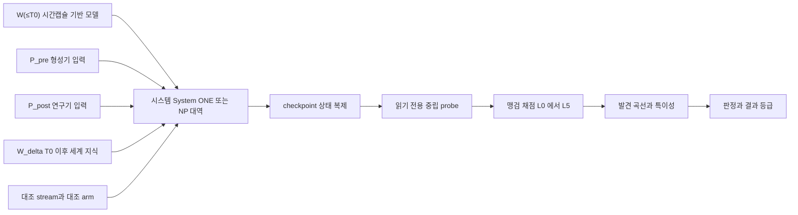
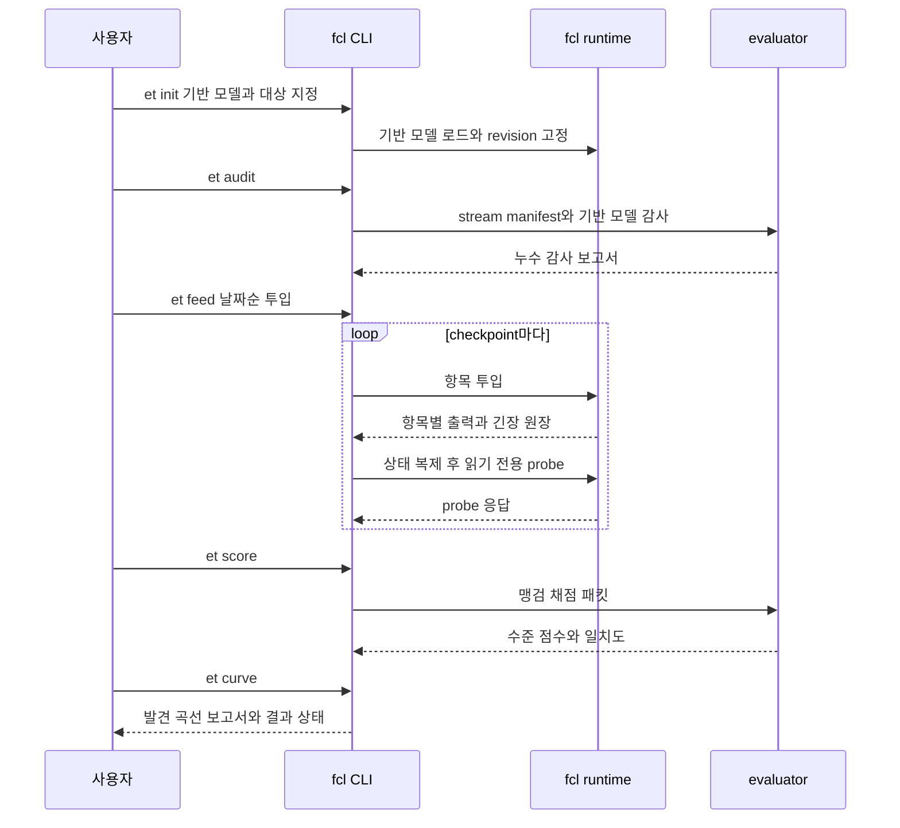

# 17. 아인슈타인 테스트: 경험 조건부 발견 시험(ET)의 운영 정의와 절차

**상태 라벨:** 이 문서는 **PROPOSAL**과 **OPEN**이며 **NOT RUN**이다. 사용자가 한 말(**USER**)은 §2.1의 원문과 위치뿐이고, 운영 정의·사다리·stream 설계·rubric·통과 기준의 형식·실행 절차는 모두 제안이다. 구현, 모델 실행, 학습, 유료 API, 클라우드 GPU 사용, 가중치 내려받기를 하지 않았다. 계획용 규모는 **ESTIMATE**(low / base / high)이고 통과 기준의 값은 [값]으로 비워 두었다. 문헌과 보도는 확인한 만큼만 확인 수준을 적었다(**LITERATURE**). 미결정은 **OPEN**(§13의 결정 후보. 번호는 docs/09 §10의 D-번호)이다. 작성: 2026-11-18.

## 한눈에 보기

**무엇인가.** 사용자의 최종 목표인 아인슈타인 테스트를 우리 제품에서 돌릴 수 있는 시험으로 바꾼 설계다. 우리의 운영 정의는 「경험 조건부 발견 시험(ET)」이다. 시간캡슐 기반 모델이 T0까지의 세계 지식 W(≤T0)를 갖고 있다. 그 위에 한 인물이 그 시기에 넣었을 법한 입력(형성기 P_pre, 연구기 P_post)을 시간순으로 넣는다. checkpoint마다 중립 probe로 발견 수준(L0~L5)을 채점해 「어떤 data까지 넣었을 때 어떤 발견이 나오는가」의 곡선을 얻고, 그 곡선이 대조 stream에서는 나오지 않는다는 특이성을 확인한다. 진짜 1901년 data만 주고 입력 없이 답을 보는 시험이 아니다. 대상은 아인슈타인에 한정하지 않고 지식 마감이 맞는 공개 시간캡슐 모델에 맞춰 고른다. 가설 H-DISCOVER(§2.6)는 이 시험이 시험하는 세 번째 명제이며 헌장의 두 명제와 별개의 PROPOSAL이다.



**사다리.** 시험의 해상도는 단 여섯이고 phase가 지날수록 올라간다. 단별 등급 상한과 쓸 수 있는 문구는 §3.2의 표 하나가 정한다.

| 단 | 한 줄 | 판정 대상인 phase | 탐색·회귀인 phase |
|---|---|---|---|
| ET-0 | 합성 미시 발견 세계. 누수 0, 객관 채점, 대량 | P0, P1, P2 | 없음 |
| ET-1 | 재분장한 역사 원형 사례. 오염 probe를 붙인다 | P3, P4 | P0, P2 |
| ET-2 | 공개 모델의 지식 마감 이후의 실제 사례. 소수 | P4 | P3 |
| ET-3p | 미리보기. 무학습 NP 시스템이 공개 시간캡슐 모델 위에서 절차를 처음부터 끝까지 한 번 돈다. 발견 여부는 주장하지 않는다 | 없음 | P0, P1 |
| ET-3 | System ONE을 시간캡슐 모델에 retrofit해서 pilot 대상으로 돈다 | P5 | P4 |
| ET-4 | 시간캡슐 모델 + 봉인된 주력 대상 묶음. 최종 판정 | P6 | 없음 |

**이 문서가 정하는 것과 다른 문서가 정하는 것.**

| 이 문서가 정한다 | 다른 문서가 정한다 |
|---|---|
| 운영 정의, 「입력」의 두 해석, 사다리와 단별 상한·문구, stream 항목 schema와 입력 tier, 누수·사후 편향 통제, 관찰 설계와 곡선 지표, 발견 수준 rubric, 통과 기준의 형식, 실행 절차, dev/test 분리, 위험 | P0의 suite와 V0 목록은 [18-poc-nonparametric.md](/home/jimmy/repos/full-continual-learning/docs/18-poc-nonparametric.md), feature와 flow는 [16-ideal-blueprint.md](/home/jimmy/repos/full-continual-learning/docs/16-ideal-blueprint.md), phase 종료 gate는 [09-roadmap.md](/home/jimmy/repos/full-continual-learning/docs/09-roadmap.md), 논문 주장은 [19-paper-plan.md](/home/jimmy/repos/full-continual-learning/docs/19-paper-plan.md), 비용은 [15-compute-plan.md](/home/jimmy/repos/full-continual-learning/docs/15-compute-plan.md), 시험의 출처와 모델·대상 조사는 [2026-11-18-blueprint-et-design.md](/home/jimmy/repos/full-continual-learning/research/2026-11-18-blueprint-et-design.md) |

**먼저 사용자 확인이 필요한 것.** (1) 「입력」을 경험을 받는 학습자로 읽을지 대화하는 동반 AI로 읽을지(D-30, §2.4). (2) 대상 묶음과 T0, 그리고 원문의 「1904」를 어떻게 읽을지(D-28, §2.5). 나머지 결정 후보는 §13에 있다.

**읽는 순서.** 처음이면 §2(원문과 운영 정의), §3(사다리와 상한), §6~§9(stream, 누수, 관찰, 평가), §11(실행 절차) 순서로 읽는다. 누수 통제(§7)와 입력 내재 수준(§7.5)이 「조회표로도 통과한다」는 비판에 대한 이 문서의 답이다.

## 1. 지위와 근거 표기

**PROPOSAL:** 이 문서는 최종 목표인 아인슈타인 테스트를 우리 제품에서 시험할 수 있는 절차로 바꾼 설계다. 구현하거나 실행한 것이 없다. 이 문서가 정하는 것은 운영 정의, 시험의 사다리, stream 설계, 누수 통제, 관찰 설계, 평가, 통과 기준의 형식, 실행 절차, 위험이다. 다른 문서가 소유하는 것은 이름으로 가리키고 값을 되풀이하지 않는다.

| 표기 | 이 문서에서의 쓰임 |
|---|---|
| USER | 사용자가 쓴 말. 원문이 있는 문장에만 쓴다(§2.1). 해석은 USER가 아니다 |
| USER-HYPOTHESIS | 사용자가 가설로 말한 것. 이 문서에서는 해법 개념과 schema 가설이 [13-schema-decomposition-and-interference.md](/home/jimmy/repos/full-continual-learning/docs/13-schema-decomposition-and-interference.md)에 있고 여기서는 쓰지 않는다 |
| PROPOSAL | 이 문서의 설계 제안. 사용자가 승인한 것이 아니다 |
| LITERATURE | 문헌·보도의 요지. 확인한 만큼만 확인 수준을 적는다 |
| ARCHIVE | 과거 기록. 이 문서에서는 저장소의 이전 기록을 가리킬 때만 쓴다 |
| OPEN | 미결정과 미해결. 결정 후보는 §13이다 |
| NOT RUN | 실행하지 않았다는 선언. 이 문서의 모든 실험이 NOT RUN이다 |
| ESTIMATE | 계획용 규모와 범위. low / base / high로만 쓰고 비용은 [15-compute-plan.md](/home/jimmy/repos/full-continual-learning/docs/15-compute-plan.md)가 계산한다 |

**다른 문서와의 경계.**

| 주제 | 소유 문서 |
|---|---|
| feature(BF-*)와 flow(FL-*), 특히 발견 flow와 긴장 원장 | [16-ideal-blueprint.md](/home/jimmy/repos/full-continual-learning/docs/16-ideal-blueprint.md) |
| P0(NP)의 suite S-A~S-D, V0 항목, NP 대역, P0 실행 행렬, ET-3p run의 시스템 쪽 규칙 | [18-poc-nonparametric.md](/home/jimmy/repos/full-continual-learning/docs/18-poc-nonparametric.md) |
| phase 정의, 종료 gate, 회귀 gate, 사용자 여정 UJ0·UJ6, 결과 등급 0–5 | [09-roadmap.md](/home/jimmy/repos/full-continual-learning/docs/09-roadmap.md) |
| 논문별 주장 Ck-n과 판정 규칙 | [19-paper-plan.md](/home/jimmy/repos/full-continual-learning/docs/19-paper-plan.md) |
| token, GPU 시간, 비용 | [15-compute-plan.md](/home/jimmy/repos/full-continual-learning/docs/15-compute-plan.md) |
| 시험의 출처, 시간캡슐 모델 현황, 대상 후보 매트릭스, 사료 계획 | [2026-11-18-blueprint-et-design.md](/home/jimmy/repos/full-continual-learning/research/2026-11-18-blueprint-et-design.md) |

**제품과의 관계.** ET는 제품의 발견 기능을 시험하는 절차이고, 모든 phase에서 실제 `fcl` CLI와 실제 모델로 돈다. mock으로만 도는 ET는 증거가 아니다. P0(NP)의 ET-0과 ET-3p는 외부 frozen LLM을 쓰는 비모수 대역(stand-in) 위에서 도는 것이며 최종형(통합 System ONE)에 대한 주장이 아니다([AGENTS.md](/home/jimmy/repos/full-continual-learning/AGENTS.md), [01-intent-and-charter.md](/home/jimmy/repos/full-continual-learning/docs/01-intent-and-charter.md) §5). 가중치 수준의 schema 형성이나 통합 모델의 내부 depth 효율은 ET-0·ET-3p로 주장하지 않는다.

## 2. 사용자 원문과 운영 정의

### 2.1 USER 원문

**USER (2026-11-18, 원문 전체와 위치: [2026-11-18-discussion.md](/home/jimmy/repos/full-continual-learning/sources/sync/2026-11-18-discussion.md)):** 아인슈타인 테스트에 관한 부분의 원문이다(줄 끝 공백만 뺐다).

```text
최종적으로는 아인슈타인 테스트 통과를 목표로 함.
- 근데 진짜 1901년 data만 주고 아무 입력 없이 1904년 발견을 도출하는게 아니라 우리 solution 기준이라면 1901~1904사이에 아인슈타인이라면 했을법한 입력 set들을 기반으로 진행하고, 1901 이전 data에 대해서도 아인슈타인이 했을법한 입력 data를 만들어서 준비해야함. 그리고 어떤 data까지 넣었을 때 유의미한 발견들이 나오는지 관찰하는 것임
- 그리고 아인슈타인 테스트라고 해서 아인슈타인만 대상으로 할 필요는 없음(data구하기 어려우니). 근본 목적은 창발적이고 직관에 매우 크게 의존하는 인류 역사상 큰 발견/발명을 AI가 할수 있는지를 보는 테스트라서 2026 이전 어느시점을 기준으로 잡아도 괜찮음. 단지 그 시점에 어떤 사람의 발견/발명을 대상으로 할지, 어디서 과학적 발견, 동료의 연구등을포함한 모든 연구 결과 data를 어느시점까지만 주고 그 이후 특정 인물의 연구, 사고방식 data를 줄지 이런것들을 잘 결정해서 보면 되는 것임
```

### 2.2 원문에서 읽은 것과 읽지 않은 것

**PROPOSAL:** 아래 표의 왼쪽은 위 원문의 말이고 가운데는 이 문서가 그 말을 읽은 방식이다. 읽은 방식은 해석이므로 USER가 아니다.

| 원문의 말 | 이 문서가 읽은 방식 | 어디서 다루나 |
|---|---|---|
| 「1901년 data만 주고 아무 입력 없이 … 도출하는게 아니라」 | 자료만 주고 입력 없이 답을 보는 조회표식 시험을 목표로 하지 않는다 | §2.3 |
| 「우리 solution 기준이라면 1901~1904사이에 아인슈타인이라면 했을법한 입력 set들」 | 대상 인물이 우리 시스템을 자기 AI로 썼다면 넣었을 법한 입력을 stream으로 만든다 | §2.4, §6 |
| 「1901 이전 data에 대해서도 … 입력 data를 만들어서」 | 형성기 입력 P_pre를 따로 만든다 | §6.3 |
| 「어떤 data까지 넣었을 때 유의미한 발견들이 나오는지 관찰」 | checkpoint마다 발견 수준을 재서 입력량에 대한 발견 곡선을 얻는다 | §8 |
| 「아인슈타인만 대상으로 할 필요는 없음 … 2026 이전 어느시점」 | 대상은 기준표로 정한다. 아인슈타인은 주력 후보다 | §5 |
| 「모든 연구 결과 data를 어느시점까지만 주고 그 이후 특정 인물의 연구, 사고방식 data를 줄지」 | 시점 T0까지는 세계 지식 W(≤T0), 그 뒤는 인물 stream P_post | §2.3 |
| 「아인슈타인 테스트 통과를 목표로」 | 최종 목표다. 「통과」의 뜻은 ET-4 판정이다 | §10 |

원문이 말하지 않은 것: 통과 임계값, 대상 인물의 확정, 시간캡슐 모델의 선택, 입력의 형식(읽기·관찰·메모 등), 채점 방법, 모의 인물의 반응(closed-loop), 비용. 이것들은 이 문서의 PROPOSAL이거나 OPEN이며 사용자가 정한 것이 아니다.

### 2.3 운영 정의: 경험 조건부 발견 시험(ET)

**PROPOSAL (MD-1118-A·G):** 아인슈타인 테스트의 우리 운영 정의는 「경험 조건부 발견 시험(Experience-conditioned discovery Test, ET)」이다. 시간캡슐 기반 모델이 T0까지의 세계 지식을 갖고 있다. 거기에 한 인물의 경험 stream을 시간순으로 넣는다. checkpoint마다 중립 probe로 발견 수준을 채점한다. 그러면 「어떤 data까지 넣었을 때 어떤 발견이 나오는가」라는 곡선과, 그 곡선이 대조 stream에서는 나오지 않는다는 특이성이 얻어진다. 한 번의 ET가 내는 보고서는 이 곡선, 특이성, 누수 감사, 채점 일치도를 한꺼번에 담는다.

| 기호 | 뜻 | 정하는 방법 |
|---|---|---|
| T0 | 기반 모델이 가진 세계 지식의 마감 | 기반 모델의 실제 마감이다. 공개 문서와 마감 probe(§7.3)로 확인한다. 인물의 연표가 정하지 않고 기반 모델이 정한다. 주력 후보 TG-01에서는 기반 GPT-1900의 마감에 맞춘 1900-01-01이다(§5.3. MD-1118-H 잠정안의 1900년 말과 다르다). 기반의 마감과 인물의 연표가 어긋나면 그 사이의 문헌을 W_delta의 앞부분으로 넣는다 |
| W(≤T0) | T0까지의 모든 연구 결과. 동료의 연구를 포함해 전부 | 시간캡슐 기반 모델의 사전학습 지식이 맡는다(MD-1118-G). 우리가 따로 넣지 않는다 |
| P_pre | 대상 인물이 T0까지 했을 법한 입력(형성기) | §6.3 |
| P_post | T0 이후 연구기의 입력. 발견 진술 자체는 뺀다 | §6.4 |
| W_delta | T0 이후 t까지의 세계 지식(동료의 새 연구, 공개된 관측 등). 기반을 다시 학습하지 않고 System ONE의 지속학습 입력으로 넣는 안을 기본으로 검토한다 | §6.4 |
| t_c | 구성요소 c의 발견 진술이 날짜 있는 출처(초고와 편지 포함)에 처음 나타나는 시점 | 구성자가 사료로 정한다. 구성요소 c의 평가에 쓰는 입력은 t_c 직전까지다 |
| T1 | 연구기의 끝. 구성요소 t_c 중 가장 늦은 시점 | stream은 가장 늦은 t_c 직전까지 간다. 구성요소 c의 평가 창은 T0 이후 t_c 직전까지이고, 다른 구성요소의 발견 진술은 그 날짜 이후에 인물 자신의 산출물로 들어간다(§6.4) |
| checkpoint k | 입력의 시간순 위치에서 사전에 정한 점 | §8.1 |

한 번의 ET는 (대상, 기반 모델, 입력 tier, stream과 대조 stream, probe 은행, rubric, arm)의 조합이다. arm은 같은 기반에 같은 자료를 주는 방식의 차이다(H-DISCOVER의 「기억 없이 또는 평면 기억으로 준 경우」가 대조 arm이다). arm의 목록과 예산 일치는 P0에서는 [18-poc-nonparametric.md](/home/jimmy/repos/full-continual-learning/docs/18-poc-nonparametric.md), P1 이후에는 [09-roadmap.md](/home/jimmy/repos/full-continual-learning/docs/09-roadmap.md)를 따른다.

**기본은 open-loop다.** 인물의 입력은 시스템 출력과 무관하게 고정된다. 모의 인물이 시스템 출력에 반응하는 closed-loop는 OPEN이다(D-32). open-loop에서는 시스템의 출력이 이후 입력을 바꾸지 못하므로 출력의 기여와 입력의 기여를 가를 수 있다.

### 2.4 「입력」의 두 해석과 기본 선택

**PROPOSAL (MD-1118-G):** 원문의 「아인슈타인이라면 했을법한 입력 set」은 두 가지로 읽힌다. 아래 표는 두 해석의 차이와 이 문서의 기본 선택이다. **사용자 확인 대기**(D-30).

| 비교 | 해석 L: 경험을 받는 학습자 (기본) | 해석 C: 대화하는 동반 AI |
|---|---|---|
| 한 줄 정의 | 시스템이 인물의 경험 stream을 자기 경험으로 받는다. 인물의 삶을 겪는 학습자다 | 시스템이 인물의 AI로서 인물과 대화한다. 입력은 인물이 시스템에 건넨 말이다 |
| 입력 항목의 모양 | 경험 기록형(읽은 것, 관찰한 것, 적은 메모, 던진 질문, 나눈 토론, 해본 계산) | 사용자 turn형(인물이 AI에게 건넨 질문, 자료, 계산 요청) |
| 시스템 출력 | 처리 중의 내부 계산과 기록(긴장 원장, 보고). 인물에게 돌려주는 응답이 없다 | 매 turn 응답이 있다. open-loop에서는 인물의 다음 입력이 그 응답과 무관하다 |
| 사료와의 거리 | 가깝다. 편지, 노트, 독서 기록이 이미 경험 기록의 모양이다 | 멀다. 당시에는 AI가 없었으므로 turn형 문장은 대부분 합성이다(입력 tier C 비중이 커진다) |
| 누수 위험 | 낮음에서 중간 | 높음. 현대 LLM이 만든 turn 문장에 후대 어휘와 관점이 스며든다 |
| 무엇을 시험하나 | 같은 경험을 한 학습자가 발견에 이르는가 | 인물을 돕는 AI가 발견에 이르는가. 인물 입력의 기여와 AI의 기여를 가르기가 더 어렵다 |
| 원문과의 거리 | 「했을법한 입력」은 C에 가깝게 읽히기도 한다. 그러나 MD-1118-G는 이 입력을 「그 인물이 겪은 경험의 stream과 같은 것」으로 본다 | 원문의 어감에 더 가깝다 |

**기본 선택은 L이다.** 이유는 넷이다. (1) 사료가 이미 경험 기록의 모양이라 구성 중 합성이 적다. (2) 누수 위험이 낮다. (3) 시스템 출력은 생성물이고 stream은 관측이라는 분리([07-state-and-storage.md](/home/jimmy/repos/full-continual-learning/docs/07-state-and-storage.md) §1–§2, [AGENTS.md](/home/jimmy/repos/full-continual-learning/AGENTS.md))를 그대로 지킨다. (4) 두 해석이 같은 stream 항목에서 나온다. 항목에 `render` 칸(`experience` 또는 `turn`)을 두면 C로도 돌릴 수 있고(§6.1), 사료 구성은 한 번만 한다. 두 해석의 결과는 한 표에 섞지 않는다.

### 2.5 원문의 「1901~1904」·「1904년 발견」과 역사 사실

**PROPOSAL:** 원문의 연도와 보도·역사의 연도가 다르다. 조용히 맞추지 않고 차이를 기록한다. 역사 사실은 2차 출처(Annalen der Physik 1905년 논문 4편의 접수·게재일을 정리한 백과 문서)에서 확인했고 원 논문의 서지는 부록 B·C에 있다.

| 항목 | 내용 | 확인 수준 |
|---|---|---|
| 사용자 원문 | 「1901년 data만 주고 … 1904년 발견을 도출」, 「1901~1904사이」 | USER |
| Einstein test 보도 판본 (b) | 1901년까지의 지식만으로 1905년 논문들을 낼 수 있는가 | 2차 출처 요약. 조사 기록에서 확인 |
| Einstein test 보도 판본 (a) | 1911년까지의 지식으로 1915년 일반상대성을 스스로 도출하는가 | 2차 출처 요약. 조사 기록에서 확인 |
| 역사 기록 | 1905년의 논문 4편은 1905년 3월 18일, 5월 11일, 6월 30일, 9월 27일에 접수됐고 같은 해에 게재됐다 | LITERATURE, 2차 출처 확인 |
| 1904년의 발견 | 1904년에 완결된 같은 주제의 논문은 확인하지 못했다. 조사하지 않았다 | 미확인 |

처리 원칙은 셋이다.

1. 사용자 원문의 「1904」를 1905로 고쳐 쓰지 않는다. 가능한 읽기는 둘이다. (Y1) 사용자가 1905를 1904로 적었다. (Y2) 연구기의 입력을 1904년까지로 보고 발견은 그 직후로 본다. 어느 쪽이든 이 문서의 stream은 T0 이후 구성요소별 t_c 직전까지의 입력을 담으므로 절차는 같고, 달라지는 것은 어느 해의 입력까지 P_post에 들어가는지뿐이다. 사용자 확인 대기(D-28).
2. T1은 연도가 아니라 구성요소별 t_c(발견 진술이 날짜 있는 출처에 처음 나타나는 시점)로 정의한다. 주력 후보의 t_c는 1905년의 접수일을 기본으로 하되 구성자가 사료로 확정한다.
3. 원문의 「1901」은 T0 직후의 첫 해로 읽는다. 주력 후보의 기반(pre-1900 공개 모델 후보)의 마감과 1901년 사이의 문헌은 W_delta의 앞부분이다(§6.4).

### 2.6 가설 H-DISCOVER

**PROPOSAL, OPEN (MD-1118-N):** 모든 문서가 같은 문장을 쓴다. 헌장 [01-intent-and-charter.md](/home/jimmy/repos/full-continual-learning/docs/01-intent-and-charter.md) §4의 두 중심 명제(H-SAMPLE, H-COMPUTE)에 없는 세 번째 명제이므로 헌장 개정이 아니라 PROPOSAL·OPEN으로 표기한다.

> H-DISCOVER (PROPOSAL): 「T0까지의 세계 지식을 가진 기반 위에서, 한 인물의 경험 stream을 schema로 쌓고 미해결 불일치를 보존했다가 재조합·재구조화하는 시스템은, 같은 기반에 같은 자료를 기억 없이 또는 평면 기억으로 준 경우보다 (i) 더 적은 입력에서 (ii) 더 높은 발견 수준에 이르고, (iii) 그 차이는 stream의 내용에 특이적이다(대조 stream에서는 나오지 않는다).」

세 부분은 §8.4의 지표에 하나씩 대응한다. (i)은 최초 발견 시점과 필요한 입력량, (ii)는 최고 수준과 곡선 아래 면적, (iii)은 대조 stream 대비 특이성이다. 통찰의 운영적 정의([11-research-agenda.md](/home/jimmy/repos/full-continual-learning/docs/11-research-agenda.md) §4)를 그대로 쓴다. 새로운 관계·표현·적용 조건의 형성과 새 사례에서의 재사용이 증거이고, 암기·self-consistency·confidence 증가·저차원화는 증거가 아니다. 그래서 L4(새 예측)는 stream에 없던 새 상황에서의 재사용으로 채점한다(§9.1).

## 3. 사다리 ET-0 ~ ET-4와 단별 등급 상한

**PROPOSAL (MD-1118-A·B):** ET는 마지막 phase에만 두지 않는다. P0(NP)부터 가장 얇은 형태로 넣고 phase가 지날수록 해상도를 올린다. 단(ET-0~ET-4와 ET-3p)은 phase가 아니라 시험의 해상도다. 아래 phase 대응은 기본안이며 phase 정의의 소유는 [09-roadmap.md](/home/jimmy/repos/full-continual-learning/docs/09-roadmap.md)다. 둘이 어긋나면 docs/09를 따르고 이 표를 고친다.

### 3.1 사다리

| 단 | 한 줄 정의 | 기반 모델 | 입력(stream) | 채점 | 누수·오염 통제 | 판정 대상인 phase | 탐색·회귀인 phase |
|---|---|---|---|---|---|---|---|
| ET-0 | 합성 미시 발견 세계. 누수 0, 객관 채점, 대량 | 같은 frozen LLM 안에서 arm 비교(현대 모델 가능) | 세계 생성기가 만든 stream. 설계는 [18-poc-nonparametric.md](/home/jimmy/repos/full-continual-learning/docs/18-poc-nonparametric.md)의 suite S-B | 프로그램 oracle(객관). 사람 채점 없음 | 생성기 구조가 교과서 법칙과 겹치는지 점검 | P0, P1(학습 arm 대 NP arm), P2(깊이 곡선) | 없음 |
| ET-1 | 재분장(re-skin)한 역사 원형 사례. 실제 발견의 구조를 보존하고 이름·상수·표면을 바꾼다 | 같음 | 구성자가 만든 재분장 stream. suite S-C | rubric과 객관 하위 과제 | 오염 probe(모델이 원 사례를 알아보는가, §7.4) | P3, P4(잠복 효과) | P0, P2 |
| ET-2 | 공개 모델의 지식 마감 이후에 나온 실제 사례. 실제 텍스트, 소수 | 마감이 확인된 공개 모델 | 마감 이후의 실제 논문·기록 | rubric(사람) | 마감 검증 probe(§7.3) | P4 | P3 |
| ET-3p | 미리보기. 무학습 NP 시스템을 공개 시간캡슐 모델에 얹어 이 문서의 절차를 처음부터 끝까지 한 번 돈다. 목적은 절차·채점·누수 감사가 실제로 도는지 확인하는 것이다. 발견 여부는 주장하지 않는다 | 공개 시간캡슐 모델 | pilot 대상 stream | 맹검 채점 절차를 소규모로 실제 수행 | 시스템 안 모델은 시간캡슐 모델만(§7.7), 누수 감사 | 없음 | P0, P1(회귀) |
| ET-3 | 정식. System ONE을 시간캡슐 모델에 retrofit해서 pilot 대상으로 돈다 | 시간캡슐 모델 + retrofit | pilot 대상 stream(입력 tier A·B·C) | 맹검 2인 이상 | 위와 같음 | P5 | P4(pilot 대상) |
| ET-4 | 시간캡슐 모델 + 봉인된 주력 대상 묶음. 최종 판정 | 시간캡슐 모델 + System ONE | 봉인 stream(입력 tier A·B·C) | 맹검 2인 이상과 일치도 | 위와 같음 + 봉인 | P6 | 없음 |

- ET-3p와 ET-3는 같은 절차를 다른 해상도로 돈다. ET-3p는 학습이 없는 NP 시스템이 절차를 끝까지 통과하는지만 본다. ET-3는 System ONE을 retrofit한 시스템의 발견 곡선을 본다. ET-3p의 결과는 ET-3의 근거가 아니다.
- 「탐색」(MD-1118-A)은 결과 등급 2 이하로만 보고하고 「발견했다」·「확증」 문구를 쓰지 않는다는 뜻이다. ET-1과 ET-3p는 P0에서 탐색이다.
- ET-0에는 입력 tier(§6.2)가 없다. 생성기 산출이라 모두 합성이고, 합성 사실이 곧 표시다. 생성물을 관측 증거로 올리지 않는 규칙([07-state-and-storage.md](/home/jimmy/repos/full-continual-learning/docs/07-state-and-storage.md) §1–§2)은 그대로 적용한다.

### 3.2 단별 등급 상한과 쓸 수 있는 문구·없는 문구

**PROPOSAL (MD-1118-P):** 이 표 하나가 ET 단별 상한의 기준이다. docs/18, docs/09, docs/19는 이 표를 가리키고 값을 다시 쓰지 않는다. 등급은 [09-roadmap.md](/home/jimmy/repos/full-continual-learning/docs/09-roadmap.md) §3의 0–5이며 단이 아니라 주장 단위로 부여한다. 「최대」는 상한이고 각 주장은 자기 증거가 채운 등급만 받는다. 아래 표는 결과 상태(PASS·FAIL·INCONCLUSIVE·BLOCKED·NOT RUN)와 별개다. FAIL이나 INCONCLUSIVE도 같은 틀로 쓴다.

| ET 단 | 판정하는 것 | 최대 등급(주장 단위) | 상한을 막는 것 | 쓸 수 있는 문구 | 쓸 수 없는 문구 |
|---|---|---|---|---|---|
| ET-0 | 합성 세계에서 arm 사이의 상대 효과: 발견 수준, 필요한 입력량, stream 특이성 | 3, 조건부. suite S-A·S-B의 개별 주장이 docs/09 §3 등급 3 조건(봉인 manifest, fresh locked cohort, 같은 예산 대조, 구조 family 2종 이상, 사전 명세 seed, 독립 검토)을 모두 채울 때만 3을 시도한다. 그 밖은 2 이하 | 합성 세계, frozen LLM 소수, 생성기의 구조 family 수. 현대 LLM은 원리를 이미 알 수 있어 절대 주장이 불가능하다 | 등급 2: 「이 합성 pilot 범위에서 [arm]의 발견 수준이 대조 arm과 [차이]를 보였다」(구간 병기). 등급 3: 「이 합성 family·이 frozen LLM·이 seed 집합에서 같은 예산의 대조군 대비 발견 수준의 우위(PASS)」 | 「발견했다」, 「원리를 발견하는 능력」, 「과학적 발견」, 「아인슈타인 테스트」, 「일반화」, 「다른 모델에서도」 |
| ET-1 | 재분장 사례에서 arm 사이의 상대 효과. 오염 probe 수치를 항상 병기 | 2. P0·P2의 탐색은 2 이하다. P3 이후 판정 대상이 되어 등급 3 조건(재분장 family 2종 이상 포함)을 채우면 그 주장만 3 | 현대 LLM이 원 사례를 알아보는 오염, 사례 수, 사람 채점 | 등급 2: 「이 재분장 사례 pilot에서 오염 probe 수치([값])와 함께 arm 사이 상대 차이를 관측했다」. 등급 3: 「오염 probe를 통제한 이 재분장 family에서 대조군 대비 우위(PASS)」 | 「발견했다」, 「역사적 발견을 재현했다」, 「[인물]처럼」, 「확증」 |
| ET-2 | 지식 마감 이후의 실제 사례에서 arm 사이의 상대 효과 | 2. P3의 탐색은 2 이하다. P4에서 판정 대상이 되어 사례 수가 fresh locked cohort 조건을 채우면 3을 시도(OPEN) | 소수 사례, 마감 일자의 불확실성(후속 미세조정·검색 경로로의 유입), 채점의 주관성 | 「이 사례 [n]개에서 관측했다」(마감 확인 수준 병기) | 「새로운 발견」, 「연구 수준의 발견」, 「확증」 |
| ET-3p | 절차가 끝까지 도는가(Contract) | 1, 계약 통과. 발견 곡선은 기술 보고만 싣고 발견 여부를 주장하지 않는다 | 1회 실행, pilot 대상, 무학습 NP 대역, 시간캡슐 모델의 능력 하한 미확인 | 「ET 절차가 끝까지 돌았고 감사·채점·원장 기록이 계약을 통과했다」, 「누수 감사가 [찾은 것 또는 못 찾은 것]을 보고했다」 | 「발견했다」, 「[수준]에 도달했다」를 결과 문장으로 쓰기, 「시간캡슐 모델이 [발견]을 재발견했다」, 「성공」 |
| ET-3 | pilot 대상에서 System ONE retrofit 시스템의 발견 곡선(대조 arm·대조 stream 대비) | 2, 개발 pilot. pilot 대상은 개발에 노출되므로 봉인할 수 없어 3을 받지 못한다 | 개발 노출, 인물 1명, retrofit 모델 1종 | 「이 pilot 대상·이 시간캡슐 모델 범위에서 시스템 출력이 rubric의 [L]을 충족하는 것으로 채점됐다」(입력 내재 수준·특이성 병기) | 「발견했다」, 「확증」, 「일반화」, 「다른 인물·시대에서도」 |
| ET-4 | 봉인 주력 대상 묶음에서 사전 명세 ET 판정(최종) | 3, 한정 확증(P6 상한 제안). 4는 같은 절차를 두 번째 시간캡슐 기반과 두 번째 봉인 대상 묶음에서 새 fresh cohort로 복제한 경우에 한한다(OPEN) | 대상 수가 적다(통계 단위는 대상과 구성요소), 단일 기반, stream 재구성의 불확실성, 사후 편향의 잔존, 인물 사료의 편중 | PASS이면 「이 대상 묶음·이 시간캡슐 기반·이 입력 tier에서 사전 명세 ET-4 판정을 통과했다(대조 stream 대비 특이적, 입력 내재 수준 초과)」. 「발견했다」는 이 범위 태그와 함께만 쓴다 | 「아인슈타인 테스트를 통과했다」, 「AI가 [인물]처럼 발견한다」, 「AGI」, 「초지능」, 「모든 발견·인물·분야」, 입력 tier C 단독 결과를 발견으로 읽는 문구 |

표를 읽는 규칙(PROPOSAL):

1. 「발견했다」라는 동사는 ET-4 등급 3에서만, 범위 태그(대상 묶음·기반·입력 tier)와 함께 쓴다. 그 아래 단에서는 채점된 수준을 관측으로 서술한다(MD-1118-I: 절대 주장은 시간캡슐 기반에서만, 그것도 봉인된 단에서만).
2. ET-0~ET-2는 같은 frozen LLM 안에서 arm 사이의 상대 효과만 주장한다. 현대 LLM은 역사적 발견을 이미 알 수 있기 때문이다.
3. 대조 stream이 같은 수준에 이르면 특이성이 없으므로 한 단계 낮은 문구를 쓴다(§8.4).
4. 입력 내재 수준(§7.5)을 넘지 못한 출력은 발견 수준으로 세지 않는다. 입력을 되풀이한 것이기 때문이다.
5. 「아인슈타인 테스트 통과」라는 말은 쓰지 않는다. 합의된 실행 절차가 공개돼 있지 않은 시험이고(§4. 학술 의견 글이 골격만 냈고 기술 사양은 일부러 비워 두었다), 우리는 그것을 ET라는 운영 정의로 바꿔 시험하기 때문이다. 쓸 수 있는 말은 「ET-4 판정(이 문서의 운영 정의)을 [범위]에서 통과했다」까지다. 사용자 확인 대기(D-34).

### 3.3 단 사이의 규칙

**PROPOSAL:**

- **각 단은 자기 증거만 쓴다.** 앞 단의 PASS는 뒤 단 주장의 근거가 아니고, 뒤 단의 FAIL이 앞 단 결과를 소급해서 무효로 만들지도 않는다. ET-0의 통과가 ET-4의 통과를 예측한다고 쓰지 않는다(OPEN).
- **같은 틀을 올린다.** stream 항목 schema(§6.1), 발견 수준 척도(§9.1), 곡선 지표(§8.4), 판정 문장의 형식(§10)은 모든 단이 같다. 단이 올라갈 때 바뀌는 것은 대상별 rubric, 기반 모델, 입력 tier의 폭, 누수 통제의 강도, 봉인 여부다.
- **NP arm은 모든 단의 영구 대조군이다**(MD-1118-O). 학습 모듈은 같은 예산의 NP arm보다 나을 때만 필요하다고 주장한다. NP arm은 그 phase의 base 모델로 다시 돈다.
- **ET-3p는 ET-3의 사전 조건이다.** ET-3p에서 절차의 계약(§10.3)이 통과하지 못하면 System ONE을 얹은 ET-3로 올라가지 않는다. 절차가 안 도는 상태에서 시스템을 바꾸면 어느 쪽 문제인지 가려지지 않기 때문이다.
- **봉인은 ET-4에서만 요구한다.** ET-0·ET-1은 생성기 seed와 사전 명세 manifest로, ET-3까지는 pilot 대상의 개발 노출 사실을 기록하는 것으로 충분하다. ET-4의 봉인 범위는 §11.4다.

## 4. 선행 맥락 (요약)

**LITERATURE (2차 출처 요약. 조사 기록에서 확인):** 이 절은 배경만 요약한다. 출처 확인과 판본·수치의 상세는 [2026-11-18-blueprint-et-design.md](/home/jimmy/repos/full-continual-learning/research/2026-11-18-blueprint-et-design.md)의 조사 기록이 가지며, 여기의 문장은 그 기록의 확인 수준을 넘지 않는다.

| 항목 | 요지 | 확인 수준 |
|---|---|---|
| Einstein test의 출처 | Demis Hassabis의 제안으로 보도됐다. 더 이른 선행 서술이 있다(2025년 4월의 잡지 기사, 연도 없음, 기자 서술). 보도에 두 판본이 있다. (a) 2026년 2월 India AI Impact Summit 기간의 발언 보도: 1911년까지의 지식으로 학습한 시스템이 1915년 일반상대성을 스스로 도출하는가. (b) 1901년까지의 지식만으로 1905년 논문들을 낼 수 있는가: 2026년 5월 보도와 10월의 신문 인물 기사를 인용한 보도에 있다. 둘 다 기자 서술이고 Hassabis가 그 연도를 직접 말했는지는 확인하지 못했다. 별개로 학술 의견 글(CACM, 2026년 5월)이 공식 제안의 골격을 냈다 | 2차 출처 요약(원문 일부 미열람). 상세는 조사 기록 §5 |
| 비판 | 조회표로도 통과할 수 있다는 지적, AGI가 아니라 초지능의 정의라는 지적(한 매체만 전함, 1차 미확인), 통과한 시스템의 공개 결과가 없고 절차의 기술 사양이 비어 있다는 평(학술 의견 글은 골격만 제시하고 기술 사양을 일부러 비워 두었다) | 2차 출처 요약과 학술 의견 글 직접 확인 |
| 공개된 시간캡슐(vintage, historical) 언어모델 | 마감 1899의 GPT-1900(1904의 GPT-1905 포함), 1913년 이전 text의 TypewriterLM, 1931년 이전 text의 Talkie-1930, 1800~1875년 text의 TimeCapsuleLLM이 공개돼 있다. 마감 1913~1946의 Ranke-4B 계열은 보도됐으나 가중치 공개를 확인하지 못했다. 크기, 라이선스, 실행 형식, 알려진 누수·한계는 조사 기록의 현황 표가 가진다 | 공개 페이지 직접 확인(조사 기록 §1). 기반의 과제 수행 능력은 재지 않았다. 이름은 후보로만 쓴다 |
| 발견 시험의 선례 | GPT-1900의 저자는 단서가 붙은 모순 문제에서 단편적 직관이 나온다고 보고했고 전체로는 물리 과제의 대부분에서 실패한다고 평가했다. 이 평가는 저자가 인상 기반이라고 밝힌 것이라 재발견의 성패를 정량으로 판정한 결과가 아니다 | 블로그·모델 카드 직접 확인(조사 기록 §7 정정 3) |
| 참고 영상 | 1900년 이전의 과학 지식만 학습시킨 실험을 다룬 것으로 보이는 영상 1건이 있으나 확인하지 못했다. 저장소는 이 영상을 이미 「논문 미확정」으로 기록했다([2026-11-17-design-review.md](/home/jimmy/repos/full-continual-learning/research/2026-11-17-design-review.md)). 정체를 추정으로 채우지 않는다 | 미확인(needs-resolution) |

**이 문서와의 관계(PROPOSAL):**

- 공개 모델의 지식 마감에 대상을 맞추면 시간캡슐 기반 모델을 직접 사전학습하지 않아도 역사 ET를 일찍 시작할 수 있다. 그래서 대상 선택의 주요 기준에 「지식 마감이 맞는 공개 시간캡슐 모델이 있는가」를 둔다(§5.2).
- 「조회표로도 통과한다」는 비판에는 입력 내재 수준(§7.5)과 대조 stream(§7.6)으로 답한다. 자료에 답이 들어 있어서 통과한 것과 시스템이 넘어선 것을 가르는 것이 ET의 핵심 장치다.
- 「공개된 실행 절차가 없다」는 평(학술 의견 글은 골격만 내고 기술 사양을 비워 두었다)에는 이 문서가 운영 정의와 절차를 제안한다. 제안이지 외부에서 합의된 시험이 아니다(위험 RSK-11, §12.1).
- 우리의 시험은 자료만 주는 시험이 아니라 한 인물의 경험 stream을 주는 시험이다(§2.2).

## 5. 대상 묶음

**PROPOSAL (MD-1118-H, 잠정안. 조사 기록이 검증하고 수정한다):** 근본 목적은 창발적이고 직관에 크게 의존하는 인류 역사상의 큰 발견을 AI가 할 수 있는지 보는 것이므로 대상은 아인슈타인에 한정하지 않는다(원문 §2.1). 공개 시간캡슐 모델의 지식 마감에 맞춰 고르는 쪽을 기본으로 한다.

### 5.1 잠정안

| 자리 | 대상 | 시점과 기반 | 장점 | 확인할 것 |
|---|---|---|---|---|
| 주력 후보 | Einstein 1905 | T0 = 1900년 말, 구성요소 t_c는 1905년. 기반 후보는 pre-1900 공개 모델 | 사용자가 든 예다. 발견 여럿(광양자, 브라운 운동, 특수상대성, 질량–에너지)을 수식 수준으로 채점할 수 있다. 읽은 책, 편지, 토론의 기록이 많다 | 사료의 언어·접근·저작권, 공개 모델의 수학·물리 능력 |
| 후보 | 일반상대성 1915 | T0 = 1911~1913. 기반 후보는 마감 1913 공개 모델 | 보도 판본 (a)다 | 위와 같음, 구성요소의 수학적 난이도 |
| 후보 | 1930년 이후의 발견 | 기반 후보는 마감 1929~1946 공개 모델 | 공개 모델이 있다. 예: 중성자 1932, 계산 가능성 1936, 핵분열 1938, 정보 이론 1948 | 조사로 고른다 |
| 후순위 | 이른 시기 대상(Darwin 1838, Mendeleev 1869, Semmelweis 1847) | 지식 마감이 맞는 공개 모델이 없다. 자체 사전학습이 필요하다 | ET-1 재분장 원형의 재료로는 쓴다 | 자체 사전학습은 비용 결정이다([15-compute-plan.md](/home/jimmy/repos/full-continual-learning/docs/15-compute-plan.md)) |

개발용(pilot) 대상과 봉인된 주력 대상을 나눈다(§5.4, §11.4).

조사로 달라진 점과 최종 추천은 §5.3에 있다.

### 5.2 선정 기준표

**PROPOSAL (MD-1118-H):** 최종 추천은 이 기준표로 정한다. 기준마다 점수와 근거는 조사 기록의 대상 후보 매트릭스가 가진다.

| 기준 | 뜻 | 확인 방법 |
|---|---|---|
| 직관 의존도(시험 가치) | 발견이 자료 처리가 아니라 비약과 직관에 크게 의존했는가 | 과학사 문헌, 발견 과정의 증언 |
| 날짜 있는 과정 기록의 양과 신뢰도 | stream을 날짜 있는 1차 사료로 얼마나 채울 수 있는가 | 사료 인벤토리(§6.5) |
| 지식 마감이 맞는 공개 시간캡슐 모델 | T0에 맞는 기반이 있는가 | 조사 기록의 시간캡슐 모델 현황 표 |
| T0 이전 corpus 확보 | 기반이 없을 때 자체 사전학습용 corpus를 얻을 수 있는가 | 조사 기록 |
| 채점 객관성 | 구성요소를 식과 수치로 채점할 수 있는가 | rubric 초안(§9.2) |
| 누수 통제 가능성 | 회고, 후대 해설, 번역에서 오는 후대 어휘를 통제할 수 있는가 | 누설도 채점(§7.2) |
| 언어 | 사료의 언어와 기반 모델의 언어가 맞는가. 번역이 필요하면 후대 어휘가 스며드는가 | 사료 인벤토리, 위험 RSK-8 |
| 저작권 | 사료, 번역, 주석의 이용 조건 | 사료 인벤토리, §12.3 |

### 5.3 최종 추천

**PROPOSAL (D-28):** 조사 기록의 [et-targets-research.md](/home/jimmy/repos/full-continual-learning/research/2026-11-18-blueprint-et-design/et-targets-research.md)가 대상 후보 16개(TG-01~TG-16)를 §5.2의 기준표로 점수화하고 두 관문을 걸었다. 관문 G1은 「T0와 마감이 맞는 가용한 공개 시간캡슐 모델이 있는가」, 관문 G2는 「구성요소를 식·수치·정의로 채점할 수 있는가」다(점수 합이 아니라 관문으로 거른다). 두 관문을 통과한 5개가 추천 묶음이다. 최종 선택은 사용자 결정이다. 공개 상태와 수치는 2026-11-18 조회 결과이고 확인하지 못한 칸은 「미확인」이다.

| 역할 | ID | 대상 | 기반 모델 | T0 | T1 | 이유 | 주요 위험 |
|---|---|---|---|---|---|---|---|
| 주력(ET-4 봉인 후보) | TG-01 | Einstein 1905 | GPT-1900(주), GPT-1905(비교) | 1900-01-01 / 1905-01-01 | 구성요소별 t_c 직전(§2.3, §9.3) | 사용자가 든 예다. 마감이 T0와 맞는 공개 모델이 있다. 논문 4건을 따로 채점할 수 있다. 같은 문제를 다룬 비발견자의 사료가 풍부하다 | 기반 능력(저자가 대부분의 물리 과제 실패로 평가), 독일어 사료와 번역 누수, 후대 서술의 사후 편향, 편집판의 접근과 권리 |
| pilot A(ET-3p·ET-3 개발) | TG-02 | Planck 1900 | GPT-1900 | 1900-01-01 | 1900-10 ~ 1900-12 | 주력과 기반·T0가 같고 대상만 다르다. 창이 작고 수식으로 채점한다. host 재현이 가능한 크기다 | Planck 1900의 결과가 주력의 W_delta(1900~1904)에 들어간다. pilot run의 저장 상태를 주력 run에 재사용하면 오염이다 |
| pilot B(ET-3 개발, 두 번째 기반) | TG-06 | Chadwick 중성자 1932 | Talkie-1930 | 1930-12-31 | 1932-02 ~ 1932-05 | 영어이고 창이 1~2개월로 짧다. 같은 데이터를 다르게 해석한 비발견자가 있다. 라이선스가 Apache-2.0이다 | 마감 이후 누수(probe 필수), 1931~32 문헌의 저작권, 13B는 host RAM에 맞지 않는다 |
| 대안 1 | TG-03 | 일반상대성 1915 | TypewriterLM(7.24B) | 1912말 또는 1913말(미확정) | 1915-11 | Hassabis의 판본 (a)다. 날짜 있는 과정 기록이 후보 중 가장 풍부하다 | 모델 카드가 없어 라이선스가 미명시, 1913 포함 여부 미확정, 7B 모델의 수학 능력 |
| 대안 2 | TG-07 | Turing 1936 | Talkie-1930 | 1930-12-31 | 1936 중반 ~ 말 | 영어이고 정의·증명으로 채점한다 | 간극 약 5년(1931~1936의 세계 지식을 stream으로 넣어야 한다), 날짜 있는 과정 기록이 얇다 |

기반 단위의 쌍: GPT-1900은 Planck(개발)과 Einstein(봉인), Talkie-1930은 Chadwick(개발)과 Turing(봉인 후보)이다. 개발에서 얻은 프롬프트·probe·절차 수정이 봉인 대상의 정답과 무관하게 같은 기반의 특성에만 맞춰지게 하려는 것이다. 분리 규칙은 §5.4와 §11.4가 정한다.

MD-1118-H 잠정안(§5.1)에서 달라진 점은 다음과 같다.

- Planck 1900을 pilot으로 더했다. 기반·T0가 주력과 같아 개발과 봉인을 대상 단위로 나눌 수 있다.
- 일반상대성 1915를 주력 후보에서 대안으로 내렸다. 모델 카드가 없고 기반 능력이 불확실하며, Hassabis의 T0(1911)와 기반의 마감(1913 부근)이 다르다.
- 1930년 이후는 1932와 1936만 남겼다. Ranke-4B의 가중치 공개를 확인하지 못했고 처음부터 학습한 공개 모델은 Talkie-1930뿐이다. 핵분열 1938은 보류, 정보 이론 1948은 기반이 없어 제외했다.
- 가용한 마감은 1899(GPT-1900), 1904(GPT-1905), 1913(TypewriterLM), 1930-12-31(Talkie-1930), 1875(TimeCapsuleLLM)다. 1914~1929와 1939년 이후에는 공개된 처음부터 학습한 모델이 없다.
- 주력 Einstein 1905의 T0는 기반 GPT-1900의 마감에 맞춘 1900-01-01이다(잠정안의 1900년 말과 약 1년 다르다). 그 사이의 문헌은 W_delta에 든다(§6.4).
- Einstein 1905는 주력으로 유지하되 기반 능력을 위험으로 올렸다. 능력 한계는 도달 수준 상한을 낮게 보고하는 쪽(§3.2)으로 반영한다. 기반의 실제 과제 수행 능력은 재지 않았다(NOT RUN).

추천 묶음의 데이터 계획 요약이다. 상세와 확인 수준은 조사 기록 §4에 있고, 사료와 논문의 원문은 저장소에 재배포하지 않는다(구성한 stream은 항목마다 출처 인용과 해시만 둔다, §12.3).

| 대상 | W(≤T0)를 맡을 모델 | W(T0..t)의 출처 | 인물 stream의 1차 사료 | 비발견자 대조 stream 후보 | 접근·언어·권리 |
|---|---|---|---|---|---|
| TG-01 Einstein 1905 | GPT-1900. checkpoint는 누수 감사 뒤에 정한다(D-28). 비교로 GPT-1905. context 2048 token | 1900-01 ~ 1905-06의 영어 동시대 정기간행물(1931년 이전 출판, 스캔은 항목별 확인 필요)과 당대 영어 요약 간행물. 독일어 원문과 현대 LLM 번역은 쓰지 않는다. 규모는 선별 목록 뒤에 센다(미확인) | Collected Papers of Albert Einstein 1·2·5권(독일어 원문, 영어 번역 보충판), 편지(Marić, Besso, Habicht, Solovine). 독서 목록은 회고에 기대므로 입력 tier B 이하 | 특수상대성은 Lorentz·Poincaré·Abraham, 광양자는 Planck·Lenard, 브라운 운동은 Smoluchowski·Sutherland, 질량–에너지는 Hasenöhrl. 무관한 인물은 후속 작업이 고른다(미선정) | 독일어 원문이다. 편집판은 두 기관이 권리를 주장하고 온라인판은 일부 무료와 구독이다(D-35). 개별 문서 열람은 미확인 |
| TG-02 Planck 1900 | GPT-1900 | 1900-01 ~ 1900-10의 Rayleigh 1900-06(영어), 실험가들의 Wien–Planck 식 이탈 보고, Rubens·Kurlbaum의 장파장 측정. 규모 미확인 | Planck의 1897~1900 복사 논문(독일어, 저작권 소멸). 날짜 있는 과정 기록이 얇고 회고는 입력 tier B 이하 | Wien, Rayleigh, Thiesen과 실험가들 | 독일어. 저자와 논문 모두 저작권 소멸 |
| TG-06 Chadwick 1932 | Talkie-1930(마감 이후 누수가 보고돼 마감 probe를 먼저 한다) | 1931-01 ~ 1932-02. Joliot-Curie 부부의 1932년 보고(프랑스어) 등. 1931년 이후 문헌은 저작권 기간 안이라 출처 인용과 해시만 둔다 | Chadwick의 1932년 Nature 글과 Proc. R. Soc. A 논문. 실험 노트와 서신의 접근은 미확인 | Joliot-Curie 부부(감마선 해석 유지), Bothe·Becker | 영어 사료가 많다. 보호 기간 안의 문헌이 있다 |
| TG-03 일반상대성 1915 | TypewriterLM. T0는 corpus의 year 열 감사로 확정한다 | 1914 ~ 1915-11(Nordström, Einstein·Fokker 1914, Hilbert 1915-11 등). 독일어 비중이 크다. 규모 미확인 | Collected Papers 4·5·6·8권. 날짜 있는 과정 기록이 후보 중 가장 풍부하나 개별 문서는 미확인 | Nordström, Abraham, Mie | 독일어. 라이선스 미명시(D-29) |
| TG-07 Turing 1936 | Talkie-1930 | 1931 ~ 1936(Gödel 1931, Church 1932~36, Kleene 1935 등). 대부분 보호 기간 안이고 독일어가 섞인다 | Turing의 1936~37년 논문. 학생기 독서와 강의는 전기 서술에 의존해 입력 tier B 이하 | Church(같은 결론에 다른 경로), Post, Kleene | 보호 기간 안의 문헌이 많다. 날짜 있는 과정 기록이 얇다 |

가용 모델의 이름과 공개 상태는 가변이므로 각 phase 시작 때 다시 조회한다(D-29).

### 5.4 pilot 대상과 주력 대상의 분리

**PROPOSAL:**

- pilot 대상은 주력 대상과 같은 기반 모델의 마감 안에서 고른다. 같은 시간캡슐 기반으로 절차를 개발해야 하기 때문이다.
- 다른 인물·다른 발견이어야 한다. 같은 인물의 다른 구성요소를 pilot으로 쓰면 개발이 주력의 stream과 rubric에 노출된다.
- 사료의 언어, 양, 구성요소의 구조는 주력과 가능한 한 비슷하게 고르고, 다른 점은 보고서에 적는다(§11.4).
- 개발에 쓴 대상은 주력에 쓰지 않는다. 주력 묶음의 목록은 pilot 결과를 보기 전에 선언한다.
- ET-3p와 ET-3는 pilot 대상을 쓴다. 주력 묶음은 ET-4에서만 연다.
- 주력 대상이 사료 접근 때문에 BLOCKED이면 묶음의 대안으로 넘어간다. 대안으로 넘어가는 규칙은 pilot 결과를 보기 전에 정한다.

## 6. stream 설계

**PROPOSAL (MD-1118-G):** stream은 대상 인물의 경험을 시간순으로 늘어놓은 항목의 열이다. 항목 하나는 날짜와 출처와 입력 tier와 누설도를 단다. 이 절은 모든 ET 단이 같이 쓰는 항목 schema, 입력 tier, 구성법, 구성 절차, 규모 추정을 정한다. ET-0의 세계 stream은 생성기가 같은 schema로 만든다(생성기 설계는 [18-poc-nonparametric.md](/home/jimmy/repos/full-continual-learning/docs/18-poc-nonparametric.md)).

### 6.1 항목 schema

항목의 유형은 여섯이다(MD-1118-G). 유형은 인물이 우리 시스템을 자기 AI로 썼다면 넣었을 법한 것이고, 해석 L에서는 그 인물이 겪은 경험의 기록이다(§2.4).

| 유형 | 뜻 | 사료의 예(후보, 사료 확인은 조사 기록) | 대체로 가능한 입력 tier |
|---|---|---|---|
| READ | 읽을거리 공유. 책, 논문, 기사의 구간 | 독서 목록, 대출 기록, 편지 속 언급, 인용 | A, B |
| OBSERVE | 관찰·실험 결과. 인물이 알게 된 측정값과 표 | 읽은 논문 속 측정, 직접 관찰, 업무에서 접한 기술 자료 | A |
| NOTE | 메모, 사고 실험, 스케치 | 보존된 노트, 회고에 남은 사고 실험 | A(노트), B(회고) |
| QUESTION | 인물이 던진 질문 | 편지 속 질문, 강의 노트의 의문 | A, C |
| DISCUSS | 토론 | 편지 왕래, 모임 기록, 회고 속 대화 | A, B, C |
| TRY | 시도와 계산 | 보존된 계산, 회고에 적힌 시도 | A, B, C |

항목의 칸은 다음과 같다. 모든 칸이 채워지지 않은 항목은 stream에 넣지 않는다(`fcl et audit`가 거부한다, §11.2).

| 칸 | 값 | 비고 |
|---|---|---|
| item_id | stream 이름과 번호 | 재전송은 같은 root로 한 번만 반영된다([07-state-and-storage.md](/home/jimmy/repos/full-continual-learning/docs/07-state-and-storage.md) §1) |
| stream | P_pre, P_post, W_delta, control | control은 대조 stream의 항목이다(§7.6) |
| type | READ, OBSERVE, NOTE, QUESTION, DISCUSS, TRY | 위 표 |
| date_lo, date_hi | 방어 가능한 가장 이른 날짜와 가장 늦은 날짜(ISO) | 일 단위를 모르면 구간으로 쓴다. 시간 필터는 date_hi를 쓴다 |
| date_basis | document, event, inferred | 문서에 적힌 날짜, 사건의 날짜, 추정. 추정은 근거를 구성 메모에 쓴다 |
| source_id, source_cite | 날짜가 달린 출처, 판본, 쪽 | 후대 판본의 편집 주석을 뺀 본문인지도 적는다 |
| source_class | primary, retrospective, synthesized | 당시 1차 기록, 나중의 회고, 합성 |
| input_tier | A, B, C | §6.2 |
| origin | archival, generated | 생성물은 관측 증거로 올리지 않는다. 시스템 상태에서도 generated 표시를 단다(AGENTS.md) |
| leak_by_component | 구성요소별 누설도 0–3 | 채점자 2인 이상. §7.2 |
| leak_flags | 누설 어휘 사전에 걸린 항목 | 자동 검사 결과 |
| inherent_level | 구성요소별 입력 내재 수준 L0–L5 | 항목이 이미 담고 있는 발견 수준. §7.5 |
| language, translation_ref | 원문 언어, 번역의 출처·번역자·연도 | 현대 번역은 후대 어휘의 누수 경로다(§12) |
| license | 사료·번역·주석의 이용 조건 | 공개 범위는 §12.3 |
| render | experience, turn | 해석 L은 experience, 해석 C는 turn. 같은 항목에서 파생한다 |
| construction_note | 구성자 ID, 보조 도구, 현대 모델 사용 여부 | 현대 모델을 썼으면 입력 tier C 표시와 누설도 채점이 의무다(MD-1118-I) |

### 6.2 입력 tier A·B·C

**PROPOSAL (MD-1118-G):** 입력 tier는 「자원 tier」(docs/15)나 「NP 단」(NP-0/1/2)과 다른 말이다. 언제나 「입력 tier」로 쓴다. 높은 tier일수록 채울 수 있는 범위가 넓어지고 사후 편향의 위험도 커진다. 모든 결과는 tier별 곡선 셋(A, A+B, A+B+C)으로 보고하고, 어느 tier에서 처음 발견이 나왔는지를 같이 쓴다.

| 입력 tier | 담는 것 | 조건 | 위험 | 보고 규칙 |
|---|---|---|---|---|
| A | 날짜 있는 1차 사료만 | 항목마다 당시 날짜가 달린 출처가 있다. 후대 편집 주석 없는 본문 | 사료 공백. 곡선이 성글다 | 가장 보수적인 기준선 곡선. 주 판정 단위는 사용자 결정(D-31) |
| B | A + 회고 자료의 조심스러운 재구성 | 회고 속 사건의 날짜가 독립 출처로 확인된 것만 그 날짜에 넣는다. 회고의 작성 시점은 별도 칸에 적는다 | 회고는 결과를 안 채로 쓰인다. 사후 편향이 가장 스며들기 쉽다 | 누설도 채점 필수. 누설도 2 이상 항목은 주 stream에서 뺀다(§7.2). 주 판정 단위로 추천하는 tier(D-31) |
| C | B + 사료 제약 아래 합성한 「했을 법한」 입력 | 항목마다 그럴 법한 이유의 근거 사료를 단다. 발견 구성요소와 무관한 내용으로 제한한다(누설도 1 이하). 현대 모델이 도왔으면 표시한다 | 구성자가 정답을 안다. 「했을 법한」이라는 판단 자체가 결과에서 거꾸로 나온 것일 수 있다 | tier C에서만 나온 발견은 한 단계 낮춰 쓴다. 누설 항목을 뺀 실험이 같은 결과를 내야 인정한다 |

### 6.3 형성기 P_pre 구성법

**PROPOSAL (MD-1118-G, 원문 「1901 이전 data에 대해서도 … 입력 data를 만들어서」):** W(≤T0)는 기반 모델이 이미 갖고 있다. 그래서 P_pre의 역할은 새 지식을 넣는 것이 아니라 이 인물이 무엇에 주목했고 어떤 순서로 어떤 질문을 품었는지(선택·순서·질문)를 시스템에 주는 것이다. 이것이 인물 특이적인 부분이다.

1. **연표 만들기.** 인물의 교육, 독서, 사건을 날짜 있는 출처로 연표에 올린다(tier A).
2. **READ를 W(≤T0)에 매핑하기.** 읽은 글의 본문이 기반 모델의 사전학습 지식에 이미 있으면 본문을 복제하지 않고 포인터와 인물이 주목했다고 알려진 구절만 넣는다. 본문이 기반에 없으면(마감 이후 문헌, W_delta) 본문을 넣는다.
3. **NOTE·QUESTION·DISCUSS 채우기.** 직접 사료가 있으면 tier A, 회고에서 재구성하면 tier B다. 날짜는 사건의 날짜를 쓰고 회고의 작성 시점은 따로 적는다.
4. **공백 메우기(tier C).** 같은 시기 교육과 독서 가운데 발견 구성요소와 무관한 것으로 한정하고, 항목마다 근거 사료를 단다. 발견 구성요소의 어휘나 관계가 들어가면 쓰지 않는다.
5. **밀도 점검.** 기간별 항목 수를 기록한다. 항목이 정답 시점 부근에서 갑자기 늘면 시기 자체가 단서가 된다. 밀도 곡선을 대조 stream과 비교한다.
6. **채점·감사·봉인.** 누설도 채점과 누수 감사(§7)를 거쳐 manifest의 해시를 만든다.

### 6.4 연구기 P_post와 W_delta

**PROPOSAL (MD-1118-G):**

- **P_post.** T0 이후 인물의 연구기 입력이다. 구성요소 c의 발견 진술 자체는 뺀다. 발견 진술을 담은 초고나 편지는 그 날짜가 t_c이므로 c의 평가 창 밖이다. 중간 사고(미해결 의문, 막힌 계산, 시도)는 창 안에 넣는다. 중간 사고가 발견에 얼마나 가까운지는 입력 내재 수준으로 채점해서 곡선과 함께 보고한다(§7.5).
- **W_delta.** T0 이후 t까지의 세계 지식(동료의 새 연구, 공개된 관측 결과)이다. 기반을 다시 학습하지 않고 지속학습 입력으로 날짜순으로 P_post 사이에 끼워 넣는다. 인물이 읽었을 법한 것은 그 인물의 READ 항목으로 들어가므로, W_delta는 인물이 읽었다는 근거가 없는 나머지 세계 지식이다. 대조 stream에도 같은 W_delta를 준다.
- **W_delta의 선택 규칙은 사후 판단이 아니라 사전 규칙이어야 한다.** 발견에 중요했던 동료 연구만 골라 넣으면 결과가 단서가 된다. 정해진 간행물 집합의 해당 기간 전부(또는 사전에 정한 추출 규칙)를 넣고, 경쟁 이론과 틀린 이론도 같이 넣는다. 규칙은 stream manifest에 쓴다.
- **구성요소가 여럿인 대상.** stream은 날짜순으로 한 번 투입하고, 구성요소 c의 평가 창은 T0 이후 t_c 직전까지다. 구성요소 j의 발견 진술(날짜 t_j)은 t_j 이후 인물 자신의 산출물로 투입한다. 이후 구성요소의 선행 경험이기 때문이며 j의 평가 창 밖이다. 이후 구성요소가 앞 구성요소의 진술에 기대는 정도는 rubric의 의존 칸과 입력 내재 수준(§7.5)이 기록하고, 앞 진술을 뺀 변형이 그 의존 효과를 가른다(§8.3).
- **기반의 마감과 대상 연표의 틈.** T0는 기반 모델의 실제 마감이다. 기반의 마감이 대상 인물의 연표상 시작점보다 이르면 그 틈의 문헌은 W_delta의 앞부분이다. 주력 TG-01은 기반 GPT-1900의 마감(1900-01-01)을 T0로 두므로(§5.3) 1900-01 이후의 문헌 전부가 W_delta의 대상이다.

### 6.5 구성 절차와 역할 분리

**PROPOSAL:** 구성자는 정답을 알고 시스템 개발자도 역사를 안다. 이것은 제거할 수 없으므로 통제로 다룬다. 통제는 (a) 날짜와 출처의 의무, (b) 누설도 채점과 누설 항목을 뺀 실험, (c) 같은 구성자가 같은 규칙으로 만든 대조 stream, (d) 구성자와 감사자의 분리, (e) 봉인이다.

| 역할 | 하는 일 | 보지 않는 것 | 한 사람이 겸하면 |
|---|---|---|---|
| 구성자 | 사료 인벤토리, 항목 작성, 연표, 대조 stream, probe 은행 작성 | 봉인 run의 시스템 출력 | 구성자가 감사자를 겸하면 누설도 채점의 독립성이 없다 |
| 감사자 | 누설도 채점, 날짜·출처 재확인, 누설 어휘 사전 검토 | 시스템 출력, 어느 stream이 어느 arm에 쓰이는지 | 겸하면 해당 stream은 등급 2 이하 |
| 시스템 개발자 | 시스템과 CLI 개발, pilot 대상에서 절차 조정 | 봉인 stream과 probe 은행과 rubric의 본문 | 개발자가 구성자를 겸하면 봉인 대상에서 시스템을 조정할 위험이 있다. 봉인 대상은 겸하지 않는다 |
| 채점자 | rubric에 따른 맹검 채점, 일치도 측정 | 어느 arm·stream·tier·seed인지 | 시스템 개발자가 채점하지 않는다 |
| 봉인 관리자 | 봉인 해시 기록, 개봉 시점 관리, 사후 변경 금지 | 없음 | 독립 검토를 겸하지 않는다 |
| 독립 검토자 | 등급 3 주장에 필요한 구현자와 다른 검토 | 개발 중의 조정 이력 | 없으면 등급 3을 쓰지 않는다([09-roadmap.md](/home/jimmy/repos/full-continual-learning/docs/09-roadmap.md) §3) |

절차는 아홉 단계다.

1. 대상 사양서: 대상, T0, 구성요소별 t_c, rubric, 핵심 입력 집합 K의 사전 지정 규칙, 누설 어휘 사전. (구성자)
2. 사료 인벤토리: 출처, 날짜, 언어, 이용 조건. (구성자)
3. stream 작성: 항목 schema(§6.1) 전 칸. 대조 stream은 같은 규칙과 같은 구성자로 만든다. (구성자)
4. 누설도 채점과 누수 감사(§7). (감사자)
5. probe 은행과 채점 지침 작성·봉인. (구성자, 봉인 관리자)
6. manifest 해시 봉인(stream, probe 은행, rubric, 분석 계획). (봉인 관리자)
7. run. (시스템, 시스템 개발자는 개입하지 않는다)
8. 개봉과 맹검 채점, 일치도. (채점자)
9. 보고(결과 상태와 등급, §10). 봉인 후 변경은 새 gate로 기록하고 이전 것은 FAIL 또는 INCONCLUSIVE로 남긴다([08-evaluation.md](/home/jimmy/repos/full-continual-learning/docs/08-evaluation.md) §6).

역할은 사람과 AI 세션이 나눠 맡을 수 있다. 구성 보조에 현대 LLM을 쓰면 정답을 아는 도구라는 점이 위험이므로 tier C 표시, 누설도 채점, 사람 감사가 의무다(MD-1118-I). 한 주체가 여러 역할을 겸하면 표의 「겸하면」 열대로 등급을 낮춰 쓴다.

### 6.6 규모 추정 (ESTIMATE)

**ESTIMATE (NOT RUN):** 계획용 규모다. 실제 stream을 만들기 전의 가정이고 low / base / high 범위로만 쓴다. 숫자는 사료 조사([2026-11-18-blueprint-et-design.md](/home/jimmy/repos/full-continual-learning/research/2026-11-18-blueprint-et-design.md))와 pilot에서 확정한다. 열별 가정은 조사 기록의 부록에 표 형식으로 둔다. 비용은 이 문서에 쓰지 않고 [15-compute-plan.md](/home/jimmy/repos/full-continual-learning/docs/15-compute-plan.md)가 계산한다.

가정의 근거는 다음과 같다. 구간 합 항목 수는 P_pre와 P_post와 W_delta의 합이다. 항목 길이는 짧은 편지·메모(수백 token)에서 긴 읽을거리 구간(천 token대)까지 섞인 것을 가정했다. probe 한 번은 질문과 인출된 기억과 답을 합쳐 수천 token으로 가정했다. 시스템 내부의 생성·호출은 이 표에 없고 [18-poc-nonparametric.md](/home/jimmy/repos/full-continual-learning/docs/18-poc-nonparametric.md)와 docs/15가 더한다.

| 단 | 구간 합 항목 수 | stream token(ingest) | checkpoint 수 | probe 호출 수 | run 수(축소 설계) | run 수(전수 상한) |
|---|---|---|---|---|---|---|
| ET-0 (세계 1개) | 40 / 150 / 440 | 2K / 12K / 64K | 5 / 9 / 18 | 20 / 36 / 72 | 36 / 85 / 220 | 72 / 225 / 720 |
| ET-1 (사례 1개) | 70 / 210 / 530 | 5K / 29K / 144K | 7 / 14 / 27 | 42 / 84 / 162 | 42 / 95 / 220 | 90 / 270 / 720 |
| ET-2 (사례 1개) | 20 / 60 / 200 | 10K / 72K / 600K | 4 / 8 / 12 | 24 / 48 / 72 | 24 / 60 / 150 | 36 / 120 / 360 |
| ET-3p (pilot 대상 1개) | 330 / 900 / 2400 | 66K / 460K / 3.68M | 7 / 14 / 28 | 42 / 84 / 168 | 1 / 6 / 36 | 1 / 6 / 48 |
| ET-3 (pilot 대상 1개) | 330 / 900 / 2400 | 66K / 460K / 3.68M | 10 / 19 / 38 | 80 / 152 / 304 | 54 / 225 / 510 | 72 / 450 / 1260 |
| ET-4 (주력 대상 1개) | 600 / 1700 / 4500 | 158K / 1M / 7.80M | 14 / 28 / 56 | 112 / 224 / 448 | 108 / 240 / 540 | 180 / 540 / 1440 |

표를 읽는 법.

- 칸은 low / base / high다. 각 열은 모든 인자가 함께 낮은, 중간인, 높은 경우의 계획용 범위이므로 곱한 값은 양 끝이 극단이다.
- ET-0과 ET-1과 ET-2는 세계·사례 1개 기준이다. 세계 수·원형 수·사례 수는 docs/18의 P0 실행 행렬과 조사 기록이 정한다. ET-3p와 ET-3와 ET-4는 대상 1개 기준이며 묶음의 대상 수는 OPEN이다(D-28).
- run 수의 식은 전수 상한이 (1 + 대조 stream 수) × 입력 tier 변형 × arm 수 × seed 수다. 대조 stream을 모든 arm에서 돌리지 않는 축소 설계는 입력 tier 변형 × seed 수 × ((1 + 대조 stream 수) × 2 + (arm 수 − 2))이다. 대조 stream은 시스템 arm과 가장 강한 대조 arm 둘에서만 돌고 나머지 arm은 대상 stream에서만 돈다는 뜻이다. 기본 계획은 축소 설계다.
- arm 수와 seed 수와 대조 stream 수는 계획용 가정이다. 확정은 docs/18(P0)과 사전 명세(봉인 전, dev pilot의 분산)가 한다.
- ET-3p의 run 수(1 / 6 / 36)는 이 문서의 일반 식에 따른 계획이다. P0의 ET-3p 정식 실행(실행 행렬 R15)은 [18-poc-nonparametric.md](/home/jimmy/repos/full-continual-learning/docs/18-poc-nonparametric.md) §6.3이 구체 arm 집합과 대조 stream 2종으로 정한 arm과 stream의 조합 수(1 / 11 / 14)를 쓰고, docs/15의 비용도 그 값으로 계산됐다. 두 숫자가 다른 것은 식과 P0의 구체 arm 집합이 다르기 때문이며 최종은 사전 명세가 정한다(OPEN).
- ET-3p의 low는 주 실행 한 번(대조 stream 0, arm 1)이다. 「절차를 한 번 돈다」의 최소 형태다. host에서 재현하는 규모는 docs/18이 줄일 수 있으나 절차의 단계(감사, 투입, checkpoint, 채점, 곡선)는 하나도 줄이지 않는다.
- 비교의 arm은 같은 장치에서 돈다([15-compute-plan.md](/home/jimmy/repos/full-continual-learning/docs/15-compute-plan.md) §7.4).

## 7. 누수와 사후 편향 통제

**PROPOSAL (MD-1118-I):** 현대 LLM은 역사적 발견을 이미 안다. 구성자도 정답을 안다. 그래서 ET는 두 갈래로 통제한다. 하나는 시스템에 들어가는 것(시간 필터, 누설도, 누수 감사)이고 다른 하나는 읽는 방법(입력 내재 수준, 대조 stream, 오염 probe)이다. 용어를 둘로 가른다. **누설(leakage)** 은 항목이 자기 날짜보다 나중의 내용을 담은 시대착오다(후대 어휘, 후대 결과, 결과를 아는 시선). **입력 내재 수준** 은 날짜에 맞게 존재하던 선행 연구와 중간 사고가 이미 담고 있는 발견의 정도다. 항목은 누설이 0이면서 내재 수준이 높을 수 있다(예: 같은 시기 동료의 선행 논문).

### 7.1 시간 필터

- **들어가는 조건.** 항목은 날짜가 있어야 하고 date_hi가 checkpoint의 날짜 이하여야 한다. 날짜가 없는 항목은 넣지 않는다. 회고 속 사건은 그 사건의 날짜가 독립 출처로 확인될 때만 사건의 날짜에 넣는다(§6.2).
- **텍스트.** 초판 또는 당대 텍스트를 쓴다. 후대 판본의 편집 주석, 해설, 주석 달린 판은 뺀다. 번역은 번역자와 연도를 적고 후대 어휘를 검사한다(§12).
- **검색 범위.** 시스템이 인출하는 기억은 날짜가 t 이하인 항목으로 만든 것뿐이다. 세계 색인을 따로 두지 않는다.
- **집행.** `fcl et audit`가 stream manifest의 날짜와 순서를 검사하고, 런타임은 미래 항목의 주입을 거부한다(Contract 테스트: 날짜 없는 항목 거부, 미래 항목 거부, 대조 stream의 표시). 순서 섞기 대조는 같은 항목 집합 안에서만 섞는 시간 필터의 명시적 예외이며 checkpoint를 항목 수로 정한다.

### 7.2 누설도 채점

**PROPOSAL:** 누설도는 항목마다, 구성요소마다 채점한다(`leak_by_component`). 채점자는 두 명 이상이고 어느 구성요소의 발견인지는 알지만 시스템의 출력은 보지 않는다. 불일치는 제3자가 판정하고 일치도를 보고한다.

| 누설도 | 뜻 | 주 stream에서의 처리 |
|---|---|---|
| 0 | 날짜에 맞는 내용. 후대 어휘·결과·시선 없음 | 들어간다 |
| 1 | 의심. 어휘나 틀이 후대의 것일 수 있으나 날짜에 맞는 설명이 가능하다 | 들어간다. 누설 제거 변형에서 뺀다 |
| 2 | 발견 구성요소의 후대 어휘나 후대 틀이 분명히 들어 있다. 발견 진술 전체는 아니다 | 주 stream에서 뺀다. 누설 포함 변형에서만 넣는다 |
| 3 | 발견 진술이나 핵심 관계가 들어 있다(결과를 아는 시선) | 어떤 변형에도 넣지 않는다 |

누설 변형 셋을 둔다. V1은 주 실험(누설도 1 이하)이다. V0는 누설 제거 변형(누설도 0만)이고, 결과가 V0에서도 유지돼야 누설에 강건하다고 쓴다(「누설 항목을 뺀 실험」). V2는 누설 민감도 변형(누설도 2까지)이고, V2와 V1의 차이가 누설이 곡선을 얼마나 부풀리는지를 보인다. V0·V1·V2의 결과는 항상 같이 보고한다.

**누설 어휘 사전:** 구성요소마다 발견 이후에 처음 나타나는 어휘, 식, 틀의 목록을 만든다. 칸은 구성요소, 형태(어휘·식·틀), 날짜 있는 최초 출현, 출처다. 날짜가 그 최초 출현보다 이른 항목에 사전의 항목이 나오면 시대착오다. 사전은 자동 검사의 근거이고 probe 작성 규칙(§8.6)에도 쓰인다. 사전은 구성자가 쓰고 감사자가 검토하며 stream과 함께 봉인한다.

### 7.3 누수 감사

| 층 | 무엇을 | 방법 | 통과 조건(형식) |
|---|---|---|---|
| 항목 | 날짜, 출처, 시대착오 | 날짜·출처 재확인, 누설도 채점, 사전 자동 검사 | 날짜 없는 항목과 누설도 3 항목이 stream에 없다 |
| stream | 시기·밀도·순서가 단서가 되는지 | 기간별 밀도 곡선, 마지막 항목들의 주제 이동 점검, 순서 섞기 대조와의 비교, 누설 변형 V0·V1·V2 비교 | 밀도·주제 이동이 정답 시점과 겹치는지 보고했고, V0·V1 비교가 기록돼 있다 |
| 기반 모델 | 모델 자신이 후대 지식을 아는지 | 마감 probe(마감 전후의 날짜 달린 사실 질문 묶음으로 실효 마감을 추정), 발견 어휘 probe(stream 없는 arm이 발견 어휘·식을 아는지), 출처 점검(학습 corpus 설명의 후대 판본·주석·OCR 메타데이터, SFT data를 현대 모델로 만들었는지), revision 고정 | 실효 마감이 기록돼 있고, 알려진 누수 경로가 보고서에 열거돼 있다 |
| 인프라 | 시스템 안에서 쓴 모델과 접근 | 모든 호출의 모델 id·revision·입력 해시를 원장에 기록하고 감사한다. 실행 중 시스템 프로세스는 외부 망 없이 돈다 | 시스템 안 현대 모델 호출이 없다(§7.7) |

감사 결과는 「누수 감사 보고서」로 한 번에 낸다. 찾지 못한 것은 「없다」가 아니라 「이 방법으로는 찾지 못했다」고 쓴다.

### 7.4 오염 probe

**PROPOSAL:** 오염은 모델이 원 사례를 이미 알아보는 것이다. ET-1과 ET-2에서 사례마다 재고, ET-0에서는 세계마다 생성기를 점검한다.

| probe | 묻는 것 | 읽는 법 |
|---|---|---|
| 직접 식별 | 재분장한 사례의 설명을 주고 닮은 실제 역사적 발견이 있는지 묻는다 | 식별률. 높으면 그 사례는 상대 효과만 보고한다 |
| 이어쓰기 | 원 사례의 앞부분을 주고 뒷부분을 이어 쓰게 한다 | 원문 서술의 재현 정도 |
| 이름·상수 복원 | 바꾼 이름·상수에서 원래 것을 추측하게 한다 | 복원률 |
| 표면 의존 차이 | 같은 구조를 원 표면과 재분장 표면으로 주고 난이도와 발견 수준의 차를 본다 | 원 표면에서만 쉬우면 오염 의심 |
| 마감 검증(ET-2) | 마감 이후에만 나온 사실을 묻는다 | 알면 그 사례는 제외한다 |
| 생성기 점검(ET-0) | 생성된 규칙을 stream 없이 묻는다 | 이미 맞히면 그 세계는 제외한다(floor·ceiling 점검과 같은 취지, [09-roadmap.md](/home/jimmy/repos/full-continual-learning/docs/09-roadmap.md) P1-T07) |

오염 수치는 곡선 옆에 병기한다. 오염이 높은 사례는 요약에서 별도 층으로 가른다. 오염 probe는 중립 probe와 같은 작성·봉인 규칙을 따른다(§8.6).

### 7.5 입력 내재 수준

**PROPOSAL (MD-1118-G):** 시스템 출력에 쓰는 rubric(§9)과 같은 rubric으로 입력 stream 자체를 채점한다. 질문은 「이 checkpoint까지 들어간 입력만 읽을 때, 구성요소 c에 대해 어느 수준의 내용이 이미 말해져 있는가」이다. 채점자는 시스템 출력이 아니라 stream의 접두부만 읽는다. 결과가 `L_in(c,k)`다. 입력 내재 수준은 stream에만 달려 있으므로 arm 사이에서 재사용한다.

- **초과.** 시스템의 수준 `L_sys(c,k)`가 `L_in(c,k)`보다 높은 만큼이 입력을 넘어선 부분이다. 같은 수준이면 둘을 더 확인한다. (a) 진술이 입력 항목 하나로 도출되는 것인지 둘 이상의 결합이 필요한 것인지(재조합) 본다. (b) 가장 가까운 입력 항목과의 어휘·의미 중복이 사전에 정한 한도를 넘는지 본다(한도는 dev pilot에서 정한다). 입력을 되풀이한 것으로 판정된 출력은 발견 수준으로 세지 않는다.
- **입력이 정답을 준 시점.** `L_in(c,k)`가 L3 이상이 된 첫 checkpoint를 `x_in`으로 기록한다. 그 이후의 출력은 발견 곡선에서 제외하고 그 시점까지의 곡선만 보고한다.
- **쓰임.** 곡선 보고서는 시스템 곡선과 입력 내재 곡선을 한 그림에 놓는다(§8.4). 입력 내재 수준이 높은 구성요소(예: 같은 시기 동료의 선행 논문이 W_delta에 이미 식 수준의 L3 내용을 가진 경우)는 원리 구성요소 중심으로 채점한다(§9.3).
- **대조.** 같은 채점을 요약 기억 arm의 출력에도 한다. 요약 기억이 낸 수준이 입력 내재 수준에 가까우면 그 arm은 입력을 옮겨 적은 것이다.

### 7.6 대조 stream

**PROPOSAL (MD-1118-G):** 대조 stream은 H-DISCOVER (iii)의 근거다. 모든 대조 stream은 대상 stream과 같은 구성자, 같은 규칙, 같은 schema로 만들고 크기를 맞춘다(항목 수, token 수, 유형 구성, 날짜 밀도. 허용오차는 dev pilot에서 정한다). 같은 W_delta를 준다.

| 대조 | 만드는 법 | 가르는 것 | 귀무 가설(대조에서 기대하는 것) |
|---|---|---|---|
| C0 없음 | 인물 stream 없이 W(≤T0)와 (선택) W_delta만 | 인물 stream이 발견에 기여하는지, 기반이 이미 아는 것 | 곡선이 낮고 평평하다 |
| C1 순서 섞기 | 같은 항목을 무작위 순서로 | 시간 구조(원인과 결과의 순서)가 필요한지 | 순서가 무너지면 곡선이 내려간다 |
| C2 같은 시기 비발견자 | 같은 시기에 같은 문제를 다뤘지만 그 구성요소에서 다른 결론에 간 동료의 stream. 후보는 조사 기록 | 발견이 이 인물의 내용 때문인지, 시대 문제의 풍토 때문인지 | 풍토만으로는 같은 수준에 이르지 못한다 |
| C3 무관한 인물 | 다른 분야·시기의 인물 stream | 양과 형식의 효과 | 곡선이 낮다 |
| C4 핵심 입력 제거 | 핵심 입력 집합 K를 뺀 같은 stream. 같은 크기의 무작위 제거도 함께 돌린다 | 필요한 입력이 무엇인지, 양의 효과와 내용의 효과 | K를 빼면 내려가고 무작위 제거는 덜 내려간다 |

- **C2의 선택 기준.** (i) 같은 문제를 다뤘다는 날짜 있는 근거가 있다. (ii) 사료의 양과 질이 비슷하다. (iii) 그 구성요소를 발견하지 않았다는 점이 사료로 확인된다. 공동 발견자일 수 있는 인물은 뺀다. 이 판단에는 역사학적 해석이 들어가므로 선택의 근거를 manifest에 쓴다.
- **핵심 입력 집합 K는 사전에 지정한다.** 구성자가 구성요소별로 지정하고 근거를 달아 봉인한다. 시스템 결과를 본 뒤에 K를 바꾸지 않는다.
- 이 대조는 arm 대조(기억 없음, 평면 기억 등)와 직교한다. 두 축을 곱한 설계는 §6.6의 run 수 식을 따른다.
- F17(이력 분기, [08-evaluation.md](/home/jimmy/repos/full-continual-learning/docs/08-evaluation.md) §2-1)의 대조(순서 섞기, 이력 없음)와 같은 취지이며, 여기서는 「같은 시기 비발견자」를 더한 것이다.

### 7.7 시스템 안의 모델 사용 규칙

**PROPOSAL (MD-1118-I):**

| 단 | 시스템 안(생성·판정·검색) | 시스템 밖(채점 보조·stream 구성 보조) | 주장 범위 |
|---|---|---|---|
| ET-0, ET-1, ET-2 | 같은 frozen LLM을 모든 arm에 쓴다. 현대 모델이어도 된다 | 현대 모델 가능. 사람이 누수를 감사한다 | arm 사이 상대 효과만 |
| ET-3p, ET-3, ET-4 | 시간캡슐 모델만. 현대 임베딩 모델은 쓰지 않는다. 현대 지식이 유사도에 들어 있어 누수 경로이기 때문이다. 검색은 시간캡슐 모델의 hidden state나 어휘 기반 방법으로 한다 | 현대 모델 가능. 사람이 누수를 감사한다. stream 구성에 썼으면 입력 tier C 표시와 누설도 채점이 의무다 | 절대 주장은 ET-4 등급 3에서만(§3.2) |

- 호출 기록으로 집행한다. 모든 생성·판정·검색 호출의 모델 id와 revision을 원장에 남기고 감사가 현대 모델 호출이 없음을 확인한다(§7.3).
- 시간캡슐 모델 자체의 누수 점검 항목은 후대 판본·주석, OCR 메타데이터, 현대 모델로 만든 SFT data, 현대 번역, 토크나이저 어휘의 현대 신조어다. 알려진 것은 보고서에 열거한다(조사 기록 참조).
- 지시를 따르지 못하는 base 모델에서 NP-0의 추상화와 정합 판정을 돌리는 방법과 한계는 [18-poc-nonparametric.md](/home/jimmy/repos/full-continual-learning/docs/18-poc-nonparametric.md)가 쓴다.

## 8. 관찰 설계

**PROPOSAL (MD-1118-G, 원문 「어떤 data까지 넣었을 때 유의미한 발견들이 나오는지 관찰」):** 관찰은 stream을 시간순으로 넣다가 사전에 정한 점에서 멈추고 중립 probe로 발견 수준을 재는 것이다. 그 점들의 열이 곡선이다. 결과는 한 점수가 아니라 곡선과 그 곡선의 특이성이다.

### 8.1 checkpoint

- **종류.** (a) 고정 간격(항목 수), (b) 달력 시점(반기 말 등. 대상 stream의 기술용), (c) 사건 전후(핵심 입력 집합 K의 직전과 직후, 구성요소 t_c 직전), (d) 구간 끝(P_pre의 끝, P_post의 끝).
- **사전 등록.** 위치는 run 전에 manifest에 쓴다. 시스템 출력으로 정하지 않는다(open-loop). 대조 stream은 항목 수 기준의 대응 위치를 쓴다.
- **읽기 전용.** checkpoint에서 시스템 상태를 복제하고 그 복제본에서 probe를 돌린 뒤 버린다. probe의 질문과 응답은 진행 중인 run의 상태에 쓰이지 않는다([07-state-and-storage.md](/home/jimmy/repos/full-continual-learning/docs/07-state-and-storage.md) §2의 read와 write 분리). 이를 어기면 probe가 stream의 일부가 되어 곡선이 오염된다.
- **Sleep.** Sleep을 쓰는 arm은 Sleep 일정도 사전에 등록한다. Sleep을 쓰지 않는 arm과는 총 계산을 맞춘다.
- **시계.** x축은 token 시계가 아니라 경험(입력 항목) 시계를 기본으로 하고 token 수와 달력 날짜를 같이 기록한다. recursion·optimizer·CMS 시계와 섞지 않는다([07-state-and-storage.md](/home/jimmy/repos/full-continual-learning/docs/07-state-and-storage.md) §1).

### 8.2 용량–반응

- **x축.** 후보는 셋이다. (1) 날짜 t(「어떤 data까지」에 답한다), (2) 입력 항목 수, (3) 입력 token 수. H-DISCOVER (i)의 효율은 (2)나 (3)으로 판정하고 판정 축은 사전 명세에서 하나로 고정한다(OPEN, D-31). 날짜는 기술용으로 항상 같이 쓴다.
- **접두 곡선과 독립 절단 곡선.** 접두 곡선은 한 run의 checkpoint마다 잰다. 접두 곡선은 앞 입력에 의존하는 경로 의존성을 가진다. 독립 절단 곡선은 x에서 끊은 독립 run을 따로 돌려 이 의존성을 뗀다. 비용이 크므로 구성요소 일부에만 쓴다.
- **양과 내용.** 양만 같은 대조(C3), 내용이 다른 대조(C2, C4)를 같은 x에서 비교해 양의 효과와 내용의 효과를 가른다.
- **모양.** 점진적인가, 핵심 입력 직후의 문턱인가를 보고한다. 문턱이 K의 직후에 오면 그 입력이 필요하다는 증거 후보이고, K 없이도 오면 다른 경로가 있다는 뜻이다.

### 8.3 핵심 입력 제거

**PROPOSAL:** 핵심 입력 집합 K(구성요소별, 사전 지정·봉인, §7.6)를 뺀 stream을 같은 시스템에 넣어 곡선의 변화를 본다. 같은 크기의 무작위 제거를 함께 돌린다. K를 빼서 곡선이 내려가고 무작위 제거는 덜 내려가야 K가 필요한 입력이라고 쓴다.

- 이것은 stream 쪽 개입이다. 시스템 쪽 인과 개입(wrong-schema swap, 표현 제거, 긴장 원장 제거, Sleep 제거)은 [08-evaluation.md](/home/jimmy/repos/full-continual-learning/docs/08-evaluation.md) §5의 틀을 따르고 arm 설계는 [18-poc-nonparametric.md](/home/jimmy/repos/full-continual-learning/docs/18-poc-nonparametric.md)와 [09-roadmap.md](/home/jimmy/repos/full-continual-learning/docs/09-roadmap.md)가 소유한다.
- F16(iii)과 대응한다. 형성된 표현을 제거했을 때 새 사례에서의 재사용(L4)만 선택적으로 줄어드는지를 본다. 같은 checkpoint의 inference lesion과 다시 학습한 ablation은 다른 질문이다(08 §5).

### 8.4 발견 곡선 지표

**PROPOSAL:** 아래 지표는 구성요소 c, arm a, stream s, seed r의 곡선 `L(c,a,s,r,k)`(checkpoint k의 발견 수준, §9.1의 L0–L5를 0–5로 읽은 값)에서 계산한다. 집계의 단위는 대상과 구성요소(ET-0은 세계)이고 probe 반복이나 질의 반복을 독립 표본으로 세지 않는다([08-evaluation.md](/home/jimmy/repos/full-continual-learning/docs/08-evaluation.md) §7). 지속 창 w, 기준 수준 L*, 일치도 한도, 허용오차는 모두 [값]이며 dev pilot의 분산으로 봉인 전에 정하고 사용자가 승인한다(D-05).

| 지표 | 정의 | H-DISCOVER 대응 | 읽는 법 |
|---|---|---|---|
| 최초 발견 시점 | 수준이 L* 이상으로 연속 w개 checkpoint 동안 유지되는 첫 지점의 x. 끝까지 없으면 중도 절단(censored)으로 기록 | (i) 더 적은 입력에서 | 작을수록 적은 입력으로 발견에 이른다. L1, L2, L3에 대해 각각 구한다 |
| 최고 수준 | 구성요소의 t_c 직전 checkpoint까지에서 수준의 최댓값과 마지막 값 | (ii) 더 높은 수준 | 이른 순간의 우연한 최고치와 유지를 구별하려고 마지막 값을 병기한다 |
| 곡선 아래 면적 | x축을 정규화한 수준 곡선의 면적(AULC) | (ii) | 일찍, 오래 높은 수준에 있었는지를 한 수로 쓴다. 순간의 최고치에 덜 흔들린다 |
| 오발견율 | L2 이상으로 채점된 응답 중 rubric의 정답 관계와 어긋나거나 stream에 근거가 없다고 판정된 응답의 비율 | 보호 지표 | 발견 수준을 높이려고 오답 가설을 쏟아내는 시스템을 가른다. 대조 stream에서 L* 이상이 나오는 비율도 같이 보고한다(거짓 발견) |
| 특이성 | 대상 stream의 곡선 지표와 각 대조 stream의 같은 지표의 차(구성요소·seed 짝). 최초 발견 시점은 차의 부호를 뒤집어 읽는다 | (iii) stream 내용에 특이적 | 대조에서도 같은 수준이 나오면 특이성이 없다. §3.2의 규칙 3 |
| 입력 내재 대비 초과 | `L_sys(c,k)`가 `L_in(c,k)`을 넘은 정도(§7.5)와 `x_in` 이후 제외 | 증거의 질 | 입력을 되풀이한 출력을 발견에서 제외한다 |

- 곡선은 arm마다, 입력 tier(A, A+B, A+B+C)마다, 누설 변형(V0, V1, V2)마다 따로 그린다. 한 그림에 시스템 곡선, 대조 stream 곡선, 입력 내재 곡선을 겹친다.
- 최초 발견 시점이 대상 안의 어느 입력(어느 날짜)이었는지는 기술로 적는다. 이것이 「어떤 data까지 넣었을 때 발견이 나왔는가」에 대한 직접 답이다. 단, 한 번의 관찰이 그 입력이 원인이라는 증거는 아니다. 인과는 핵심 입력 제거(§8.3)로 본다.

### 8.5 자발적 출현과 probe로 끌어낸 출현

**PROPOSAL:** 같은 수준이라도 질문이 얼마나 안내했는지에 따라 증거의 값이 다르다. 채널을 넷으로 가르고, 같은 수준을 가장 약한 안내의 채널에서 이룬 것을 높게 친다.

| 채널 | 정의 | 안내 수준 | 증거의 값 |
|---|---|---|---|
| S 자발 | 입력을 처리하는 중 시스템이 스스로 낸 텍스트(항목별 응답, 긴장 원장, Sleep의 재조합 후보, 발견 보고)에 나타남. probe 없음 | 없음 | 가장 높다 |
| E0 중립 probe | 주제 안내 없는 열린 질문에 대한 응답 | 약함 | 높다 |
| E1 주제 probe | 영역을 가리키되 해법을 가리키지 않는 질문에 대한 응답 | 중간 | 중간 |
| E2 과제 probe | 해법이 필요한 구체적 상황과 객관 하위 과제(수식 동치, 수치 예측)를 준 질문에 대한 응답 | 강함 | 낮다. 능력 확인과 L4 검사에 쓴다 |

- 채널별 곡선을 따로 낸다(S 곡선, E0 곡선, E1 곡선, E2 곡선). 머리 결과(headline)는 사전 명세에서 정한 채널의 곡선이고 기본 후보는 E0다.
- S 채널은 모든 arm이 같은 출력 예산을 쓰는 조건에서만 비교한다. 많이 말하는 arm이 유리해지지 않게 한다.
- E2는 **능력 하한 probe**를 겸한다. 원리를 안내문으로 준 상태에서 유도와 수치 계산을 시킨다. 이것을 못 하면 그 기반 모델은 L3·L4를 쓸 수 없는 것이므로 stream에서 발견을 못 한 것을 시스템 탓으로만 돌리지 않는다(위험 RSK-7, §12.1).

### 8.6 중립 probe의 작성 규칙

**PROPOSAL:** probe 은행은 구성자가 시스템 출력을 보기 전에 쓰고 봉인한다. 규칙은 열 가지다.

1. 해답의 어휘, 핵심 개념의 이름, 핵심 식을 쓰지 않는다. 누설 어휘 사전(§7.2)으로 자동 검사한다.
2. 질문은 checkpoint의 날짜 이전의 지식으로 이해되어야 한다. 후대 어휘를 쓰지 않는다.
3. 정답 방향을 암시하지 않는다. 유도하는 문형(「혹시 ~ 아닐까」)을 쓰지 않는다. 선택지를 주면 그럴듯한 오답 선택지를 함께 둔다.
4. 모든 대상에 같은 틀(template)을 쓰고 대상별 변수만 바꾼다. 대조 stream과 모든 arm에 같은 probe를 준다.
5. 안내 수준(S, E0, E1, E2)을 probe마다 표시하고 결과에 같이 보고한다.
6. 응답 형식은 자유 서술과 (선택) 정량 예측이다. 길이 상한과 token 예산을 arm 사이에 같게 둔다.
7. probe는 읽기 전용이다(§8.1). 응답을 시스템 상태에 쓰지 않는다.
8. 같은 의미의 probe를 paraphrase 여러 개로 던져 응답의 분산을 기록한다(표면 의존을 줄인다). 개수는 사전 명세에서 정한다.
9. probe를 보고 stream이나 rubric을 고치지 않는다. 고치면 새 gate이고 이전 것은 FAIL 또는 INCONCLUSIVE로 남긴다.
10. probe 은행의 해시와 작성자, 작성 시점을 원장에 남긴다.

### 8.7 평가 family: 기존 것을 먼저 재사용하고 새 것은 뒤에 제안한다

**PROPOSAL:** [08-evaluation.md](/home/jimmy/repos/full-continual-learning/docs/08-evaluation.md)의 family를 먼저 재사용한다. 새 후보는 F26~F29로 번호를 붙였다(이 작업의 새 후보는 F25~F31이고 docs/08에는 등록하지 않았다. 등록은 사용자 결정이며 N-5와 연결된다). 어느 것도 승인된 gate가 아니다(OPEN).

| ET의 요소 | 재사용하는 기존 family | 새 후보 |
|---|---|---|
| L1 긴장 인식 | F04 새로운 구조(적절한 보류·학습·분화), F09 불확실성 | 이 문서에는 없다. 긴장 원장은 [16-ideal-blueprint.md](/home/jimmy/repos/full-continual-learning/docs/16-ideal-blueprint.md)의 BF-F1이 정의하고, 긴장 보존과 지연 해소를 재는 후보는 F25다(docs/16 §8.2, [18-poc-nonparametric.md](/home/jimmy/repos/full-continual-learning/docs/18-poc-nonparametric.md) §5.5) |
| L2 재구성 가설 | F14 다층 추상 전이, F15 사고 중 재선택 | 없음 |
| L3 원리 진술과 핵심 관계의 유도 | F13 관계 통합 추론, F16 통찰의 전이 (i)(ii) | 없음 |
| L4 새 예측 | F16 (ii)(iii), F01 구조 전이 | 없음 |
| 이력이 다른 stream | F17 이력 분기(순서 섞기, 이력 없음 대조) | F28 |
| 생성물 반복·자기증폭 | F20 반복 조회 자기증폭, F21 생성 단독 반복 | 없음. NP arm에도 적용한다 |
| 입력량에 대한 곡선 | F03 rapid binding의 관측 곡선 | F26 발견 곡선 |
| 입력을 되풀이한 것 | 없음 | F27 입력 내재 대비 초과 |
| 오염·누설 | F07 오염·반복(생성 해석의 오염과는 다른 축) | F29 오염·누설 probe |

- **F26 발견 곡선(용량–반응):** 조작은 stream 접두의 양, 측정은 §8.4의 최초 발견 시점·최고 수준·AULC다.
- **F27 입력 내재 대비 초과:** 조작은 같은 stream과 arm, 측정은 `L_sys(c,k)`에서 `L_in(c,k)`을 뺀 값과 되풀이 판정이다.
- **F28 핵심 입력 제거와 stream 특이성:** 조작은 K 제거와 대조 stream C0~C4, 측정은 곡선의 하락과 특이성이다.
- **F29 오염·누설 probe:** 조작은 재분장과 원 표면, 마감 전후의 사실 질문, 측정은 식별률·이어쓰기 재현·복원률이다. 효용이 아니라 audit(Contract)의 성격이 강하다.

## 9. 평가

### 9.1 발견 수준 척도 L0–L5

**PROPOSAL (MD-1118-N):** 모든 문서가 같은 뼈대를 쓴다. 대상별 세부 rubric만 이 문서(§9.3)가 정한다.

> L0 없음 / L1 긴장 인식(기존 설명이 안 맞는 지점을 스스로 짚는다) / L2 재구성 가설(핵심 가정의 수정이나 새 개념을 질적으로 제안한다) / L3 원리 진술과 핵심 관계의 유도(정량) / L4 원리에서 새 예측을 도출한다(역사적 발견의 예측과 일치) / L5 논문 수준의 체계화.

| 수준 | 채점이 요구하는 증거 | 인정하지 않는 것 |
|---|---|---|
| L0 | 구성요소에 관한 내용이 없거나 기존 설명의 되풀이 | 없음 |
| L1 | 입력과 기존 설명 사이의 불일치를 구체적으로 지목한다(어느 관측이 어느 설명과 어긋나는가) | 막연한 「이상하다」, 입력에 이미 명시된 불일치의 되풀이(입력 내재 수준에 이미 있음) |
| L2 | 어느 가정을 어떻게 바꾸는지, 또는 어떤 새 개념을 도입하는지를 질적으로 진술한다 | 이유 없는 보정 가설, 이름만 붙인 개념, 기존 가정을 그대로 둔 설명 |
| L3 | 원리를 문장으로 진술하고 핵심 관계를 유도한다. 식의 동치(객관)와 유도 단계(사람)를 둘 다 본다 | 유도 없이 결과 식만 제시, 입력에 있던 식을 그대로 옮김 |
| L4 | stream에 없던 새 상황에서의 정성·정량 예측이 rubric의 역사적 예측과 일치한다 | 입력에 있던 사실의 재진술, 일치 확인 없이 내놓은 임의의 예측 |
| L5 | 가설 진술, 근거, 응용, 적용 한계가 하나의 일관된 논증이다 | 단편의 나열, 오류를 포함한 체계 |

채점 규칙(PROPOSAL):

1. 수준 j를 받으려면 j의 요건을 채워야 한다. 낮은 수준의 요건이 필수 조건은 아니다(L1과 L2를 건너뛴 L3 진술도 L3다). 정답 관계와 어긋나면 그 수준을 인정하지 않고 오발견으로 센다(§8.4).
2. 한 응답이 여러 구성요소를 다루면 구성요소별로 채점한다. checkpoint의 수준은 그 채널의 모든 응답 중 가장 높은 수준이다. 채널(§8.5)별 곡선은 따로 만든다.
3. L3·L4의 증거는 stream에 없던 새 사례에서의 재사용이다. 같은 문제의 재제시 정답(암기), self-consistency, 반복된 confidence 증가, 표현의 저차원화는 증거가 아니다([11-research-agenda.md](/home/jimmy/repos/full-continual-learning/docs/11-research-agenda.md) §4, F16).
4. 애매하면 낮은 수준을 준다. 정답을 아는 채점자는 모호한 진술을 후하게 읽기 쉬우므로 rubric은 인정하지 않는 표현의 목록을 둔다(§9.2).
5. 입력 내재 수준을 넘지 못한 출력은 발견 수준으로 세지 않는다(§7.5). 새로움 검사에서 W에 이미 있던 진술로 판정된 출력도 같다(§9.7).
6. ET-0은 세계 생성기가 각 세계에 L1~L4 검사 항목을 프로그램으로 가진다(L1은 불일치 관측의 지목, L2는 숨은 변수나 새 개념의 구조 일치, L3는 관계식의 동치, L4는 새 상황 예측의 정확도). 사람 채점이 없다. 생성기는 [18-poc-nonparametric.md](/home/jimmy/repos/full-continual-learning/docs/18-poc-nonparametric.md)의 suite S-B다.

### 9.2 rubric의 형식

**PROPOSAL:** 대상의 구성요소마다 rubric 한 장을 쓴다. 구성자가 쓰고 감사자가 검토하며 stream과 함께 봉인한다.

| 칸 | 내용 |
|---|---|
| component_id, 대상 | 구성요소 ID와 대상 |
| 날짜 t_c | 발견 진술이 날짜 있는 출처에 처음 나타나는 시점. 출처와 확인 수준 |
| W 선행 목록 | 그 시점 이전에 이미 있던 관련 연구(날짜, 출처). 새로움 검사(§9.7)의 기준. 기반의 실효 마감 이후 것은 W_delta로 표시한다 |
| L1 기준 | 어느 관측·이론이 어긋나는가 |
| L2 기준 | 허용되는 재구성의 형태 목록과 인정하지 않는 형태 |
| L3 기준 | 원리 진술의 필수 요소, 핵심 관계식, 기호·상수·표기의 허용 규칙, 인정하는 유도 경로 |
| L4 기준 | 역사적 예측의 목록과 일치 판정 규칙 |
| L5 기준 | 체계화에 필요한 요소 |
| 객관 하위 과제 | 과제 ID, 종류(수식 동치, 수치 예측, 정성 참거짓), 기준 해답, 허용오차 [값] |
| 인정하지 않는 표현 | 자주 나올 오답과 모호한 진술의 예 |
| 핵심 입력 집합 K | 지정 규칙과 근거(§7.6) |
| 누설 어휘 사전 | §7.2 |
| 의존 | 다른 구성요소와의 선후와 그 효과를 가르는 변형(§6.4) |
| 채점 지침 | 애매할 때의 하향 규칙, 채점 예시(pilot 대상으로 만든 보정 예시) |

### 9.3 Einstein 1905 rubric 초안

**PROPOSAL (초안, 구성자의 확정과 감사자의 검토 전):** 사용자가 든 예이고 주력 후보다(§5). 구성요소는 네 개다. 날짜와 서지는 Annalen der Physik 1905년 논문 4편에 대한 2차 확인이고(§2.5), 물리 내용은 공개된 영어 번역 본문을 조회하고 총설 논문과 맞춰 본 범위에서 썼고 정독하지는 않았다(부록 C). 식은 코드 표기이며 기호와 상수의 표기 차이는 허용한다. 「W 선행」은 미확인이고 조사 기록에서 날짜를 확인한다. 기반의 실효 마감이 그 문헌보다 이르면 W_delta의 앞부분으로 넣는다(§6.4). 원 논문의 문장을 옮기지 않았다.

**E1905-LQ 광양자(빛의 에너지 양자와 광전 현상).** 접수 1905년 3월. 의존 없음.

| 수준 | 판정 기준 |
|---|---|
| L1 | 연속 파동으로 본 복사 장의 이론과 복사의 열역학적 성질(Planck의 복사식, Wien의 극한) 사이의 불일치, 또는 광전 현상에서 파동론이 예상하는 세기 의존과 관측의 불일치를 구체적으로 짚는다 |
| L2 | 복사의 에너지가 공간에 국소화된 불연속 단위로 존재하거나 그렇게 행동한다는 가설을 제안한다. 불연속성을 물질의 공진자에만 두는 입장(W에 있음)과 구별한다 |
| L3 | Wien 영역의 단색 복사가 진동수에 비례하는 에너지를 가진 독립 양자들의 기체처럼 열역학적으로 행동한다는 원리를 진술하고, 엔트로피의 부피 의존 `S − S0 = k (E/hν) ln(V/V0)`을 Boltzmann의 원리와 확률 `(V/V0)^n`(`n = E/hν`) 논증으로 유도한다 |
| L4 | 광전자의 최대 운동에너지 `K_max = hν − P`가 진동수에 선형이고 기울기가 물질에 무관하며 세기에 무관하고 전자 수는 세기에 비례함, Stokes 규칙(방출광의 진동수가 여기광보다 크지 않음), 기체의 자외선 이온화에 문턱이 있음 중 둘 이상을 이 원리에서 도출한다 |
| L5 | 원리 진술, 열역학적 근거, 응용(광전·Stokes·이온화), 적용 한계(Wien 영역, 낮은 복사 밀도)를 하나의 일관된 논증으로 쓴다 |

- 객관 하위 과제: OS-LQ-1 수식 동치(엔트로피식, 광전 관계. 표기 `R/N = k`, `β = h/k` 허용). OS-LQ-2 수치 예측(주어진 진동수와 일함수에서의 저지 전위, 진동수 몇 점에서 구한 기울기와 `h/e`의 비교. 기준값은 rubric 봉인 때 계산). OS-LQ-3 정성 참거짓 세 가지(세기 변화, 문턱 진동수 아래, Stokes 규칙).
- W 선행(미확인): Wien의 복사 분포, Planck의 복사식(공진자 에너지의 양자화), 광전 현상의 관측 보고.
- 인정하지 않는 것: 「빛은 입자이면서 파동이다」식의 일반 서술, Planck의 공진자 양자화를 되풀이한 진술, 열역학적 근거 없이 상수만 적은 진술.

**E1905-BM 브라운 운동과 분자 실재.** 접수 1905년 5월. 의존 없음.

| 수준 | 판정 기준 |
|---|---|
| L1 | 열이 분자의 운동이라는 운동론이 눈에 보이는 크기의 부유 입자에 불규칙 운동을 일으켜야 하는데 관측된 불규칙 운동(Brown)과 운동론 사이에 정량적 연결이 없음을 짚는다 |
| L2 | 부유 입자를 큰 용질 분자처럼 다루어 삼투압과 확산의 법칙을 적용하면 불규칙 운동이 열운동의 직접 결과로 설명된다는 가설을 제안한다 |
| L3 | 확산 계수 `D = RT / (6π η N_A a)`(η 점성, a 입자 반지름)와 한 방향 평균 제곱 변위 `⟨x²⟩ = 2Dt`를 유도한다. 유도 경로의 목록(삼투압과 Stokes 저항을 쓰는 경로, 변위의 확률 분포를 쓰는 경로 등)은 rubric 봉인 때 확정한다 |
| L4 | 변위가 시간의 제곱근에 비례함, 온도·점성·반지름에 대한 의존, 마이크로미터 크기 입자에서 관측 가능한 크기의 변위, 이 관측으로 분자 수 `N_A`를 정할 수 있다는 방법을 도출한다 |
| L5 | 분포 함수에서 확산 방정식과 변위 분포까지 체계화하고 측정 절차를 제안한다 |

- 객관 하위 과제: OS-BM-1 `D` 식의 동치(`R/N_A = k_B` 표기 허용). OS-BM-2 `⟨x²⟩ = 2Dt`의 동치. OS-BM-3 수치 예측(주어진 점성, 온도, 반지름에서 시간 t 동안 변위의 자릿수. 기준값은 rubric 봉인 때 계산).
- W 선행(미확인): 기체 운동론, 삼투압 법칙, Stokes의 저항식, 확산 법칙, Brown의 관찰.
- 인정하지 않는 것: 입자가 분자와 부딪혀 움직인다는 정성 서술만으로 L3를 주는 것, 점성과 반지름의 의존이 없는 확산 계수 식. 이후의 실험적 검증은 rubric 밖이다.

**E1905-SR 특수상대성.** 접수 1905년 6월. 의존 없음(E1905-ME의 선행).

| 수준 | 판정 기준 |
|---|---|
| L1 | 전자기학이 자석과 도체의 상대운동에서 같은 현상을 서로 다른 설명으로 나누는 비대칭, 또는 지구의 운동을 광학 매질에 대해 검출하려던 시도의 실패가 절대 정지계 개념과 맞지 않음을 짚는다 |
| L2 | 상대성 원리를 역학에서 전자기학·광학으로 넓히고, 빛의 속도가 광원의 운동과 무관하다는 가정을 병립시키며, 동시성과 시간을 시계 동기화(빛 신호)로 조작적으로 정의해 에테르 없이 이론을 짓자고 제안한다 |
| L3 | 두 가정(상대성 원리, 진공에서 빛 속도의 불변)과 공간의 균질성·등방성에서 좌표와 시간의 변환 `x' = γ(x − vt)`, `t' = γ(t − vx/c²)`, `γ = 1/√(1 − v²/c²)`를 유도한다 |
| L4 | 길이 수축, 시간 지연, 속도 합성 `u = (u' + v)/(1 + u'v/c²)`, 도플러 효과와 광행차, 전자기장의 변환, 전자 질량의 속도 의존 중 둘 이상을 이 원리에서 도출한다 |
| L5 | 운동학(동시성과 변환)과 전기역학(Maxwell 방정식이 모든 관성계에서 같은 꼴)을 하나의 체계로 쓴다 |

- 객관 하위 과제: OS-SR-1 변환식의 동치(표기 `ξ`, `τ`, `β` 허용). OS-SR-2 속도 합성식의 동치. OS-SR-3 수치 예측(주어진 속도에서 시간 지연 인자와 길이 수축 인자. 기준값은 rubric 봉인 때 계산).
- **새로움 주의.** Lorentz 변환꼴과 국소 시간의 개념은 같은 시기 동료 문헌(W 또는 W_delta)에 있을 수 있다(미확인, 조사 기록에서 날짜 확인). 식이 맞는 것만으로 L3를 주지 않는다. L3는 에테르 없이 두 가정에서 유도했는지, 동시성의 조작적 정의가 있는지, 같은 식을 에테르 아래의 보정 가설로 내놓은 것이 아닌지로 판정한다. 보정 가설로 내놓은 진술은 L2의 재구성이 아니라 선행 연구의 되풀이이며 입력 내재 수준에 이미 들어 있을 수 있다(§7.5).
- W 선행(미확인): Maxwell 전자기학, 에테르 검출 실험의 null 결과, 길이 수축 가설과 국소 시간, 동시성의 약속적 성격을 다룬 동시대 문헌.

**E1905-ME 질량–에너지 동등성.** 접수 1905년 9월. 선행: E1905-SR.

| 수준 | 판정 기준 |
|---|---|
| L1 | 복사가 에너지와 함께 관성(운동량)을 나르는 것, 또는 상대성 이론에서 에너지의 변환이 물체의 관성과 연결될 징후(속도에 따른 질량 증가)를 짚으며 물체의 관성이 에너지 함량과 관계있는지를 묻는다 |
| L2 | 물체의 관성이 그 에너지 함량에 의존한다는 가설을 제안한다. 전자기적 질량에 한정하지 않는 일반 진술이다 |
| L3 | 정지계에서 반대 방향으로 같은 에너지를 복사로 내놓는 물체를 움직이는 계에서 보고 에너지 보존을 적용해, 에너지 L을 복사로 내놓은 물체의 질량이 `L/c²`만큼 줄어든다는 관계를 (1차 근사로) 유도한다 |
| L4 | 에너지의 모든 변화 `ΔE`에 `ΔE/c²`의 질량 변화가 따른다는 일반화, 에너지 함량이 크게 변하는 물질(예: 방사성 물질)로 검증할 수 있다는 예측, 복사가 방출체에서 흡수체로 관성을 옮긴다는 귀결을 도출한다 |
| L5 | 일반 증명과 체계화. 1905년 논문은 1차 근사의 사례이므로 일반 증명은 L5에 속한다 |

- 객관 하위 과제: OS-ME-1 `Δm = L/c²`의 동치. OS-ME-2 수치 예측(주어진 에너지에 대응하는 질량 변화. 기준값은 rubric 봉인 때 계산). OS-ME-3 유도에서 두 관성계의 에너지 보존을 썼는지(절차 채점).
- W 선행(미확인): 복사 압력과 복사의 운동량(Maxwell), 전자기적 질량의 개념.
- **의존.** E1905-SR을 선행으로 쓴다. 시스템이 SR 없이 ME에 이르는지는 SR 입력(앞 구성요소의 진술)을 뺀 변형으로 따로 본다(§6.4, §8.3).

### 9.4 그 밖 대상의 rubric

**PROPOSAL:** 주력 후보의 다른 대상과 pilot 대상(§5)의 rubric은 §9.2의 형식으로 대상 확정 뒤에 구성자가 쓰고 감사자가 검토한다. 이 문서는 그 내용을 쓰지 않는다. 구성요소 목록과 날짜, W 선행의 후보는 조사 기록의 대상별 데이터 계획이 채운다.

| 대상 | rubric 상태 | 필요한 입력 |
|---|---|---|
| Einstein 1905 (주력 후보) | 초안(§9.3) | 구성자 확정, 감사자 검토, 봉인 |
| 일반상대성 1915 (대안 1, TG-03) | 미작성 | 구성요소 목록(후보는 조사 기록 §4-4), t_c, W 선행 |
| Turing 1936 (대안 2, TG-07) | 미작성 | 구성요소 목록(후보는 조사 기록 §4-5), t_c, W 선행 |
| pilot 대상(Planck 1900 TG-02, Chadwick 1932 TG-06) | 미작성 | 구성요소 후보는 조사 기록 §4-2·§4-3에 있고 rubric은 같은 형식으로 쓴다. 주력과 같은 기반의 마감을 공유하는 다른 인물·발견이다(§5.4) |
| ET-1 재분장 원형 | 미작성 | 원형마다 §9.2의 형식으로 쓰고 이름·상수·표면을 바꾼 대응표를 단다 |

### 9.5 객관 하위 과제

**PROPOSAL:** 객관 하위 과제는 사람 채점을 줄이고 L3·L4의 일부를 기계로 검사한다. 이것의 통과는 발견이 아니다. 식의 동치는 L3의 필요 조건 일부이고(원리 진술과 유도 단계는 사람이 본다), 수치 예측은 L4의 일부다.

| 종류 | 방법 | 비고 |
|---|---|---|
| 수식 동치 | 응답에서 식을 추출해 표기 규칙(기호, 상수, 단위계, 부호 규약)을 정규화한 뒤 기호 계산으로 기준 식과 동치인지 검사한다 | 추출은 모델이 돕되 동치 판정은 기호 계산이 한다. 표기 규칙은 rubric이 정한다 |
| 수치 예측 | 기준값을 rubric 봉인 때 계산해 두고 허용오차 [값] 안인지 검사한다 | 시스템에는 그 날짜에 맞는 단위와 상수를 준다. 현대 상수로 계산한 기준 해답은 날짜 허용 범위를 사전에 정한다 |
| 정성 참거짓 | 방향이 균형 잡힌 문항 묶음을 준다 | 찍기 기댓값을 보고서에 쓴다 |

- E2 채널(§8.5)에서 주로 쓰고, E0 채널에서 시스템이 스스로 식을 쓰면 같은 자동 검사를 건다.
- 기준 해답은 평가자 전용이다. 시스템과 개발자에게 노출하지 않는다([09-roadmap.md](/home/jimmy/repos/full-continual-learning/docs/09-roadmap.md) §2의 evaluator 분리).

### 9.6 채점자

**PROPOSAL:**

- **사람 채점자 두 명 이상**이 수준을 판정한다. arm, stream, 입력 tier, seed, 채널을 숨기고 응답 순서를 무작위로 한다(맹검). 구성자와 시스템 개발자는 채점하지 않는다(§6.5).
- **일치도.** 구성요소별로 서열 척도의 일치도(가중 kappa 계열)를 보고한다. 한도는 [값]이며 dev pilot에서 정한다. 불일치는 제3 채점자가 판정한다.
- **보정.** pilot 대상의 출력으로 채점자를 훈련하고 rubric의 모호한 칸을 정리한다. 봉인 뒤에는 rubric을 바꾸지 않는다.
- **현대 LLM의 쓰임.** 응답에서 구성요소별 주장을 추출하는 일과 객관 하위 과제의 기호 검사 보조에만 쓴다. 수준 판정에는 쓰지 않는다. 현대 모델은 정답을 알아서 모호한 일치를 후하게 읽을 수 있다. 사람 채점자를 구하지 못하면 등급 3 주장을 쓰지 않는다(등급 2 이하, D-33).
- **ET-0**은 프로그램 oracle이 채점하므로 사람 채점자가 필요 없다. 생성기가 선언한 의미와 실제 fixture가 일치하는지는 독립 의미 검토를 한다([08-evaluation.md](/home/jimmy/repos/full-continual-learning/docs/08-evaluation.md) §7).

### 9.7 새로움 검사

**PROPOSAL (MD-1118-N, 수용 항목 「W에서 검색되지 않음」):** L2 이상으로 채점된 진술은 그 진술이 시점 t까지의 세계 지식 W(≤t)에 이미 있었는지 검사한다. 재발견이어도 그 시점의 W에 없었다는 점이 발견의 조건이다.

1. **선행 목록 대조.** rubric의 W 선행 목록(날짜, 출처)과 진술을 사람이 대조한다. 선행에 같은 원리 구성요소가 있으면 한 단계 낮춘다.
2. **검색.** 시간캡슐 모델의 학습 corpus 설명이 공개된 범위에서, 또는 우리가 조립한 날짜 필터 색인에서 진술의 핵심 어구와 식을 어휘 검색한다. 현대 임베딩 검색은 쓰지 않는다(§7.7).
3. **판정.** Nv0은 W에서 같은 진술이 발견된 경우, Nv1은 선행은 있으나 결합이나 확장이 새로운 경우, Nv2는 찾지 못한 경우다. 발견 수준 L3 이상은 Nv1 이상이어야 하고, Nv0이면 L0~L1로 내려 회상으로 센다.
4. **보고.** 어떤 방법으로 어디까지 찾았는지와 찾지 못한 범위를 함께 쓴다. 「찾지 못했다」는 「없다」가 아니다.

## 10. 통과 기준 제안과 결과 등급

**PROPOSAL:** 통과 기준은 형식과 확정 시점만 쓴다. 임계값, seed 수, 최소 효과, 일치도 한도, 지속 창은 모두 자리표시자 [값]이며 dev pilot의 분산으로 봉인 전에 처음 정하고 사용자가 승인한다([09-roadmap.md](/home/jimmy/repos/full-continual-learning/docs/09-roadmap.md) §2, D-05). 값을 manifest에 쓰고 해시로 봉인한 뒤에만 봉인 실행을 한다. 결과를 본 뒤 기준, 대조, subset을 바꾸면 새 gate이고 이전 gate는 FAIL 또는 INCONCLUSIVE로 남는다([08-evaluation.md](/home/jimmy/repos/full-continual-learning/docs/08-evaluation.md) §6).

### 10.1 판정 문장의 형식

한 주장 단위(대상 묶음 B, 기반 M, 입력 tier τ, 누설 변형 V1, 시스템 arm S, 대조 arm K)의 판정은 아래 조건을 모두 만족할 때 PASS다. 아래 표의 값은 전부 자리표시자다.

| 조건 | 형식 | 대응 |
|---|---|---|
| P1 발견 수준 | 구성요소 [m_min]개 이상에서 수준 [L*]가 연속 [w] checkpoint 동안 유지된다. 구성요소 t_c 직전까지의 창 안에서 | H-DISCOVER (ii) |
| P2 필요한 입력량 | 최초 발견 시점이 대조 arm K보다 이르다. 구성요소·seed 짝의 차에 대한 paired bootstrap 95% 구간이 0을 넘는다 | (i) |
| P3 arm 대비 우위 | AULC의 차에 대한 구성요소·seed 단위 paired bootstrap 95% 구간이 0을 넘고 중앙값 차이가 최소 효과 [δ] 이상이다 | (ii) |
| P4 특이성 | 각 대조 stream(C0~C4)에서 같은 방식의 차가 양수이고 [δ_spec] 이상이다 | (iii) |
| P5 입력 내재 초과 | 최초 발견 checkpoint에서 `L_sys`가 `L_in`을 넘고, 그 checkpoint가 `x_in`보다 앞선다 | 증거의 질 |
| P6 누수 강건성 | 누설 제거 변형 V0에서도 P1~P4가 성립한다 | 누수 |
| P7 오발견 | 오발견율이 [ε] 이하이고 대조 stream의 거짓 발견 비율이 [ε'] 이하다 | 보호 |
| P8 새로움 | 인정된 L3 이상 진술이 Nv1 이상이다(§9.7) | 새로움 |
| P9 채점 | 구성요소별 일치도가 [κ_min] 이상이고 맹검과 독립 검토의 기록이 있다 | 채점 |
| P10 계약 | 감사, 원장, 호출 로그의 계약(§10.3)을 통과한다 | Contract |

- 결과 상태는 PASS·FAIL·INCONCLUSIVE·BLOCKED·NOT RUN이다([08-evaluation.md](/home/jimmy/repos/full-continual-learning/docs/08-evaluation.md) §8). 대상이 하나나 둘이고 구성요소가 중도 절단되면 INCONCLUSIVE가 정직한 결과일 수 있다. 사료 접근이나 모델 문제로 질문을 보존한 실행을 못 하면 BLOCKED다. FAIL은 어느 가설과 범위를 기각하는지 쓴다.
- NP arm이 같은 수준에 이르면 학습 모듈이 필요하다고 주장하지 않는다(MD-1118-O). 대조 stream에서 같은 곡선이 나오면 H-DISCOVER (iii)을 기각한 것이고, 시스템의 이득이 아니라 풍토나 입력 양의 효과로 읽는다.
- 임계값을 모르는 상태에서 「PASS」라는 말은 쓰지 않는다. P1~P10 가운데 하나라도 값이 봉인되지 않았으면 그 실행은 탐색이다.

### 10.2 결과 등급과의 연결

**PROPOSAL:** 단별 상한과 문구는 §3.2의 표가 정한다. 여기서는 [09-roadmap.md](/home/jimmy/repos/full-continual-learning/docs/09-roadmap.md) §3의 등급 3 조건이 ET에서 무엇에 대응하는지만 쓴다. 한 조건이라도 못 채우면 그 주장은 등급 2 이하다.

| docs/09 §3 등급 3 조건 | ET에서의 대응 |
|---|---|
| 봉인 manifest | stream, probe 은행, rubric, 누설 어휘 사전, 분석 계획, 핵심 입력 집합 K의 해시 봉인(§11.4) |
| fresh locked cohort | ET-0은 봉인 뒤에 만든 세계, ET-1은 봉인 뒤에 만든 재분장, ET-4는 봉인 주력 대상 묶음 |
| 같은 계산·쓰기 예산의 고정·무구조·항상-갱신 대조 | 같은 기반, 같은 token·호출·저장 예산의 기억 없음, 평면 기억, 항상 쓰기 arm(MD-1118-F, NP 대응) |
| 2종 이상 구조 family(lure 포함) | ET-0은 세계 구조 family 2종 이상. ET-4는 구조가 다른 대상이나 구성요소 2종 이상, lure는 같은 시기 비발견자 stream(C2)과 표면이 비슷한 사례 |
| 사전 명세 충분 seed | seed 수는 dev pilot의 분산으로 봉인 전에 정한다 |
| 독립 검토 | 구현자와 다른 검토자(§6.5). 없으면 등급 3을 쓰지 않는다 |

- 등급 4 이상은 두 번째 기반 모델·새 fresh cohort의 복제가 필요하다. ET-4에서는 두 번째 시간캡슐 기반과 두 번째 봉인 대상 묶음이 해당한다. 그래서 P6의 상한 제안은 3이고 4는 OPEN이다(D-34).
- **「아인슈타인 테스트 통과」의 뜻.** 이 문서에서 통과는 §10.1의 P1~P10을 한 대상 묶음에서 만족해 ET-4가 PASS인 것이다. 쓸 수 있는 문구는 §3.2의 표가 정한 범위 태그 달린 문장뿐이다(D-34).
- 각 단의 PASS는 그 단의 증거만 채운다(§3.3). ET-0의 PASS를 ET-4의 근거로 쓰지 않는다.

### 10.3 ET-3p의 계약 gate (절차 계약, 결과 주장 없음)

**PROPOSAL:** ET-3p의 결과 상태는 아래 계약의 통과 여부다. 발견 곡선은 기술 보고로만 싣고 발견 여부를 주장하지 않는다(§3.2).

| 계약 | 검사 | 증거 |
|---|---|---|
| C-1 감사 실행 | 누수 감사의 네 층(항목, stream, 기반 모델, 인프라)이 모두 실행되고 보고서가 있다. 통과가 아니라 실행의 기록이다 | 누수 감사 보고서 |
| C-2 시간 필터 | 미래 항목 주입과 날짜 없는 항목을 거부하는 테스트가 PASS한다 | 자동 테스트 |
| C-3 모델 사용 규칙 | 호출 로그 감사가 시스템 안 현대 모델 호출과 현대 임베딩 호출이 없음을 확인한다 | 호출 로그 |
| C-4 checkpoint·probe | 사전 등록된 위치에서 읽기 전용 probe가 돌고 probe 전후의 시스템 상태 해시가 같다 | 상태 해시 |
| C-5 채점 | 맹검 채점이 소규모로 실제 수행되고 일치도가 계산된다. 값의 판정은 없다 | 채점 기록 |
| C-6 보고 | 곡선 보고서가 생성되고 결과 상태와 등급 필드가 「등급 1」로 찍히며 금지 문구 검사기가 통과한다 | 보고서 |
| C-7 원장 | run ID, 모델 revision, stream manifest 해시, 환경, 실제 비용이 증거 원장에 남는다 | 증거 원장 |

C-1~C-7을 모두 통과해야 ET-3로 올라간다(§3.3).

## 11. 실행 절차

### 11.1 사용자가 CLI에서 하는 일의 순서

**PROPOSAL:** 사용자는 `fcl` CLI에서 기반 모델을 지정하고, stream을 시간순으로 넣고, checkpoint마다 probe를 돌리고, 발견 곡선 보고서를 받는다. 모든 arm과 대조 stream은 같은 CLI와 같은 session 프로토콜과 같은 runtime 경로를 쓰고 `--arm`과 `--stream`만 다르다([09-roadmap.md](/home/jimmy/repos/full-continual-learning/docs/09-roadmap.md) §2의 규칙). 아래 명령 이름은 가칭이다.



### 11.2 명령(가칭)과 권한

| 명령(가칭) | 하는 일 | 산출 |
|---|---|---|
| `fcl et init` | 대상 묶음 manifest, 기반 모델(revision 고정), arm, 입력 tier, 누설 변형, 대조 stream을 지정한다. T0와 실효 마감을 확인한다 | 실행 설정과 해시 |
| `fcl et audit` | stream manifest(날짜, 누설도, 사전)와 기반 모델(마감 probe, 발견 어휘 probe)과 호출 규칙(§7.7)을 검사한다. 계약이 깨지면 멈춘다 | 누수 감사 보고서 |
| `fcl et feed` | P_pre에서 P_post와 W_delta로 날짜순으로 투입한다. checkpoint에서 상태를 복제하고 probe를 실행한다 | 항목별 출력, 긴장 원장, 상태 해시 |
| `fcl et probe` | 지정한 checkpoint와 채널(S, E0, E1, E2)의 probe를 읽기 전용으로 돌린다 | probe 응답 |
| `fcl et score` | 맹검 채점 패킷(arm, stream, tier, seed 숨김, 순서 무작위)을 만들고 채점 결과를 가져온다. 객관 하위 과제를 자동 검사하고 일치도를 계산한다 | 수준 점수 표 |
| `fcl et curve` | §8.4의 지표, 채널별·tier별·누설 변형별 곡선, 입력 내재 곡선, 대조 stream 곡선, 오염 probe, 누수 감사, 결과 상태와 등급을 한 보고서로 낸다. 금지 문구 검사기를 건다 | 발견 곡선 보고서 |
| `fcl et compare` | 같은 설정에서 `--arm`과 `--stream`만 바꿔 반복하고 한 보고서에 놓는다 | 비교 보고서 |
| `fcl et seal`, `fcl et verdict` | ET-4 전용. 봉인 해시를 만들고, 개봉 뒤 §10.1의 조건으로 판정한다 | 봉인 기록, 판정 보고서 |

권한 경계(PROPOSAL): rubric의 기준 해답, 객관 하위 과제의 기준값, 핵심 입력 집합 K, 봉인 대상의 stream 본문은 evaluator 프로세스에만 있다. runtime과 시스템 개발자는 봉인 전에 이를 보지 못한다([09-roadmap.md](/home/jimmy/repos/full-continual-learning/docs/09-roadmap.md) §2의 oracle 분리). CLI와 runtime은 별도 프로세스다.

### 11.3 UJ0의 ET 부분과 UJ6의 재료

**PROPOSAL:** [09-roadmap.md](/home/jimmy/repos/full-continual-learning/docs/09-roadmap.md)의 UJ0(P0)와 UJ6(P6)이 쓰는 재료다. 사용자 여정의 정의 자체는 docs/09가 소유하므로 여기서는 ET가 기여하는 단계만 쓴다. P0의 나머지 단계(UJ1의 ①~⑩, Sleep-NP)는 [18-poc-nonparametric.md](/home/jimmy/repos/full-continual-learning/docs/18-poc-nonparametric.md)가 쓴다.

| 단계 | 명령(가칭) | 원장에 남는 것 | UJ0 (P0) | UJ6 (P6) |
|---|---|---|---|---|
| 1 기반 모델 지정 | `et init` | 모델 revision, 실효 마감, 설정 해시 | ET-0: 합성 세계와 frozen LLM. ET-3p: 공개 시간캡슐 모델 | 시간캡슐 모델 + System ONE retrofit, 봉인 manifest |
| 2 감사 | `et audit` | 누수 감사 보고서 | ET-0은 생성기 점검, ET-3p는 4층 감사 | 4층 감사와 봉인 해시 검증 |
| 3 stream 투입 | `et feed` | 항목별 출력, 상태 해시, 긴장 원장 | ET-0 세계 stream, ET-3p pilot 대상 stream | 봉인 주력 대상의 인물 stream, 날짜순 |
| 4 checkpoint probe | `et probe` | probe 응답, 채널, 상태 해시 | 읽기 전용 probe | 같음 |
| 5 채점 | `et score` | 수준 점수, 일치도 | ET-0은 프로그램 채점, ET-3p는 소규모 맹검 채점 | 맹검 2인 이상, 일치도 |
| 6 곡선 보고 | `et curve` | 곡선 보고서, 결과 상태, 등급 | ET-0은 NP arm 대 대조 arm, ET-3p는 기술 보고와 등급 1 | 발견 곡선, 특이성, 입력 내재 대비 초과 |
| 7 대조·arm 반복 | `et compare` | 비교 보고서 | ET-0 arm 비교 | 대조 stream C0~C4와 arm 반복 |
| 8 판정 | `et verdict` | 판정 보고서 | 없음(ET-3p는 계약 판정, §10.3) | 봉인 대상 판정(§10.1), 등급 3 이하 |

- UJ0에서 ET-3p는 학습 없는 NP 시스템이 위 단계 1~6을 끝까지 통과하는지만 본다. host에서 재현하는 규모는 docs/18이 줄일 수 있으나 단계는 하나도 줄이지 않는다. 같은 비교 안의 arm은 같은 장치에서 돈다. runcrate는 대량 readout 전용이다([15-compute-plan.md](/home/jimmy/repos/full-continual-learning/docs/15-compute-plan.md) §5.1).
- UJ6은 UJ0의 ET 부분(ET-0 run과 ET-3p run)을 회귀로 다시 통과한다. P6은 이 절차를 평가에서 끝내지 않고 제품의 넓이와 깊이(더 긴 stream, 여러 대상, System ONE의 retrofit과 Sleep·외부화 위에서의 발견)를 같은 CLI에서 올린 상태로 돈다. 평가만 하는 phase가 아니다.

### 11.4 dev/test 분리와 봉인

**PROPOSAL (MD-1118-H):** 개발은 pilot 대상에서 하고 주력 대상은 봉인한다. 결과를 본 뒤 대상을 고르거나 바꾸지 않는다.

| 구분 | dev (pilot 대상) | test (주력 봉인 대상) |
|---|---|---|
| 용도 | 절차 조정, rubric 형식 연습, 채점자 보정, probe 작성법, 누설 어휘 사전 만들기, 임계값을 정하는 분산 측정, 시스템 개발 | 최종 판정 |
| 대상 | 주력과 같은 기반 모델의 마감을 공유하는 다른 인물·발견(§5.4) | 대상 묶음(§5) |
| 내용의 노출 | 개발자에게 노출된다 | stream 본문, probe 은행, rubric, K, 누설 어휘 사전은 개발자에게 노출하지 않는다. 해시만 공개한다 |
| 조정 | 허용 | 봉인 뒤 변경 금지. 변경하면 새 gate이고 이전은 FAIL 또는 INCONCLUSIVE로 남는다 |
| 실행 | 반복 가능 | 사전 명세한 횟수만. 같은 봉인 대상을 다른 candidate에 재사용하지 않는다. FAIL도 보고한다 |
| 가능한 최대 등급 | 2(ET-3) | 3(ET-4) |

- **대상 목록의 선언.** 봉인 대상 묶음의 목록(내용이 아니라 목록)은 pilot 결과를 보기 전에 선언한다. 어느 대상이 잘 되는지 보고 고르는 일을 막는다.
- **봉인 범위.** stream manifest(항목, 해시, 입력 tier, 누설도, 날짜), 대조 stream manifest, probe 은행, rubric과 객관 하위 과제의 기준 해답, 누설 어휘 사전, 핵심 입력 집합 K, 채점 지침, 분석 계획(지표와 판정 기준의 확정된 값), 기반 모델 revision과 시스템 코드의 커밋 해시. 봉인 시각이 첫 봉인 실행의 기록보다 앞서야 하고, 평가 코드는 manifest 해시가 맞지 않으면 실행을 거부한다.
- **ET-0과 ET-1.** 생성기 seed와 사전 명세 manifest로 봉인하고 봉인 뒤에 fresh cohort를 만든다([09-roadmap.md](/home/jimmy/repos/full-continual-learning/docs/09-roadmap.md) P1-T14).
- **구조적 차이의 보고.** pilot과 주력이 언어, 사료 밀도, 구성요소 구조에서 다르면 개발에서 맞춘 것이 주력에 옮겨지지 않을 수 있다. 차이를 보고서에 적는다.
- **ET-3p가 실패하면.** 절차를 고치고 같은 pilot 대상으로 다시 도는 것은 허용한다(dev). System ONE을 얹은 ET-3로 올라가는 것은 §10.3의 계약을 통과한 뒤다. 단계가 중단·전환되는 조건은 [09-roadmap.md](/home/jimmy/repos/full-continual-learning/docs/09-roadmap.md) §7과 [18-poc-nonparametric.md](/home/jimmy/repos/full-continual-learning/docs/18-poc-nonparametric.md)를 따른다.

## 12. 위험, 한계, 저작권

### 12.1 위험

**PROPOSAL:** 위험마다 통제와 남는 한계를 같이 쓴다. 통제가 위험을 없앤다는 뜻이 아니다.

| ID | 위험 | 통제 | 남는 한계 |
|---|---|---|---|
| RSK-1 | 시간캡슐 모델 자신의 누수: 후대 판본·주석, OCR 메타데이터, 현대 모델로 만든 SFT data, 현대 번역, 현대 신조어 | 기반 모델 감사(§7.3), 출처 점검, 마감 probe, 발견 어휘 probe | 알려지지 않은 누수 경로. 보고서에 열거한 것만 안다 |
| RSK-2 | 구성자의 정답 인지: 「했을 법한 입력」이 결과에서 거꾸로 나온다 | 날짜·출처 의무, 누설도 채점, 누설 변형 V0·V1·V2, 같은 규칙으로 만든 대조 stream, 역할 분리, 봉인 | 구성자의 선택이 완전히 중립일 수는 없다 |
| RSK-3 | 조회표 비판: 자료에 답이 있으면 통과한다 | 입력 내재 수준, 입력 내재 대비 초과, 대조 stream(C2), 핵심 입력 제거 | 입력 tier C에서는 입력과 정답의 구분이 약해진다 |
| RSK-4 | 통계 단위가 작다: 인물 1명, 구성요소 몇 개. seed는 모델의 표집 분산만 잡는다 | 구성요소와 대상 단위 집계, INCONCLUSIVE의 정직한 사용, 등급 상한 3 | 일반화 주장은 불가능하다 |
| RSK-5 | 역사적 우연과 다중 발견: 시대가 가능하게 한 것과 이 인물만의 것을 가르기 어렵다 | 같은 시기 비발견자 stream(C2)과의 대조 | 반사실(그 stream이 없어도 발견했을까)은 시험하지 못한다 |
| RSK-6 | rubric의 주관성과 채점자의 사후 편향 | 인정하지 않는 표현의 목록, 애매하면 낮은 수준, 맹검, 일치도, 객관 하위 과제 | 사람 채점자 확보가 필요하다(D-33) |
| RSK-7 | 기반 모델의 능력 하한: 작은 시간캡슐 모델이 L3 유도나 수치 계산을 쓰지 못해 거짓 음성이 나온다 | E2 능력 하한 probe(§8.5): 원리를 안내문으로 준 상태에서 유도와 계산을 시킨다 | 능력이 모자라면 ET-4의 판정은 INCONCLUSIVE이거나 기반을 바꿔야 한다 |
| RSK-8 | 언어와 번역: 사료의 언어와 기반 모델의 언어가 다르고 현대 번역에 후대 어휘가 스며든다 | 당대 번역 우선, 번역자·연도 기록, 어휘 검사, 사료 언어와 같은 기반 선택 | 번역이 필요한 대상은 누설 위험이 커진다 |
| RSK-9 | open-loop의 한계: 시스템 출력에 반응하는 인물이 없다 | 기본값으로 명시, closed-loop는 OPEN(D-32) | 협업형 발견은 다루지 못한다 |
| RSK-10 | 과해석: ET의 통과가 AGI나 인물의 창의성 재현을 뜻하지 않는다 | §3.2의 쓸 수 없는 문구, 범위 태그 | 외부 독자의 해석은 통제하지 못한다 |
| RSK-11 | 합의된 공개 절차가 없다(학술 의견 글은 골격만 제시하고 기술 사양을 비워 두었다): 이 운영 정의는 제안이고 외부에서 합의된 시험이 아니다 | 모든 문서에서 PROPOSAL로 표기한다. 「아인슈타인 테스트 통과」를 쓰지 않는다 | 외부가 이 정의를 받아들일지는 모른다 |
| RSK-12 | 재분장(ET-1)이 구조를 정말 보존했는지: 재분장 과정에서 구조가 바뀌거나 표면에 단서가 남는다 | 원형마다 대응표, 사람 검토, 오염 probe(§7.4), 표면 의존 차이 | 검토자의 해석에 달려 있다 |
| RSK-13 | 측정이 개입을 일으킨다: probe의 응답이 stream의 일부가 된다 | probe는 상태 복제본에서만 읽기 전용으로 돈다(§8.1), 상태 해시 계약(C-4) | 복제본과 원본의 차이를 완전히 배제하려면 구현 검증이 필요하다 |

### 12.2 ET가 보이지 않는 것

**PROPOSAL:**

- AI가 인류 역사상의 큰 발견을 일반적으로 할 수 있다는 것. ET-4는 대상 묶음의 몇 개 사례를 다룬다.
- 인물의 실제 사고 과정을 재현했다는 것. 시스템이 같은 결론에 이르러도 같은 경로를 거쳤다는 증거는 아니다.
- 그 stream이 없었어도 발견했을지(반사실)와 다른 입력으로도 같은 곳에 이를지.
- 시간캡슐 기반 모델 자체의 능력. 기반의 한계는 능력 하한 probe로 따로 잰다.
- 모든 phase에서 모든 수준의 모델이 같은 결과를 낸다는 것. 각 단은 자기 증거만 가진다(§3.3).

### 12.3 저작권과 공개 범위

**PROPOSAL (사용자 결정 D-35):** 공개 저장소에는 사료와 논문의 원문을 재배포하지 않는다([SYNC_POLICY.md](/home/jimmy/repos/full-continual-learning/SYNC_POLICY.md)). 사료, 번역, 편집 주석의 저작권은 항목마다 확인하고 `license` 칸에 적는다.

| 자료 | 공개 범위 | 조건 |
|---|---|---|
| 사료 원문, 번역, 편집 주석 | 저장소에 재배포하지 않는다 | 이용 조건이 허용하는 범위에서만 짧게 인용한다. 공개 저장소에는 출처, 날짜, 해시, 가져오는 절차(recipe)만 둔다 |
| stream manifest(날짜, 유형, 출처, 입력 tier, 누설도, 해시) | 공개한다 | 메타데이터이며 본문이 아니다 |
| 입력 tier A·B의 본문 | 이용 조건이 허용하는 항목만 | 나머지는 recipe로 재구성한다 |
| 입력 tier C의 합성 본문 | 누설 감사 뒤 공개할 수 있다 | 사료 문장을 포함하지 않는다. 현대 모델이 도왔으면 표시한다 |
| 봉인 대상의 stream·probe 은행·rubric·K·누설 어휘 사전 | 봉인 중에는 해시만 | 판정 보고 뒤의 공개 범위는 사용자 결정이다 |
| 시스템 출력, 곡선 보고서, 증거 원장 | 공개한다 | 비밀이 아니다. 계정·키·비공개 경로는 쓰지 않는다 |
| 기반 모델 가중치 | 저장소에 넣지 않는다 | 라이선스를 지킨다 |

- 공개와 오염은 맞바꾼다. 봉인 대상의 본문과 probe를 공개하면 이후 모델의 학습 data에 들어가 시험이 오염된다. 해시 공개와 판정 뒤 제한 공개, 제3자 검증 같은 대안을 둔다(OPEN).
- 외부 연락, 사료 이용 허가 요청, 발송은 이 문서의 범위가 아니다.

## 13. OPEN과 사용자 결정 후보

**OPEN:** 아래는 사용자가 정할 후보다. 번호는 [09-roadmap.md](/home/jimmy/repos/full-continual-learning/docs/09-roadmap.md) §10의 결정 번호다. 같은 결정은 한 행으로 합쳐져 있어 번호가 겹칠 수 있다([id-map.tsv](/home/jimmy/repos/full-continual-learning/research/2026-11-18-blueprint-et-design/id-map.tsv)). 추천은 PROPOSAL이며 사용자가 정한 것이 아니다. 겹치는 기존 결정은 D-05(통계 계획: 이 문서의 [값]은 D-05의 확정 시점을 따른다), D-09(P1은 영어 합성 세계: ET-0 세계의 언어는 docs/18이 밝힌다), D-01(base model: 시간캡슐 기반의 선택은 조사 기록과 docs/09 §10의 새 행이 맡는다)이다.

| ID | 결정 | 선택지 | 추천 | 비용 발생 | 결정자 |
|---|---|---|---|---|---|
| D-30 | 「입력」의 해석(§2.4) | L 학습자 / C 동반 AI / 둘 다 | L을 기본으로 하고 C는 `render` 변형으로 ET-3 이후에 | 없음 | 사용자 |
| D-28 | 대상 묶음(주력, pilot, 대안과 묶음의 대상 수), T0, 원문 「1904」의 읽기(Y1 또는 Y2, §2.5) | 주력: Einstein 1905 / 일반상대성 1915 / 1930년 이후. 연도: t_c 정의 유지 또는 사용자 지정 | 조사 기록의 기준표 결과. 연도는 t_c 정의를 유지 | 없음(사료 확보와 번역은 별도) | 사용자 |
| D-31 | 입력 tier의 주 판정 단위(§6.2) | A만 / A+B / 세 곡선 모두 | 세 곡선을 모두 보고하고 주 판정은 A+B, C는 보조 | 없음 | 사용자 |
| D-32 | closed-loop(모의 인물) 도입(§2.3) | open-loop만 / 모의 인물 도입 | open-loop로 고정, closed-loop는 후속 연구 | 모의 인물에 현대 LLM 호출 비용 | 사용자 |
| D-31 | 판정 x축과 머리 결과 채널(§8.2, §8.5) | x축: 날짜 / 항목 수 / token 수. 채널: S / E0 / E1 / E2 | 항목 수(또는 token 수)로 판정하고 날짜는 기술용, 머리 결과는 E0 | 없음 | 사용자(dev pilot 뒤 확정) |
| D-33 | 채점자 구성(§9.6) | 사람 전문가 2인 이상 / 사람 1인 + 보조 / 현대 LLM 패널만 | 사람 2인 이상 맹검. 불가하면 등급 3을 쓰지 않는다 | 사람 채점자의 시간과 보상 | 사용자 |
| D-34 | P6의 등급 상한(§3.2, §10.2) | 3 확정 / 4를 시도(두 번째 시간캡슐 기반과 두 번째 봉인 대상 묶음) | 3 | 4를 시도하면 기반과 사료 확보 비용이 늘어난다 | 사용자 |
| D-34 | 통과 문구와 최소 수준(§3.2, §10.2) | 「아인슈타인 테스트 통과」 금지 유지 / 허용. 최소 수준 [L*]는 L3 / L4 | 금지 유지. [L*]는 dev pilot 뒤 사용자 승인 | 없음 | 사용자 |
| D-35 | stream·rubric·probe의 공개 범위와 사료 저작권(§12.3) | manifest만 / 허용 범위의 본문 / 봉인 중 비공개 후 판정 뒤 공개 | 봉인 중 해시만, 판정 뒤 이용 조건이 허용하는 범위만, tier C는 감사 뒤 공개 | 사료 이용 허가 비용이 있을 수 있다 | 사용자 |
| D-36 | stream 구성에 현대 LLM을 쓰는 범위(§6.5, §7.7) | 조건부 허용(tier C 표시, 누설도 채점, 사람 감사) / 사람만 | 조건부 허용 | 호출 비용 | 사용자 |
| D-32 | T0 이후 세계 지식 W_delta의 투입 방식(§6.4) | 인물 READ에 흡수하고 사전 규칙으로 고른 공통 stream을 더함 / 주지 않음(원문의 「그 이후 특정 인물의 data」만) / 별도 stream만 | 인물 READ와 공통 stream | 없음 | 사용자 |

**OPEN (결정이 아닌 미해결):**

- 시간캡슐 모델의 실효 마감을 마감 probe로 얼마나 믿을 수 있는지. 후속 미세조정과 현대 SFT data가 섞였을 때의 판별력은 모른다.
- 구성요소 사이의 의존(예: 특수상대성에서 질량–에너지로)을 순차 투입과 앞 진술 제거 변형으로 가를 수 있는지(§6.4, §8.3).
- 독립 절단 곡선의 비용 대비 가치(§8.2).
- ET-1 재분장이 구조를 보존했는지의 검증 방법(위험 RSK-12).
- 입력 내재 수준을 사람이 채점하는 비용을 줄이는 방법. 현대 모델 보조는 정답을 아는 편향이 있어 쓰지 않는다.
- P0(NP)와 이후 phase의 ET readout을 종료 gate에 올리는 방식은 docs/09가 소유한다. 판정 대상 주장은 docs/19의 Ck-*를 가리킨다.

---

**조사 기록:** 초안 끝의 색인(정의 위치와 초안의 가칭), 새 참고문헌, 조사 출처는 [doc17-appendices.md](/home/jimmy/repos/full-continual-learning/research/2026-11-18-blueprint-et-design/doc17-appendices.md)에 있다. 작업 방법, 마스터 결정, 사용자 결정 대기, NOT RUN 선언은 [2026-11-18-blueprint-et-design.md](/home/jimmy/repos/full-continual-learning/research/2026-11-18-blueprint-et-design.md)에 있다.
