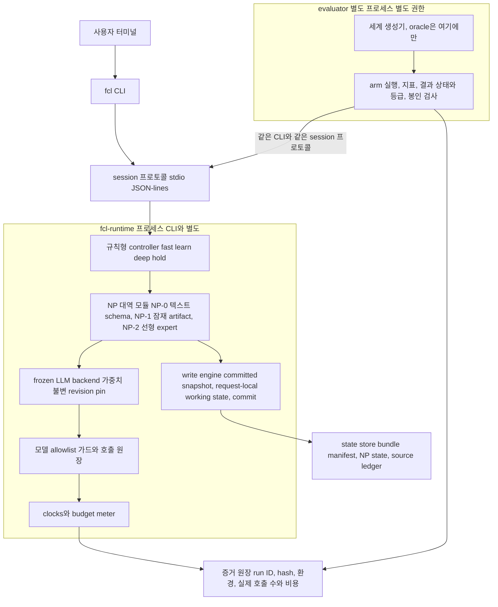

# 18. P0(NP) 비모수 POC: System ONE-NP의 설계와 검증 계획

**상태 라벨:** 이 문서 전체는 **PROPOSAL**이고 모든 실험은 **NOT RUN**이다. 구현, 학습, GPU 실행, 비용 지출은 0회다. 규모와 시간은 **ESTIMATE**(low / base / high)이며 사용자가 승인한 값이 아니다. 사용자가 명시한 것(**USER**)은 §1.1에 원문 그대로 따로 적었다. 미결정은 **OPEN**과 사용자 결정 후보(§14.3. 번호는 docs/09 §10의 D-번호)로 표시한다. 작성일: 2026-11-18.

## 한눈에 보기

**정의.** P0(NP)는 **System ONE-NP**다. gradient 학습 0회로, 고정(frozen) 공개 가중치 LLM과 비모수 schema 기억만으로 전체 flow(입력, 인식, 경로 선택, 계산, 출력, 결과, 쓰기, Sleep, 발견)를 실제 `fcl` CLI에서 끝까지 돈다. 이상형 feature마다 같은 계약을 가진 비모수 대역(stand-in)을 두고, 이후 phase가 대역을 학습 모듈로 하나씩 바꾼다. 사용자 원문 「모델 학습없이 non parameter 기반의 무언가로 POC검증을 먼저 해보자」의 POC다.

- **대역이고 최종형이 아니다.** 외부 frozen LLM을 쓰는 P0는 최종형이 아니며 가중치 수준의 schema 형성, 간섭 해소, 통합 모델의 내부 depth 효율을 주장하지 않는다(§1.3).
- **그러나 완결 제품이다.** mock이나 조사 단계가 아니라 실제 LLM, 실제 저장, 실제 CLI로 끝까지 돌고, 사용자가 host에서 재현한다(UJ0, §2).
- **영구 대조군이다.** P0의 NP arm은 이후 모든 phase의 대조군이다. 학습 모듈은 같은 예산의 NP보다 나을 때만 필요하다고 주장한다(§8).
- **상한.** 결과 등급은 주장 단위로 최대 3이다. 등급 3은 봉인 manifest, fresh locked cohort, 같은 예산의 대조, 구조 family 2종 이상, 사전 명세 seed, 독립 검토를 모두 채운 합성 suite의 주장만 시도한다. ET-1과 ET-3p는 탐색이다(발견·확증 문구 금지).

| 이 문서가 정하는 것 | 위치 | 규모 |
|---|---|---|
| 전체 여정 UJ0, 구조, 저장과 프로세스 경계, CLI 명령(가칭), NP 단 | §2 | UJ0 14단계(UJ1의 ① ~ ⑩을 포함) |
| BF feature와 비모수 대역의 대응, 문헌 근거와 확인 수준 | §3 | BF 32개 |
| 검증 목록 V0와 사전 판정 규칙의 형식 | §4 | V0-1 ~ V0-17 (MD-1118-M의 열두 항목을 모두 덮는다) |
| suite S-A ~ S-D의 설계, 새 평가 family 후보 | §5 | 합성 2종, 재분장, 관찰 |
| ET-3p run 설계, 시스템 쪽 누수 규칙 | §6 | 대상 1개의 실제 실행 1회 |
| 대조군, 예산 일치, base 일치 규칙 | §7, §8 | arm 정의 약 20묶음 |
| 지표와 통계(형식만) | §9 | world 단위 paired bootstrap |
| 실행 행렬(세계 수, arm, checkpoint, probe, 호출, token) | §10 | 16행, low / base / high |
| 실험 환경: frozen LLM 후보, backend, 고정, 실행 위치 규칙 | §11 | host gate, runcrate readout |
| 작업 표, 종료 gate, 절삭 순서 | §12 | P0-T01 ~ T21 |
| Melete 자산 재사용 후보 | §13 | 파일 20개 안팎 |
| 위협, 한계, NP가 못 이길 때의 분기, 사용자 결정 후보 | §14 | D-16 ~ D-23 |

**다른 문서와의 경계.** BF feature의 정의는 [16-ideal-blueprint.md](/home/jimmy/repos/full-continual-learning/docs/16-ideal-blueprint.md), ET의 운영 정의·stream·대상·발견 수준 rubric·단별 상한은 [17-einstein-test.md](/home/jimmy/repos/full-continual-learning/docs/17-einstein-test.md), phase 정의와 로드맵 쪽 종료 gate는 [09-roadmap.md](/home/jimmy/repos/full-continual-learning/docs/09-roadmap.md), 논문 주장과 초록은 [19-paper-plan.md](/home/jimmy/repos/full-continual-learning/docs/19-paper-plan.md), token·GPU-시간·비용은 [15-compute-plan.md](/home/jimmy/repos/full-continual-learning/docs/15-compute-plan.md)가 소유한다. 이 문서는 이름으로 가리키고 값을 복제하지 않는다. 조사 기록은 [2026-11-18-blueprint-et-design.md](/home/jimmy/repos/full-continual-learning/research/2026-11-18-blueprint-et-design.md)다. 읽는 순서는 §2.1(전체 여정), §4(검증 목록), §10(실행 행렬), §12(작업 표)다.

## 1. USER 원문과 범위

**이름 충돌 주의.** 이 문서의 P0(NP)는 2026-11-18에 신설한 phase다. 2026-11-03 계획의 P0(옛(11-03) P0), 옛 로드맵의 「P0 연구 계약」(P1 앞쪽 작업으로 흡수됨), `experiments/phase0`의 「Phase-0」(합성 Bayesian 선형 prediction 실험, ARCHIVE), 2026-11-09 추적 우선순위의 「P0–P2」와 모두 무관하다. 정리는 [09-roadmap.md](/home/jimmy/repos/full-continual-learning/docs/09-roadmap.md) §9에 있다.

### 1.1 USER 원문

**USER (2026-11-18).** 아래는 사용자 요청의 해당 두 줄(요청의 둘째 줄과 넷째 줄)을 줄 단위로 글자 그대로 옮긴 것이다. 요청 전문과 이번 작업의 경계는 [2026-11-18-discussion.md](/home/jimmy/repos/full-continual-learning/sources/sync/2026-11-18-discussion.md)에 있다.

```text
그리고 이걸 달성하기 위한 POC로 검증은 어떤것들 진행할지(모델 학습없이 non parameter 기반의 무언가로 POC검증을 먼저 해보자), 그뒤 단계별 구현(근데 모든 단계는 각 단계가 완전하게 종료되어 독립적으로도 의미를 가지고 돌릴 수 있는 상태여야함)계획과 각 단계별(최초 poc포함)논문을 쓴다면 어떤 주장을 할것이고 논문 제목, 초록을 어떻게 할지 그것도 써서 준비해둬
```

```text
당연히 논문이니까 실험환경이나 객관적 증면, 비교대조, test data어떻게 할지, 학습 data어떻게 할지 계획이 포함되어야 함
```

**PROPOSAL (읽는 방식).** 위 원문을 이 문서는 다음처럼 읽는다. 이 읽기는 사용자 확인 대상이다.

| 원문의 말 | 이 문서의 읽기 |
|---|---|
| 모델 학습 없이 | 가중치 갱신과 gradient 학습이 0회다. frozen 공개 가중치 LLM을 그대로 쓴다 |
| non parameter 기반의 무언가 | 비모수 schema 기억(NP-0 텍스트, NP-1 잠재 artifact). 파라미터가 있는 닫힌 꼴 선형 expert(NP-2)를 「비모수」에 넣을지는 사용자 결정이다(D-16) |
| POC검증을 먼저 | P0(NP)로 둔다. 「P1은 MVP」라는 전역 규칙과의 관계는 아래 1.4 |
| 모든 단계는 완전하게 종료되어 독립적으로도 의미를 가지고 돌릴 수 있는 상태 | 점진적 해상도 규칙(매 phase 종료 = 실제 인터페이스와 실제 의존성으로 끝까지 도는 전체 제품)과 같다. P0도 예외가 아니다 |
| 학습 data어떻게 할지 | P0에서는 「학습 없음」이다. 대신 기억에 넣는 경험 data와 질문을 어떻게 나누는지를 §5에 쓴다 |

### 1.2 지위와 근거 표기

이 문서 전체는 **PROPOSAL**이고 모든 실험은 **NOT RUN**이다. 규모와 시간은 **ESTIMATE**(low / base / high)이며 사용자가 승인한 값이 아니다. 문헌은 **LITERATURE**로 표시하고 확인 수준을 적었으며(§3.1, 부록 B·C) 전문을 읽은 것은 없다. 과거 Melete 기록은 **ARCHIVE**이고 이 저장소에서 새로 실행하지 않았다. 미결정은 **OPEN**과 사용자 결정 후보(§14.3)로 표시한다. 이 작업에서 모델 구현, 학습, GPU 실행, 클라우드 인스턴스 생성, 유료 API, 비용 지출은 0회다.

### 1.3 P0로 증명할 수 있는 것과 없는 것 (MD-1118-D)

| 주장 | P0에서 | 이유와 상한 |
|---|---|---|
| 비모수 schema 형태 기억이 같은 frozen LLM·같은 예산의 사례·검색 기억보다 낫다 | 증명할 수 있다 | V0-1, 2, 9. 합성 world, 모델 1종, 주장 단위 등급 3까지(조건 충족 시) |
| 입력 → 인식 → 경로 선택 → 계산 → 출력 → 결과 → 쓰기 → Sleep → 발견의 전체 flow가 실제 CLI에서 끝까지 돈다 | 증명할 수 있다(Product) | UJ0 종료 gate. 효용 판정이 아니다 |
| 조건별 분해, 생명주기, version, 삭제 계약이 비모수 state에서 성립한다 | 증명할 수 있다 | V0-2 ~ V0-7. 계약 항목은 등급 1, 효용 항목은 2 또는 3 시도 |
| 익숙함 기반 경로 선택이 같은 품질에서 LLM 호출·token을 줄인다 | 시스템 수준에서만 | V0-8. H-COMPUTE의 NP판일 뿐 통합 모델 내부 depth 효율이 아니다 |
| 합성 미시 발견 세계에서 긴장 원장과 재조합이 발견을 늘린다 | 증명할 수 있다(같은 frozen LLM 안의 arm 간 상대 효과) | V0-12. 절대 「발견했다」는 아니다 |
| 잠재 artifact를 무학습으로 저장·재적재·합성할 수 있다 | 증명할 수 있다 | V0-13. hook이 되는 backend 한정 |
| 이후 phase가 쓸 영구 대조군, 평가 harness, 세계 생성기, ET 절차가 선다 | 증명할 수 있다 | UJ0 종료 gate와 V0-15 |
| 가중치 수준의 schema 형성, 간섭 해소, 통합 모델의 내부 depth 효율 | **증명할 수 없다** | 가중치가 바뀌지 않는다. P1 이후 학습 모듈의 몫이다 |
| 통합 모델이 필요하다, 학습 모듈이 NP보다 낫다 | **증명할 수 없다** | 학습 모듈은 같은 예산의 NP보다 나을 때만 필요하다고 주장한다(P1 이후) |
| 자연어 일반, 다른 모델 계열, 실제 consumer | **증명할 수 없다** | P5 |
| 시간캡슐 모델 위에서 발견했다는 절대 주장 | **증명할 수 없다** | ET-3p는 절차 완주 확인뿐이다. ET-3 이후 phase의 몫 |
| 「LLM은 엉킨 schema」라는 사용자 가설(USER-HYPOTHESIS) | **입증하지 못한다** | suite S-D는 관찰이며 등급 2 이하 |

### 1.4 P0는 대역이고 최종형이 아니다, 그리고 완결 제품이다

P0는 사용자가 요청한 POC의 **대역(stand-in)이며 최종형이 아니다.** 외부 frozen LLM을 쓰는 이 시스템은 헌장 U05와 [05-integrated-architecture.md](/home/jimmy/repos/full-continual-learning/docs/05-integrated-architecture.md) §3, [09-roadmap.md](/home/jimmy/repos/full-continual-learning/docs/09-roadmap.md) §1.3이 말하는 「외부 대형 LLM + 작은 판단기」의 최종 제품화가 아니다. 이 구성은 별도 작은 System1 + 외부 LLM 설계로 사용자 정정을 되돌리는 것이 아니다. 사용자의 최종 목표는 하나의 통합 System ONE이고, P0는 그 이후 phase가 학습 모듈로 바꿀 자리를 같은 계약으로 먼저 채우며 영구 대조군이 된다.

동시에 P0는 **mock이나 조사 단계가 아니다.** 학습 0회로 실제 frozen LLM, 실제 디스크 state, 실제 runtime 프로세스 재시작, 실제 CLI에서 전체 여정을 끝까지 도는 완결 제품이며, 종료 때 사용자가 호스트에서 그대로 돌려 볼 수 있다. 「P1은 MVP」라는 사용자 전역 규칙과의 관계는 이렇게 읽는다. 이번 구성에서는 P0(NP)가 뼈대와 전체 여정을 먼저 세우고 P1이 첫 학습 해상도가 된다. 이는 사용자 원문의 순서(POC를 먼저 하고 그 뒤에 단계별로 구현한다)에 맞춘 해석이며 사용자 확인 항목이다([09-roadmap.md](/home/jimmy/repos/full-continual-learning/docs/09-roadmap.md)의 결정표가 소유한다).

## 2. P0 제품 정의: System ONE-NP

**PROPOSAL.** P0(NP)가 끝났을 때 사용자는 터미널에서 실제 `fcl` CLI로 실제 frozen 공개 가중치 LLM과 실제 디스크 state를 써서 아래 전체 여정을 처음부터 끝까지 돌린다. gradient 학습은 0회다. 이름(`fcl`, 명령어, 옵션, 디렉터리)은 가칭이다. 이 절의 구조는 [09-roadmap.md](/home/jimmy/repos/full-continual-learning/docs/09-roadmap.md) §2의 뼈대(프로세스 경계, session 프로토콜, state store, 분리된 evaluator, 증거 원장)를 바꾸지 않고 안쪽만 비모수 대역으로 채운 것이다.

### 2.1 전체 여정 UJ0

UJ0은 UJ1(① ~ ⑩, [09-roadmap.md](/home/jimmy/repos/full-continual-learning/docs/09-roadmap.md) §5 P1)의 상위 집합이다. ① ~ ⑩의 번호와 뜻을 그대로 두고 NP arm으로 모두 실행하며, ⑪ ~ ⑭를 더한다. 뒤 phase는 UJ0을 회귀 gate로 다시 돌린다([09-roadmap.md](/home/jimmy/repos/full-continual-learning/docs/09-roadmap.md) §6의 보충 행은 docs/09가 소유한다).

| 단계 | 사용자가 CLI에서 하는 일 | NP arm에서 실제로 일어나는 일 | UJ1 대응 | 남는 기록과 gate |
|---|---|---|---|---|
| ① 세션 시작 | `fcl session start`로 arm, 기반 LLM, state를 지정한다 | arm 설정 hash, 모델 revision과 가중치 hash, backend 능력(hook 가능 여부), 모델 호출 allowlist, state 버전이 표시된다 | UJ1 ① | 증거 원장 run ID |
| ② 경험 입력 | 작은 관계 구조 세계의 관측 k개(k = 1/3/10)를 자연어로 넣는다 | 정규화, root ID, 인식(정합 판정), 경로 선택, 생명주기 판정(update / branch / create / hold), 쓰기가 입력마다 실제로 실행된다 | UJ1 ② | source ledger, 호출 원장 |
| ③ 상태 변화 관찰 | `fcl diff`와 같은 probe 질문의 전/후 응답을 본다 | record·schema version·vector·kNN 항목 수, 저장 bytes, 시계, 호출 수의 변화가 보인다. 「바뀌었다」는 관찰이지 schema 형성의 증거가 아니다 | UJ1 ③ | diff 보고 |
| ④ 새 개체 질문 | `fcl ask --trace`로 경험에 없던 이름·값·표면, 새 역할 결합을 묻는다 | 응답마다 controller가 고른 경로(fast / learn / deep / hold), 신호값, 선택된 schema, 예산이 trace로 나온다 | UJ1 ④ | 결정 trace |
| ⑤ 반례·정정 | 규칙에 맞지 않는 사례를 `fcl correct`로 준다 | 같은 조건의 정정이면 in-place update(새 version), 조건이 다르면 branch 또는 create가 판정된다 | UJ1 ⑤ | version 계보 |
| ⑥ 최초 과제 재평가 | `fcl reeval --first-task` | 정정 전에 처음 평가한 질의 묶음을 다시 던져 망각과 오염을 잰다 | UJ1 ⑥ | 재평가 보고 |
| ⑦ 이전 조건 재방문 | `fcl revisit`로 조건 A, B, A의 질의를 수정 없이 다시 던진다 | 분해 기억이 덮어쓰지 않고 분기했는지 본다 | UJ1 ⑦ | ABA 보고 |
| ⑧ 저장과 복원 | `fcl save`, runtime 종료, 재시작, `fcl restore`, 같은 질문 | 원자적 commit, runtime 프로세스 실제 종료·재기동, 모델 revision 불일치 거부, 같은 응답(결정적 decoding, 장치 종류별 허용오차) | UJ1 ⑧ | 재시작 전후 프로세스 ID |
| ⑨ source 삭제 | `fcl source retract --root <id>` | source 원장에서 철회하고 남은 source로 NP state를 같은 순서로 재구성한다. 그 source를 근거로 한 record·vector·schema version이 사라졌는지 검사한다(NP state 한정) | UJ1 ⑨ | 삭제 동등 검사 |
| ⑩ arm 바꿔 반복 | `--arm`만 바꿔 `fcl eval` | NP arm(`np0`, `np1`, 선택 `np2`)과 대조군(§7)을 같은 CLI·같은 session 프로토콜·같은 runtime 경로로 돌려 한 보고서에 나란히 놓는다(등급 상한 표기) | UJ1 ⑩ | arm별 보고서 |
| ⑪ Sleep | `fcl sleep` 뒤 같은 질의를 다시 던진다 | Sleep-NP가 오프라인 군집·병합·추상화, 재조합 후보 생성, 저장된 근거에 비춘 자가 검사, 정리를 한다. 경험 후(SE) 대 경험 + Sleep 후(SES)를 비교한다 | 새 단계 | Sleep 전후 diff |
| ⑫ 발견 run (ET-0) | `fcl et init --suite S-B`로 합성 세계와 frozen LLM을 지정하고 `fcl et audit`, `feed`, `probe`, `score`, `curve`, `compare`로 절차를 돈다. `fcl tensions`, `fcl discover`로 긴장 원장과 후보 원리를 본다 | 합성 미시 발견 세계의 stream(P_pre, P_post, W_delta)을 시간순으로 넣고 긴장 원장(미해결 불일치)을 열람하며 checkpoint마다 중립 probe로 발견 수준을 채점한다(합성이라 프로그램 채점). 입력량에 따른 곡선을 대조 stream과 나란히 본다 | 새 단계 | 발견 곡선, 긴장 원장 |
| ⑬ ET-3p run | `fcl et init --timecapsule --model <시간캡슐 모델>`에 이어 같은 `et` 명령들 | 같은 절차를 공개 시간캡슐 모델 위에서 한 번 끝까지 돈다. 시스템 안의 모든 생성·판정·검색이 그 모델만 쓴다(§6). 발견 여부는 주장하지 않는다 | 새 단계 | 호출 원장 allowlist 검사, 누수 감사 요약 |
| ⑭ 보고서 | `fcl report` | 결과 상태와 결과 등급 필드가 필수로 찍히고, 등급에 허용되지 않은 문구는 검사기가 막는다 | UJ1 ⑩의 보고 | 등급 보고서 |

각 단계가 따르는 flow(FL-1 입력 1건 처리, FL-2 불일치와 조절, FL-3 깊이, FL-4 Sleep, FL-5 발견, FL-6 상태)는 [16-ideal-blueprint.md](/home/jimmy/repos/full-continual-learning/docs/16-ideal-blueprint.md)가 소유한다. UJ0의 대응은 ②와 ④가 FL-1, ⑤가 FL-2, ④의 deep 경로가 FL-3, ⑪이 FL-4, ⑫와 ⑬이 FL-5, ⑧과 ⑨가 FL-6이다.

**두 가지를 함께 밝힌다.** (1) P0는 사용자가 요청한 POC의 대역(stand-in)이며 외부 frozen LLM을 쓰므로 최종형이 아니다. 헌장 U05와 [05-integrated-architecture.md](/home/jimmy/repos/full-continual-learning/docs/05-integrated-architecture.md) §3, [09-roadmap.md](/home/jimmy/repos/full-continual-learning/docs/09-roadmap.md) §1.3이 외부 frozen LLM 경로를 최종 제품이 아니라 대조군으로 두므로 이 문장은 그것과 충돌하지 않는다. P0의 NP arm이 하는 일은 이후 phase가 학습 모듈로 바꿀 자리를 같은 계약으로 먼저 채우고, 학습 모듈의 영구 대조군이 되는 것이다. (2) 그러나 P0는 mock이나 조사 단계가 아니다. 위 ① ~ ⑭가 실제 LLM 가중치, 실제 디스크 state, 실제 runtime 프로세스 재시작, 실제 CLI에서 끝까지 돈다. mock·fake는 진단용이며 종료 gate의 증거가 아니다.

### 2.2 구조



- **대역 교체의 자리:** `NP 대역 모듈`과 `규칙형 controller`가 P1 이후 retrofit 모듈과 학습된 controller로 바뀌는 자리다. 나머지(프로세스 경계, session 프로토콜, write engine의 계약, 시계, 예산, evaluator, 증거 원장)는 바꾸지 않는다. 같은 계약(interface)은 [16-ideal-blueprint.md](/home/jimmy/repos/full-continual-learning/docs/16-ideal-blueprint.md)의 BF feature 입출력을 따른다(§3).
- **P0에서 새로 생기는 것:** 모델 allowlist 가드와 모델 호출 원장이다. 호출 1건마다 모델 ID, revision, 호출 종류(ingest / query / judge / sleep / deliberate), token 수, arm, world, checkpoint를 남긴다. 시간캡슐 모드(§6)에서는 allowlist 밖 모델 호출을 거부하고, 호출 원장으로 0건임을 검사한다. 예산 일치 검사(§7)와 누수 감사의 근거도 이 원장이다.

### 2.3 저장과 프로세스 경계

| 경계 | P0에서 실제로 있는 것 | 뒤 phase에서 커지는 것 |
|---|---|---|
| CLI와 runtime | 별도 프로세스, stdio JSON-lines session 프로토콜. 「재시작」은 runtime 프로세스를 실제로 종료·재기동해 검증한다 | P1 이후 같은 프로토콜 위에 retrofit 모듈, P5 외부 consumer |
| frozen LLM backend | 가중치 불변(가중치 hash가 세션 전후 같아야 한다), revision pin, backend 능력 표시(§11.2). backend는 runtime의 하위 모듈이며 allowlist 가드를 거친다 | P1에서 같은 base에 retrofit |
| state store | bundle manifest v0, 원자적 commit(임시 파일에 쓰고 manifest를 마지막에 교체), source ledger(append-only), NP state(아래 표), 결정 trace | P4 외부화(export / import, offload / reload) |
| evaluator | 별도 프로세스·별도 권한. 세계 생성기와 oracle은 여기에만 있고 runtime은 읽지 못한다. 같은 CLI와 session 프로토콜로 arm을 호출한다 | 확증 반복, 후보 계보 |
| 증거 원장 | run ID, config·code·data hash, 환경(backend 버전, 장치), 모델 호출 수와 token, 실제 비용(실패·취소 포함) | 후보 계보 |

NP state의 저장 단위(가칭)는 아래와 같다. 항목의 정의와 manifest 서식은 [07-state-and-storage.md](/home/jimmy/repos/full-continual-learning/docs/07-state-and-storage.md) §5가 소유하고, 여기서는 P0가 그 부분집합에 더하는 필드만 적는다.

| 저장 단위 | 내용 | 생성물 표시 | 재구축 가능 |
|---|---|---|---|
| source ledger | 입력 원문 항목: root ID(내용 hash), 종류 태그, 시각, 출처, 철회 표시 | 관측(observed)만 | 아니오(원본) |
| 사례 record(NP-0) | 구조화한 사례와 검색 key | 관측에서 만든 파생(derived) | 예 |
| schema record(NP-0) | 조건, 관계, 예외, 증거 root 목록, version, 부모 version. 추상화 문장은 frozen LLM이 쓴 것이다 | 생성물(generated). 독립 근거가 아니다 | 재생성은 가능하나 비결정적일 수 있다 |
| vector artifact(NP-1) | 추출 조건(층, 방법, demo 묶음 hash)과 vector, version | 파생 | 예(같은 입력으로 재추출) |
| kNN 저장소(NP-1) | hidden-state key와 value(결과 label 또는 record 포인터) | 파생 | 예 |
| expert 상태(NP-2, 선택) | 고정 특징 위 선형 읽기의 계수와 갱신 통계 | 파생 | 예 |
| 긴장 원장 | 미해결 불일치 항목: 관련 root, 관련 schema, 상태(open / closed), 등록·해소 시계 | 등록 사실은 파생, 설명 문장은 생성물 | 부분 |
| 검색 색인 | key 종류별 색인(`lexical` / `hidden` / `embed`) | 파생 | 예 |
| 결정 trace | 경로, 신호값, 선택된 schema와 판정, 예산 | 파생 | 아니오(기록) |

### 2.4 CLI 명령 목록 (가칭)

| 명령 | 하는 일 | 단계 | 비고 |
|---|---|---|---|
| `fcl session start` · `resume` · `stop` | 세션을 열고 닫는다. arm, 기반 LLM, state를 지정한다 | ① | 모델 revision 불일치면 복원을 거부한다 |
| `fcl experience add` | 경험 항목을 입력한다. `--kind`로 READ / OBSERVE / NOTE / QUESTION / DISCUSS / TRY를 붙인다 | ② ⑫ ⑬ | 항목 종류의 이름과 의미는 [17-einstein-test.md](/home/jimmy/repos/full-continual-learning/docs/17-einstein-test.md)의 stream 항목을 따른다 |
| `fcl diff` | 상태 변화와 probe 응답 전/후를 보인다 | ③ | |
| `fcl ask` | 질문한다. `--trace`로 경로와 신호값을 본다 | ④ | |
| `fcl correct` | 반례·정정을 입력한다 | ⑤ | |
| `fcl reeval` · `fcl revisit` | 최초 과제 재평가, 이전 조건 재방문 | ⑥ ⑦ | |
| `fcl save` · `fcl restore` | state를 저장하고 복원한다. 사이에 runtime을 실제로 종료·재기동한다 | ⑧ | |
| `fcl source retract` · `replace` | source 철회(삭제)와 수정(삭제 + 같은 위치 재삽입) | ⑨ | 기능적 망각(Delete/Retain)과 다른 개념이다 |
| `fcl eval` | suite와 arm을 지정해 배치 평가를 돌리고 보고서를 낸다 | ⑩ | `--suite S-A` ~ `S-D`, `--worlds dev` 또는 `sealed`. sealed는 봉인 manifest hash가 맞을 때만 실행한다 |
| `fcl sleep` | Sleep-NP를 실행한다 | ⑪ | P4에서 같은 명령이 학습 Sleep으로 바뀐다(대역 교체) |
| `fcl tensions` | 긴장 원장을 열람한다 | ⑫ | |
| `fcl discover` | 후보 원리, 귀결 검사 결과, 발견 보고를 낸다 | ⑫ ⑬ | 생성물 표시가 붙는다 |
| `fcl et init` · `audit` · `feed` · `probe` · `score` · `curve` · `compare` | ET 절차: 기반 모델과 대상(시간캡슐 모드는 `--timecapsule`) 지정, 감사, stream 시간순 투입, checkpoint probe, 채점, 발견 곡선, arm·stream 반복 | ⑫ ⑬ | 명령의 이름과 뜻, stream 서식, probe 규칙은 docs/17이 소유한다. `et audit`는 이 문서의 allowlist 검사와 호출 원장 검사를 포함한다 |
| `fcl artifact list` · `show` · `versions` · `rollback` · `export` · `import` | schema·vector의 version 계보를 보고 되돌린다. export / import는 bundle을 다룬다 | ⑤ ⑧ | export / import의 확장은 P4 |
| `fcl intervene` | wrong-schema swap, lesion, oracle schema 주입 같은 인과 개입을 건다 | ⑩ | 평가 전용 권한. learner에는 노출되지 않는다 |
| `fcl models check` | 모델 revision, 가중치 hash, backend 능력, allowlist를 점검한다 | ① | |
| `fcl ledger show` | 증거 원장과 모델 호출 원장을 보인다 | 전체 | |
| `fcl report` | 결과 상태와 등급이 찍힌 보고서를 낸다 | ⑭ | 금지 문구 검사기 포함 |

### 2.5 NP 단 정의

「NP 단」은 NP-0 / NP-1 / NP-2를 가리킨다(「입력 tier」, 「자원 tier」와 다르다). 세 단 모두 같은 session 프로토콜과 같은 생명주기·controller·Sleep 계약 위에서 돈다.

| NP 단 | 위상 | 저장하는 것 | 읽기와 쓰기 | 가중치 | 대표 위험 |
|---|---|---|---|---|---|
| NP-0 텍스트 artifact schema | 필수 | 구조화 기록과 검색 key. 추상화·정합 판정은 frozen LLM이 한다 | 검색 key로 후보 schema를 찾고, 선택한 schema를 prompt에 넣는다. 쓰기는 record 갱신(version 증가) | 불변 | 작은 base에서 언어 능력이 부족하면 성립하지 않는다(§8). 추상화가 환각이면 생성물이 오염원이 된다 |
| NP-1 잠재 artifact schema | 필수 arm | frozen LLM activation에서 뽑은 function / task vector와 hidden-state kNN key–value | 조건 key로 vector를 고르고 지정한 층에 주입한다. kNN 결합으로 사례를 읽는다. 쓰기는 vector 재추출·병합과 kNN 삽입 | 불변 | hook이 가능한 backend가 필요하다. 주입 효과가 모델·층·scale에 민감할 수 있다 |
| NP-2 닫힌 꼴 선형 expert | 선택 arm(D-16) | 고정 특징 위의 선형 읽기(Delta / RLS / ridge)의 계수 | 조건별 expert를 고르고 읽는다. 쓰기는 닫힌 꼴 갱신 | 불변. backprop은 없으나 파라미터가 있다 | 「비모수」에 넣을지는 사용자 결정이다. 특징이 고정이라 표현 능력이 한계 |

**NP-0 / NP-1 / NP-2는 생명주기와 controller가 같다.** read / update / branch / create / hold / evict는 CRP(Chinese restaurant process)식 사전과 정합도 우도로 판정한다. 조건(잠재 원인)이 다르면 덮어쓰지 않고 분기한다. controller는 규칙형이며 P1 controller v0의 fast / learn / deep에 hold를 더한 것이다. 정합도 우도의 계산은 NP 단마다 다르다(NP-0은 frozen LLM이 후보 schema 아래에서 관측에 주는 로그우도, NP-1은 주입 뒤 로그우도 변화와 kNN 거리, NP-2는 예측 잔차). 임계값은 dev pilot에서 정해 봉인한다(§9).

## 3. BF feature와 비모수 대역의 대응

**PROPOSAL.** BF feature의 정의, 입출력, 이상형 메커니즘은 [16-ideal-blueprint.md](/home/jimmy/repos/full-continual-learning/docs/16-ideal-blueprint.md)가 소유한다. 이 표는 feature ID와 이름만 그대로 쓰고(조사 기록의 뼈대 31개와 docs/16이 더한 BF-D4), P0의 NP 단(NP-0 / NP-1 / NP-2)이 그 자리를 어떻게 채우는지를 적는다. 모든 feature에 대역이 있고(「모든 phase에 모든 feature가 있다」), 형태가 NP 대역이거나 이후 학습 모듈일 뿐이다. 대역의 성격은 세 가지로 구분한다. **규칙형**은 학습도 LLM 호출도 필요 없는 결정 규칙이다(예: admission, controller). **생성형**은 frozen LLM이 만든 생성물을 쓴다. 이 생성물은 관측 증거와 섞지 않는다(BF-A3). **잠재형**은 frozen LLM의 activation을 읽고 쓴다. 규칙형이 NP-0 / NP-1 / NP-2에 공통인 곳은 「공통」이라고 적었다.

| BF | feature | 성격 | NP-0 텍스트 schema | NP-1 잠재 artifact | NP-2 닫힌 꼴 (선택) | 근거와 확인 수준 |
|---|---|---|---|---|---|---|
| BF-A1 | 입력 정규화와 source 경계 | 규칙형 | 입력을 항목(종류 태그, 시각, 출처, 입력 tier)으로 정규화하고 내용 hash를 root ID로 쓴다. 같은 입력 재전송은 같은 root | 공통 | 공통 | [07-state-and-storage.md](/home/jimmy/repos/full-continual-learning/docs/07-state-and-storage.md) §1·§2. Melete journal.py(§13, ARCHIVE) |
| BF-A2 | 관심·수준 상태와 admission(흘려듣기) | 규칙형 | 관심 상태(주제 key 집합)와 수준 상태(회수 적합도)에 두 임계 규칙을 적용해 write / 보류 / 거름을 정한다 | 수준 = hidden-state 거리(kNN 거리) | 수준 = 예측 잔차 | M-B04-03(재구성). 풀이는 PROPOSAL이며 사용자 확인 대기. Melete admission.py(ARCHIVE) |
| BF-A3 | 관측과 생성물의 분리 | 규칙형 | 모든 항목에 origin(observed / generated / derived)을 붙인다. generated는 독립 근거로 세지 않는다. NP-0 추상화와 Sleep 재조합 후보는 generated다 | vector·kNN은 observed에서 만든 derived. vector 주입 아래의 LLM 생성은 generated | 공통 | [07-state-and-storage.md](/home/jimmy/repos/full-continual-learning/docs/07-state-and-storage.md) §2, F20·F21([08-evaluation.md](/home/jimmy/repos/full-continual-learning/docs/08-evaluation.md) §2-2), V0-17 |
| BF-B1 | fast 결합 기억 | 잠재형·규칙형 | 사례 record와 검색 key(`lexical` / `hidden` / `embed`)로 검색 | hidden-state key–value kNN 저장소와 그 결합 | 고정 특징 위 Delta·RLS 연상 | kNN-LM(S70)과 Memorizing Transformers(S71): 초록 수준. Melete fast_state.py(ARCHIVE) |
| BF-B2 | slow schema | 생성형(NP-0), 잠재형(NP-1) | schema record(조건, 관계, 예외, 증거 root, version). 추상화 문장은 frozen LLM의 생성물 | function / task vector artifact | 조건별 선형 expert | S26 Function Vectors(catalog, 초록 수준 재확인), S69, S112, S113 |
| BF-B3 | 조건(잠재 원인)별 분해와 context gating | 규칙형 | 조건 key 검색과 정합도 우도로 schema를 고른다(`sel-*` 대조와 비교) | 조건 key는 문맥의 hidden state. 고른 vector를 주입 | 조건별 expert를 정합 우도로 선택(혼합) | N07·S04(catalog, discussion-import), S24(catalog, official-search-checked). Melete patterns(ARCHIVE) |
| BF-B4 | 생명주기 CRUD | 규칙형 | CRP식 사전과 정합도 우도로 read / update / branch / create / hold / evict를 판정하고 보존 예산 아래 evict한다 | 같은 판정. 정합도는 주입 뒤 로그우도 변화와 kNN 거리 | 같은 판정. 정합도는 예측 잔차 | S160(초록 수준. CRP 본문은 읽지 않음), N07·S04. [14-schema-lifecycle-crud-and-joint-paper.md](/home/jimmy/repos/full-continual-learning/docs/14-schema-lifecycle-crud-and-joint-paper.md) §3·§4. 「못 찾으면 create」의 해석은 N-4 결정 대기 |
| BF-B5 | version과 계보 | 규칙형 | 변경은 새 version(부모 pointer, 증거 증분, diff 요약). 되돌리기 지원 | vector에 추출 조건(층, 방법, demo 묶음 hash)을 기록 | 계수 snapshot | [07-state-and-storage.md](/home/jimmy/repos/full-continual-learning/docs/07-state-and-storage.md) §6, [13-schema-decomposition-and-interference.md](/home/jimmy/repos/full-continual-learning/docs/13-schema-decomposition-and-interference.md) §3 |
| BF-C1 | 익숙함·불일치·모호함 신호 | 규칙형 | 검색 점수, 정합 로그우도, 후보 간 margin | kNN 거리, 주입 전후 로그우도 변화 | 예측 잔차 | Melete turns.py(ARCHIVE). [05-integrated-architecture.md](/home/jimmy/repos/full-continual-learning/docs/05-integrated-architecture.md) §4 |
| BF-C2 | 경로 선택 controller | 규칙형 | 신호의 두 임계 규칙으로 fast / learn / deep / hold를 고른다. 임계는 dev에서 정해 봉인 | 공통 | 공통 | [09-roadmap.md](/home/jimmy/repos/full-continual-learning/docs/09-roadmap.md) §2의 controller v0. hold를 P1에도 넣을지는 D-21 |
| BF-C3 | 계산·쓰기 예산과 halting | 규칙형 | 호출 수, token, 저장 bytes 상한(budget meter), 숙의 반복 상한, 신호가 안정되면 중단 | 공통 | 공통 | P1-T03의 budget 단위를 NP 단위로 옮긴다 |
| BF-D1 | schema 조건부 해석 | 생성형·잠재형 | 고른 schema 문장을 prompt에 넣어 답한다 | 고른 vector를 지정 층에 주입하고 kNN 결합으로 답한다 | expert 읽기를 후보 답의 점수 보정에 쓴다(설계안) | Melete frame(ARCHIVE) |
| BF-D2 | 반복 계산과 깊이 | 규칙형 | NP에서는 숙의 반복 수, 생성 token, 호출 수로 깊이를 잰다. 구조적 recursion은 P2부터다 | 공통 | 공통 | [09-roadmap.md](/home/jimmy/repos/full-continual-learning/docs/09-roadmap.md) §5 P2 |
| BF-D3 | 사고 중 재선택 | 규칙형·생성형 | deep 경로에서 정합 우도를 다시 계산해 schema를 다시 고른다(첫 선택 고정 대조와 비교, F15) | 공통 | 공통 | [08-evaluation.md](/home/jimmy/repos/full-continual-learning/docs/08-evaluation.md) §2-1 F15 |
| BF-D4 | 응답 형성과 불확실성 표현 | 생성형·규칙형 | frozen LLM이 응답을 만들고, hold 경로에서는 규칙형 응답(보류, 추가 관측 요청, 복수 가능성 제시)을 낸다. 응답에 생성물 표지를 붙인다 | 공통 | 공통 | [08-evaluation.md](/home/jimmy/repos/full-continual-learning/docs/08-evaluation.md) F09·F19. BF-D4는 docs/16이 뼈대 31개에 더한 feature다 |
| BF-E1 | online rapid learning(in-place update) | 생성형·잠재형 | record 갱신(증거 추가, 예외 추가, 조건 정제)으로 version 증가 | vector 재추출·병합, kNN 삽입 | Delta·RLS 한 걸음 | Melete conditional.py(ARCHIVE) |
| BF-E2 | accommodation(분기·create) | 규칙형 | branch / create 판정 | 공통 | 새 expert 할당 | [14-schema-lifecycle-crud-and-joint-paper.md](/home/jimmy/repos/full-continual-learning/docs/14-schema-lifecycle-crud-and-joint-paper.md) §3. N-4 |
| BF-E3 | Sleep 통합 | 생성형 | Sleep-NP: 군집·병합·추상화, 재조합 후보 생성, 저장된 근거에 비춘 자가 검사, 정리 | vector 군집·병합, kNN 정리 | 가중 ridge의 느린 보정 | [05-integrated-architecture.md](/home/jimmy/repos/full-continual-learning/docs/05-integrated-architecture.md) Sleep, A03(catalog). Melete rehearsal.py(ARCHIVE) |
| BF-E4 | 여러 시계와 리듬 | 규칙형 | 시계 분리 기록(경험, token, 호출, wall). Sleep 시점은 호출·경험 수 임계 또는 `fcl sleep`. 리듬 조율은 없다 | 공통 | 공통 | [07-state-and-storage.md](/home/jimmy/repos/full-continual-learning/docs/07-state-and-storage.md) §1, [04-rhythms-and-orchestration.md](/home/jimmy/repos/full-continual-learning/docs/04-rhythms-and-orchestration.md) |
| BF-F1 | 긴장 원장(미해결 불일치 보존) | 규칙형·생성형 | 정합 우도가 낮은 입력과 schema의 충돌을 항목으로 등록하고 반복과 해소를 추적한다. 설명 문장은 LLM 생성물 | 잔차·거리가 큰 항목을 등록 | 잔차로 등록 | [11-research-agenda.md](/home/jimmy/repos/full-continual-learning/docs/11-research-agenda.md) §4. 새 family F25 |
| BF-F2 | 유추·재조합 | 생성형 | Sleep-NP에서 schema 쌍의 재조합 후보를 frozen LLM이 생성한다 | vector 합성 후보(V0-13) | 없음 | M-B04-02(재구성). 합성의 문헌 근거는 확인하지 못했다(S26은 합성 여부를 이 작업에서 읽지 않음) |
| BF-F3 | 후보 원리 생성과 귀결 검사 | 생성형 | 후보 원리를 생성하고 귀결을 도출해 저장된 관측과 대조(자가 검사)하며 반증되면 폐기한다 | 약함(예측 중심) | 없음 | [11-research-agenda.md](/home/jimmy/repos/full-continual-learning/docs/11-research-agenda.md) §4. F30 |
| BF-F4 | 통찰 사건과 재구조화 | 규칙형 판정 | 후보 채택, 관련 schema의 병합·분기, 새 사례 전이 개선이 함께 있을 때만 통찰 사건으로 센다. 암기, self-consistency, confidence 증가는 증거가 아니다 | 공통 | 없음 | [11-research-agenda.md](/home/jimmy/repos/full-continual-learning/docs/11-research-agenda.md) §4, F16 |
| BF-F5 | 발견 보고와 근거 연결 | 생성형 | 보고서에 원리 진술, 근거 root, 생성물 표시, rubric 연결을 넣는다 | 공통 | 없음 | rubric은 [17-einstein-test.md](/home/jimmy/repos/full-continual-learning/docs/17-einstein-test.md) |
| BF-G1 | 상태 계약(commit·snapshot·복원) | 규칙형 | 원자적 commit, snapshot, 복원, 모델 revision mismatch 거부 | 공통 | 공통 | [07-state-and-storage.md](/home/jimmy/repos/full-continual-learning/docs/07-state-and-storage.md) §5. P1-T10 |
| BF-G2 | offload/reload(bundle) | 규칙형 | NP state bundle의 디스크 저장과 복원. export / import의 확장은 P4 | 공통 | 공통 | [07-state-and-storage.md](/home/jimmy/repos/full-continual-learning/docs/07-state-and-storage.md) §5 |
| BF-G3 | source 수정·삭제 전파 | 규칙형 | 철회하고 남은 source를 재생해 재구성한다 | 공통 | 공통 | P1-T13, V0-7. Melete durability.py(ARCHIVE) |
| BF-G4 | 보존 예산과 eviction | 규칙형 | 저장 예산(record 수, bytes) 아래 기능 손실 추정(대표 사례 재검사에서의 정합도 하락)으로 evict 순위를 정한다 | vector·kNN 항목 단위 | expert 단위 | [14-schema-lifecycle-crud-and-joint-paper.md](/home/jimmy/repos/full-continual-learning/docs/14-schema-lifecycle-crud-and-joint-paper.md) §4. F22는 N-5 결정 대기 |
| BF-H1 | CLI·session 프로토콜 | 규칙형 | §2 | 공통 | 공통 | [09-roadmap.md](/home/jimmy/repos/full-continual-learning/docs/09-roadmap.md) §2 |
| BF-H2 | trace·증거 원장 | 규칙형 | 결정 trace와 모델 호출 원장 | 공통 | 공통 | [09-roadmap.md](/home/jimmy/repos/full-continual-learning/docs/09-roadmap.md) §2 |
| BF-H3 | 평가 harness와 인과 개입 | 규칙형 | 별도 프로세스 evaluator, wrong-schema swap, lesion, oracle schema | `vec-swap`, `vec-random` | expert swap | [08-evaluation.md](/home/jimmy/repos/full-continual-learning/docs/08-evaluation.md) §5. P1-T11 |
| BF-H4 | 외부 consumer 접점 | 없음 | P0는 약속하지 않는다. 같은 session 프로토콜만 둔다 | 없음 | 없음 | [09-roadmap.md](/home/jimmy/repos/full-continual-learning/docs/09-roadmap.md) §5 P5 |

### 3.1 문헌 근거와 확인 수준

NP-1의 근거는 활성값 수준의 개입과 hidden-state 검색 기억에 관한 문헌이다. 확인 수준은 이 작업에서 실제로 읽은 범위를 따른다. 전문을 읽은 것은 없다. 「task vector」는 두 가지로 쓰이므로 구분한다. 여기서 쓰는 것은 활성값 공간의 vector이고, 가중치 공간의 차이 vector를 가리키는 같은 이름의 용법과 다르다(후자의 문헌은 이 작업에서 확인하지 않았다).

| ID | 방법 | 이 작업에서 확인한 것 | 확인 수준 | 이 문서의 쓰임 |
|---|---|---|---|---|
| S26 (catalog) | Function Vectors in Large Language Models | 초록: in-context learning 과제의 인과 매개 분석에서 소수의 attention head가 과제의 압축 표현(function vector)을 나르고, 중간 층에서 강한 인과 효과를 보고. 주입 방식은 초록에 없음 | catalog는 discussion-import. 이 작업은 초록 확인(metadata-checked 수준) | NP-1 vector artifact의 근거 후보 |
| S69 | In-Context Learning Creates Task Vectors | 초록: in-context learning이 학습 set을 하나의 task vector로 압축하고 그 vector가 transformer를 조절해 출력을 만든다는 주장. 활성값 공간이라는 서술은 초록에 없음 | metadata-checked (초록만) | NP-1 추출 방식 후보 |
| S112 | In-context Vectors: Latent Space Steering | 초록: demo에 대한 forward 한 번의 latent 표현으로 vector를 만들고 prompt에 demo를 넣는 대신 latent 상태를 그 vector로 이동. 크기로 효과 조절 | metadata-checked (초록만) | NP-1 주입 방식 후보와 `ctx` 대조의 근거 |
| S113 | Steering Language Models With Activation Engineering | 초록: prompt 쌍의 중간 활성값 차이로 steering vector를 만들고 추론 중 forward에 더한다. 기계 최적화가 필요 없다고 서술 | metadata-checked (초록만) | NP-1 추출·주입의 무학습 선례 |
| S70 | Generalization through Memorization: Nearest Neighbor Language Models | 초록: LM의 embedding 공간에서 찾은 이웃과 LM 예측을 선형 보간. 추가 학습이 필요 없다고 서술 | metadata-checked (초록만) | NP-1 hidden-state kNN 결합의 근거 |
| S71 | Memorizing Transformers | 초록: 과거 (key, value) 쌍의 미분 불가능한 기억에 근사 kNN 조회를 하는 확장. 기억 쓰기 방식은 초록에 없음 | metadata-checked (초록만) | kNN 기억의 인접 선례. 이 논문의 모델은 학습된 구조이므로 P0의 frozen 사용과는 다르다 |
| S160 | A Tutorial on Bayesian Nonparametric Models | 초록: 모델 복잡도를 데이터가 정하게 하는 베이즈 비모수 방법의 개관. CRP와 Dirichlet process는 초록에 언급되지 않음 | metadata-checked (초록만) | CRP식 사전의 일반 참고. CRP 자체의 1차 출처는 확인하지 못했다(미확인) |
| N07, S04 (catalog) | latent-cause inference 계열 | catalog 기록만 읽었다 | discussion-import | 조건(잠재 원인)별 분해와 판정의 인접 근거 |
| S24 (catalog) | Task Schema and Binding | catalog 기록만 읽었다 | official-search-checked | 과제 schema와 binding의 인접 근거 |

**정직한 상한.** 위 문헌은 NP-1이 쓰는 개입 방식이 학습 없이도 가능하다는 인접 근거이지, 이 저장소의 과제에서 NP-1이 성립한다는 증거가 아니다. 성립 여부는 P0-T05와 V0-13이 NOT RUN인 채로 남는 질문이다. NP-0의 추상화·정합 판정을 frozen LLM에 맡기는 근거는 선행 연구 조사([19-paper-plan.md](/home/jimmy/repos/full-continual-learning/docs/19-paper-plan.md)와 조사 기록)가 정리한다. 이 문서는 확인하지 못한 방법 이름을 쓰지 않는다.

## 4. 검증 목록 V0

**PROPOSAL.** P0의 효용 질문을 V0-1 ~ V0-17로 나눈다. 모든 항목은 NOT RUN이다. 평가 family는 [08-evaluation.md](/home/jimmy/repos/full-continual-learning/docs/08-evaluation.md)의 F01 ~ F24를 먼저 재사용하고, 재사용으로 재지 못하는 것만 새 family 후보로 둔다(F25·F30·F31, §5.5). F22 ~ F24와 새 arm·실험 B의 채택은 사용자 결정 대기(N-5)이므로, 이 family에 기대는 하위 지표는 승인 전까지 보조 지표(탐색)로만 보고한다. 결과 등급과 상한은 [09-roadmap.md](/home/jimmy/repos/full-continual-learning/docs/09-roadmap.md) §3과 MD-1118-P를 따른다.

### 4.1 V0 정의표

| ID | 검증하는 것 | 가설 (PROPOSAL) | suite | MD-1118-M 항목 | 등급 상한 |
|---|---|---|---|---|---|
| V0-1 | schema 형태 기억 대 사례·검색 기억 | 같은 관측 수에서 NP arm은 구조는 같고 표면이 다른 새 사례로 더 잘 전이하고(F01), 표면은 같고 구조가 다른 lure에 덜 속는다(F02) | suite S-A (2×2) | 1 | 3 시도 |
| V0-2 | 분해 기억 대 단일 기억: 간섭·망각 | 충돌하는 조건 B를 겪은 뒤에도 조건별로 분해된 기억은 조건 A의 판단을 평면 기억보다 덜 잃고 A 재방문 때 재학습 없이 복귀한다(F05·F06) | suite S-A | 2 | 3 시도 |
| V0-3 | context gating(Read)과 wrong-schema swap | 맞는 schema를 고르는 gating이 무작위·key만 쓰는 선택보다 정확하고, 잘못된 schema를 끼우면 정확도가 인과적으로 떨어진다 | suite S-A | 3 | 3 시도 (선택 오류 지표는 F23 승인 전 보조) |
| V0-4 | 생명주기 판정: update 대 create | 구조가 맞으면 update, 조건이 다르면 branch나 create, 설명 불가·모호하면 hold로 판정하는 규칙이 create 없음·항상 create·무작위 create보다 새 학습과 기존 보존을 함께 낫게 한다 | suite S-A | 4 | 3 시도. 「못 찾으면 create」의 두 해석을 비교하되 기본 해석은 확정하지 않는다(N-4) |
| V0-5 | version 계보와 되돌리기 | 모든 schema 변경이 version으로 남고 되돌리면 그 version의 응답을 허용오차 안에서 재현하며 이후 version이 새지 않는다 | suite S-A (계약 시험) | 4 | 1 (계약 통과) |
| V0-6 | 보존 예산 아래 eviction | 같은 저장 예산에서 기능 손실 추정 기반 eviction이 최근성·빈도·무작위 정책보다 재방문 정확도와 savings를 더 잘 지킨다 | suite S-A | 4 | 2 (F22는 N-5 결정 대기. 승인 뒤 3 시도) |
| V0-7 | source 삭제 계약 | 삭제 뒤 NP state가 그 source 없이 같은 순서로 재생한 state와 허용오차 안에서 같다 | suite S-A (Product) | 4 | 1 (계약 통과. NP state 한정) |
| V0-8 | 익숙함 기반 경로 선택 (H-COMPUTE의 NP판) | 경험 뒤(SE) controller가 익숙한 질문을 fast로 처리해 같은 품질에서 호출·token이 항상 deep이나 controller 없음보다 적다. 쉬운 사례만 조기 종료한 평균과 구분한다 | suite S-A | 5 | 3 시도 (난이도 층화 필수) |
| V0-9 | 적은 사례의 성급한 일반화와 수정 (H-SAMPLE의 NP판) | 관측 0/1/3/10에서 NP arm이 기억 없음·평면 기억보다 적은 관측으로 같은 정확도에 이르고(F03), 처음 1 ~ 3개 관측이 유도한 잘못된 단순 규칙을 반례 뒤 더 빨리 해소하며 원래 조건은 보존한다(F18) | suite S-A | 6 | 3 시도 |
| V0-10 | 관심·수준 admission (흘려듣기) | 관심·수준 상태에 따른 admission이 무관·반복 입력을 거르거나 보류해 항상 쓰기보다 같은 저장 예산에서 정확도 저하와 저장 증가를 줄인다 | suite S-A (F19) | 7 | 2 (흘려듣기 풀이가 사용자 확인 대기) |
| V0-11 | Sleep-NP 오프라인 통합 | 같은 경험에 Sleep-NP를 한 상태(SES)는 경험만 한 상태(SE)보다 이후 새 개체 성능이 같거나 높고 저장 크기와 질의당 호출이 줄며, 같은 호출 예산의 replay-only보다 낫다 | suite S-A (다세션) | 8 | 3 시도. 가중치 수준 공고화가 아니다 |
| V0-12 | 발견 (ET-0): 긴장 원장과 재조합 | 아래 H-DISCOVER 문장의 합성 세계(ET-0) 시험판. 긴장 원장과 재조합이 대조군보다 원리 발견을 늘리고 입력량에 대해 용량–반응을 보인다 | suite S-B | 9 | 3 시도 (같은 frozen LLM 안의 arm 간 상대 효과만 주장) |
| V0-13 | 잠재 artifact (NP-1): vector 저장·재적재·합성 | function / task vector를 schema로 저장하고, 재시작 뒤 재적재해도 효과가 보존되며, 새 개체로 전이하고, 두 vector를 합성해 합성 과제를 풀 수 있다. 제거·교체하면 효과가 선택적으로 사라진다 | suite S-A + suite S-D의 과제 일부 | 10 | 3 시도 (hook 가능 backend, 구조 family 2종) |
| V0-14 | (선택) frozen LLM 내부 schema 중첩 관찰 | Base와 같은 계열 post-training 변형은 task vector의 분리도, 교차 주입 간섭, 부분공간 겹침이 다르다 | suite S-D | 11 | 2 (관찰. 인과·가중치 수준 주장 없음) |
| V0-15 | ET-3p: 절차가 끝까지 도는가 | 가설이 아니라 절차 시험이다. 시간캡슐 모델 위에서 NP 시스템이 stream 투입, checkpoint probe, 곡선 보고, 누수 감사를 실제로 끝까지 수행한다 | ET-3p run | 12 | 탐색. 결과 주장 없음 (발견·확증 문구 금지) |
| V0-16 | P1 base급(135M급)에서 NP-1이 성립하는가 | 135M급 HF 모델에서 NP-1(추출·주입·kNN)이 round-trip을 통과하고 기억 없음보다 정확하다. NP-0은 이 크기에서 성립하지 않을 수 있고 그 사실을 보고한다 | suite S-A 소규모 | MD-1118-O | 2 |
| V0-17 | 생성물과 관측의 분리 (F20·F21의 NP판) | 생성물(추상화, 재조합 후보)은 관측으로 승격되지 않고 독립 근거로 세어지지 않으며, 틀린 추상화를 반복 조회하거나 모델 자신의 해석을 반복해도 고착·drift 없이 독립 반례 뒤 회복한다 | suite S-A + suite S-B | MD-1118-C | 계약 부분 1, 효용 부분 2 |

**H-DISCOVER (PROPOSAL):** 「T0까지의 세계 지식을 가진 기반 위에서, 한 인물의 경험 stream을 schema로 쌓고 미해결 불일치를 보존했다가 재조합·재구조화하는 시스템은, 같은 기반에 같은 자료를 기억 없이 또는 평면 기억으로 준 경우보다 (i) 더 적은 입력에서 (ii) 더 높은 발견 수준에 이르고, (iii) 그 차이는 stream의 내용에 특이적이다(대조 stream에서는 나오지 않는다).」 이 문장은 헌장 [01-intent-and-charter.md](/home/jimmy/repos/full-continual-learning/docs/01-intent-and-charter.md) §4의 두 중심 명제(H-SAMPLE, H-COMPUTE)에 없는 세 번째 명제이므로 헌장 개정이 아니라 PROPOSAL·OPEN으로 표기한다. V0-12는 이 문장의 ET-0(합성 세계) 시험판이고, 인물 stream 위의 시험은 ET-3p(탐색)와 이후 phase의 ET-3·ET-4가 맡는다. 인물과 stream, 발견 수준 척도(L0 ~ L5)의 대상별 rubric, 발견 곡선 지표는 [17-einstein-test.md](/home/jimmy/repos/full-continual-learning/docs/17-einstein-test.md)가 소유한다.

### 4.2 V0 측정표

대조 arm의 이름과 정의는 §7, suite 설계는 §5, 지표의 통계 처리는 §9를 따른다. 「형식」은 §4.3의 사전 판정 규칙 형식이다. 모든 임계값, 최소 효과, seed 수는 대괄호 자리표시자이며 dev pilot의 분산으로 봉인 전에 정하고 사용자가 승인한다(§9.3).

| ID | 대상 arm 대 대조 arm | 주 지표 | 보호·보조 지표 | 형식 |
|---|---|---|---|---|
| V0-1 | `np0`, `np1` 대 `rag`, `flat`, `ctx`, `ctx-deep`, `base` | 새 표면·같은 구조 질의의 정확도(F01), 표면 같고 구조 다른 lure에서의 negative transfer(F02) | both-correct condition pairs, 관측 수별 곡선, 질의 식별 가능 비율 | A + B |
| V0-2 | `np0`, `np1` 대 `flat`, `flat-judge`, `always`, `rag`, `ctx` | 조건 B 경험 전후 조건 A 질의 정확도 변화, A 재방문(ABA) 정확도 | 조건 B의 새 학습 정확도(쌍으로 보고), 최초 과제 재평가, savings(재학습 관측 수) | A + B |
| V0-3 | `np0`, `np1` 대 `sel-random`, `sel-key`, `sel-oracle`(진단 상한). 인과 개입 `swap`(wrong-schema swap), `swap-null`(같은 크기 무관 내용), lesion | wrong-schema swap 뒤 정확도 하락량(swap-null 대비 추가 하락) | 선택한 schema가 정답 조건의 것인 비율, lure 오선택률(F23 승인 전 보조), 선택 오류와 내용 손상의 분리 | A |
| V0-4 | `np0`의 판정 규칙 변형 `create-by-miss`, `create-by-novelty` 대 `nocreate`, `always-create`, `random-create`, `flat-judge`, `oracle-create`(진단 상한) | 새 조건 학습 곡선과 기존 조건 보존을 쌍으로 본 종합 정확도 | 판정 혼동행렬(update / branch / create / hold, evaluator의 잠재 사건 라벨 기준), 과잉 create율, 저장 증가량 | A + B |
| V0-5 | `np0`, `np1`, `np2` (NP 단별 계약) | 되돌린 version의 응답 동등, 계보(부모 pointer)와 증거 root 연결 무결 | 이후 version 내용의 누출 0건 | C |
| V0-6 | `evict-fun`(기능 손실 추정 기반) 대 `evict-lru`, `evict-lfu`, `evict-rand`, 참고선 `noevict` | 같은 저장 예산에서 재방문 정확도, savings | 기능 손실 추정치와 실제 손실의 차, 새 학습 정확도(학습 정지로 얻은 보존을 가려낸다) | A + B (보조) |
| V0-7 | `np0`, `np1`, `np2` (NP 단별 계약) | 삭제 뒤 state와 「그 source 없이 재생한 state」의 동등 | 삭제 전후 해당 질문의 응답 변화(또는 변화 없음의 사유), 쓰기 집합 밖 state의 바이트 동일(hash) | C |
| V0-8 | `np0` 대 `noctl-fast`, `noctl-deep`, `always`, `random-path`, `ctx-deep`. 절제 `np0-nohold`(hold 경로의 기여. D-21의 입력) | 사전 지정 품질 q* 에 이르는 데 든 호출 수·token, cost-to-quality 곡선 | 난이도 층(식별 가능 질의 단계)별 방향, 경로 분포, 보호 지표 | D |
| V0-9 | `np0`, `np1` 대 `base`, `flat`, `rag`, `ctx`, `ctx-deep`, `summ`, `insight`, `concept` | 관측 0/1/3/10 곡선의 목표 정확도까지 관측 수와 곡선 아래 면적 | 잠정 편향 형성 속도, 오류 해소 속도(correction latency), false update, unrelated regression | A + B |
| V0-10 | `np0` 대 `noadmit`(항상 쓰기), `admit-random`(같은 비율 무작위), `oracle-admit`(진단 상한) | 유관 질의 정확도와 저장 증가량을 같이 본 효율 | 거른 입력 중 무관 입력의 비율, 거른 입력이 나중에 필요해진 경우의 손실 | A + B |
| V0-11 | `sleep`(SES) 대 `nosleep`(SE), `replay-only`(같은 호출 예산으로 원문 재독) | 세션 2 새 개체 질의 정확도, 저장 bytes와 질의당 호출 | ABA 보존, 생성물 오염 지표(V0-17) | A + D |
| V0-12 | `np0`, `np1` 대 `base`, `ctx`, `ctx-deep`, `rag`, `summ`, `insight`, `concept`, `flat`. 절제 `np0-notension`, `np0-norecomb`. 진단 `oracle` | 발견 수준(L0 ~ L5)과 그 곡선(최초 발견 시점, 최고 수준, 곡선 아래 면적), 입력량 용량–반응 | 오발견율, 대조 stream(순서 섞기, 핵심 입력 제거, 무관 stream, 결론이 다른 stream)에서의 특이성, 입력 내재 수준 | A + B |
| V0-13 | `np1`, `np1-vec`, `np1-knn` 대 `base`, `ctx`(demo 재제시), `rag`, `vec-random`(같은 norm의 무작위 방향), `vec-swap`(다른 조건의 vector) | 재시작 뒤 주입 효과 보존, 새 개체 zero-shot 정확도, 합성 과제 정확도 | 제거·교체 때만 효과가 사라지는지, 저장 bytes 대 `ctx` token | A + B |
| V0-14 | Base 대 post-training 변형(같은 계열·같은 크기) | 과제 분리도(vector로 과제를 구별하는 정확도), 교차 주입 간섭 행렬, 부분공간 겹침 | 무작위 방향 대조, 과제 label 섞기 | E |
| V0-15 | ET-3p의 NP arm(`np0`, `np1`)과 `lexical-rag`, `base`, `ctx-trunc`. 순서를 섞은 stream과 무관 인물의 stream | docs/17의 ET-3p 계약 gate(EC-1 ~ EC-7) 전부와 이 문서가 더하는 두 항목(allowlist 밖 호출 0건, 대조 stream 1개 이상 실행) | 누설도 채점 결과, 입력 내재 수준 | F |
| V0-16 | `np1`, `np0` 대 `base`, `ctx`, `rag`(135M급 모델) | round-trip 통과 여부, S-A 소규모 정확도 | NP-0 성립 여부(성립하지 않으면 그 사실을 보고) | A (소규모, 탐색) |
| V0-17 | `np0`(origin 분리 규칙) 대 `np0-promote`(생성물을 관측으로 승격시키는 위험 arm), `flat` | 근거 root 목록에 생성물이 들어간 건수(0이어야 한다), 틀린 초기 추상화의 고착률과 독립 반례 뒤 회복 속도 | 모델 자신의 같은 해석을 반복한 뒤 drift | C + A |

### 4.3 사전 판정 규칙의 형식과 확정 시점

판정 규칙은 형식만 이 문서에 둔다. 대괄호 안의 값(최소 효과 [δ], 한도 [ε], 품질 수준 [q*], seed 수 [n_seed], 다중 비교 방법, bootstrap 반복 수 [B_boot], 허용오차)은 P0-T14에서 dev pilot의 분산으로 처음 정해 봉인 manifest에 쓰고 사용자가 승인한다. 봉인 hash의 시각이 sealed cohort 생성 기록보다 앞서야 하고, 결과를 본 뒤 값을 고치지 않는다.

| 형식 | 쓰는 곳 | 규칙 |
|---|---|---|
| A 대조 우위형 | 대상 arm이 대조 arm보다 낫다는 주장 | world 단위 paired bootstrap 95% 구간의 하한이 0을 넘고 평균 차이가 [δ]를 넘으면 PASS |
| B 보호형 | 함께 지켜야 하는 지표(보존, 새 학습의 쌍, lure) | 같은 방식의 구간의 하한이 −[ε]보다 크면 보호 통과. 하나라도 어기면 평균 향상으로 상쇄하지 않고 FAIL |
| C 계약형 | 상태·삭제·version·분리 계약 | 사전에 나열한 검사 항목이 전부 PASS (통계 없음. 효용 판정이 아니다) |
| D 비용–품질형 | H-COMPUTE의 NP판 | 사전 지정 품질 [q*]에서 호출·token 차이의 구간 하한이 0을 넘고 품질은 대조 대비 −[ε] 이내. 난이도 층별로도 방향이 같아야 한다 |
| E 탐색형 | 선택·관찰 항목 | 판정을 내리지 않고 효과 크기와 구간, 실패 사례를 보고한다. 보고서 문구는 「관찰했다」까지 |
| F 절차형 | ET-3p | 체크리스트가 전부 PASS면 「절차 완주」다. 발견의 PASS가 아니다 |

결과 상태는 PASS / FAIL / INCONCLUSIVE / BLOCKED / NOT RUN이다([08-evaluation.md](/home/jimmy/repos/full-continual-learning/docs/08-evaluation.md) §8). 통계적으로 유의하지 않음은 동등성이 아니다. 등급 3을 시도하려면 §4.1의 상한 칸이 3 시도인 항목이 [09-roadmap.md](/home/jimmy/repos/full-continual-learning/docs/09-roadmap.md) §3의 조건을 모두 채워야 한다: 봉인 manifest, fresh locked cohort, 같은 예산의 대조(§7), 구조 family 2종 이상(lure 포함), 사전 명세 충분 seed, 독립 검토. 하나라도 못 채우면 그 주장은 등급 2다.

### 4.4 MD-1118-M 열두 항목과 V0의 대응

| MD-1118-M 항목 | 덮는 V0 |
|---|---|
| 1. schema 형태 기억 대 사례·검색 기억 (2×2 표면/구조) | V0-1 |
| 2. 분해 대 단일 기억 (A → B → A) | V0-2 |
| 3. context gating(Read), wrong-schema swap | V0-3 |
| 4. 생명주기 (in-place update 대 create, version 되돌리기, 보존 예산 아래 eviction, source 삭제 계약) | V0-4, V0-5, V0-6, V0-7 |
| 5. 익숙함 기반 경로 선택 (fast / learn / deep / hold) | V0-8 |
| 6. 적은 사례의 성급한 일반화와 수정 | V0-9 |
| 7. 관심·수준 admission (흘려듣기) | V0-10 |
| 8. Sleep-NP | V0-11 |
| 9. 발견 (ET-0) | V0-12 |
| 10. 잠재 artifact (NP-1) | V0-13 |
| 11. (선택) suite S-D 관찰 분석 | V0-14 |
| 12. ET-3p | V0-15 |
| (MD-1118-O) P1 base급 NP-1 성립 | V0-16 |
| (MD-1118-C) 생성물과 관측의 분리 | V0-17 |

## 5. suite 설계

**PROPOSAL.** suite는 「suite S-A」 ~ 「suite S-D」로 쓴다(docs/08·09의 상태 이름 S0 / SE / SES와 구분하려고 언제나 suite를 붙인다). P0는 학습이 없으므로 train 대신 「기억에 넣는 경험」(경험 stream)과 「질문」(probe)을 나눈다.

### 5.0 공통 규칙: 분할, 누수 감사, 오염 probe

| 규칙 | 내용 |
|---|---|
| 세 겹의 분할 | (1) world 분할: dev와 sealed는 world seed와 구조 매개변수를 분리한다. sealed cohort는 봉인 hash의 시각 뒤에 만든다. (2) 한 world 안의 분할: 경험 stream과 질문은 renderer를 분리한다. 질문은 경험과 다른 paraphrase template과 다른 개체 이름 pool을 쓴다. (3) 시점 분할: 정정·재방문·최초 과제 재평가는 그 입력 이후에만 던진다 |
| learner view와 oracle | 세계 생성기와 정답, 잠재 조건 라벨, 긴장 라벨은 evaluator에만 있다. runtime은 읽지 못한다([08-evaluation.md](/home/jimmy/repos/full-continual-learning/docs/08-evaluation.md) §7) |
| 식별 가능성 audit | 관측 수마다 각 질문이 식별 가능한지 먼저 계산한다. 식별 불가 질문은 삭제하지 않고 모호 사례로 보존한다. 식별 가능 비율이 사전 기준 미만이면 그 데이터를 쓰지 않는다. query 반복을 독립 표본으로 늘리지 않는다 |
| trivial baseline과 ceiling / floor | 다수결, 마지막 label 복사, 최근접, 기억 없음(`base`)을 같은 split에서 먼저 보고한다. `base`가 floor에 붙어 있지 않거나(세계가 LLM의 사전 지식으로 풀림) `oracle`이 ceiling에 못 미치면 dev에서만 난이도를 조정하고, 통과 전에는 봉인하지 않는다 |
| 오염 probe | 합성 suite(S-A, S-B)는 nonce 어휘를 써서 사전 지식과 무관하게 만들고, `base`의 floor 확인이 오염 probe 역할을 한다. 재분장 suite(S-C)는 모델이 원 사례를 알아보는지 직접 묻는 probe를 붙인다(§5.3) |
| 시험 순서와 시도 수 | 사용한 dev 반복 횟수와 시도한 가설 수를 원장에 기록하고 multiplicity 계획에 넣는다. sealed 점수를 반복 조회해 튜닝하지 않는다 |

### 5.1 suite S-A: 조건부 판단 세계

**재사용과 언어.** 생성기는 [09-roadmap.md](/home/jimmy/repos/full-continual-learning/docs/09-roadmap.md) P1-T06의 세계 생성기 설계를 그대로 쓴다(재사용: P1-T06 설계). 구조 family 1은 P1의 「역할–결과 규칙 세계」(조건 A·B에 따라 같은 동사 표면이 다른 결과 규칙을 갖는다)다. 세계는 자연어로 렌더링한다. D-09(P1은 영어 합성 세계, 한국어·자연어는 P5)를 따라 S-A도 영어 렌더링이다. 같은 생성기와 seed 규칙을 쓰므로 P1이 같은 세계를 retrofit 모델로 다시 돌려 NP arm과 같은 world에서 비교할 수 있다(영구 대조군). 규칙 문장은 주지 않고 경험(관측 사례)만 준다. 질의는 「이 조건에서 어떤 결과·판단이 맞는가」이며 미래 결과 예측이 아니다(B16).

**구조 family 2종.** 등급 3 시도에는 구조 family 2종 이상(lure 포함)이 필요하다. family 2는 D-03의 선택지 (b) 순서 추론을 기본안으로 둔다. 이는 P2의 family 후보를 P0로 앞당기는 것이며 D-03과 연결된 OPEN이다.

**world 하나의 모양 (ESTIMATE).** 경험 24건(조건 A 관측 10, 정정 2, 조건 B 관측 10, 무관·반복 입력 2)과 checkpoint 7개다.

| checkpoint | 시점 | 주로 보는 것 |
|---|---|---|
| 1 ~ 4 | 조건 A 관측 누적 0 / 1 / 3 / 10건 뒤 | 새 개체 전이 곡선(F01·F03), 표면 함정(F02) |
| 5 | 반례 2건으로 정정한 뒤 | 정정의 국소성, 최초 과제 재평가(F05) |
| 6 | 충돌하는 조건 B 관측 10건 뒤 | 조건 B의 새 학습과 조건 A의 보존 |
| 7 | 조건 A 재방문(수정 없이) | ABA(F06) |

checkpoint마다 probe 8개를 던진다(ESTIMATE). 유형은 같은 구조·새 표면 2, 같은 표면·다른 구조(lure) 2, 새 역할 결합 1, 최초 과제 재평가 1, 경험과 무관한 질문 1(기억이 무관한 질문을 해치는지), 경계·모호 1이다. 관측 수별로 식별 가능한 질문 집합이 달라지면 같은 사례의 학습 곡선인 것처럼 보고하지 않는다. 난이도 층은 식별 가능 단계로 나눠 V0-8의 층화에 쓴다.

**Sleep과 다세션.** V0-11은 같은 world를 두 세션으로 쪼갠다. 세션 1에서 조건 A·B 경험을 넣고 `fcl sleep`(SES) 또는 건너뛰기(SE)를 한 뒤, 세션 2에서 같은 구조의 새 개체를 묻는다.

**admission 시험.** V0-10은 경험 stream에 무관 입력(표면만 같은 입력, 매우 먼 입력)을 섞은 변형 world를 쓴다(F19의 가까운 새로움·먼 새로움).

### 5.2 suite S-B: 미시 발견 세계 (ET-0)

**목적.** 누수 0, 객관 채점, 대량이라는 ET-0의 조건에서 NP 시스템이 긴장 원장과 재조합으로 원리를 발견하는지를 본다. 발견 수준 척도(L0 ~ L5, 대상별 rubric)와 지표(최초 발견 시점, 최고 수준, 곡선 아래 면적, 오발견율, 특이성)는 [17-einstein-test.md](/home/jimmy/repos/full-continual-learning/docs/17-einstein-test.md)의 정의를 따른다. 이 절은 세계 생성기 쪽 요구와 ET-0의 자동 채점 연결만 정한다.

**생성기 요구.** 세계마다 evaluator 전용으로 (1) 숨은 구조의 ground truth, (2) 긴장(기존 설명이 안 맞는 관측)의 라벨, (3) 핵심 입력의 목록(제거 시험용), (4) 새 예측 과제(L4), (5) 정량 진술을 검사할 수 있는 형식(식 또는 규칙)을 가진다. 어휘는 nonce로 사전 지식과 분리한다.

**원형 4종.** 지표는 [11-research-agenda.md](/home/jimmy/repos/full-continual-learning/docs/11-research-agenda.md) §4의 통찰 정의와 F13·F16을 먼저 쓰고, 그것으로 재지 못하는 부분만 새 family(§5.5)로 둔다.

| 원형 | 숨은 구조 | 긴장의 모양 | 발견 판정 | 객관 채점 | 재사용 family |
|---|---|---|---|---|---|
| (a) 숨은 변수·새 개념 도입 | 관측되지 않는 변수 h가 결과를 정한다 | 보이는 속성이 같은데 결과가 다른 사례들 | L2: h(새 개념)를 제안, L3: 결과 규칙을 진술, L4: 새 사례 예측 | h의 분할이 ground truth와 일치하는 정도, 규칙의 형식 동치, 예측 정확도 | F04, F13 |
| (b) 먼 영역에서의 유추 전이 | 영역 X에서 충분히 드러난 규칙이 영역 Y에도 같은 구조로 있다. Y는 어휘가 다르고 관측이 적다 | Y의 관측이 Y 안의 규칙으로는 설명되지 않음 | L2: X에서 Y로의 대응을 제안, L3: 대응 규칙 진술, L4: Y의 새 사례 예측 | 역할 대응의 정확도, 예측 정확도 | F14, F16 |
| (c) 두 이론의 충돌을 공통 가정의 수정으로 통합 | 두 이론이 공유하는 가정 g가 틀렸다 | 두 이론이 겹치는 영역에서 서로 모순 | L2: 공통 가정을 지목하고 수정 제안, L3: 수정 규칙 진술, L4: 충돌 영역 밖의 새 예측 | 지목한 가정의 일치, 수정 규칙의 동치, 예측 정확도 | F15, F13 |
| (d) 분류 체계의 빈칸 예측 | 개체가 속성 격자에 주기적 조직 원리로 배치된다 | 기존 분류 순서와 맞지 않는 개체와 비어 있는 칸 | L2: 조직 원리를 제안, L3: 원리의 정량 진술, L4: 빈칸 속성값 예측 | 원리의 동치, 빈칸 예측 정확도 | F13, F16 |

L1(긴장 인식)은 네 원형 모두 긴장 라벨에 대한 재현율과 정밀도로, L5(논문 수준 체계화)는 ET-0에서 채점하지 않는다(역사 대상의 몫이다). 자연어 진술을 L3에서 자동 채점하려면 진술을 지정한 필드 형식으로 받는 요청과 자유 서술을 함께 받고, 자동 채점은 필드 형식만 보며, 자유 서술은 맹검 사람 채점의 표본 검사로 확인한다(채점자 규칙은 docs/17).

**stream과 용량–반응.** world 하나의 stream은 docs/17의 구간(형성기 P_pre, 연구기 P_post, 동료 결과 W_delta)으로 나눈다. 크기는 docs/17의 ET-0 규모 추정을 따르고 base는 항목 약 150건(형성기 30, 연구기 100, 동료 결과 20), checkpoint 9개(형성기 뒤 1개와 연구기 안의 8개), checkpoint당 probe 4개다(ESTIMATE). 긴장 항목과 그것을 해소하는 단서 사이에 무관한 항목 L개를 두고 간격 L을 바꿔 가며 잠복 보존(긴장 원장의 효용)을 본다(F25). 연구기 안의 checkpoint가 입력량 곡선의 점이 되어 「어디까지 넣었을 때 발견이 나오는가」를 본다.

**대조 stream 4종.** docs/17의 대조 stream을 ET-0 합성판으로 구현한다. (1) 순서 섞기, (2) 핵심 입력 제거, (3) 무관 world의 stream, (4) 같은 관측에서 다른 결론에 이르는 stream(생성기가 숨은 구조만 바꾼 변형 world). 기억 없음은 `base`가 맡는다. 발견 수준이 stream 내용에 특이적인지(H-DISCOVER의 (iii))는 이 대조에서 본다.

**입력 내재 수준.** 같은 rubric으로 입력 stream 자체도 채점한다. 합성 world에서는 생성기가 입력 안에 원리를 직접 진술한 항목이 없음을 보증하고, 시스템 출력이 입력의 되풀이인지 넘어선 것인지를 이 보증으로 구분한다.

### 5.3 suite S-C: 재분장한 역사 사례 (ET-1, 탐색)

**탐색이다.** 결과 등급 2 이하로만 보고하고 「발견했다」·「확증」 문구를 쓰지 않는다. 현대 frozen LLM은 역사적 발견을 이미 알 수 있으므로 같은 모델 안의 arm 간 상대 효과만 본다(MD-1118-I). 원형 목록은 [17-einstein-test.md](/home/jimmy/repos/full-continual-learning/docs/17-einstein-test.md)와 조사 기록이 정한다. 이 문서는 재분장기와 오염 probe의 규칙만 정한다.

| 규칙 | 내용 |
|---|---|
| 보존하는 것 | 관계 구조, 긴장의 모양, 해소 구조, 단서의 순서, 정량 관계 |
| 바꾸는 것 | 이름, 상수와 단위, 도메인 어휘, 서사 틀. 원형마다 표면 거리가 다른 재분장 3종 |
| 오염 probe | 기억 없는 모델에게 (1) 재분장한 입력이 실제의 어떤 사례와 같은지 묻는 인식 probe, (2) 입력 일부만 주고 결론을 완성하게 하는 probe를 던진다. 인식률이 사전 기준 [τ_c]를 넘으면 오염 의심으로 표시하고 주 readout에서 분리 보고한다. [τ_c]는 dev에서 정한다 |
| 분할 | 원형을 dev(조정용)와 sealed(봉인)로 나눈다. 원형 수가 적으므로 sealed는 최종 readout에서 한 번만 연다 |
| 규모 | case 하나의 stream은 docs/17의 ET-1 규모 추정(base 항목 약 210건, checkpoint 14개, checkpoint당 probe 6개)을 따른다. 전체 이력 대조는 문맥 한계 때문에 자른 `ctx-trunc`로 대신한다 |
| 보고 문구 | 「이 재분장 사례에서 같은 모델 안의 arm 사이에 관찰했다」까지. 재분장해도 모델이 원 사례를 알아보면 그 사례의 결과는 절대 주장에 쓰지 않는다 |

### 5.4 suite S-D (선택): frozen LLM 내부 schema 중첩 관찰

[13-schema-decomposition-and-interference.md](/home/jimmy/repos/full-continual-learning/docs/13-schema-decomposition-and-interference.md) §10 실험 B의 무학습 관찰판이다. LLM이 엉킨 schema를 가진다는 가설(USER-HYPOTHESIS)과 post-training이 선택·분리를 만든다는 경쟁 가설(Access/routing, Specialization, New structure, Output policy, [11-research-agenda.md](/home/jimmy/repos/full-continual-learning/docs/11-research-agenda.md) §1)을 가중치 갱신 없이 관찰한다.

- **대상:** 같은 계열·같은 크기의 Base와 post-training 변형 쌍(§11.1). 같은 data·계산 통제는 불가능하므로 상관 관찰이다.
- **과제:** S-A의 조건(규칙)과 그 밖의 소규모 조건부 과제 모음 20 ~ 80개(ESTIMATE).
- **측정:** (1) 과제 분리도: 과제마다 뽑은 vector로 과제를 구별할 수 있는가. (2) 인과 충분성: vector 주입이 few-shot demo를 대신하는가. (3) 교차 주입 간섭: 과제 A의 vector가 과제 B의 정확도를 바꾸는가. (4) 부분공간 겹침. 대조는 같은 크기의 무작위 방향과 과제 label 섞기다.
- **해석 한계:** 분리도나 겹침 수치는 「분리됨」·「엉킴」의 증명이 아니다. 인과와 가중치 수준의 결론을 내지 않고 등급은 2 이하다. 선택 항목이며 하지 않으면 「없음」으로 보고한다.

### 5.5 새 평가 family 후보

기존 F01 ~ F24로 재지 못하는 부분만 제안한다. 번호(F25, F30, F31)는 이 작업이 붙였고 docs/08에는 등록하지 않았다. 승인된 gate가 아니다.

| family | 조작 | 측정 | 기존 family와의 관계 |
|---|---|---|---|
| F25 지연 해소 불일치 | 초반에 기존 설명이 안 맞는 관측(긴장)을 주고, 무관한 항목 L개 뒤에 그 불일치를 해소하는 단서를 준다 | 단서 직후 해소(L2 이상 도달) 여부, 간격 L에 따른 감쇠, 긴장 원장이 있을 때와 없을 때의 차 | F13은 A–B, B–C로 A–C를 추론하는 통합이다. 여기서는 해소되지 않은 불일치를 보존하는 능력을 잰다 |
| F30 원리 도출과 귀결 예측 | 숨은 변수, 유추, 가정 수정, 빈칸 예측의 네 원형(§5.2) | 원리 진술의 형식 동치(L3), 새 예측의 정확도(L4) | F13·F16으로 재지 못하는 정량 진술과 빈칸 예측을 더한다 |
| F31 잠재 artifact 재적재와 합성 | vector를 저장하고 재시작 뒤 재적재하며 두 vector를 합성해 합성 과제를 푼다 | 효과 보존, 새 개체 zero-shot 전이, 합성 과제 정확도, 제거·교체 때만 사라지는 선택성 | F01(구조 전이)과 F16(제거 시 선택적 감소)의 NP-1판 |

## 6. ET-3p run 설계

**PROPOSAL.** ET-3p(미리보기)는 suite가 아니라 P0 끝의 실제 실행 1회다. 무학습 NP 시스템을 공개 시간캡슐 모델 위에 얹어 절차를 처음부터 끝까지 한 번 돈다. 목적은 절차, 채점, 누수 감사가 실제로 도는지 확인하는 것이다. **발견 여부는 주장하지 않는다.** 대상, stream 항목 서식, 입력 tier, 대조 stream, 발견 수준 rubric, 단별 등급 상한과 쓸 수 있는 문구는 [17-einstein-test.md](/home/jimmy/repos/full-continual-learning/docs/17-einstein-test.md)와 조사 기록이 소유한다(「단별 표는 docs/17」). 이 절은 규모 매개변수와 시스템 쪽 규칙만 정한다. 등급 상한과 쓸 수 있는 문구는 docs/17의 단별 표가 정한다(MD-1118-P: 탐색, 결과 등급 2 이하).

### 6.1 시스템 쪽 규칙 (MD-1118-I)

| 규칙 | 내용 | 집행과 검사 |
|---|---|---|
| 시간캡슐 모델만 사용 | 시스템 안의 모든 생성, 판정, 검색은 allowlist의 시간캡슐 모델 1종만 쓴다 | 모델 allowlist 가드가 밖의 호출을 거부하고, 호출 원장에서 밖의 호출 0건을 확인한다(Contract) |
| 현대 임베딩 모델 금지 | 현대 임베딩 모델도 누수 경로다(현대 지식이 유사도에 들어 있다). 검색 key는 `lexical`(어휘 기반) 또는 `hidden`(그 시간캡슐 모델의 hidden state)만 허용한다 | `embed` key는 시간캡슐 모드에서 거부한다 |
| 현대 모델은 시스템 밖에서만 | 채점 보조와 stream 구성 보조에만 쓴다. 쓰면 별도 원장(`outside`)에 호출을 남기고 사람이 누수를 감사한다. stream 구성에 쓰면 입력 tier C 표시와 누설도 채점을 반드시 붙인다 | tier와 누설도 서식은 docs/17 |
| 전처리 호출도 시스템 안이다 | 번역, OCR 정리, 요약, 맞춤법 교정에 현대 모델을 쓰면 누수 경로다. 이런 전처리는 stream 구성 단계에서만 하고 기록한다 | `fcl audit leak`이 시스템 안 전처리 호출 0건을 확인한다 |
| 날짜 필터 | 항목마다 날짜가 t 이하인 출처를 달고, checkpoint t의 입력에는 그 이하의 항목만 들어간다 | 항목 날짜 ≤ t 검사(docs/17) |
| 시간캡슐 모델 자체의 누수 점검 | 후대 판본, 주석, OCR 메타데이터, 현대 모델로 만든 SFT data. instruction 판이 있으면 SFT data의 출처를 점검한다(SFT용 질의응답을 현대 모델로 만들었다는 보도가 있으나 2차 출처 수준이다) | 모델 카드와 data 설명의 확인 기록, 기억 없는 모델에게 지식 마감 이후 사실을 묻는 사후 지식 probe. 완전하다고 주장하지 않는다 |

### 6.2 instruction 판이 없는 base 모델에서 NP-0을 돌리는 방법과 한계

시간캡슐 모델이 pretrained base 판뿐일 수 있다. 이때 NP-0은 아래 방식으로 돈다.

| 단계 | 방법 |
|---|---|
| 호출 형식 | 모든 호출을 문서 완성 형식으로 만든다. 고정 머리말, few-shot 예시, 입력, 완성 지점의 순서다. 예시는 시대에 맞는 어휘의 중립적인 것이며 대상 영역의 결론을 담지 않는다 |
| 정합 판정 | 생성이 아니라 후보 비교로 한다. 후보 schema마다 「관측이 그 schema 아래에서 나올 로그우도」를 계산해 순위와 차이로 판정한다(지시 준수 능력에 덜 의존한다) |
| 구조 출력 | 문법 제약 생성을 쓴다. host의 llama.cpp 빌드에 해당 옵션이 있음을 확인했다(§11.2). HF backend는 logits processor를 구현해야 한다. 제약이 불가능하면 구분자 기반 파싱과 제한 횟수 [r_max]의 재시도를 쓴다 |
| 추상화와 재조합 생성 | 「실험 노트 항목」 같은 문서 형식의 머리말로 유도한다. sampling 설정은 dev에서 정해 봉인한다. 생성물은 generated로 표시한다 |
| 긴 항목 | 모델의 문맥 길이에 맞게 분할한다. 문맥 길이는 모델마다 다르다(조사 기록의 현황 표. 수천 token급인 모델도 있다) |
| 방법 검증 | 시간캡슐 모델에 옮기기 전에, 현대 base 모델(§11.1의 Base 후보)에서 같은 completion 방식의 NP-0을 suite S-A dev에서 시험한다. 옮길 때는 방법을 바꾸지 않고 모델만 바꾼다. 이 시험에는 등급을 붙이지 않는다 |

한계는 다음과 같다. (1) base 모델의 지시 준수와 추론 능력이 낮아 정합 판정과 추상화의 품질이 낮을 수 있다. 성립하지 않으면 그 사실을 보고하고 NP-1과 어휘 기반 대조로 본다(MD-1118-O의 정신). (2) 영어가 아닌 사료는 모델 입력 언어로 옮겨야 하는데, 번역에 현대 모델을 쓰면 누수 경로다. 번역 정책은 docs/17과 조사 기록이 정한다. (3) 문맥 길이가 짧으면 few-shot 머리말과 후보 schema를 합친 prompt가 문맥을 압박하고 전체 이력 대조(`ctx-trunc`)는 크게 잘린다. (4) 공개 시간캡슐 모델의 수식·물리 능력은 확인하지 못했다(조사 기록의 확인 대상). L3·L4의 정량 채점이 불가능하면 L1·L2 중심으로 보고한다. (5) 1.7B ~ 13B급에서는 생성물의 환각이 많을 수 있다. generated 표시와 근거 대조로 억제하지만 보장하지 않는다.

### 6.3 규모 매개변수 (ESTIMATE)

stream의 크기(항목 수, token, checkpoint 수, probe 수)는 [17-einstein-test.md](/home/jimmy/repos/full-continual-learning/docs/17-einstein-test.md)의 ET-3p 규모 추정(pilot 대상 1개)을 입력으로 쓴다. 이 문서는 그 위에 시스템 쪽 호출과 arm을 얹어 행렬의 행 R15를 만든다. docs/17의 추정이 바뀌면 이 표와 R15를 그에 맞춰 바꾼다.

| 매개변수 | low | base | high | 출처와 메모 |
|---|---|---|---|---|
| stream 항목 수 | 330 | 900 | 2,400 | docs/17의 ET-3p 규모(형성기, 연구기, 동료 결과 구간의 합) |
| stream token(투입) | 약 66K | 약 460K | 약 3.7M | docs/17 |
| checkpoint 수 | 7 | 14 | 28 | docs/17 |
| checkpoint당 probe 수 | 6 | 6 | 6 | docs/17. 중립 probe 작성 규칙도 docs/17 |
| 대상 × 입력 tier 변형 × seed 반복 | 1 | 1 | 4 | 대상 1개. high는 tier 변형 2 × seed 2 (이 문서의 가정) |
| arm과 stream의 조합 수 | 1 | 11 | 14 | low는 `np0` 주 실행 한 번. base는 `np0`, `np1`, `lexical-rag`를 대상 stream과 대조 stream 2종(순서 섞기, 무관 인물)에서, 여기에 `base`와 `ctx-trunc`. high는 대조 stream 1종(핵심 입력 제거) 추가 (이 문서의 가정) |
| 모델 크기 | 1.7B급 | 3B ~ 7B급 | 13B급 | 소형판(R04)은 low의 모델, 정식판(R15)은 base 또는 high의 모델. 대상의 지식 마감에 맞는 모델이 정한다(docs/17과 조사 기록의 추천 묶음) |

### 6.4 절차 (UJ0 ⑬의 세부)

명령의 이름과 뜻은 [17-einstein-test.md](/home/jimmy/repos/full-continual-learning/docs/17-einstein-test.md)가 소유하고, 여기서는 시스템 쪽에서 더해지는 확인만 적는다.

1. `fcl models check`로 모델 revision, 가중치 hash, backend 능력, allowlist를 확인한다.
2. `fcl et init --timecapsule --model <모델>`로 기반 모델(revision 고정), arm, 입력 tier, 대조 stream을 지정한다.
3. `fcl et audit`로 stream manifest의 날짜와 누설도, 기반 모델의 마감 probe, 호출 규칙(allowlist, 현대 모델 금지)을 검사한다. 계약이 깨지면 멈춘다.
4. `fcl et feed`로 stream을 시간순으로 넣는다(항목마다 날짜, 출처, 입력 tier, 누설도 칸). 투입은 `fcl experience add`와 같은 경로다.
5. `fcl et probe`로 checkpoint마다 중립 probe를 읽기 전용으로 던진다. 응답 속의 자발적 출현과 probe로 끌어낸 출현을 구분한다.
6. `fcl et score`로 채점한다(소규모 맹검 채점과 객관 하위 과제는 docs/17).
7. `fcl et curve`와 `fcl et compare`로 발견 곡선과 대조 stream·arm 반복 보고를 만든다.
8. 호출 원장의 allowlist 위반이 0건임을 다시 확인하고 `fcl report`로 보고서를 낸다. 결과 자리는 [자리표시자]이고 문구는 docs/17의 ET-3p 행을 따른다.

### 6.5 완주 판정과 보고

V0-15의 체크리스트는 [17-einstein-test.md](/home/jimmy/repos/full-continual-learning/docs/17-einstein-test.md)의 ET-3p 계약 gate(EC-1 ~ EC-7: 누수 감사 네 층의 실행, 시간 필터, 모델 사용 규칙, checkpoint와 읽기 전용 probe, 소규모 맹검 채점, 보고, 증거 원장)에 이 문서가 시스템 쪽에서 더하는 두 항목(시간캡슐 모드에서 allowlist 밖의 호출 0건, 대조 stream 1개 이상 실행)을 합친 것이다. 전부 PASS하면 「절차 완주」다. 이것은 발견의 PASS가 아니며 절차와 채점·누수 감사가 실제로 돈다는 Product 확인이다. 소형판(R04, host)과 정식판(R15, runcrate)의 결과를 한 비교로 합치지 않는다. 정식판이 어떤 곡선을 보이더라도 이 phase에서는 「발견했다」, 「확증」, 「인간 수준」이라고 쓰지 않는다. 이후 phase의 ET-3(System ONE을 시간캡슐 모델에 retrofit)와 ET-4(봉인 대상 묶음)가 판정 대상이다.

## 7. 대조군과 예산 일치

**PROPOSAL.** 모든 arm은 같은 frozen LLM, 같은 revision, 같은 token·호출·저장 예산 상한을 쓴다. [09-roadmap.md](/home/jimmy/repos/full-continual-learning/docs/09-roadmap.md) §3의 「고정·무구조·항상-갱신」 대조는 NP에서 「기억 없음(`base`)·평면 기억(`flat`)·항상 쓰기(`always`)」로 대응한다. 모든 arm은 같은 CLI, 같은 session 프로토콜, 같은 runtime 경로를 쓰고 `--arm`과 arm manifest(설정 hash)만 다르다. 이름은 가칭이다.

### 7.1 arm 정의

| 묶음 | arm | 정의 | 쓰는 곳 |
|---|---|---|---|
| 대상 | `np0` | NP-0: 텍스트 schema, 생명주기, 규칙형 controller, admission. Sleep은 V0-11과 suite S-B에서만 켠다 | 전체 |
| 대상 | `np1` | NP-1: vector와 kNN 기억. 생명주기와 controller는 `np0`와 같다 | 전체 |
| 대상(선택) | `np2` | NP-2: 고정 특징 위 선형 expert(D-16) | V0-5, V0-7 |
| 기억 없음 | `base` | 경험 없이 직접 응답 | 전체 |
| 전체 이력 | `ctx` | 경험을 prompt에 넣은 같은 모델. 계산 예산이 다르므로 같은 예산 대조가 아니라 강한 참고 대조다 | 전체 |
| 전체 이력 | `ctx-deep` | `ctx`에 숙의 호출을 더해 질문당 호출 수를 `np0`의 평균(약 3회)과 맞춘 변형. 호출을 더 쓴 이득과 기억 구조의 이득을 가른다 | V0-1, 8, 9, 12 |
| 전체 이력 | `ctx-trunc` | 문맥 한계 때문에 이력을 token 상한으로 자른 `ctx`. 긴 stream(suite S-C, ET-3p)에서 쓴다 | V0-12, 15 |
| 검색 기억 | `rag` | 경험 항목을 임베딩해 상위 k를 prompt에 넣는다. k는 token이 `np0`의 prompt 예산과 맞게 정한다. 시간캡슐 모드에서는 어휘 기반 검색의 `lexical-rag` | 전체 |
| 계열 대조 | `summ` | 요약 기억 계열: 갱신마다 누적 요약을 다시 쓴다 | V0-9, 12 |
| 계열 대조 | `insight` | 통찰·전략 기억 계열: 경험마다 교훈 문장을 만들어 저장하고 검색한다 | V0-9, 12 |
| 계열 대조 | `concept` | 개념 기억 계열: 경험에서 이름 붙은 개념 항목을 추출해 저장하고 검색한다 | V0-9, 12 |
| 구조 대조 | `flat` | 생명주기 없는 평면 schema: `np0`와 같은 추상화 호출로 항상 새 record를 더하고 갱신·분기·hold·evict와 조건 분해가 없다 | V0-1, 2, 9, 12 |
| 구조 대조 | `flat-judge` | 평면 저장 + 같은 판정 연산: `np0`와 같은 정합 판정으로 강화·대체·분기·생성을 정하지만 조건별 분해와 version 계보가 없다. 단일 기억의 강한 형태다(「분해 대 단일 기억」의 가장 어려운 대조) | V0-2, 4 |
| 구조 대조 | `always` | 항상 쓰기: admission과 hold 없이 모든 입력을 정합 판정과 추상화로 처리한다 | V0-2, 8 |
| controller 대조 | `noctl-fast`, `noctl-deep`, `random-path`, `np0-nohold` | controller 없이 항상 fast, 항상 deep, 경로를 무작위로, hold 경로만 없앤 `np0` | V0-8 |
| 생명주기 대조 | `create-by-miss`, `create-by-novelty`, `nocreate`, `always-create`, `random-create`, `oracle-create` | create 판정 규칙의 두 해석(「못 찾으면 create」, 「구조적 새로움이 확인될 때만 create」)과 create 없음, 항상, 무작위, 진단 상한 | V0-4 |
| 보존 대조 | `evict-fun`, `evict-lru`, `evict-lfu`, `evict-rand`, `noevict` | 기능 손실 추정, 최근성, 빈도, 무작위 eviction과 무제한 참고선 | V0-6 |
| admission 대조 | `noadmit`, `admit-random`, `oracle-admit` | 항상 쓰기, 같은 비율을 무작위로 거름, 진단 상한 | V0-10 |
| Sleep 대조 | `sleep`, `nosleep`, `replay-only` | Sleep-NP를 한 상태(SES), Sleep 없음(SE), 같은 호출 예산으로 원문 재독 | V0-11 |
| 인과 개입 | `swap`, `swap-null`, lesion, `sel-random`, `sel-key`, `sel-oracle` | wrong-schema swap, 같은 크기 무관 내용, schema 제거, 무작위 선택, key만 쓰는 선택, 진단 상한 | V0-3 |
| stream 대조(접미) | `-shuf`, `-unrel`, `-keyrm` | 같은 arm을 순서를 섞은 stream(`-shuf`), 무관한 world 또는 인물의 stream(`-unrel`), 핵심 입력을 뺀 stream(`-keyrm`)에서 돌린다. 예: `np0-shuf`, `lexical-rag-unrel` | V0-12, 15 |
| 발견 절제 | `np0-notension`, `np0-norecomb`, `np0-promote` | 긴장 원장 없음, 재조합 없음, 생성물을 관측으로 승격시키는 위험 arm | V0-12, 17 |
| artifact 대조 | `np1-vec`, `np1-knn`, `vec-random`, `vec-swap` | vector만, kNN만, 같은 norm의 무작위 방향, 다른 조건의 vector | V0-13 |
| 진단 상한 | `oracle` | evaluator가 정답 schema를 준다. 승패 비교에서 제외한다 | V0-3, 12 |

계열 대조(`summ`, `insight`, `concept`)는 계열의 핵심 연산만 구현한 간이판이며 특정 논문의 재현이 아니다. 이름만 같은 간이 구현을 원본 재현이라고 부르지 않고 설계 차이와 생략된 부분을 기록한다([09-roadmap.md](/home/jimmy/repos/full-continual-learning/docs/09-roadmap.md) §3의 문구 규칙). 대표 방법의 이름은 선행 연구 조사([19-paper-plan.md](/home/jimmy/repos/full-continual-learning/docs/19-paper-plan.md)와 조사 기록)가 확인한 것만 붙인다. 그래프·연결 기억 계열의 arm은 이 표에 없다. 추가할지는 D-22이다. 이 저장소의 catalog에는 외부 agent memory 연구(S36, S37, S38, E05)와 연속 기억 평가(S29, S30, S41)가 있으나 이들을 대조군 구현의 원본이라고 부르지 않는다(D-22).

### 7.2 같은 것으로 맞추는 것

| 항목 | 규칙 |
|---|---|
| 모델 | 같은 frozen LLM, revision, backend, 장치. 한 비교 안에서 바꾸지 않는다(§11.4) |
| 입력 | 같은 world, 같은 경험 순서, 같은 checkpoint, 같은 probe 집합과 renderer |
| decoding | 판정과 답변은 같은 greedy 설정. 생성 단계의 sampling 설정도 arm 사이에 같게 둔다 |
| prompt 형식 | 모든 arm이 같은 형식 계열을 쓴다. arm 고유의 부분(schema 삽입, vector 주입)만 다르다 |
| dev 튜닝 공정성 | arm마다 같은 dev 반복 횟수 상한을 쓴다. arm별 prompt·설정 조정 횟수를 원장에 남긴다. 대상 arm만 조정하고 대조는 기본값으로 두는 비대칭을 막는다 |

### 7.3 예산 일치 방법

1. **예산 벡터.** 호출 수, 입력 token, 출력 token, 저장 bytes(record 수와 vector 수 포함), 호출당 생성 token 상한을 쓴다. wall은 참고로만 기록한다.
2. **상한 일치.** 상한은 `np0` / `np1`의 dev 사용량으로 사전 지정해 봉인한다. 모든 대조 arm에 같은 상한을 건다. 허용오차 [τ_B]는 P0-T03에서 결과를 보기 전에 정한다. 상한을 넘은 실행은 evaluator가 INVALID로 거부한다.
3. **여유를 채우지 않는다.** 상한보다 적게 쓰는 arm(`base`, `ctx`)에는 남는 예산을 억지로 채우지 않는다. 대신 호출 수를 맞춘 변형(`ctx-deep`)을 따로 둔다.
4. **두 비교를 나눈다.** (i) 상한 일치 비교(같은 예산에서 누가 더 낫나)와 (ii) 같은 품질에서의 비용(cost-to-quality 곡선, V0-8)을 따로 보고한다. 한쪽의 PASS는 다른 쪽의 근거가 아니다.
5. **같은 단위로 센다.** 모든 arm의 호출은 같은 원장 필드로 센다. 후보를 로그우도로 점수 매기는 호출은 후보 1개당 1건이다(한 요청에 묶어도 호출 수는 후보 수다). 임베딩 호출은 호출 수와 따로 적는다. 원장의 합계가 보고서의 합계와 다르면 INVALID다.
6. **생성물의 비용.** NP 쪽의 추상화·Sleep 호출은 모두 예산에 들어간다. 오프라인 Sleep의 호출도 센다. 「오프라인이라 공짜」로 두지 않는다.

## 8. base 일치 규칙

**PROPOSAL (MD-1118-O).** 모든 비교는 같은 base에서 한다. NP arm은 그 phase의 base 모델로 다시 돈다. P0의 NP arm은 이후 모든 phase의 영구 대조군이며, 학습 모듈은 같은 예산의 NP보다 나을 때만 필요하다고 주장한다. base의 언어 능력이 필요한 NP-0이 작은 base에서 성립하지 않으면 그 사실을 보고하고 NP-1(잠재 대역)을 대조로 쓴다.

P0는 주 모델(8B급) 말고도 P1 base급(135M급)에서 NP-1이 성립하는지를 계획에 넣는다(V0-16, 행렬 R13, P0-T20).

| 확인 | 방법 | 판정 | 결과에 따른 행동 |
|---|---|---|---|
| NP-1 round-trip | 135M급 HF 모델에서 추출, 저장, 재시작, 재적재, 주입 | 효과가 보존되는가(형식 C) | 통과하지 못하면 NP-1을 135M급에서는 성립하지 않는다고 보고한다 |
| NP-1의 효과 | S-A 소규모에서 `np1` 대 `base`, `ctx`, `rag` | 형식 A(탐색, 등급 2) | 효과가 없으면 P1에서 NP 대조군은 `rag`와 `ctx`뿐이다(그 사실을 보고) |
| NP-0 성립 | 같은 모델에서 정합 판정 정확도와 추상화 형식 준수율 | 성립 여부 보고 | 성립하지 않으면 NP-0은 이 크기에서 대조로 쓰지 않고 NP-1을 대조로 쓴다 |
| P1 base 크기의 입력 | 위 세 결과와 같은 크기의 상위 모델(1.7B ~ 4B급)에서의 같은 시험 | D-20의 자료 | 135M급에서 둘 다 성립하지 않으면 P1 base를 1.7B ~ 4B급으로 올리는 안을 비용과 함께 결정 후보로 올린다(D-01과 연결, 비용은 docs/15) |

**hold 경로.** hold를 P1 controller v0에도 넣을지는 결정 후보다(D-21). V0-8의 `np0-nohold` 대조가 hold의 기여를 재므로 그 결과를 입력으로 쓴다. 기본은 현재 로드맵(hold 없음)이다.

## 9. 지표와 통계

**PROPOSAL.** 이 절은 형식과 확정 시점만 정한다. 임계값, 최소 효과, seed 수는 정하지 않는다. 통계 틀은 [08-evaluation.md](/home/jimmy/repos/full-continual-learning/docs/08-evaluation.md) §6·§7을 따른다.

### 9.1 지표

| 묶음 | 지표 | 쓰는 V0 | 근거 family |
|---|---|---|---|
| 전이 | 새 표면·같은 구조 질의 정확도, 같은 표면·다른 구조 lure의 negative transfer, both-correct condition pairs | V0-1, 9 | F01, F02 |
| 학습 곡선 | 관측 0 / 1 / 3 / 10에서 목표 정확도까지의 관측 수, 곡선 아래 면적 | V0-9 | F03 |
| 보존 | 조건 A 재방문(ABA) 정확도, 최초 과제 재평가, savings(재학습 관측 수), 경험과 무관한 질문의 회귀(unrelated regression) | V0-2, 6, 11 | F05, F06, F22 |
| 수정 | 정정 뒤 correction latency, false update, 잠정 편향 형성 속도와 해소 속도 | V0-9 | F05, F18 |
| 선택 | 선택한 schema가 정답 조건의 것인 비율, lure 오선택률, 선택 오류와 내용 손상의 분리 | V0-3 | F23(승인 전 보조) |
| 판정 | update / branch / create / hold 혼동행렬, 과잉 create율 | V0-4 | F04, F18 |
| 비용 | 호출 수, 입력·출력 token, 저장 bytes, cost-to-quality 곡선(같은 품질 수준에 이르는 비용) | V0-8, 11 | F11의 NP판 |
| 발견 | 발견 수준 L0 ~ L5, 최초 발견 시점, 최고 수준, 곡선 아래 면적, 오발견율, 특이성, 입력 내재 수준, 긴장 보존 | V0-12, 15 | F13, F16, F25, b |
| artifact | 재시작 뒤 주입 효과 보존, 새 개체 zero-shot 정확도, 합성 과제 정확도, 제거·교체 때의 선택적 감소 | V0-13 | F01, F16, F31 |
| 생성물 | 근거 root에 들어간 생성물 건수(0이어야 한다), 틀린 추상화의 고착률, 독립 반례 뒤 회복 속도, drift | V0-17 | F20, F21 |
| 계약 | 시계, idempotency, 원자적 commit, 재시작 동등, 삭제 동등, version 되돌리기, 가중치 hash 불변, allowlist | V0-5, 7, 15 | docs/07 §8 |

원능력 보존은 P0에서 구조적으로 보장된다. 가중치를 바꾸지 않으므로 세션 전후 가중치 hash가 같다는 Contract 검사로 대신하고, 별도의 원능력 probe는 두지 않는다. 대신 기억이 무관한 질문을 해치는지(unrelated regression)를 보호 지표로 잰다. 이 보장은 가중치 수준의 간섭 해소를 뜻하지 않는다(§1.3).

### 9.2 통계 (형식)

- **단위.** world가 독립 표본 단위다. 한 world 안의 probe 반복은 독립 표본으로 세지 않는다. 시스템 sampling seed는 world 안에서 평균한다. 구조 family별 층화를 유지한다.
- **추정.** 같은 world에서 arm 쌍의 지표 차이 d_w를 구하고, world를 복원 추출하는 paired bootstrap으로 95% 구간을 낸다(반복 수 [B_boot]). 모든 ± 와 괄호 값에는 정의(SD / SE / 95% 구간)와 독립 단위를 적는다.
- **다중 비교.** primary 비교 목록을 manifest에 고정하고 Holm과 Benjamini–Hochberg 중 하나를 봉인 전에 고른다. 시도한 가설 수와 dev 반복 수를 원장에 남기고 multiplicity 계획에 넣는다.
- **pilot 기반 표본 수.** dev pilot에서 world 단위 차이의 표준편차 σ̂를 재고, 최소 효과 [δ], 유의 수준 [α], 검정력 목표 [π]로 필요한 world 수를 계획 근사식 n ≈ ((z(1−α/2) + z(π)) σ̂ / δ)²로 가늠한다. 값은 봉인 전에 정하고 근사식은 구간 폭 계획으로 바꿀 수 있다(D-05). §10의 world 수는 이 계산의 입력이 아니라 계획용 범위다.
- **보호 지표.** 하나라도 한도 [ε]를 어기면 평균 향상으로 상쇄하지 않는다.
- **해석.** 통계적으로 유의하지 않음은 동등성이 아니다. 효과 크기 부족과 추정 불확실성은 다르다. 결과를 본 뒤 임계, margin, subset을 고쳐 PASS로 만들지 않는다. 고치면 새 gate_id를 만들고 이전 gate는 FAIL이나 INCONCLUSIVE로 남긴다.
- **ceiling / floor.** `base`(floor), `oracle`(ceiling), 다수결, 마지막 label 복사의 값을 먼저 보고한다. ceiling이나 floor에 붙은 지표는 판정에 쓰지 않는다.
- **탐색 항목.** suite S-C와 S-D, ET-3p는 표본이 작아 구간을 참고로만 쓰고 PASS·FAIL을 내지 않는다(형식 E, F).

### 9.3 확정 시점과 승인

모든 대괄호 값은 P0-T16에서 dev pilot(R05 ~ R07)의 분산으로 처음 정한다. 구현자와 다른 reviewer가 검토하고 사용자가 승인한 뒤 manifest를 hash로 봉인한다. 평가 코드는 manifest hash가 맞지 않으면 sealed 실행을 거부한다. 봉인 hash의 시각이 sealed cohort 생성 기록보다 앞서야 한다. gate 한 행의 서식은 [08-evaluation.md](/home/jimmy/repos/full-continual-learning/docs/08-evaluation.md) §6(gate_id, 가설, family, primary 지표, 비교 baseline, 효과 크기 하한, 통계 단위, 구간 규칙, 보호 한도, 결과 상태 규칙, 등록 시점)을 쓴다.

## 10. P0 실행 행렬

**ESTIMATE / NOT RUN.** suite와 run마다 규모를 low / base / high로 적는다. 이 표의 수는 실행한 결과가 아니라 계획용 규모다. world 수와 seed 수는 봉인 manifest의 값이 아니다. 봉인 값은 dev pilot의 분산으로 P0-T16에서 처음 정하고 사용자가 승인한다(§9.3). 금액은 쓰지 않는다. 비용은 [15-compute-plan.md](/home/jimmy/repos/full-continual-learning/docs/15-compute-plan.md)가 이 표의 호출 수와 token을 받아 계산한다(P10 / P50 / P90). 같은 표를 탭으로 구분한 파일은 조사 기록의 [exec-matrix.tsv](/home/jimmy/repos/full-continual-learning/research/2026-11-18-blueprint-et-design/exec-matrix.tsv)다.

### 10.1 읽는 법

- **world:** 한 suite에서 독립 표본 단위다. suite S-D 행과 NP-1 artifact 행(R12, R14)에서는 과제 하나, ET-3p 행(R15)에서는 대상 × 입력 tier 변형 × seed 반복의 한 묶음을 가리킨다.
- **호출:** frozen LLM에 대한 sequence forward 1건이다(생성, hidden-state 추출, 주입 실행이 각각 1건이고 후보를 로그우도로 점수 매기는 호출은 후보 1개당 1건이다). 임베딩 모델 호출은 호출 수에 넣지 않고 TSV의 `embed_calls_base` 열에 따로 적었다.
- **low / base / high:** 계획 범위다. world 수가 다르고(ET-3p 행은 stream 항목 수, checkpoint 수, arm과 stream의 조합 수도 다르다), token 열에는 호출당 token의 불확실성(low ×0.8, base ×1.0, high ×1.4)을 곱했다. 통계적 분위수가 아니다. 비용 계산 쪽에서 P10 / P50 / P90으로 옮긴다.
- **stream 크기:** suite S-B(ET-0), suite S-C(ET-1), ET-3p 행의 stream 항목 수, checkpoint 수, probe 수는 [17-einstein-test.md](/home/jimmy/repos/full-continual-learning/docs/17-einstein-test.md)의 규모 추정을 입력으로 썼다(S-B는 항목 150, checkpoint 9, probe 4. S-C는 항목 210, checkpoint 14, probe 6. ET-3p는 §6.3).
- **위치:** host 행은 사용자가 재현하는 종료 gate(UJ0)뿐이다. 한 비교 안의 arm은 같은 장치에서 돈다(§11.4). runcrate는 대량 readout 전용이다.
- **arm 수:** 그 행의 base 규모에서 도는 arm의 수다. 이름과 정의는 §7이다. 핵심 arm 행(R05, R08)과 절제·개입 arm 행(R06, R09)은 같은 world의 부분집합을 써서 쌍으로 비교한다. R15는 arm과 stream의 조합(arm-run) 수다.
- **학습 비용 없음:** P0는 gradient 학습이 0회이므로 이 표는 추론 비용만 담는다. 학습 비용은 P1부터 docs/15가 다룬다.

### 10.2 규모

열이 많아 한 표를 규모(10.2)와 호출·token(10.3)으로 나눠 적었다. 두 표의 행은 run_id로 맞춘다.

| run_id | suite·run | 모델 급 | 위치 | worlds low / base / high | arm 수 | checkpoint 수 | probe 수 (checkpoint당) |
|---|---|---|---|---|---|---|---|
| P0-R01 | UJ0 종료 gate: NP-0 경로 (suite S-A 소형 + Sleep) | 8B급 instruction (GGUF Q4) | host | 1 / 2 / 3 | 7 | 7 | 4 |
| P0-R02 | UJ0 종료 gate: NP-1 경로 (suite S-A 소형) | 소형 HF (1.7B급 이하, CPU) | host | 1 / 2 / 3 | 3 | 7 | 4 |
| P0-R03 | UJ0 종료 gate: 발견 run 소형 (suite S-B, 원형 4종 각 1) | 8B급 instruction (GGUF Q4) | host | 4 / 4 / 8 | 3 | 3 | 4 |
| P0-R04 | UJ0 종료 gate: ET-3p 소형 (시간캡슐 모델, stream 20-40항목) | 시간캡슐 1.7B급 (CPU) | host | 1 / 1 / 1 | 3 | 3 | 3 |
| P0-R05 | suite S-A dev pilot: 핵심 arm (분산 추정, 난이도 조정) | 8B급 instruction (HF bf16) | runcrate | 20 / 40 / 80 | 8 | 7 | 8 |
| P0-R06 | suite S-A dev pilot: 절제·개입 arm | 8B급 instruction (HF bf16) | runcrate | 20 / 40 / 80 | 27 | 7 | 8 |
| P0-R07 | suite S-B dev pilot: 발견 세계 (ET-0) | 8B급 instruction (HF bf16) | runcrate | 20 / 40 / 80 | 13 | 9 | 4 |
| P0-R08 | suite S-A sealed readout: 핵심 arm (등급 3 시도) | 8B급 instruction (HF bf16) | runcrate | 120 / 240 / 480 | 8 | 7 | 8 |
| P0-R09 | suite S-A sealed readout: 절제·개입 arm | 8B급 instruction (HF bf16) | runcrate | 60 / 120 / 240 | 27 | 7 | 8 |
| P0-R10 | suite S-B sealed readout: 발견 세계 (등급 3 시도) | 8B급 instruction (HF bf16) | runcrate | 100 / 200 / 400 | 16 | 9 | 4 |
| P0-R11 | suite S-C: 재분장 역사 사례 (ET-1, 탐색) | 8B급 instruction (HF bf16) | runcrate | 12 / 24 / 48 | 5 | 14 | 6 |
| P0-R12 | suite S-D (선택): frozen LLM 내부 schema 중첩 관찰 | Base+post-training 쌍 (8B급 HF) | runcrate | 20 / 40 / 80 | 2 | 1 | 100 |
| P0-R13 | 135M급 base 일치 확인: NP-1 성립 (V0-16) | 135M급 (HF) | 노트북 | 40 / 80 / 160 | 5 | 7 | 8 |
| P0-R14 | NP-1 artifact 저장·재적재·합성 (V0-13, 과제 단위) | 8B급 instruction (HF bf16) | runcrate | 20 / 40 / 80 | 8 | 3 | 20 |
| P0-R15 | ET-3p: 시간캡슐 모델 위의 NP 시스템 1회 (탐색) | 시간캡슐 3B-13B급 (HF 또는 맞춤 PyTorch) | runcrate | 1 / 1 / 4 | 11 | 14 | 6 |
| P0-R16 | suite S-A 복제 모델 소규모 재현 (선택) | 다른 계열 8B급 (HF bf16) | runcrate | 0 / 60 / 120 | 8 | 7 | 8 |

### 10.3 호출과 token

| run_id | 호출 low | 호출 base | 호출 high | token 입력 low | token 입력 base | token 입력 high | token 출력 low | token 출력 base | token 출력 high |
|---|---|---|---|---|---|---|---|---|---|
| P0-R01 | 573 | 1,146 | 1,718 | 236,608 | 591,520 | 1,242,192 | 21,216 | 53,040 | 111,384 |
| P0-R02 | 160 | 320 | 480 | 71,680 | 179,200 | 376,320 | 2,688 | 6,720 | 14,112 |
| P0-R03 | 763 | 763 | 1,526 | 366,413 | 458,016 | 1,282,445 | 42,816 | 53,520 | 149,856 |
| P0-R04 | 220 | 280 | 340 | 201,272 | 313,530 | 525,658 | 16,000 | 21,300 | 31,640 |
| P0-R05 | 19,472 | 38,944 | 77,888 | 11,279,360 | 28,198,400 | 78,955,520 | 763,520 | 1,908,800 | 5,344,640 |
| P0-R06 | 130,016 | 260,032 | 520,064 | 46,346,880 | 115,867,200 | 324,428,160 | 4,008,960 | 10,022,400 | 28,062,720 |
| P0-R07 | 79,572 | 159,144 | 318,288 | 57,588,000 | 143,970,000 | 403,116,000 | 5,013,120 | 12,532,800 | 35,091,840 |
| P0-R08 | 116,832 | 233,664 | 467,328 | 67,676,160 | 169,190,400 | 473,733,120 | 4,581,120 | 11,452,800 | 32,067,840 |
| P0-R09 | 390,048 | 780,096 | 1,560,192 | 139,040,640 | 347,601,600 | 973,284,480 | 12,026,880 | 30,067,200 | 84,188,160 |
| P0-R10 | 695,580 | 1,391,160 | 2,782,320 | 409,584,000 | 1,023,960,000 | 2,867,088,000 | 41,726,400 | 104,316,000 | 292,084,800 |
| P0-R11 | 26,947 | 53,894 | 107,789 | 29,932,896 | 74,832,240 | 209,530,272 | 1,249,920 | 3,124,800 | 8,749,440 |
| P0-R12 | 4,800 | 9,600 | 19,200 | 1,312,000 | 3,280,000 | 9,184,000 | 64,000 | 160,000 | 448,000 |
| P0-R13 | 23,424 | 46,848 | 93,696 | 10,013,440 | 25,033,600 | 70,094,080 | 590,080 | 1,475,200 | 4,130,560 |
| P0-R14 | 13,000 | 26,000 | 52,000 | 4,888,000 | 12,220,000 | 34,216,000 | 307,200 | 768,000 | 2,150,400 |
| P0-R15 | 1,732 | 19,594 | 266,150 | 1,852,896 | 23,198,280 | 437,716,608 | 93,120 | 993,600 | 16,396,800 |
| P0-R16 | 0 | 58,416 | 116,832 | 0 | 42,297,600 | 118,433,280 | 0 | 2,863,200 | 8,016,960 |

### 10.4 호출·token 가정 (ESTIMATE)

경험 항목 1건과 질문 1건당 값이다. S-A의 기본 모양은 world당 경험 24건(항목당 약 50 token), 질문은 checkpoint 7개 × probe 8개 = 56건이다(§5.1). 항목 길이는 S-B 약 78 token, S-C 약 139 token, ET-3p 약 511 token으로 달라지고, 경험 쪽 입력 token은 그만큼 늘어난다. NP-0의 정합 판정은 후보 schema 3개를 로그우도로 점수 매기는 것(3호출)으로 가정했다.

| arm 그룹 | 경험 1건: 호출 / 입력 / 출력 token | 질문 1건: 호출 / 입력 / 출력 token | 비고 |
|---|---|---|---|
| `np0` | 3.5 / 1,185 / 80 | 3.1 / 1,480 / 135 | 경험은 후보 점수 3회와 추상화 0.5회. 질문은 경로 분포(fast 약 50%, learn 약 30%, deep 약 15%, hold 약 5%)의 평균이다. fast는 답 1회, learn은 후보 점수 3회와 쓰기 0.5회와 답 1회, deep은 거기에 숙의 2회가 더해진다 |
| `np1` | 2 / 700 / 0 | 2 / 800 / 40 | 추출 forward와 vector 갱신 상각. 질의 key forward와 주입 forward |
| `np2` | 1 / 300 / 0 | 1 / 300 / 40 | 특징 추출 forward 1회. 닫힌 꼴 갱신은 CPU 계산이라 LLM 호출이 아니다 |
| `base` | 0 | 1 / 300 / 40 | 기억 없음 |
| `ctx` | 0 | 1 / 300 + 50E / 40 | E는 경험 수. 전체 이력을 prompt에 넣는다 |
| `ctx-deep` | 0 | 3 / 3 × (300 + 50E) + 400 / 340 | 질문당 호출 수를 `np0`의 평균과 맞춘다 |
| `rag` | 0 (임베딩 1) | 1 / 700 / 40 (임베딩 1) | 검색 k는 token이 맞도록 정한다 |
| `summ`, `insight`, `concept` | 1 / 450 ~ 500 / 100 ~ 300 | 1 / 650 ~ 700 / 40 | 계열마다 갱신 호출 1회. 간이판(§7) |
| `flat` | 1 / 450 / 160 | 1 / 700 / 40 | 평면 기억은 매번 추상화 호출 |
| `flat-judge`, `noctl-fast` | 3.5 / 1,185 / 80 | 1 / 700 / 40 | 판정은 `np0`와 같고 질문은 fast 경로만 쓴다 |
| `always` | 4 / 1,410 / 160 | 1 / 700 / 40 | 정합 판정 3회와 추상화 1회를 항상 한다 |
| `noctl-deep` | 3.5 / 1,185 / 80 | 5 / 2,460 / 190 | 후보 점수 3회, 답 1회, 숙의 1회 |
| `random-path` | 3.5 / 1,185 / 80 | 3.5 / 1,700 / 150 | 경로를 무작위로 고른다 |
| 개입 arm(`swap`, `sel-*` 등) | 0 | 3.1 / 1,480 / 135 | `np0`가 만든 state를 재사용하므로 질문 비용만 센다 |
| suite S-B의 `np0` | 4 / 1,435 / 140 | 3.4 / 2,100 / 220 | 긴장 확인 호출 0.5회가 더해진다. 발견 probe는 출력이 길다 |
| Sleep-NP 1회 | 30호출 (입력 800, 출력 150 token씩) | | 군집은 CPU 계산이라 호출이 아니다. 추상화 10, 재조합 후보 10, 자가 검사 10호출. S-B의 `np0`는 checkpoint마다 1회 |
| 시간캡슐 base 모델 prompt | `np0` 4.0 / 5,238 / 130, `np1` 2 / 1,622 / 0 | `np0` 4.8 / 6,490 / 500, `np1` 2 / 1,800 / 300, `base` 1 / 900 / 300, `ctx-trunc` 1 / 2,000 / 300, `lexical-rag` 1 / 1,800 / 300 | few-shot 완성 형식과 후보 점수 때문에 호출당 token이 많다(§6.2). 항목 길이 약 511 token(docs/17). `ctx-trunc`는 문맥이 2K token급인 모델을 가정한 상한이다 |

### 10.5 host 종료 gate의 소요 시간 (ESTIMATE, NOT RUN)

R01 ~ R04를 host에서 직렬로 돌리는 시간이다. 처리량은 가정이다: 8B 4-bit GGUF의 CPU 실행은 입력 100 / 60 / 30 token/s, 출력 8 / 5 / 3 token/s(낙관 / 중간 / 비관), 1.7B급 HF의 CPU 실행은 입력 300 / 150 / 60 token/s, 출력 5 / 3 / 1.5 token/s로 두었다. prompt prefix 캐시 효과는 넣지 않았다. 실측은 P0-T04에서 한다.

| 규모 | 낙관 | 중간 | 비관 |
|---|---|---|---|
| low | 5.2 시간 | 8.6 시간 | 16.2 시간 |
| base | 8.6 시간 | 14.3 시간 | 27.1 시간 |
| high | 19.5 시간 | 32.1 시간 | 60.2 시간 |

계산 계획은 같은 처리량 가정에서 표본을 뽑아 host 벽시계를 P50 약 19.2시간(P10–P90 11.8–31.5)으로 적는다([15-compute-plan.md](/home/jimmy/repos/full-continual-learning/docs/15-compute-plan.md)의 P0 실행 행렬 합계 표). 위 표의 14.3시간은 base 규모·중간 처리량의 점 값이고, 표본 P50이 더 큰 것은 분포의 꼬리와 호출 고정 지연이 더해지기 때문이다. 계획에는 계산 계획의 범위를 쓴다.

종료 gate는 효용 판정이 아니라 전체 여정이 실제로 끝까지 도는지의 확인이다. P0-T04의 실측으로 base 규모가 하룻밤을 크게 넘으면 gate 규모(world 수, 질문 수, stream 항목 수)를 줄인다. 이때 줄이는 것은 규모이며 단계(① ~ ⑭)와 arm 종류가 아니다.

### 10.6 이 표가 말하지 않는 것

- 8B급 모델의 runcrate 처리량(token/s), GPU 종류, 동시성, 비용은 이 문서가 정하지 않는다([15-compute-plan.md](/home/jimmy/repos/full-continual-learning/docs/15-compute-plan.md)). runcrate 행에도 prompt prefix 캐시 효과를 넣지 않았다. 전체 이력 대조(`ctx`, `ctx-deep`)의 입력 token은 같은 이력을 질문마다 다시 넣는 것으로 셌으므로 캐시를 쓰면 크게 줄 수 있고, 이 표는 그 점에서 보수적이다.
- dev pilot의 반복 실행(난이도 조정, prompt 조정)은 R05 ~ R07의 반복이며 횟수는 §12의 작업 표에 계획 실행 횟수로 적었다.
- 시간캡슐 모델의 크기와 형식이 정해지기 전에는 R04와 R15의 token 수가 바뀔 수 있다(문맥 길이, tokenizer). stream 항목 수는 docs/17의 추정이 바뀌면 그에 맞춘다.

## 11. 실험 환경

**PROPOSAL / ESTIMATE.** 모든 arm이 같은 frozen LLM을 쓴다는 것이 P0의 비교 조건이다(§7). 이 절은 어떤 모델을 어떤 장치에서 어떤 형식으로 돌리는지, 무엇을 고정하고 무엇을 원장에 남기는지를 정한다. 모델 선택과 가중치 확보는 사용자 결정이다(D-19). 결정 전에는 가중치 다운로드, 인스턴스 생성, 유료 API, GPU 사용을 하지 않는다. 시간캡슐 모델의 현황(만든 곳, 학습 token, 문맥 길이, 라이선스, 실행 형식, 알려진 누수)은 조사 기록이 소유하고, 여기서는 gate를 돌릴 수 있는지에 필요한 네 칸만 적는다. 문맥 길이는 모델마다 수천 token급으로 짧아 prompt 설계(§6.2)와 `ctx-trunc`의 상한에 영향을 준다.

### 11.1 frozen LLM 후보 표

네 칸의 뜻은 다음과 같다. (a) host에서 종료 gate를 돌릴 수 있는 크기와 형식인가(host: CPU 16코어, RAM 27GB, GPU 없음, 메모리 압박이 잦다). (b) NP-1 hook(activation 추출·주입)을 걸 수 있는 형식인가. (c) 지식 마감. (d) 주 모델인지 복제 모델인지(주 모델은 모든 헤드라인 readout의 모델, 복제 모델은 모델 의존성을 보려고 핵심 arm만 다시 돌리는 모델이다). 크기 계산은 bf16 가중치 약 2 byte × 파라미터 수, 4-bit 양자화 약 0.5 ~ 0.6 byte × 파라미터 수로 어림한 것이다(ESTIMATE).

| 후보 | (a) host gate | (b) NP-1 hook | (c) 지식 마감 | (d) 역할 | 확인 수준과 메모 |
|---|---|---|---|---|---|
| Qwen3-8B (instruction, 8.2B) | GGUF 4-bit 사본(약 5GB)으로 CPU 실행 가능. bf16 HF 가중치(약 16GB)는 host RAM에 부담이라 host gate는 GGUF만 쓴다. runcrate 48GB급 1장에서 bf16 실행 가능 | HF 형식이면 가능. GGUF는 host 빌드에 주입 옵션(`--control-vector` 계열)이 있으나 hidden-state 추출 전용 실행 파일은 그 빌드에 없었다(직접 확인). 추출은 별도 코드가 필요하다(미확인) | 모델 카드에 명시 없음(직접 확인) | 주 모델 (S-A, S-B, S-C, V0-13) | 모델 카드 확인(Apache-2.0, 문맥 길이 32,768, safetensors BF16). host의 GGUF 사본 사용 가능. 실행 호환성은 NOT RUN |
| Qwen3-8B-Base (같은 계열 pretrained) | runcrate에서만(bf16) | HF 형식으로 가능 | 모델 카드에 명시 없음(직접 확인) | S-D 쌍의 Base 쪽. 현대 base 모델에서 NP-0의 completion 방식을 먼저 시험하는 데도 쓴다(§6.3) | 모델 카드 확인(Training Stage: Pretraining, Apache-2.0) |
| 다른 계열 8B급 instruction 모델 1종 | runcrate에서만 | HF 형식이어야 한다 | 미확인 | 복제 모델 (R16, 선택) | 후보를 확인하지 못했다. OPEN |
| 소형 gate 모델 (1.7B급 이하 HF, 예: SmolLM2 계열의 1.7B) | bf16 약 3.4GB로 CPU 실행 가능. torch와 transformers가 host에 설치돼 있지 않아(직접 확인) P0-T04에서 CPU 빌드를 설치해야 한다 | 가능(PyTorch hook) | 모델 카드(135M 카드)에 명시 없음. 1.7B 카드는 읽지 않았다 | host의 NP-1 gate 전용. 비교 결과를 헤드라인으로 쓰지 않는다 | SmolLM2가 135M / 360M / 1.7B 세 크기라는 것을 135M 모델 카드에서 확인 |
| SmolLM2-135M (-Instruct) | bf16 약 0.27GB. CPU에서 쉽게 실행 | 가능 | 모델 카드에 명시 없음(직접 확인) | P1 base급 확인 모델 (V0-16, R13). D-01 후보 1순위 | 모델 카드 확인(135M, transformer decoder, Apache-2.0, safetensors BF16, 사전학습 2T token) |
| 시간캡슐 소형 (약 1.7B급) | bf16 약 3.4GB. host 소형 gate(R04) 가능 | 가중치가 있으면 가능. 일부는 transformers 표준 구조가 아니라 맞춤 PyTorch 코드라 모델별 어댑터가 필요하다(조사 기록의 실행 형식 칸) | 모델마다 다름(예: 1900 이전, 1913 이전). 조사 기록의 현황 표를 따른다 | ET-3p 전용 | 공개 모델 카드로 확인(조사 기록 §1). 예: GPT-1900 D26(1.68B, 마감 1899, 가중치 파일 약 4.9GB, 맞춤 PyTorch 코드, context 2048). 과제 수행 능력은 재지 않았다(NOT RUN) |
| 시간캡슐 중형 (약 3B ~ 7B급) | bf16 약 6 ~ 14GB. 4B급까지는 host 가능성이 있으나 메모리 압박 때문에 직렬 실행 | 가중치가 있으면 가능. 맞춤 PyTorch 코드 모델은 모델별 어댑터가 필요하다 | 모델마다 다름 | ET-3p 전용 (R15의 후보) | 공개 페이지로 확인(조사 기록 §1). 예: GPT-1900 D34(3.29B), TypewriterLM(7.24B, 마감 1913 부근, HF Llama 구조, context 8192, 라이선스 미명시). 과제 수행 능력은 재지 않았다(NOT RUN) |
| 시간캡슐 대형 (약 13B급) | bf16 약 26GB라 host에서 불가. 4-bit(약 7 ~ 8GB)는 가능성이 있으나 hook을 걸 수 없다 | 가중치와 PyTorch 코드로 runcrate에서만 | 모델마다 다름 | ET-3p 전용 (R15의 후보) | 공개 페이지로 확인(조사 기록 §1). 예: Talkie-1930 13B(마감 1930-12-31, Apache-2.0, bf16 약 26GB). 제3자 4-bit 변환본이 있으나 충실도는 미검증이다. instruction 판이 있으면 그 판의 SFT data 누수를 점검한다 |

**기준.** (1) 한 헤드라인 비교의 모든 arm은 같은 모델, 같은 revision, 같은 backend에서 돈다. (2) NP-1이 들어가는 비교는 hook이 되는 HF backend에서 한다. 따라서 8B급의 NP-0 대 NP-1 비교는 runcrate의 HF bf16에서만 하고, host의 GGUF 결과는 gate(존재 확인)로만 쓴다. (3) 시간캡슐 모델은 ET-3p 한 대상에 대해 지식 마감이 맞는 1종만 주 모델로 정한다. 어느 모델인지는 [17-einstein-test.md](/home/jimmy/repos/full-continual-learning/docs/17-einstein-test.md)와 조사 기록의 추천 묶음이 정한다. (4) 이 표의 어떤 모델도 확정이 아니다(D-19).

### 11.2 backend 능력

runtime은 backend의 능력 표시(capability flag)를 `fcl session start`에서 보여 주고, 필요한 능력이 없는 NP 단은 거부한다. 아래는 확인한 것과 확인하지 못한 것을 나눈 표다.

| backend | 생성 | 로그우도 점수 | 임베딩 | hidden 읽기 | hidden 주입 | 문법 제약 생성 | 메모 |
|---|---|---|---|---|---|---|---|
| `gguf` (llama.cpp) | 예 | 계산 경로는 있다(perplexity 실행 파일이 빌드에 있다). 서버 API의 노출 방식은 미확인 | 별도 임베딩 모델로 예(서버의 `--embedding`, `--pooling` 옵션 확인) | 이 빌드의 실행 파일로는 없음. 별도 코드 필요(미확인) | 예(`--control-vector`, `--control-vector-scaled`, `--control-vector-layer-range` 옵션 확인) | 예(`--grammar`, `--json-schema` 옵션 확인) | host 빌드는 2026-11-18에 `--help` 출력으로 확인했다(빌드 11446). prompt 캐시(`--cache-prompt`)가 기본으로 켜져 있다 |
| `hf` (PyTorch + transformers) | 예 | 예 | 같은 모델의 hidden state 풀링으로 예 | 예(forward hook) | 예(forward hook) | logits processor 방식(구현 필요) | host에 설치돼 있지 않다(직접 확인). 필요한 능력은 구조상 모두 가능하나 NOT RUN |

NP 단별 최소 능력: NP-0은 생성과 로그우도(또는 후보 선택), 검색 key 방식 하나(`lexical`, `hidden`, `embed` 중 하나). NP-1은 로그우도, hidden 읽기, hidden 주입. NP-2는 hidden 읽기(고정 특징)와 로그우도(선택). 검색 key `embed`는 현대 임베딩 모델을 쓰므로 시간캡슐 모드에서는 거부한다(§6.2).

### 11.3 고정, seed, 원장

| 항목 | 규칙 |
|---|---|
| 모델 revision | HF commit hash와 가중치 파일 hash, tokenizer revision을 session manifest에 기록한다. GGUF 사본은 파일 hash와 양자화 종류를 기록한다. 불일치하면 복원을 거부한다 |
| 가중치 불변 | 세션 전후 가중치 hash가 같아야 한다(Contract). P0는 가중치를 바꾸지 않는다 |
| decoding | 판정과 답변은 greedy(temperature 0)로 결정적이다. 생성 단계(추상화, Sleep 재조합 후보)의 sampling 설정은 dev에서 정해 봉인한다 |
| seed | world seed(생성기), 시스템 seed(sampling), bootstrap seed를 나누고 원장에 남긴다. dev와 sealed의 world seed는 분리한다. seed 수 [n_seed]는 P0-T14에서 정한다 |
| 장치 고정 | 한 비교 안에서 장치, backend, dtype, 동시성, batch 구성을 고정하고 기록한다. runcrate에서는 GPU 상품, driver, torch, TF32와 deterministic 설정을 더 기록한다([15-compute-plan.md](/home/jimmy/repos/full-continual-learning/docs/15-compute-plan.md) §7.4) |
| 수치 허용오차 | 같은 장치·같은 batch 형태의 재실행으로 잡음 바닥 ν를 재고, 허용오차는 ν보다 작게 약속하지 않는다. 장치를 바꾸는 복원에서는 ν > 0을 예상한다([09-roadmap.md](/home/jimmy/repos/full-continual-learning/docs/09-roadmap.md) P1-T10의 OPEN과 같은 원칙) |
| 모델 호출 원장 | 호출마다 모델 ID, revision, 종류(ingest / query / judge / sleep / deliberate), token 수, arm, world, checkpoint, seed. 예산 일치 검사와 allowlist 검사의 근거다 |
| 증거 원장 | run ID, config·code·data hash, 환경(backend와 라이브러리 버전, 장치), 실제 호출 수와 token, 실패·취소 포함 |

### 11.4 실행 위치 규칙

1. UJ0 종료 gate는 사용자가 host에서 재현한다(R01 ~ R04). 클라우드에서만 되는 것은 gate로 인정하지 않는다([15-compute-plan.md](/home/jimmy/repos/full-continual-learning/docs/15-compute-plan.md) §5.1).
2. runcrate는 대량 readout 전용이다(R05 ~ R12, R14 ~ R16). dev pilot의 분산 추정도 같은 backend에서 해야 하므로 runcrate에서 한다. 사용자의 비용 승인 전에는 인스턴스 생성, 유료 API, GPU 사용, 가중치 다운로드를 하지 않는다(D-04, N-11, [09-roadmap.md](/home/jimmy/repos/full-continual-learning/docs/09-roadmap.md) §10).
3. 한 비교 안의 arm은 같은 장치에서 돈다. 핵심 arm 행과 절제·개입 arm 행의 쌍 비교(R08과 R09)는 같은 인스턴스 세션, 또는 같은 상품·driver·torch·dtype으로 고정한 환경에서 돈다. 인스턴스 상품은 날마다 바뀌므로 생성 시점에 선정 기준으로 고르고 원장에 고정한다.
4. host의 GGUF 결과와 runcrate의 HF 결과를 한 비교에 섞지 않는다. 섞은 결과에는 등급 상한 문구를 건다.
5. 노트북은 135M급 모델 확인(R13)과 개발용이다. 연결이 간헐적이므로 checkpoint 저장과 재개가 필수다.
6. ET-3p의 소형판(R04)은 host, 정식(R15)은 runcrate에서 돈다. 두 결과를 한 비교로 합치지 않는다.
7. 시간캡슐 모드의 모든 실행은 모델 호출 allowlist를 켜고 호출 원장으로 allowlist 밖 호출이 0건임을 확인한다(§6.2).

## 12. P0 작업 표, 종료 gate, 절삭 순서

**PROPOSAL / ESTIMATE.** P0는 작업 단위까지 쓴다(먼 phase는 목표와 gate까지만 쓴다). 소요 시간(h)은 그 작업의 작업 시간 추정이며 사용자 승인 대기와 run 대기를 뺀 값이다. 합계 약 344시간은 작업 시간의 합이지 벽시계가 아니고, 병렬로 돌릴 수 있는 작업(T05와 T06, T09와 T10, T15와 T18 등)을 같이 돌리면 critical path는 줄어든다. 계획 실행 횟수는 그 작업에서 run을 반복하는 횟수의 계획치다(ESTIMATE). 호스트 메모리 압박 때문에 무거운 실행(T04, T16, T17, T18)은 한 번에 하나씩 직렬로 돌린다. 「재사용: P1-Txx 설계」는 [09-roadmap.md](/home/jimmy/repos/full-continual-learning/docs/09-roadmap.md) §5 P1의 같은 번호 작업의 설계를 새로 쓰지 않고 그대로 쓴다는 뜻이다(P0가 NP 단위로 더하는 것만 적는다).

| 작업 | 제목과 내용 | 완료 판정 | 시간 (h) | 위치 | 계획 실행 횟수 | 담당 |
|---|---|---|---|---|---|---|
| P0-T01 | 계약: 용어·시계·source 경계. 재사용: P1-T01 설계. P0 추가: NP state의 시계 필드(experience, token, call, wall), origin 태그(observed / generated / derived), 모델 호출 원장 필드 | 시계 혼동 금지 항목마다 실패하는 테스트가 있고 용어 표가 문서에 있다. 생성물이 observed로 승격되지 않는다는 테스트가 있다 | 6 | host | 1 | 워커 |
| P0-T02 | 계약: 평가. 재사용: P1-T02 설계. P0 추가: 「기억에 넣는 경험」과 「질문」의 분리 규칙, 모델 호출 allowlist, 오염 probe 규격 | 무정보 learner(상수·무작위)가 evaluator에서 chance 수준이고 oracle 누수 audit이 0건이다 | 8 | host | 1 | 워커 |
| P0-T03 | 계약: budget·대조군. 재사용: P1-T03 설계. P0 단위는 호출 수, token, 저장 bytes, wall. arm 정의표(§7)와 예산 일치 허용오차 | arm 정의표와 허용오차가 hash로 고정되고, 예산이 어긋난 실행을 evaluator가 INVALID로 거부하는 테스트가 있다 | 8 | host | 1 | 워커 |
| P0-T04 | spike: frozen LLM과 backend, 자원 실측. host llama.cpp(8B 4-bit)와 소형 HF(CPU) 처리량, 노트북, 결정성 잡음 ν, 시간캡슐 후보의 가중치 형식 확인, host에 torch·transformers CPU 빌드 설치 | 실측 표와 선택 근거가 기록되고 §10.5의 host 시간 가정이 실측으로 바뀌며 D-19가 사용자 결정 요청으로 올라가 있다(결정 전에는 읽기와 설정 확인만 한다). runcrate 소액 실측은 사용자 비용 승인 뒤에만 | 10 | host, 노트북 (승인 시 runcrate) | host 3, 노트북 1, runcrate 0 ~ 2 | 워커, 사용자(승인) |
| P0-T05 | spike: NP-1 최소 hook. 소형 HF 모델에서 추출, 저장, 프로세스 재시작, 재적재, 주입, kNN round-trip | 자동 테스트가 PASS하거나, 실패 원인과 축소 범위(예: kNN만)가 사용자에게 보고돼 있고 §3의 NP-1 칸과 V0-13 상한 문구에 반영돼 있다 | 8 | host (소형 HF) | 3 | 워커 |
| P0-T06 | 세계 생성기와 renderer. 재사용: P1-T06 설계(suite S-A의 renderer와 구조 family 1). P0 추가: 구조 family 2, suite S-B 원형 4종 생성기, suite S-C 재분장기 | seed에서 같은 hash로 결정론 재생, 관측 0/1/3/10별 식별 가능 질의 비율 보고, 누수 audit 0건. S-B의 ground truth·긴장 라벨·핵심 입력 목록이 evaluator 전용으로 분리돼 있다 | 24 | host | 5 | 워커 |
| P0-T07 | 뼈대 E2E(walking skeleton). 재사용: P1-T07 설계. 실제 frozen LLM으로 `base`와 `ctx` arm이 경험 입력, 질문, 응답, 저장, runtime 종료, 새 프로세스 복원을 한 줄기로 돈다 | mock 없이 실제 가중치로 돈 E2E 스크립트의 원장 기록과 재시작 전후 프로세스 ID 변경이 있다. 같은 경로로 dev 세계의 ceiling, floor, copy baseline을 보고한다 | 16 | host | 3 | 워커 |
| P0-T08 | NP runtime과 arm. NP-0 record·schema·검색·정합 판정, 생명주기(CRP식 사전과 정합도 우도로 read / update / branch / create / hold / evict), 규칙형 controller, write engine(committed snapshot, request-local working state, commit), admission, `--arm` 전환(`np0`과 §7의 대조 arm) | 같은 CLI와 같은 session 프로토콜에서 `--arm`만 바꿔 arm들이 돌고 응답마다 결정 trace가 남으며, 원장에 arm별 호출·token·저장 bytes가 같은 단위로 남고, 각 arm이 T03 정의와 일치함을 검사하는 테스트가 PASS한다 | 40 | host, 노트북 | 5 | 워커 |
| P0-T09 | NP-1과 NP-2 구현. NP-1은 vector 추출·주입, hidden-state kNN, version, 조건 key 선택. NP-2(선택, D-16)는 고정 특징 위의 선형 expert | T05의 시험이 runtime 안에서 CLI로 통과하고 `np1` arm이 T03 정의와 일치한다. NP-2를 하지 않으면 「없음」으로 보고한다 | 24 | host (소형 HF), 노트북 | 4 | 워커 |
| P0-T10 | Sleep-NP. 오프라인 군집·병합·추상화, 재조합 후보 생성, 저장된 근거에 비춘 자가 검사, 정리. `fcl sleep` | Sleep 전후 diff가 남고, 생성물이 origin = generated로 표시되며 근거 root가 보존되고, 같은 호출 예산의 `replay-only` 대조가 돈다 | 20 | host, 노트북 | 4 | 워커 |
| P0-T11 | 상태 계약 구현. 재사용: P1-T10 설계. NP state bundle manifest v0, 원자적 commit, 복원, revision mismatch 거부, 최소 상태 회귀(재전송, 같은 ID 다른 payload, 중단된 update, restart, rollback, 삭제, mismatch, 동시 write 거부), version 되돌리기(V0-5) | 저장, runtime 종료, 복원 뒤 같은 질문의 응답이 장치별 허용오차 안에서 같고 위 회귀가 자동 테스트로 PASS한다(Contract 한정) | 16 | host | 3 | 워커 |
| P0-T12 | 관찰과 인과 개입. `fcl diff`의 NP판, wrong-schema swap, lesion, oracle schema 주입, 긴장 원장 열람. P1의 관찰 계약과 같은 판독을 NP state에 적용한다 | arm 정의표가 「바뀌어야 한다 / 바뀌면 안 된다」고 한 state 집합의 diff가 그대로 관측된다는 테스트가 PASS한다(관찰 가능성 검사이며 schema 형성의 증거가 아니다) | 12 | host | 2 | 워커 |
| P0-T13 | 평가 harness와 보고서. 재사용: P1-T12 설계. P0 추가: NP arm, cost-to-quality 지표, 발견 곡선, 등급 문구 검사기 | 모든 arm이 같은 형식의 보고서를 내고 등급 필드가 찍히며, 금지 문구 검사기가 시험 문서에서 작동하고, dev 결과로 모든 arm의 ceiling / floor 판정이 보고서에 있다 | 24 | host, runcrate(승인 시) | dev 3 ~ 5 | 워커 |
| P0-T14 | source 철회·수정의 NP판(V0-7). 철회 뒤 남은 source를 같은 순서로 재생해 NP state를 재구성한다 | 삭제 뒤 state가 「그 source 없이 처음부터 재생한 state」와 허용오차 안에서 같고, 삭제 전후 해당 질문의 응답 변화(또는 변화 없음의 사유)가 기록되며 UJ0 ⑨로 자동 실행된다 | 10 | host | 3 | 워커 |
| P0-T15 | 발견 run 구현(ET-0). `fcl et` 명령들(이름과 뜻은 docs/17), `fcl tensions`, `fcl discover`, 발견 수준의 자동 채점(수식 동치, 수치 예측 같은 객관 하위 과제), 대조 stream 구현 | ET-0 소형 run(R03)이 host에서 끝까지 돌고 곡선과 대조 stream 보고가 나오며, 채점기가 ground truth를 어기는 입력을 거부한다 | 24 | host | 4 | 워커 |
| P0-T16 | 사전 명세와 봉인(D-05의 P0판). dev pilot(R05 ~ R07)의 분산으로 primary 지표, 통계 방법, 다중 비교, [δ], [ε], [q*], [n_seed], world 수, 허용오차를 manifest에 쓰고 구현자와 다른 reviewer가 검토하며 사용자가 승인한 뒤 hash로 봉인하고 그 뒤에 sealed cohort를 만든다 | 봉인 hash 시각이 sealed cohort 생성 기록보다 앞서고 평가 코드가 manifest hash 불일치 시 실행을 거부한다. 선행 조건: T08 ~ T13의 ceiling / floor 통과, `base`가 floor 근처임을 dev에서 확인 | 16 | runcrate (dev pilot), host | dev pilot 3 ~ 5 | 마스터(조정), 워커, 사용자(승인) |
| P0-T17 | sealed readout(D-18). 봉인된 manifest대로 R08 ~ R10(해당 시 R12, R14, 선택 R16)을 한 번 실행하고 결과 상태, 등급 문구, 실제 비용(실패·취소 포함)을 기록한다. 같은 sealed cohort를 다른 candidate에 재사용하지 않는다 | 보고서가 manifest의 모든 지표를 상태와 함께 담고, 사후에 임계·subset을 바꾼 흔적이 없음을 원장이 보인다 | 12 | runcrate | 1 | 워커, 사용자(비용 승인) |
| P0-T18 | ET-3p 구현과 실행. 시간캡슐 모델 지정, stream 투입, allowlist 가드, 누수 감사, checkpoint probe, 곡선 보고. R04(host 소형)에서 R15(runcrate 정식)로 | V0-15의 체크리스트가 전부 PASS(절차 완주)하고, 호출 원장의 allowlist 위반이 0건이며 누수 감사 요약이 있고, 발견 여부의 주장이 없다 | 24 | host, runcrate | 소형 2, 정식 1 | 워커, 사용자(모델 확보·비용 승인), 마스터(stream 검토는 docs/17) |
| P0-T19 | 탐색 suite. suite S-C 재분장 사례(R11)의 오염 probe와 탐색 readout, suite S-D(R12, 선택) 관찰 | 탐색 보고(등급 2 이하)가 있다. S-D를 하지 않으면 「없음」으로 보고한다 | 16 | runcrate | 1 ~ 2 | 워커 |
| P0-T20 | 135M급 base 일치 확인(V0-16, R13). 재사용 없음 | np1의 round-trip 통과 여부와 S-A 소규모 정확도, np0의 성립 여부가 보고돼 있다. 성립하지 않으면 그 사실과 NP-1을 대조로 쓴다는 결정이 보고되고, D-20의 입력 자료가 정리돼 있다 | 10 | 노트북 | 2 ~ 3 | 워커 |
| P0-T21 | 종료. UJ0을 host에서 `np0`, `np1`(선택 `np2`)과 대조 arm으로 끝까지 자동 실행하고, 재현 절차 문서(설치, 가중치 확보, 실행)를 새 디렉터리에서 그대로 따라 UJ0이 돌게 하고, 계약 테스트를 일괄 실행하고, B07 세 질문과 capability 표 재검토를 기록한다 | 아래 종료 gate 전 항목이 PASS로 기록되거나, FAIL 항목이 §14 분기에 올라가 있다 | 16 | host | 3 | 마스터(종료 선언), 워커, 사용자(승인) |

**순서.** T01 ~ T03 → T04 → (T05, T06, T07) → (T08, T09) → (T10 ~ T15) → T16(봉인) → T17 → (T18, T19, T20) → T21. T18의 소형판은 T09와 T15 뒤에 시작할 수 있고, 정식판(R15)은 T17과 같은 장치에서 돌지 않는다. 가장 불확실한 작업은 T05(NP-1의 hook 성립), T08(NP-0 정합 판정이 작은 base에서 성립하는지), T16(dev pilot의 분산이 봉인 가능한 수준인지)이다.

### 12.1 종료 gate

**PROPOSAL.** P0 종료는 (1) ~ (5)가 모두 기록된 뒤에 선언한다. 로드맵 쪽 서술은 [09-roadmap.md](/home/jimmy/repos/full-continual-learning/docs/09-roadmap.md)가 소유하고, 판정 대상 주장은 이 문서의 V0 목록(§4)을 가리킨다.

1. **실제 인터페이스·실제 의존성 E2E.** 실제 `fcl` CLI에서 실제 frozen 공개 가중치 LLM, 실제 NP state 쓰기, 실제 디스크 저장, 실제 runtime 프로세스 재시작으로 UJ0의 ① ~ ⑭ 전체를 host에서 `np0`, `np1`(선택 `np2`)과 대조 arm으로 끝까지 실행한다(자동 E2E 스크립트, 증거 원장에 기록. R01 ~ R04의 gate 규모). ET-3p(⑬)는 소형판이 host에서 완주해야 한다. mock만으로 돈 결과나 분리된 module 시험만 통과한 상태는 완료가 아니다.
2. **앞 phase 회귀.** 없다(P0가 첫 phase). 이 UJ0이 뒤 모든 phase의 회귀 gate가 된다. UJ1의 단계 ① ~ ⑩은 UJ0의 부분집합이다.
3. **자동 테스트(Contract).** 시계 분리, 같은 입력 재전송 idempotency, 원자적 commit, 재시작 동등, 모델 revision mismatch 거부, 삭제 동등, version 되돌리기, 누수 audit(oracle 비노출), budget 일치(어긋난 실행은 INVALID), 생성물이 관측으로 승격되지 않음, 가중치 hash 불변, controller 결정이 관측 state에만 근거함, 모델 호출 allowlist(시간캡슐 모드에서 밖의 호출 0건), 시간 필터(미래 항목과 날짜 없는 항목 거부), probe 전후 시스템 상태 hash 동일, manifest 봉인 검사, 등급 문구 검사기가 전부 PASS한다.
4. **효용 readout 상태.** V0-1 ~ V0-17 각각의 결과 상태(PASS / FAIL / INCONCLUSIVE / BLOCKED / NOT RUN)와 주장별 등급이 보고서에 있다. sealed readout을 종료 gate에 포함할지는 D-18이다. 포함하지 않으면 dev pilot의 등급 2까지만 기록한다. PASS가 아니면 P1 진입 대신 §14의 분기와 [09-roadmap.md](/home/jimmy/repos/full-continual-learning/docs/09-roadmap.md) §7을 따르고 사용자에게 보고해 결정을 받는다. 구현 PASS를 효용 PASS로 읽고 진행하지 않는다.
5. **self-feedback.** 의도한 방향인가 / 의도대로 구현됐는가 / 단계 기준을 충족하는가의 세 질문(B07)과 capability 표 재검토를 기록한다.

### 12.2 범위 절삭 순서

일정이나 계산이 넘치면 아래 순서로 줄인다. 줄여도 등급은 오르지 않는다.

1. suite S-D(선택)를 뺀다. V0-14는 「없음」이 된다.
2. NP-2 arm을 뺀다(D-16).
3. 복제 모델 재현(R16)을 빼고, suite S-C의 규모를 줄인다.
4. 보조 지표만 받치는 절제 arm(V0-6, V0-10)을 줄인다.
5. sealed readout의 world 수와 seed 수를 줄인다. 이 경우 등급 3 시도를 포기하고 등급 2로 보고한다.

**절삭하지 않는 것:** 실제 CLI E2E, `np0`와 `np1` 두 arm, 기억 없음·평면 기억·항상 쓰기와 전체 이력·dense RAG 대조(§7), 망각·표면/구조 평가(V0-1, V0-2), 생성물과 관측의 분리 검사(V0-17), ET-0 소형 발견 run(R03), ET-3p 소형판(R04). 이것들은 UJ0의 일부라서 빼면 P0가 전체 여정이 아니게 된다. T04 ~ T05에서 NP-1이 어떤 backend에서도 성립하지 않으면, 그 사실을 사용자에게 보고하고 NP-0 단독으로 UJ0을 닫을지 결정을 받는다(§14).

## 13. Melete 자산 재사용 후보

**PROPOSAL.** Melete는 비공개 저장소이며 이 절은 [12-melete-lineage.md](/home/jimmy/repos/full-continual-learning/docs/12-melete-lineage.md) §4와 [09-roadmap.md](/home/jimmy/repos/full-continual-learning/docs/09-roadmap.md) §9의 고정 커밋 `1d95136c3a64580ec25bc588c96c191eecb85b41` 기준이다. 아래는 비모수 대역이 가져올 만한 파일의 후보 목록이며, 파일 경로, 한 줄 기능, 고정 커밋 링크만 적는다. 코드, 상수, 설정값은 옮기지 않았다. 접근 권한이 없는 독자는 링크를 읽지 못할 수 있다. 실제 이관은 구현 위치가 정해진 뒤(D-23) 파일 단위로 하고, 옮기기 전에 비공개 내용을 점검한다. 이 목록의 어떤 자산도 이 저장소에서 새로 실행하거나 재검증하지 않았다(ARCHIVE).

| 자산 (저장소 안 경로) | 한 줄 기능 | P0에서 쓰일 곳 | 링크 |
|---|---|---|---|
| `packages/melete-core/src/melete/storage/journal.py` | append-only journal과 항목 hash 사슬 검증 | source ledger(BF-A1, BF-G1), P0-T01, T11 | [journal.py](https://github.com/jimmylegendary/melete/blob/1d95136c3a64580ec25bc588c96c191eecb85b41/packages/melete-core/src/melete/storage/journal.py) |
| `packages/melete-core/src/melete/storage/replay.py` | journal을 접어 상태 projection과 그 hash를 재구성한다 | 재시작 동등과 삭제 뒤 재생 동등 검사(V0-7), P0-T11, T14 | [replay.py](https://github.com/jimmylegendary/melete/blob/1d95136c3a64580ec25bc588c96c191eecb85b41/packages/melete-core/src/melete/storage/replay.py) |
| `packages/melete-core/src/melete/storage/durability.py` | source 삭제와 그 의존 항목의 폐쇄 계산, 삭제 뒤 live projection | source 철회(BF-G3), P0-T14 | [durability.py](https://github.com/jimmylegendary/melete/blob/1d95136c3a64580ec25bc588c96c191eecb85b41/packages/melete-core/src/melete/storage/durability.py) |
| `packages/melete-core/src/melete/storage/revision.py` | scope별 memory revision의 원자적 증가 | version·commit 번호(BF-B5), P0-T11 | [revision.py](https://github.com/jimmylegendary/melete/blob/1d95136c3a64580ec25bc588c96c191eecb85b41/packages/melete-core/src/melete/storage/revision.py) |
| `packages/melete-core/src/melete/clock.py` | 시계 추상화(시스템 시계와 주입 가능한 시계) | 결정론 시험과 시계 분리, P0-T01 | [clock.py](https://github.com/jimmylegendary/melete/blob/1d95136c3a64580ec25bc588c96c191eecb85b41/packages/melete-core/src/melete/clock.py) |
| `packages/melete-core/src/melete/intake/attribution.py` | 패턴 draft를 기존 head에 귀속하거나 새로 만드는 규칙형 결정, 조건 key 정규화 | 생명주기 판정(BF-B4)의 규칙형 선례. CRP식 판정과는 방식이 다르므로 참고용 | [attribution.py](https://github.com/jimmylegendary/melete/blob/1d95136c3a64580ec25bc588c96c191eecb85b41/packages/melete-core/src/melete/intake/attribution.py) |
| `packages/melete-core/src/melete/patterns/applicability.py`, `conditions.py` | 조건 일치 판정과 적용 가능한 node의 층별 선택, 충돌하는 node 쌍 보고 | 조건별 분해와 context gating(BF-B3)의 규칙형 선례, P0-T08 | [applicability.py](https://github.com/jimmylegendary/melete/blob/1d95136c3a64580ec25bc588c96c191eecb85b41/packages/melete-core/src/melete/patterns/applicability.py) |
| `packages/melete-core/src/melete/retrieval/encoder.py` | 해시 기반 결정론 encoder와 임베딩 공간 식별 필드 | 검색 key `lexical`(시간캡슐 모드에서 허용), P0-T08 | [encoder.py](https://github.com/jimmylegendary/melete/blob/1d95136c3a64580ec25bc588c96c191eecb85b41/packages/melete-core/src/melete/retrieval/encoder.py) |
| `packages/melete-core/src/melete/retrieval/fusion.py` | dense와 lexical 순위를 합치는 rank fusion | 검색 key 결합, P0-T08 | [fusion.py](https://github.com/jimmylegendary/melete/blob/1d95136c3a64580ec25bc588c96c191eecb85b41/packages/melete-core/src/melete/retrieval/fusion.py) |
| `packages/melete-core/src/melete/frame/builder.py`, `readout.py` | 선택된 schema와 증거를 working frame으로 조립하고 읽는 형식으로 렌더링한다 | schema 조건부 해석의 prompt 조립(BF-D1), 발견 보고(BF-F5) | [builder.py](https://github.com/jimmylegendary/melete/blob/1d95136c3a64580ec25bc588c96c191eecb85b41/packages/melete-core/src/melete/frame/builder.py) |
| `packages/melete-core/src/melete/cognition/turns.py` | turn 단위 신호(익숙함·모호함·drift 계열) 계산과 한 걸음 처리 | 인식 신호와 controller 입력(BF-C1, BF-C2), P0-T08 | [turns.py](https://github.com/jimmylegendary/melete/blob/1d95136c3a64580ec25bc588c96c191eecb85b41/packages/melete-core/src/melete/cognition/turns.py) |
| `packages/melete-core/src/melete/cognition/admission.py` | 관심·수준 학습자 상태 구성과 admit 결정 | 관심·수준 admission(BF-A2, V0-10), P0-T08 | [admission.py](https://github.com/jimmylegendary/melete/blob/1d95136c3a64580ec25bc588c96c191eecb85b41/packages/melete-core/src/melete/cognition/admission.py) |
| `packages/melete-core/src/melete/learning/conditional.py` | 조건부 online learner(Delta, RLS 등)와 조건 호환·사후 확률 | NP-2의 닫힌 꼴 expert, P0-T09 | [conditional.py](https://github.com/jimmylegendary/melete/blob/1d95136c3a64580ec25bc588c96c191eecb85b41/packages/melete-core/src/melete/learning/conditional.py) |
| `packages/melete-core/src/melete/learning/rehearsal.py` | 근거 replay로 가중 ridge 회귀를 적합하는 느린 writer. 반복 적합은 관측을 만들지 않는다 | NP-2의 느린 보정, Sleep-NP의 `replay-only` 대조 설계 참고, P0-T09, T10 | [rehearsal.py](https://github.com/jimmylegendary/melete/blob/1d95136c3a64580ec25bc588c96c191eecb85b41/packages/melete-core/src/melete/learning/rehearsal.py) |
| `packages/melete-core/src/melete/learning/fast_state.py`, `projection.py` | 고정 투영 위의 빠른 연상 상태 갱신 | NP-2와 NP-1 kNN 보조 특징, P0-T09 | [fast_state.py](https://github.com/jimmylegendary/melete/blob/1d95136c3a64580ec25bc588c96c191eecb85b41/packages/melete-core/src/melete/learning/fast_state.py) |
| `experiments/neural_judgment/worlds.py` | 결정론 세계 생성기와 유한 정책 집합의 식별성 audit | suite S-A 생성기 설계 재사용, P0-T06 | [worlds.py](https://github.com/jimmylegendary/melete/blob/1d95136c3a64580ec25bc588c96c191eecb85b41/experiments/neural_judgment/worlds.py) |
| `experiments/neural_judgment/contracts.py` | learner view와 evaluator 전용 oracle case의 분리, observed와 generated의 구분, canonical hash | evaluator 경계와 관측·생성물 분리(V0-17), P0-T02 | [contracts.py](https://github.com/jimmylegendary/melete/blob/1d95136c3a64580ec25bc588c96c191eecb85b41/experiments/neural_judgment/contracts.py) |
| `experiments/neural_judgment/baselines.py` | 모델 독립 baseline predictor | trivial baseline 보고, P0-T13 | [baselines.py](https://github.com/jimmylegendary/melete/blob/1d95136c3a64580ec25bc588c96c191eecb85b41/experiments/neural_judgment/baselines.py) |
| `experiments/neural_judgment/protocol.py`, `j1_protocol.py` | 봉인된 구성과 실행 프로토콜, 불변 봉인과 artifact receipt | 봉인 manifest(P0-T16) 설계 참고 | [protocol.py](https://github.com/jimmylegendary/melete/blob/1d95136c3a64580ec25bc588c96c191eecb85b41/experiments/neural_judgment/protocol.py) |
| `experiments/neural_judgment/metrics.py` | family 층화 paired world bootstrap 구간 | §9의 world 단위 통계, P0-T13 | [metrics.py](https://github.com/jimmylegendary/melete/blob/1d95136c3a64580ec25bc588c96c191eecb85b41/experiments/neural_judgment/metrics.py) |
| `packages/melete-adapters/src/melete_adapters/consumer.py` | frozen LLM을 HTTP로 호출하는 consumer 어댑터(구조화 출력 schema 인자 지원) | backend 어댑터 설계 참고. 시험용 녹화 consumer는 가져오지 않는다(mock은 진단용) | [consumer.py](https://github.com/jimmylegendary/melete/blob/1d95136c3a64580ec25bc588c96c191eecb85b41/packages/melete-adapters/src/melete_adapters/consumer.py) |

**Melete의 교훈(ARCHIVE, 재실행하지 않은 과거 기록).** 단순 대조군(사례 기억)이 강했고 학습된 Graph의 추가 이득은 입증되지 않았다. 저장소의 표현은 「J1 gate 미달·같은 recipe 확대 중단」(FAIL)이다([12-melete-lineage.md](/home/jimmy/repos/full-continual-learning/docs/12-melete-lineage.md) §3). P0는 이 교훈을 세 곳에 반영한다. (1) 사례 기억 대조(`rag`)와 전체 이력 대조(`ctx`)가 강하다는 사전 가정 아래 V0-1의 PASS를 지나치게 기대하지 않고 §14의 분기를 미리 쓴다. (2) 효용 상태를 구현 PASS와 분리해 종료 gate와 진입 규칙에 건다. (3) 같은 recipe의 반복 확대를 하지 않고 candidate 상한을 둔다(D-05).

**Melete 시기 관점(재구성)과 P0 항목.** 아래는 [ledger-melete.json](/home/jimmy/repos/full-continual-learning/research/2026-11-12-design-audit/ledger-melete.json)의 재구성 항목이며 사용자 발화의 문자 그대로가 아니다.

| 원장 ID (재구성) | 내용의 요지 | P0에서 다루는 곳 |
|---|---|---|
| M-B04-02 | 인간은 한 경험도 엉뚱한 여러 곳에 적용해 일반화한다(유추) | suite S-B 원형 (b) 먼 영역 유추 전이, BF-F2 재조합 |
| M-B04-03 | 너무 동떨어진 내용은 흘려듣는다. 「학습 대상에서 빼거나 보류한다」는 풀이는 사용자 확인 대기(11-12 감사 §5 #10)이므로 풀이는 PROPOSAL이다 | V0-10 (상한 2) |
| M-B08-01 | 적은 data로 빠르게 일반화하다 오류를 겪고, 시간에 따라 그 오류가 상황에 맞게 줄어든다 | V0-9 (H-SAMPLE의 NP판) |
| M-B08-02 | 오류에 대한 golden은 없다 | V0-9의 정정은 정답 label 없이 반례 관측만 준다 |

## 14. 위협, 한계, 분기

### 14.1 위협과 한계

| 위협 | 왜 문제인가 | 설계 속의 대응 | 남는 한계 |
|---|---|---|---|
| frozen LLM의 사전 지식 | 현대 LLM은 역사적 발견을 이미 안다. 합성 세계도 일반 규칙의 prior로 풀릴 수 있다 | ET-0·1·2는 같은 frozen LLM 안의 arm 간 상대 효과만 주장한다(MD-1118-I). nonce 어휘, `base`의 floor 확인, 오염 probe(§5) | 절대 주장(「발견했다」)은 시간캡슐 기반 ET-3·ET-4에서만 가능하다 |
| 호출 수 교란 | NP가 더 많은 LLM 호출을 쓰면 이득이 기억 구조가 아니라 추가 계산일 수 있다 | `ctx-deep`, 예산 상한 일치, cost-to-quality(§7.3) | 오프라인 Sleep 호출까지 세는 규칙에 구현 오류가 없어야 한다 |
| 생성물 오염 | NP-0의 추상화가 환각이면 이후 판정을 오염시키고 Sleep이 오류를 굳힌다 | origin 태그, 저장된 근거에 비춘 자가 검사, `np0-promote` 개입, V0-17 | 자가 검사도 같은 LLM이 하므로 완전하지 않다 |
| 자기 확증 | 같은 LLM이 생성과 판정을 모두 하면 판정이 자기 생성물을 편들 수 있다 | 정합 판정을 생성이 아니라 로그우도 비교로 한정하는 안(D-22), 저장된 관측에 대한 대조, evaluator 분리 | 같은 모델 안의 편향은 남는다 |
| 대조군의 약화 | 간이판 계열 대조가 약하게 구현되면 NP가 이겨 보인다 | 같은 dev 튜닝 횟수(§7.2), 간이판 표기, 대표 방법 확인 전 승리 문구 금지 | 계열 대조의 충실도는 결정 대기(D-22) |
| prompt 민감성과 run 간 변동 | 한 prompt 형식의 우연이 결과를 만들 수 있다 | greedy decoding, renderer 2종 이상, world 단위 통계, 변동은 dev pilot 분산으로 봉인 | prompt 형식 전체에 대한 일반화는 주장하지 않는다 |
| 장치·수치 비결정성 | GPU의 부동소수점과 batch 구성으로 같은 입력의 출력이 달라질 수 있다 | 한 비교 안에서 같은 장치, 잡음 바닥 ν 측정, 장치를 섞으면 등급 상한 문구 | 허용오차의 값은 측정 뒤에 정한다 |
| 소형 base에서 NP-0 불성립 | 135M급에서 정합 판정·추상화가 안 되면 대조가 비게 된다 | §8과 V0-16: 성립하지 않으면 사실을 보고하고 NP-1을 대조로 쓴다 | NP-1도 안 되면 P1의 NP 대조군은 `rag`와 `ctx`뿐이다 |
| NP-1 hook의 민감성과 backend 제약 | 층, scale, 추출 방법에 따라 효과가 달라지고, GGUF backend는 추출 경로가 없다(직접 확인). activation으로 기억을 저장하는 시도에서 저장한 사실이 거의 쓰이지 않았다는 보고가 선행 연구 조사에 정리돼 있다(이 문서는 그 논문을 확인하지 않았다) | 선택은 dev에서만 하고 사후 변경을 금지한다. 효용 비교는 hook이 되는 HF backend에서만 한다 | host에서 8B급 NP-1을 돌리지 못한다 |
| 합성 세계의 외적 타당성 | S-A, S-B는 합성이라 자연어 일반으로 확장되지 않는다 | 결과 문구에 범위 태그(이 합성 family, 이 모델, 이 seed 집합)를 붙인다. 자연어 도메인은 P5 | 합성에서의 우위가 실제 사용의 우위를 뜻하지 않는다 |
| 시간캡슐 모델의 한계 | 수식 능력, 누수, 문맥 길이, base 판뿐일 가능성 | §6.1, §6.2. 조사 기록의 모델 확인 | ET-3p의 정량 채점이 불가능할 수 있다 |
| 개발자 자유도 | dev 반복과 arm 튜닝이 사실상 sealed에 대한 튜닝이 될 수 있다 | 시도 수 원장, candidate 상한(D-05), 독립 검토, sealed 반복 조회 금지 | 사람의 암묵적 선택은 기록되지 않는다 |
| 「실제 갱신」의 해석 | 등급 2의 조건 「실제 갱신」을 P0에서 「실제 비모수 state 쓰기」로 읽는 것은 해석이다 | D-17로 사용자 확인을 올린다 | 해석이 거부되면 P0의 등급 상한은 1이 된다 |
| 생명주기·CRP식 사전의 새로움 | 베이즈 비모수 혼합으로 기억 항목을 만들고 병합하는 연구, 강화·대체·분기·생성을 고르는 versioned schema 연구가 있다고 선행 연구 조사가 정리했다(이 문서는 그 논문들을 확인하지 않았다). 개별 연산의 새로움은 좁다 | 차별점을 개별 연산이 아니라 같은 제품에서의 결합, 구조 전이에 대한 인과 개입, 같은 예산 대조, 경로 선택, Sleep, 삭제 계약으로 한정한다. `flat-judge`와 `concept`로 가장 가까운 형태와 직접 비교한다 | 그 연구들을 원 구현으로 돌리지 않으므로 간이판과의 차이가 남는다(D-22) |
| 호스트 자원 | 메모리 압박으로 직렬 실행이 필요하고 gate 시간이 길다 | §10.5의 시간 추정, 줄이는 것은 규모뿐이고 단계와 arm 종류는 줄이지 않는다 | 실측 전에는 시간 가정이 틀릴 수 있다 |
| 문헌 확인 수준 | NP 대역의 문헌 근거는 초록 수준이다 | 부록 B·C에 확인 범위를 적었다. 전문을 읽지 않은 방법의 세부는 쓰지 않았다 | 방법의 세부 조건은 구현 전에 원문으로 확인해야 한다 |

### 14.2 NP가 대조군을 이기지 못할 때의 해석과 다음 행동

[09-roadmap.md](/home/jimmy/repos/full-continual-learning/docs/09-roadmap.md) §7의 분기표를 P0에 적용한 것이다. 결과 상태를 소급해 바꾸지 않는다. 불리한 결과를 이론 전체의 반증으로 확대하지 않되 기준을 낮춰 성공으로 바꾸지도 않는다.

| 상황 | 해석 | 다음 행동 | 금지 |
|---|---|---|---|
| `np0`, `np1`이 `rag`, `ctx`, `flat`과 같거나 못하다 (V0-1, 2, 9) | 이 합성 family와 이 모델에서 schema 형태 기억의 이득이 확인되지 않았다. 단순 사례 기억으로 충분한 과제일 수 있다(Melete의 교훈, ARCHIVE) | 병목 분리: 과제 난이도(ceiling / floor), 검색 key 품질, 추상화 품질(NP-0), hook 층과 scale(NP-1), 예산, 판정 임계 중 무엇인가. 가설 1개를 사전 등록한 새 candidate(새 ID, fresh cohort)만 허용한다. 제품 효용과 NP 구조의 독자 기여를 분리 보고하고, 그 범위에서 복잡한 구조의 필요성을 주장하지 않는다 | 같은 recipe 확대, 같은 test를 보고 튜닝, 임계의 사후 변경 |
| `np0`만 성립하고 `np1`이 성립하지 않는다(또는 반대) | 성립하지 않은 단은 이 backend와 이 모델에서 성립하지 않는다는 보고다 | 성립한 단만 NP 대조로 쓰고, 성립하지 않은 단은 「없음」으로 기록한다. NP-1이 성립하지 않으면 잠재 대역은 P1 이후 학습 모듈로 바로 시험한다 | 성립하지 않은 단이 있는 것처럼 문구 유지 |
| V0-12에서 긴장 원장·재조합의 이득이 없다 | ET-0에서 H-DISCOVER의 (i)와 (ii)가 확인되지 않았다. 반증이 아니라 이 범위의 음성 결과다 | PAPER-0을 negative-result판([19-paper-plan.md](/home/jimmy/repos/full-continual-learning/docs/19-paper-plan.md))으로 쓴다. 이후 phase의 ET-0 깊이 곡선에서 학습 arm 대 NP arm 비교를 계속한다. ET-3p의 절차 완주는 별개라 계속한다 | 대조를 바꿔 PASS로 만들기 |
| V0-8에서 경로 선택이 비용을 줄이지 못한다 | 규칙형 controller의 임계 또는 신호가 맞지 않거나 이 과제에서 deep이 필요 없다 | 임계 재검토는 새 candidate. hold와 fast의 기여를 P1 controller v0 설계(D-21)의 입력으로 올린다 | 쉬운 사례만 골라 평균을 낮추기 |
| V0-11에서 `replay-only`가 `sleep`과 같거나 낫다 | Sleep-NP의 추상화·재조합이 단순 재독보다 낫다는 근거가 없다 | P4의 학습 Sleep 기준선이 높아진다. 그 사실을 보고한다 | Sleep 이득 문구 유지 |
| Contract와 Product는 PASS인데 효용이 FAIL 또는 INCONCLUSIVE | 종료 gate의 (1), (2), (3), (5)는 충족하고 (4)가 FAIL이다 | 사용자에게 보고하고 결정을 받는다. 구현 PASS를 효용 PASS로 읽고 P1로 진행하지 않는다 | 자동 진행 |
| INCONCLUSIVE(표본·식별성·검정력 부족) | 어느 것이 부족한지 구분한다 | 새 protocol, 새 manifest, 새 fresh cohort | 같은 cohort 재사용, PASS로 읽기 |
| BLOCKED(권한·인프라·비용 승인 없음) | 실험 질문을 보존한 실행을 못 한 것이다 | 멈추고 구체적으로 보고한다. 사용자 결정 뒤 재개 | 다른 모델·장비·권한으로 바꿔치기 |
| ET-3p 절차가 끝까지 돌지 않는다 | 모델 형식, 문맥 길이, 누수 감사 실패 중 하나일 수 있다 | 실패 원인과 축소 범위를 보고한다. 시간캡슐 모델 교체는 사용자 결정이다. 소형판(host)이 돌면 절차의 존재는 확인된 것이다 | 실패한 절차를 통과로 보고 |

**NP가 이길 때의 문구 상한.** 이기더라도 쓸 수 있는 말은 「이 합성 family, 이 모델, 이 seed 집합에서 같은 frozen LLM·같은 예산의 대조 대비 우위(PASS)」까지다(등급 3 조건을 채운 경우). 통합 모델이 필요하다거나 가중치 수준의 schema 형성이 입증됐다는 말은 쓰지 않는다(§1.3).

### 14.3 사용자 결정 후보 (번호는 docs/09 §10의 결정 번호)

기존 결정 D-01, D-04, D-05, D-07, D-09와 N-3, N-4, N-5, N-10, N-11을 먼저 본다. 아래는 이것들과 겹치지 않는 새 후보이며, 겹치는 것은 그 번호를 가리킨다.

| ID | 결정 | 선택지 | 추천 | 비용 발생 | 결정자 |
|---|---|---|---|---|---|
| D-19 | frozen LLM 주 모델, 복제 모델, backend와 가중치 확보 | (a) Qwen3-8B 계열(HF와 GGUF) (b) 다른 계열 8B급 (c) 후보를 더 조사 | (a)로 gate와 readout, 복제 모델은 선택. 후보 확인 뒤 재검토 | HF bf16 가중치 약 16GB와 시간캡슐 모델 다운로드, runcrate(D-04, N-11) | 사용자 |
| D-16 | NP-2를 「비모수」 대역에 포함할지 | (a) 포함 (b) 구현은 선택으로 두되 「비모수」 주장에서는 제외 (c) 제외 | (b). 파라미터가 있으므로 논문의 비모수 주장에는 NP-0, NP-1만 넣는다 | 구현 공수 | 사용자 |
| D-18 | P0 종료 gate에 sealed readout(등급 3 시도)을 포함할지 | (a) 포함 (b) dev pilot(등급 2)까지만 하고 확증은 P1 이후 | (a). D-07의 추천과 같은 이유(효용 gate를 집행하려면 필요) | runcrate(R08 ~ R10, [15-compute-plan.md](/home/jimmy/repos/full-continual-learning/docs/15-compute-plan.md)) | 사용자 |
| D-17 | 「실제 갱신」을 P0에서 「실제 비모수 state 쓰기」로 읽을지 | (a) 그렇게 읽는다 (b) 가중치 갱신이어야 하므로 P0의 상한은 등급 1 | (a) (MD-1118-P의 제안) | 없음 | 사용자 |
| D-21 | hold 경로를 P1 controller v0에도 넣을지 | (a) 넣는다 (b) 넣지 않는다 | P0의 `np0-nohold` 결과를 본 뒤 결정. 기본은 (b) | P1 공수 증가 | 사용자 |
| D-20 | P1 base 크기(D-01과 연결) | (a) 135M급 유지 (b) 1.7B ~ 4B급으로 상향 | P0의 V0-16 결과를 본 뒤 결정. 기본은 (a) | 상향 시 P1 학습 비용 증가 | 사용자 |
| D-23 | 구현 위치와 Melete 파일 이관 방식(MD-1118-K) | (a) 공개 저장소 `fcl/` 패키지에 파일 단위로 이관하고 옮기기 전에 비공개 내용을 점검 (b) 별도 저장소 | (a) | 이관 공수 | 사용자 |
| D-22 | 계열 대조(`summ`, `insight`, `concept`)의 충실도와 그래프·연결 기억 계열 arm의 추가 여부 | (a) 핵심 연산만 구현한 간이판과 원본과의 차이 기록 (b) 대표 방법의 공식 구현 사용 | 선행 연구 조사 결과를 본 뒤 결정. 먼저 (a) | (b)는 구현·계산 비용 | 사용자 |
| D-22 | NP-0의 생성과 판정의 분리 방식 | (a) 같은 LLM·같은 prompt 계열 (b) 판정을 로그우도 비교로 한정해 생성과 분리 (c) 별도 frozen 판정 모델 | (b). (c)는 비용과 복잡도가 늘어난다 | (c)는 추가 모델 | 설계 담당 제안, 사용자 확인 |

---

**조사 기록:** 초안 끝의 색인(정의 위치와 초안의 가칭), 새 참고문헌, 조사 출처는 [doc18-appendices.md](/home/jimmy/repos/full-continual-learning/research/2026-11-18-blueprint-et-design/doc18-appendices.md)에 있다. 작업 방법, 마스터 결정, 사용자 결정 대기, NOT RUN 선언은 [2026-11-18-blueprint-et-design.md](/home/jimmy/repos/full-continual-learning/research/2026-11-18-blueprint-et-design.md)에 있다.
